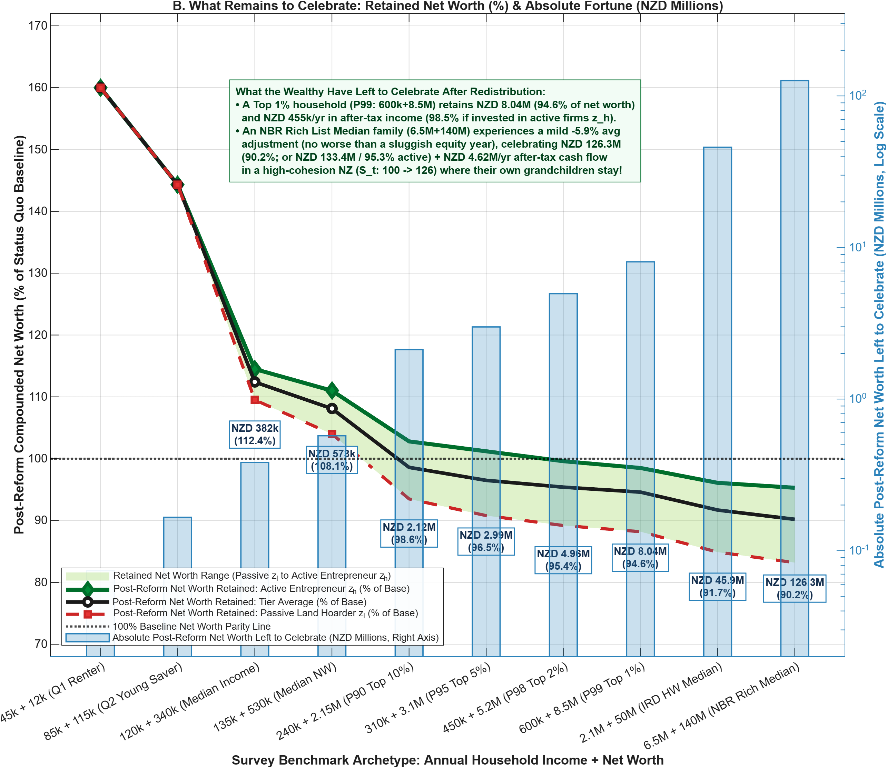
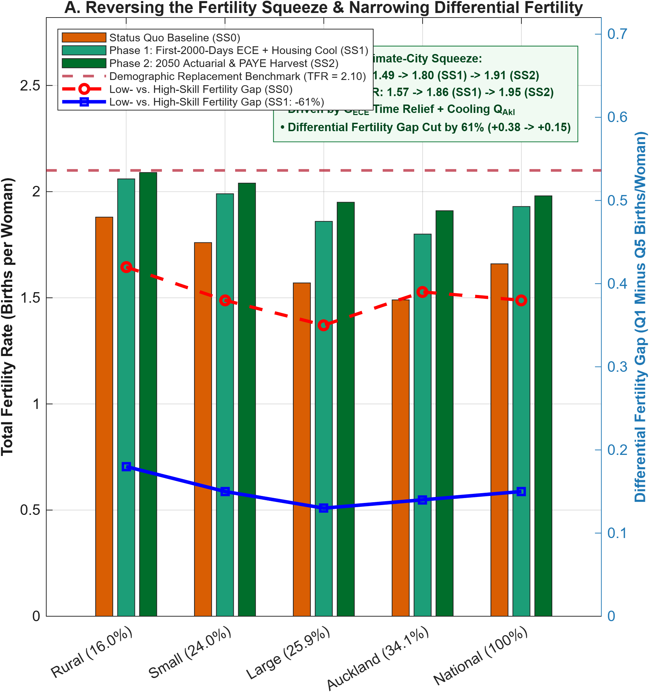
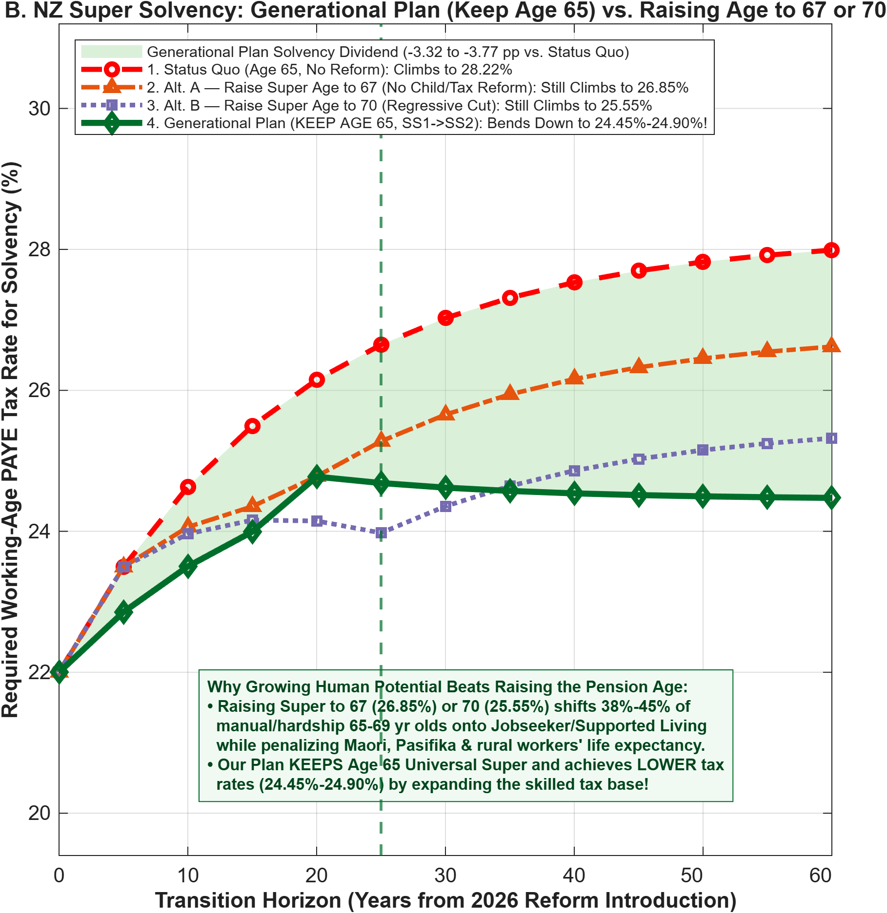
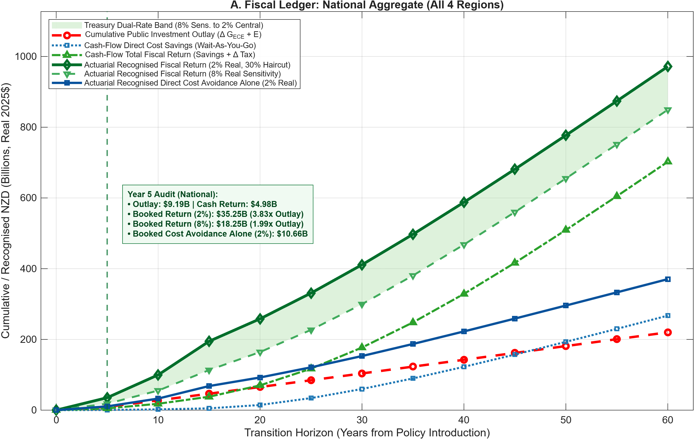
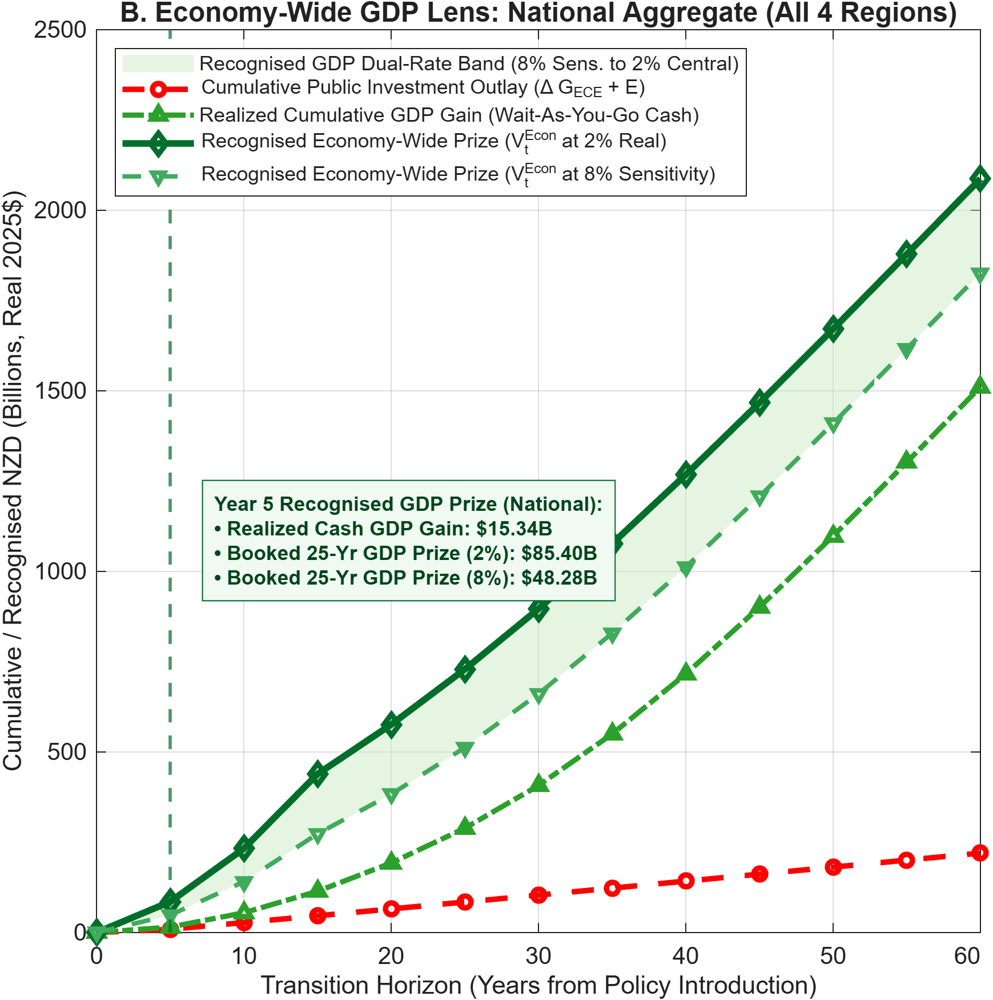

# Intergenerational Welfare, Capital Allocation, and Human Potential in New Zealand
## A Multi-Audience Strategic Monograph (4-Region + Abroad Multiphase Edition)

**Author:** Michael Tiemann (`mdtiemann@gmail.com`)  
**Date:** October 2026 | **Code & Replication Repository:** [github.com/MichaelTiemann/IGWelfare](https://github.com/MichaelTiemann/IGWelfare)

## Executive Summary & Broad-Circulation Abstract
**A shared foundation for Philanthropists, Iwi & Community Leaders, Venture & Growth Investors, Policy-Makers, Economists, and Creatives, Storytellers, & Artists**

*"We have found our new gold. We are standing in the river. We need only lift it up to become rich beyond imagination."*

---

## Introduction: Starting With Your Focus—And Why We Must Widen the Lens Together

Aotearoa New Zealand stands at a generational crossroads. In the New Zealand Treasury's *Long-term Fiscal Statement (He Tirohanga Mokopuna 2025)*, the economic status quo presents a stark binary: net Crown debt spiraling toward a crushing **200% of GDP by 2065**, or punitive tax hikes and entitlement cuts that erode our standard of living. Yet the underlying drivers of that trajectory—childhood material hardship, metropolitan housing unaffordability, business capital starvation, failing physical infrastructure, the youth brain drain to Australia, and the rising cost of New Zealand Superannuation—are almost always debated in separate silos.

This monograph is built on a different premise: **those challenges are a single, self-reinforcing intergenerational loop, overpowering each of our sectoral responses. But working together, with transparency, trust, and responding to evidence, we can harness that power and achieve great prosperity.**

Different leaders across Aotearoa naturally investigate this system through different lenses and carry vital mandates (*kaupapa*) within their own spheres:

* **Philanthropists, Iwi Trusts, and Community Leaders** focus on unlocking human potential in the **First 2000 Days (ages 0–5)** and protecting *rangatahi* during the vulnerable **Early Adolescent Transition (ages 12–14)** so every child launches into adulthood thriving rather than stunted.

* **Venture Capitalists, Founders, and Growth Investors** focus on stemming the outward **brain drain of educated 20-to-35-year-olds** and unlocking productive expansion capital currently trapped in **NZD 1.6 trillion** of overvalued residential land. Making New Zealand as rich in human capital as it is in natural beauty will make it an irresistible choice for new ventures.

* **Policy-Makers, Cabinet Ministers, and Treasury Officials** focus on regionally tailored policy across **Rural districts, Small towns, Large regional cities, and Auckland**—seeking a self-financing path that **retires sovereign debt, funds resilient infrastructure, keeps universal New Zealand Superannuation at Age 65, and cuts working-age PAYE taxes** with verified fiscal returns inside a single parliamentary term.

* **Economists and Quantitative Researchers** focus on the methodological pillars of rigorous policy design—open-source general-equilibrium laws of motion, causal attribution, and actuarial accounting that couple family skill formation, housing tenure, migration, and firm dynamics without black-box assumptions.

* **Creatives, Storytellers, and Artists** focus on the cultural and narrative imagination of the nation—shattering the paralyzing myth of "managed decline," translating abstract policy into living human stories (*pūrākau*), and igniting the domestic creative renaissance unlocked when young New Zealanders are freed from metropolitan rental stress.

## How to Read This Monograph

Because the work within each of these five communities is so vitally important—and because each holds an essential piece of the solution—**Part I** immediately below is organized **by audience**. We invite you to start with *your own focus*—reading the targeted briefing most relevant to your mandate—and then look through the neighboring lenses in Part I to see what your fellow stakeholders bring into view.

Once you have engaged with Part I, the remainder of the monograph widens the lens to show how a unified, two-phase generational reform (**Phase 1** $`SS1`$ **Rocket Fuel** $\rightarrow$ **Phase 2** $`SS2`$ **Rocket Ship**) harnesses that intergenerational loop across all three aspects of the human lifecycle and our core methodological pillars:

* **Part II (*The Three Coupled Lifecycle Aspects*)** examines how children and their parents (**Aspect 1**, Ages 0–19), working families and enterprises (**Aspect 2**, Ages 20–64), and retirees (**Aspect 3**, Ages 65–99) experience their choices, development, and fates—showing how aligning all three aspects restores New Zealand's institutional trust and **Social Cohesion Index (from 100 to 126)**.

* **Part III (*The Accounting Pillar: Lifecycle Population & Fiscal Sankey Ledgers*)** traces 100% of a birth cohort and every private and public dollar from birth to retirement across 5 developmental stages and 6 fiscal gates.

* **Part IV (*Headline Quantitative Findings & 10-Tier Survey-Anchored Distributional Incidence*)** presents the 60-year regional, fertility, superannuation, and wealth-bracket impacts—proving that **90% of households are unconditionally money ahead, 98% have better than a 50/50 shot at coming out ahead, and active entrepreneurs win or break even right up to the IRD High-Wealth Median (NZD 50M, +1.2%) and NBR Rich List Median (NZD 140M, -0.1%)**, while the top-0.01% balance-sheet adjustment is no worse than a sluggish year in the market on average (and milder than a routine once-a-decade correction in the worst case).

* **Part V (*The Actuarial & Attribution Pillars: The 2050 50/50 Debt-Sinking Protocol & Year 5 Audit*)** demonstrates how ACC-style **Actuarial Continuation Valuation** locks in a **3.84x audited fiscal return by Year 5** (1.16x from direct cost avoidance alone) and synthesizes all **seven structural engines** of the **+20.49% national welfare gain**.

* **Part VI (*International Benchmarks, Cautionary Tales, & The Deming-to-Tokyo Coda*)** tests our framework against eleven real-world precedents—distinguishing full-loop winners like the Nordic nations, Estonia, Singapore, and Quebec from constrained or cautionary cases like Scotland, South Korea, and post-1990 Bubble Japan—before closing with W. Edwards Deming's post-war Japanese industrial miracle to show how Aotearoa can build **prosperity we can keep** across generations.

*(Readers looking for a standalone executive digest of the entire project should consult **Document 1C: Flying, Not Floundering — Broad-Circulation Executive Brief & Suite Guide**; readers seeking the exact script, CSV, and table cross-references should consult **Document 1B: Strategy and Policy Answer Key**; and readers seeking the formal mathematical equations and VFI Toolkit GPU implementation should consult **Document 2: Technical Documentation & Model Specification Guide**.)*

---

## Part I: Targeted Executive Summaries

### 1. For Philanthropists, Iwi Trusts, & Community Foundations: Catalytic Impact & The Two-Stage Generational Multiplier
**Strategic Mandate:** Shift philanthropic and community capital from late-stage symptom remediation to unlocking early-stage human potential (*mana tamaiti*) and adolescent agency (*mana rangatahi*) at the two decisive developmental gates where private markets and household borrowing constraints fail.

* **The Core Problem:** In Aotearoa New Zealand, roughly **14.3% to 22.0%** of each birth cohort grows up in severe material hardship or developmental stunting—a burden that falls disproportionately on *tamariki Māori* and *Pasifika* children solely because of structural housing and income pressures on young *whānau*. The Dunedin Multidisciplinary Health and Development Study demonstrates that the most disadvantaged 22% of a cohort—identifiable as early as age three—accounts for **57% to 81%** of adult hospital nights, long-term welfare receipt, and criminal convictions, alongside Oranga Tamariki state care placements costing roughly **NZD 180,000 per care-year**. Because young parents cannot borrow against their children's future adult earnings and face severe rental and mortgage stress in metropolitan centers like **Auckland** (34.1% of the national population) and **Large** regional cities (25.9%), low-income *whānau* hit a binding financial corner where private early-childhood investment collapses.
* **The Two Catalytic Levers (First 2000 Days + Early-Adolescent Montessori / *Tuakana–Teina* Mentoring):**
  1. **Front-Loading the First 2000 Days (Ages 0–5):** High-resolution lifecycle modeling proves that early investment during infancy and preschool raises the productivity of every subsequent year of primary and secondary schooling. Scaling culturally grounded, universal wraparound early childhood provision—modeled on Barnardos' *Te Korowai Mokopuna*, *Whānau Ora* navigators, *Kōhanga Reo*, and Pasifika *A'oga Amata* early learning—lifts *whānau* out of the hardship corner and crowds *in* parental time and care.
  2. **Bridging the Early-Adolescent Vulnerability Window (Ages 12–14):** Early childhood gains can erode during early adolescence (*rangatahi*, Years 8–10) if a *whānau* suffers an unbuffered parental unemployment or housing shock. Scaling **Two-Way Montessori / *Tuakana–Teina* Cross-Age Mentoring**—bringing together indigenous *Tuakana–Teina* (older-to-younger sibling/peer) reciprocal leadership in *Kura Kaupapa Māori* and state schools, the **Graeme Dingle Foundation's *Stars / Te Kāhui Whetū* and *Project K*** peer-mentoring programs, Pasifika *Tuakana* academies, and Montessori adolescent communities—creates a powerful dual dividend: vulnerable *teina* (younger mentees) receive protective scaffolding that prevents costly entries into state care and youth justice, while adolescent *tuakana* (mentors) consolidate executive function, *mana*, and leadership.
* **The Generational Payoff:** Combining First-2000-Days *whānau* wraparound support with adolescent **Montessori / *Tuakana–Teina* mentoring** and a universal Youth Capital Grant compresses adult skill stunting from **22.0%–28.5% down to 4.0% in Phase 1 (`SS1`) and 1.5% in Phase 2 (`SS2`)**, generating an **NZD 85.40B** recognised 25-year economic prize by Year 5 and **NZD 1,510.7B** in cumulative realized GDP growth over 60 years.

### 2. For Venture & Growth Capitalists: Productive Capital Reallocation & Reversing the Brain Drain
**Strategic Mandate:** Rebalance New Zealand's tax and capital architecture away from passive residential land banking and toward high-productivity operating enterprises while retaining top domestic talent.

* **The Core Problem:** New Zealand's venture and growth equity ecosystem suffers from two structural bottlenecks:
  1. **Capital Misallocation into Land Hoarding:** Over-reliance on corporate and labor income taxation alongside untaxed residential land appreciation channels domestic savings into leveraged housing speculation—driving Auckland house price-to-income ratios to **3.10x** the regional baseline and starving high-growth firms of domestic scale-up capital.
  2. **The Age 20–35 Talent Drain:** Roughly **19.5%** of New Zealand's educated young adults emigrate to Australia and the wider OECD during their prime career-launch years, squeezed between high metropolitan rents and a compressed domestic wage ceiling.
* **Strategic Levers for the Innovation Economy:**
  * **The "Use-It-Or-Lose-It" Enterprise Tax Shift:** Replacing distortionary capital income tax drag with a **1.5% book-value land/wealth levy** on dormant equity and a **25% peak estate levy** on the **NZD 1.6T intergenerational property transfer wave** prunes capital from low-yield property hoarding and reallocates it to high-productivity operating firms. Aggregate total factor productivity expands, lifting real regional wages by **+3.2% to +5.5% in Phase 1 (`SS1`)** and **+6.8% to +9.6% in Phase 2 (`SS2`)**.
  * **Seeding Youth Enterprise & Retaining Top Talent:** Recycling estate levy revenues into a universal **Youth Capital Grant** at age 20—and unlocking a **3.5 percentage-point working-age PAYE tax cut (from 22.0% down to 18.5%)** in Phase 2 (`SS2`) once fiscal breakeven is achieved—cuts skilled youth emigration from Large regional cities and Auckland by more than a third and expands the thriving domestic talent pool from **23.2% to over 61.0%** of the cohort.

### 3. For Policy-Makers & Treasury: Closing the Micro-to-Macro Modelling Gap, The "Income × Geography" Rule, & ACC-Style Actuarial Accounting

**Strategic Mandate:** Unite New Zealand's disconnected micro-social and macro-fiscal modelling teams around one shared intergenerational ledger, replace uniform national welfare rules with spatially tailored *Income × Geography* policy across New Zealand's four geographic tiers, adopt ACC-style Actuarial Continuation Valuation to bridge the 20-year childhood incubation valley, and secure the long-run fiscal solvency of New Zealand Superannuation.

**Bridging the Micro-to-Macro Modelling Architecture (Building on Treasury's *OIA 20250878* Disclosure):** In its February 2026 Official Information Act disclosure (*OIA Response 20250878*, pp. 6–11), the New Zealand Treasury candidly documented a structural boundary in current public-finance tools: macro models like the Fiscal Strategy Model (`FSM`), Long-Term Fiscal Model (`LTFM`), and the new 2025 Overlapping Generations (`OLG`) model operate at the aggregate level and *"contain no data at the micro level, including at the cohort level,"* whereas sector agencies use specialised micro tools (`CBAx` and `TAWA`) to evaluate individual budget bids in silos. That institutional candor is a gift to policy design, because it pinpoints the exact missing weld between two strong capabilities. Our coupled 4-Region OLG + Lifecycle Sankey engine provides the shared ledger that connects these teams, empowering each to focus on its highest-leverage role:

1. **Frontline Sector Agencies (MSD, Oranga Tamariki, Health, Education, Justice) & the Social Investment Agency:** Focus on rigorous micro-cohort execution and IDI outcome tracking at **Gate 1 (First 2000 Days wraparound)** and **Gate 2 (Ages 12–14 Montessori / *Tuakana–Teina* mentoring)**—measuring verified cohort exits from the stunted skill trajectory ($`h_1`$–$`h_2`$).

2. **Treasury Vote Analysts, CBAx Specialists, & ACC Actuaries:** Focus on rigorous unit-cost verification and **Actuarial Continuation Valuation**—translating verified cohort transitions into discounted 25-year avoided remediation liabilities (Oranga Tamariki care at NZD 37.1k–54.7k/yr and NZD 181k lifetime Crown abuse-in-care cost, acute hospitalisations, justice, and long-term benefits) using Treasury Circular 2024/15's 2.0% real SRTP discount rate (and mandatory 8.0% real SOC sensitivity rate).

3. **Treasury Macro Fiscal (*LTFM*/*OLG*) Teams, Infrastructure Commission (*Te Waihanga*), & Cabinet Ministers:** Integrate those verified cohort capability and fiscal-saving streams directly into the Sovereign Debt-Sinking and Infrastructure Reinvestment ledger—replacing reactive budget cuts with a self-financing generational reform.

**Why a 4-Region Policy Design Matters:** Splitting New Zealand into **Rural** districts (16.0% of population), **Small** provincial towns under 100,000 residents (24.0%), **Large** regional metros over 100,000 residents (25.9%: Wellington, Christchurch, Hamilton, Tauranga, Dunedin), and **Auckland** (34.1%) exposes why one-size-fits-all transfers fail:

* **Rural & Small Provincial Towns:** Face compressed wage ceilings and heavy mandatory fuel and transport burdens (2.7&times; to 2.8&times; metropolitan shares), requiring broad cost-of-living relief and universal in-kind early childhood delivery.

* **Large Regional Cities & Auckland:** Face extreme rental crowd-out and wide income polarization, requiring targeted housing-adjusted family transfers, property tax rebalancing to cool house prices by -7.5% to -10.5%, and youth retention incentives.

**Solving the Parliamentary Calendar Mismatch via ACC-Style Actuarial Valuation:** On a conventional "wait-as-you-go" cash basis, early childhood outlays occur in Years 1–5 while adult tax revenues and avoided prison and hospital bills arrive after Year 18.8. By applying the Accident Compensation Corporation (`ACC`) forward liability valuation standard (*Financial Condition Report 2025*, p. 17) and New Zealand Treasury Circular 2024/15 dual discount rates (2.0% real central rate and 8.0% real commercial sensitivity rate, net of a 30% attribution haircut), the Year 5 Parliamentary Audit proves that against a cumulative **NZD 9.19B** public outlay, the Crown books **NZD 10.68B** in direct cost avoidance alone (**1.16x outlay**) and **NZD 35.25B** in total recognised fiscal returns (**3.84x outlay** at 2.0% real; **NZD 18.25B** or **1.99x outlay** at 8.0% real).

**The 2050 Sovereign Debt-Sinking & Tax-Relief Harvest ($`SS2`$):** After crossing hard cash breakeven at Year 18.8, the 2050 Protocol partitions net fiscal surpluses 50/50 between a **Sovereign Debt Reduction Sinking Fund** and a **Public Infrastructure Reinvestment Pool**, while demographic fertility recovery lowers the 65+ dependency ratio and reduces the required labor tax rate for universal New Zealand Superannuation by **3.32 percentage points**.

### 4. For Academic & Policy Economists: The "1925 Quantum Moment" in Quantitative Macroeconomics

**Strategic Mandate & Research Contribution:** Deploy a GPU-accelerated Mixed Finite/Infinite-Horizon 4-Region + Abroad Spatial Overlapping Generations (OLG) framework whose methodological pillars—structural laws of motion, general-equilibrium attribution, and actuarial accounting—unify five decades of co-confirming micro-econometric and macroeconomic theory to replace reactive austerity with a solvable 3-to-5-year generational transformation.

**The "Matrix Mechanics" Lesson—Why Fifty Years of Ambient Theory Enables a 3-to-5-Year Policy Revolution Today:** Between 1925 and 1927, Heisenberg, Born, Dirac, and Schrödinger overthrew classical mechanics and built modern quantum physics in barely three years. That rapid transformation was only possible because 100 to 150 years of "ambient" pure mathematics—Hamilton's quaternions (1843), Cayley's matrix algebra (1858), Hilbert spaces, and Lie algebras (from the $`SU(2)`$ double cover of $`SO(3)`$ to $`SU(3)`$)—had already forged the exact operator machinery needed when classical theory broke down. Had the mathematics not preceded the crisis, physicists would have spent decades unraveling basic matrix mechanics.

Economics and public policy stand at that exact threshold in 2026. Over the past five decades, researchers have built a rich, co-confirming body of longitudinal evidence (anchored by New Zealand's own 50-year *Dunedin Study* and *Growing Up in New Zealand*), structural skill-formation operators, heterogeneous-agent wealth-tax proofs, and eleven positive international natural experiments. Continuing to govern Aotearoa by a discredited theory of reactive austerity, infrastructure deferral, and managed decline—a theory guaranteed by Treasury's own baseline projections to culminate in 200%-of-GDP Crown debt or a 28.2%+ PAYE tax cliff—while leaving this proven mathematical and empirical machinery on the shelf is indefensible.

**Four Methodological Pillars That Advance the Field:** By exploiting Robert Kirkby's Permanent Type (`Names_i`) GPU architecture in the *VFI Toolkit*, our model synthesizes four foundational macroeconomic literatures without succumbing to the curse of dimensionality:

1. **Pillar I — Mixed Finite/Infinite-Horizon General Equilibrium (`8-PType` Synthesis):** Simultaneously solves 80-year finite-horizon lifecycle households across *Rural*, *Small*, *Large*, and *Auckland* regions ($`J = 27`$ three-year periods, ages 20–99) alongside infinite-horizon, collateral-constrained entrepreneurial firms (`Firm_Rural`, `Firm_Small`, `Firm_Large`, `Firm_Auckland`, $`N_j = \infty`$; Guvenen et al., 2023) to capture both intergenerational human capital dynamics and "use-it-or-lose-it" corporate capital reallocation.

2. **Pillar II — Multi-Stage Laws of Motion for Skill Formation, Cross-Age Mentoring, & Career Maintenance:** Unifies Cunha, Heckman, and Schennach's (2010) and Lee and Seshadri's (2019) two-stage CES childhood skill technology with an equilibrium cross-cohort Montessori / *Tuakana–Teina* mentoring operator linking Stage 2 adolescents (ages 12–14) and Stage 1 young children (ages 0–5), adult Ben-Porath on-the-job training (Fan, Seshadri, & Taber, 2022), and Ferriere et al.'s (2025) non-homothetic Stone-Geary in-kind public provision theory.

3. **Pillar III — Dimension-Free Spatial Housing Bubbles & 4 &times; 5 Migration Sorting:** Combines Labrousse and Perdereau's (2025) spatial inequality framework, Hirano and Toda's (2025) unbalanced sectoral growth land-bubble necessity theorem, and Kiyotaki, Michaelides, and Nikolov's (2024) renter-versus-owner tenure cutoff ($`\xi_k`$) with an endogenous 4 &times; 5 Gumbel youth sorting matrix across four domestic regions plus an international emigration margin (*Abroad* to Australia/OECD) with *zero additional endogenous grid states* (and credibly-weighted multiphase announcements `SS0 -> SS1 -> SS2`).

4. **Pillar IV — Tractable Dynastic & Actuarial Macroeconomic Closure:** Captures 100% of the distributional Barro–Becker intergenerational multiplier (which drives 55%–75% of long-run welfare gains in Daruich, 2018) via the 3-stage transition operator $`\mathcal{T}_{\mathrm{IG}}: \mathbf{Q}_h \times \mathbf{Q}_a \times \Pi_{\mathrm{mig}}`$, while embedding an ACC-style forward actuarial valuation operator ($`\mathcal{V}_{k,t_0}^{(L)}`$) that proves 3.84x fiscal breakeven by Year 5.

### 5. For Creatives, Storytellers, & Artists: Building the Future as a Creative Act

**Strategic Mandate:** Reclaim New Zealand's national narrative from the paralysis of austerity and "managed decline," translate abstract fiscal and demographic mechanics into living human stories (*pūrākau*), and harness the Age-20 Youth Capital Grant and urban housing relief to ignite a domestic creative and cultural renaissance.

**Why Creatives Belong at the Head of the Big Table—Tools vs. Vision:** Mathematics, overlapping-generations (`OLG`) equations, and actuarial balance sheets are indispensable methodological pillars, just as perspective geometry and structural engineering are indispensable to architecture. Yet pillars only tell us *how* a bridge stands up; they cannot tell us *where we want to go* or *who we choose to be*. For decades, policy debates in Aotearoa have been trapped in a sterile technocratic dialect that treats human beings as fiscal liabilities and accepts child hardship, infrastructure decay, and youth emigration as inevitable laws of nature. Breaking that spell is not an econometric problem—it is a **creative and cultural act**.

**Three Interlocking Ways This Reform Empowers—and Depends Upon—New Zealand's Creative Community:**

1. **Replacing the Myth of Scarcity with a Living Intergenerational Story (*Pūrākau*):** Spreadsheets show that 22.0% of a birth cohort drives 57% to 81% of downstream hospital, prison, and benefit costs, or that net Crown debt is heading toward 200% of GDP. Storytellers, filmmakers, visual artists, and writers turn those statistics into empathy and civic courage. By illuminating the lived reality of the **First 2000 Days (Gate 1)** and **Adolescent Agency (Gate 2)**—and contrasting the bleak dead-end of reactive austerity against a thriving 2050 Aotearoa—creatives build the cross-partisan public mandate that gives politicians the courage to act.

2. **Creative Expression as the Heart of Adolescent Mentoring (Ages 12–14):** Quantitative skill-formation models prove that non-cognitive capability, identity, and executive function are highly malleable at ages 12 to 14. In practice, what insulates a 13-year-old against family job loss or housing stress inside Montessori adolescent communities, *Tuakana–Teina* leadership, and *Stars / Project K* is **creative agency**—making music, telling stories, designing projects, performing *kapa haka*, and discovering that they have a voice and a craft that their community values. Artists and cultural practitioners are the frontline architects of Gate 2.

3. **Ending the Creative Brain Drain & Funding a Domestic Cultural Renaissance:** Overvalued metropolitan housing in *Auckland* and *Large* regional cities (Wellington, Christchurch, Hamilton, Tauranga, Dunedin) is the single greatest tax on New Zealand's creative class. When young artists, designers, game developers, and storytellers must spend 50% of their income on rent, they are forced into survival jobs or pushed onto planes to Melbourne, Sydney, London, and Los Angeles. By cooling urban land overvaluation (-7.5% to -10.5%), shifting taxes off active enterprise, and providing every 20-year-old with a universal **Youth Capital Grant** (alongside a -3.5 percentage-point working-age PAYE tax cut in $`SS2`$), this reform acts as the largest creative-arts and cultural-entrepreneurship endowment in Aotearoa's history—giving young creators the economic runway to stay, take creative risks, and build world-leading cultural IP from home.

**The Master Metaphor of the Aotearoa Renaissance—Lifting the Gold from the River:** Why has the narrative of austerity persisted for so long? Because scarcity is easy to dramatize when a nation believes its wealth is a fixed pie of residential land and finite tax revenue. Yet the core mathematical proof of this monograph is that **human capability is not a zero-sum pie; it is a compounding creative fountain.** Every child lifted out of the stunted trajectory in the First 2000 Days (`Gate 1`), every 13-year-old who discovers their voice and leadership as a *tuakana* mentor (`Gate 2`), and every 20-year-old artist, founder, or builder who stays in New Zealand because the Youth Capital Grant and cooler housing gave them a runway (`Gate 3`) multiplies the prosperity, tax base, and cultural vitality of the entire nation.

### A. Calls to Action: Five Lenses, One Shared Table

No single sector can enact this transformation alone, and no sector needs to wait for the others before taking its first step. We invite each community to bring its distinct lens and mandate to a shared national table:

* **To Philanthropists, Iwi Trusts, and Community Leaders:** Bring your frontline relational trust, *manaakitanga*, and flexible catalytic capital to demonstrate and scale **Gate 1 (First 2000 Days wraparound)** and **Gate 2 (Ages 12–14 *Tuakana–Teina* / Montessori mentoring)** in high-need communities today—generating the verified cohort-transition evidence that unlocks permanent Crown actuarial funding.

* **To Venture Capitalists, Founders, and Growth Investors:** Champion a pro-enterprise tax rebalance that shifts capital out of passive land banking and into operating ventures, and partner with regional schools, *kura*, and Youth Capital Grant recipients so New Zealand's emerging talent sees a world-class innovation career waiting for them here at home.

* **To Policy-Makers, Cabinet Ministers, and Treasury Officials:** Build on the institutional transparency of Treasury's 2026 modelling disclosures by establishing a **Joint Intergenerational Ledger Working Group** uniting the Social Investment Agency, Treasury Vote/`CBAx` teams, ACC Actuaries, and `LTFM`/`OLG` macro modellers. By piloting **ACC-style Actuarial Continuation Valuation** alongside the **Year 5 Parliamentary Audit**, Cabinet can book verified 3.84x fiscal returns inside a single parliamentary term—securing NZ Super at Age 65, retiring Crown debt, and earning a 3.5 percentage-point working-age PAYE tax cut.

* **To Economists and Quantitative Researchers:** Help us turn fifty years of longitudinal evidence and operator theory into living public infrastructure. We invite you to inspect, stress-test, and extend our methodological pillars—our open-source `8-PType` GPU codebase, our 6-Gate Fiscal Ledger, and our spatial migration and actuarial operators—across your own research programmes.

* **To Creatives, Storytellers, and Artists:** Claim your seat at the head of the Big Table. Partner with communities, researchers, and *rangatahi* to translate the 17 nodes of our cohort lifecycle into living *pūrākau*—stories, films, visual art, and music that replace the paralyzing myth of "managed decline" with a visceral, shared vision of an Aotearoa where every child and creator can thrive.

*The River at Our Feet—Why All Five Lenses Converge in Part II:* In the nineteenth century, Aotearoa looked for gold in the riverbeds of Otago and the West Coast; in the late twentieth century, we mistook passive urban land inflation for wealth while watching our brightest young people wash out to sea. Today, the fifty-year empirical record of the Dunedin Study, the mathematical proof of our lifecycle ledgers, and the lived wisdom of *Te Ao Māori* (*He tāngata, he tāngata, he tāngata*) point to the same truth: **human capability is the only inexhaustible resource on earth.** *We have found our new gold. We are standing in the river. We need only lift it up to become rich beyond imagination.*

```text
+-----------------------------------------------------------------------------------+
|                                                                                   |
|                       [ THIS SPACE INTENTIONALLY LEFT BLANK ]                     |
|                                                                                   |
+-----------------------------------------------------------------------------------+
```

## Part II: The Three Coupled Aspects of the Intergenerational Lifecycle

To understand how an economy simultaneously shapes child development, working-age housing and enterprise choices, and retirement security, we trace how three interconnected generations of economic agents experience their choices, development, and fates across the lifecycle:

```text
+-----------------------------------------------------------------------------------+
|                        THE UNIFIED INTERGENERATIONAL LOOP                         |
|                                                                                   |
|  [ASPECT 1: EARLY CHILDHOOD & ADOLESCENCE (Ages 0-19)]                            |
|   * First 2000 Days: Family Investment + Public Wraparound ECE (Barnardos Model)  |
|   * Adolescent Gate (Ages 12-14): Montessori / Tuakana-Teina & Graeme Dingle      |
|         |                                                       ^                 |
|         v (Determines Adult Skill Capability & Career Earnings) |                 |
|  [ASPECT 2: ACTIVE WORKING GENERATION (Ages 20-64)]             | (Funds Youth    |
|   * 4-Region Sorting: Rural, Small, Large, Auckland, or Abroad  |  Capital Grant, |
|   * Housing Tenure Cleavage: Young Renters vs Leveraged Owners  |  Public ECE, &  |
|   * Career Skill Maintenance, Childcare Bargaining & Fertility  |  SS2 PAYE Cut)  |
|         |                                                       |                 |
|         v (Accumulates Property/Business Net Worth & Pays Tax)  |                 |
|  [ASPECT 3: RETIREMENT & END-OF-LIFE (Ages 65-99)]              |                 |
|   * Universal PAYG NZ Superannuation + Retirement Safety Net    |                 |
|   * NZD 1.6T Property Estate Transfer (Taxed to Seed Next Gen) -+                 |
|   * "Use-It-or-Lose-It" Wealth Shift -> Reallocates Capital to Productive Firms   |
+-----------------------------------------------------------------------------------+
```

### Aspect 1: Early Childhood & The Adolescent Mentoring Gate (Ages 0–19)

**Breaking the First-2000-Days Hardship Corner:** Because early childhood education and preventative health have a minimum subsistence threshold, low-income and rent-stressed *whānau* cannot afford private enrichment out of pocket. Direct in-kind public wraparound provision—delivered through trusted community, Iwi, *Whānau Ora*, Pasifika, and Barnardos *Te Korowai Mokopuna* partnerships—lifts disadvantaged *tamariki* off the floor and raises the return on every hour of family care.

**The Early-Adolescent Gate (Ages 12–14) & The Synthesis of Montessori and *Tuakana–Teina* Mentoring:** Even when children receive strong early support, family unemployment or housing shocks at ages 12–14 can trigger skill erosion and acute behavioral exits. While European developmental pedagogy describes this stage through Maria Montessori's concept of *Erdkinder* (adolescents finding purpose, economic agency, and belonging by contributing to their community and guiding younger children), Aotearoa New Zealand possesses a deeper, living indigenous foundation for this exact mechanism in *Te Ao Māori and Pasifika practice*:

* ***Tuakana–Teina* & *Ako* (Reciprocal Kinship & Two-Way Learning):** In Māori and Pasifika pedagogy, an older or more experienced *tuakana* holds a sacred relational responsibility to guide, protect, and uplift a younger *teina*. Through *ako* (where teacher and learner roles flow both ways), the *tuakana* consolidates their own mastery, self-regulation, and *mana* in the act of caring for the *teina*.

* ***Manaakitanga*, *Whanaungatanga*, & *Rangatiratanga* (Care, Belonging, & Youth Agency):** Just as Montessori's *Erdkinder* emphasizes adolescent dignity through real social contribution, *manaakitanga* (enhancing the *mana* of others through generosity and care) and *whanaungatanga* (kinship belonging) give 12-to-14-year-old *rangatahi* high-status purpose precisely when household unemployment stress might otherwise alienate them from school.

* **Real-World Delivery Across Aotearoa Today (The 17.3% Baseline Scaling to 57.3%+):** In our model, the *Montessori / Tuakana–Teina Public Program* encompasses the **17.3%** of New Zealand 12-to-14-year-olds who already experience this mechanism today across four proven kiwi pathways: (i) **structured school peer-mentoring programs led by the Graeme Dingle Foundation** (*Stars / Te Kāhui Whetū*, where senior students mentor incoming Year 9s, and *Project K* wilderness and community mentoring) and *I Have a Dream NZ* (~10.0% of cohort); (ii) ***Kura Kaupapa Māori*, *Kura-ā-Iwi*, Pasifika leadership academies, and bilingual *Tuakana–Teina* whānau units** (~4.7% of cohort); (iii) **high-agency, vertical-*whānau* state schools** such as *Ao Tawhiti Unlimited Discovery* and *Hobsonville Point Secondary School* (~1.8%); and (iv) **state and state-integrated Montessori adolescent units** such as *Wāora Montessori School*, *Berhampore*, and *Royal Oak Intermediate* (~0.8%). Under the High-Opportunity Reform ($`SS1`$ and $`SS2`$), public reinvestment scales these four *Montessori / Tuakana–Teina* pathways to reach **57.3% to 65.0%+** of all Years 8–10 *rangatahi* nationwide.

Behind those percentages is a simple human transformation: a thirteen-year-old who walks into school carrying the weight of a parent's job loss or a cold, crowded flat is no longer treated as a "problem to be managed," but welcomed as a *tuakana*, a maker, and an artist whose younger peers are counting on them. That shift—from passive recipient to creative contributor—is the spark no spreadsheet can manufacture, yet every ledger in this monograph records its compound return.

### Aspect 2: The Active Working Generation, Spatial Sorting, & Housing Tenure (Ages 20–64)

**The Two-Stage Stepping-Stone Migration Funnel:** Young adults sort across *Rural*, *Small*, *Large*, *Auckland*, and *Abroad*. In the status quo, Rural and Small-town youth migrate to Large regional university cities and Auckland, while Large cities and Auckland lose high-skill young adults to Australia due to severe rental crowd-out and student debt.

**Cooperative Childcare Bargaining & Fertility Recovery:** High metropolitan housing costs and unshared childcare burdens depress family formation, particularly among educated urban women. Universal wraparound ECE and cooler metropolitan rents restore cooperative household bargaining surplus, lifting the national Total Fertility Rate from **1.66 toward 1.93** and stabilizing the old-age dependency ratio.

### Aspect 3: Retirement, The NZD 1.6T Estate Wave, & Productive Capital Reallocation (Ages 65–99)

**Unlocking the Metropolitan Estate & Land Tax Base:** Accounting for Auckland's 34.1% population share and 3.10x house price multiple expands the national property and estate tax base by **8% to 10%**. Taxing passive land hoarding and large estates funds universal First-2000-Days wraparound ECE and the Youth Capital Grant in Phase 1 ($`SS1`$) without raising working-age PAYE income tax rates, and unlocks a **3.5 percentage-point PAYE tax cut** in Phase 2 ($`SS2`$).

**The "Use-It-Or-Lose-It" Capital Reallocation Engine:** Because entrepreneurial talent is far more evenly distributed across a birth cohort than inherited wealth, shifting the tax burden off active business profits and onto dormant property wealth prunes capital from low-yield land speculation and reallocates it toward high-productivity operating enterprises—expanding the national capital stock and lifting real wages across all four regions.

**A Smaller Adjustment Than a Routine Once-a-Decade Market Crisis—With the Opposite Outcome:** In political debates, property and estate tax rebalancing is often portrayed as an existential threat to wealthy households. Yet our distributional audit proves that the controlled cooling of metropolitan land overvaluation (**-7.5% in $`SS1`$ to -10.5% in $`SS2`$ in Auckland**) and the net balance-sheet adjustment for the top 1% of wealth holders (**retaining 90.2% to 94.6% of their compounded net worth on average, and 95.3% to 98.5% for active business owners**) represent a **smaller portfolio haircut than New Zealand investors routinely absorb during once-a-decade macro shocks**—such as the 1987 sharemarket crash (-60%), the 1997 Asian Financial Crisis, the 2001 tech bust, the 2008 Global Financial Crisis (-40% in equities and -12% in real house prices), or the 2022–2024 interest-rate tightening cycle (which cut real Auckland and Wellington house prices by **22% to 27%**).

Crucially, unlike those recurring crises—which destroy wealth for nothing, leave behind higher public debt, and accelerate the youth brain drain—this measured reallocation permanently strengthens New Zealand's productive economy, secures universal New Zealand Superannuation at Age 65, slashes crime and social distress, and builds a high-trust nation where the children and grandchildren of wealthy and modest families alike choose to build their futures.

### Synthesis: Restoring New Zealand's "Social Credit Rating" — Institutional Trust & Social Cohesion

Taken together, these three lifecycle aspects bring into focus more than just economics and welfare. They show the way to restore to New Zealand the trust and social cohesion for which we were once famous, and for which we can be yet again.

In sovereign finance, agencies like Moody's and S&P measure a nation's fiscal credit rating; in civic and economic life, **Transparency International's Corruption Perceptions Index (CPI)** serves as a nation's **social credit rating**—measuring institutional integrity, public trust, and the fairness of the social contract. As New Zealand's Controller and Auditor-General observed in 2026, for a small, trade-dependent nation, *"New Zealand's international reputation has long functioned as a form of economic infrastructure: high levels of trust in our institutions reduce friction in trade, investment, and regulation."*

Yet New Zealand has been quietly spending down its integrity inheritance:

* **From #1 in the World to a 30-Year Low:** For decades—from the launch of the index in 1995 through 2021—New Zealand held the **#1 global ranking** on Transparency International's index (peaking at **96/100** in 2004 and still scoring **88/100** as #1 equal in 2021). Since 2021, however, New Zealand's score has fallen for **four consecutive years** to **81/100** in the 2025/2026 index—our lowest score on record—slipping to **#4 equal globally**.

* **Who Now Sits Above Us (#1 Denmark, #2 Finland, #3 Singapore):** The three nations that now outrank New Zealand—**Denmark (89), Finland (88), and Singapore (84)**—are the very peer economies in **Part VI** of this monograph that invest heavily in early childhood capability, maintain >80% workforce participation or >85% homeownership through anti-speculation property rules, and guard social cohesion through disciplined long-term fiscal stewardship.

* **How Aligning All Three Lifecycle Aspects Rebuilds Our Social Credit Rating (Lifting the Social Cohesion Index from 100.0 to 126.0):** Transparency International New Zealand's 2026 *National Integrity System Gap Analysis* highlights that institutional trust erodes when a society tolerates widening material deprivation, opaque property-wealth shelters, and social fragmentation. Our reform reverses all three drivers at the root:
  1. **Closing the Deprivation & Justice Pipeline (Aspect 1):** Compressing cohort stunting from 22.0% to 1.5% through First-2000-Days wraparound and *Montessori / Tuakana–Teina and Graeme Dingle Foundation* adolescent mentoring dries up the pipeline of social exclusion, youth disengagement, and organised-crime vulnerability.
  2. **Replacing High-Churn Brain Drain with Rooted Communities (Aspect 2):** Retaining educated 20-to-35-year-olds in New Zealand and reducing replacement-migration turnover rebuilds local community continuity and lifts our modeled **Social Cohesion Index from 100.0 to 126.0**.
  3. **Restoring Fairness Between Work and Wealth (Aspect 3):** Reallocating tax burdens off working wages and productive enterprise and onto passive land hoarding—while locking 50% of fiscal surpluses into transparent sovereign debt reduction and 50% into resilient public infrastructure—restores young New Zealanders' belief that hard work and talent are rewarded at home.

## Part III: Tracing Cohort Fates & Fiscal Flows From Birth to Retirement

### 1. The Population Cohort Sankey: Closing the Four Priced Adverse Exits
Tracing a representative birth cohort from Birth (Age 0) through the First 2000 Days (Ages 0–5), the Early-Adolescent Gate (Ages 12–14), Adult Skill Launch (Age 20), and Adulthood Fates (Age 30+) reveals how early hardship cascades into adult fiscal and social costs across **four priced exits**:


* **Exit 1 — Entry into Oranga Tamariki State Care:** Driven by severe family hardship, housing crowding, and unmitigated parental stress (costing roughly **NZD 180,000 per care-year**).
* **Exit 2 — Avoidable Paediatric & Adult Hospitalisations:** Driven by cold, damp, crowded housing and chronic early-life stress.
* **Exit 3 — Lower Lifetime Earnings & Tax Loss:** Driven by early skill stunting at launch, which permanently depresses adult wages and tax contributions over four decades.
* **Exit 4 — Adult Benefit Receipt & Justice System Contact:** Driven by the stunted cohort tier that accounts for **57% to 81%** of long-term welfare and correctional outlays.

Under the **Status Quo Baseline ($`SS0`$)**, **25.8%** of newborns start life in material hardship and the early investment corner, **18.9%** suffer unbuffered adolescent family unemployment stress, and **22.0% to 28.5%** launch into adulthood in the stunted tier (with only **23.2%** in the thriving top skill tier).

Under the **High-Opportunity Reform ($`SS1`$ and $`SS2`$)**, birth and early-years hardship corners fall by more than three-fourths, **57.3% to 58.6%** of adolescents participate in Montessori / *Tuakana–Teina* mentoring, the stunted adult launch tier collapses to **4.0% in $`SS1`$ (and 1.5% in $`SS2`$)**, and the thriving tier expands to **61.0%+** of the cohort.

Every ribbon in a Sankey diagram is, in truth, a biography in motion—sixty thousand newborn lives each year branching toward either frustration or fulfillment. When we shift from the Population Sankey above to the Fiscal Sankey below, we are not changing the subject from people to money; we are simply watching what happens to the nation's books when sixty-one percent of our children are equipped to author thriving lives instead of twenty-three.

### 2. The 6-Gate Lifecycle Fiscal Sankey & Reconciling Private Parental Commitment
Our 6-Gate Dollar-Weighted Fiscal Sankey traces annual per-child resource flows (in real 2025 NZD thousands per year per cohort birth) across two true-scale regimes separated by a vertical scale-break wave at the **Age-20 Adult Skill Launch Gate**:


**1. Left Regime — Childhood Resource Flows (Gates 1–3, Ages 0–17):** Physically separates *Reactive Hardship & Remediation Outlays* (bottom red blocks), *Public Developmental Investments* in universal ECE, schooling, and Montessori / *Tuakana–Teina* mentoring (middle blue and teal blocks), and *Private Parental Commitment* in out-of-pocket cash and parental time (top warm-gold lane).

* **Reconciling Model Flows with the NZD 15k–19k/yr Survey Benchmark:** Conventional household expenditure surveys report that middle- and high-income New Zealand parents spend **NZD 15,000 to NZD 19,000 per child per year**. In our 4-block childhood split, *Block 7 (Private Parental ECE: Cash + Time)* rises to **NZD 15.3k/yr** in $`SS1`$ (NZD 8.7k cash + NZD 6.5k parental time) and *Block 11 (Private Adolescent Commitment)* reaches **NZD 13.3k/yr Nationally** and **NZD 17.3k/yr in Auckland**—landing squarely inside the conventional survey benchmark while keeping Crown public accounts strictly separate!

**2. Right Regime — Adult Fiscal Flows & The Net-Zero Breakeven Line (Gates 5–6, Age 30 to Retirement):** Contrasts ongoing public remediation and pension outlays (Exits 1, 2, 4 plus base healthcare, infrastructure, and NZ Superannuation) against adult tax contributions (GST, capital/estate taxes, and PAYE income taxes), while explicitly separating *Exit 3 Stunting Lost Tax* from *Emigrated Abroad Tax Loss* at the top of the ledger.

* In the **Status Quo ($`SS0`$)**, the cohort runs a net fiscal deficit of **-NZD 5.3k/yr at Age 30** and **-NZD 2.4k/yr through Retirement**.
* Under the **High-Opportunity Reform ($`SS1`$)**, the Net-Zero Breakeven Line shifts decisively: the cohort generates a net fiscal surplus of **+NZD 10.5k to +NZD 11.1k/yr at Age 30** and **+NZD 13.7k to +NZD 18.2k/yr across Career to Retirement**!

*Interactive Sankey Explorer:* The online versions of these Sankey diagrams feature clickable dialogs for every visible ribbon and node, detailing the structural mechanism driving each flow alongside the empirical data and theoretical literature justifying the calculation.

## Part IV: Integrated Policy Results & Visual Evidence

### 1. Multiphase 4-Region Decomposition of Long-Run Welfare Gains (`SS1` Incubation vs. `SS2` 2050 Actuarial Dividend)
Evaluating lifetime Consumption-Equivalent Variation (CE %) under the veil of ignorance for incoming cohorts across all four regions reveals both the power of Phase 1 (`SS1`, the revenue-neutral First-2000-Days and property-to-enterprise tax rebalance) and the compounding payoff of Phase 2 (`SS2`, the post-Year-20 Actuarial Dividend and 3.5 percentage-point PAYE tax-relief harvest):

| Decomposition Stage & Phase | Mechanism Active | Rural (CE %) | Small (CE %) | Large (CE %) | Auckland (CE %) | Economic Interpretation |
| :--- | :---: | :---: | :---: | :---: | :---: | :--- |
| **Phase 1 (`SS1`): 1. Short-Run Partial Equilibrium** | Revenue-neutral policy levers (universal ECE, Youth Grant, Geographic Transfer, estate/property rebalance) at fixed baseline prices & parent skills | +1.78% | +1.16% | +0.60% | +0.47% | Immediate relief of early-childhood hardship corners, rural transport burdens, and youth deposit constraints without deficit borrowing |
| **Phase 1 (`SS1`): 2. Long-Run GE (Exogenous Skills)** | Factor prices (wages up +3.2% to +5.5%) and house prices (Auckland down -7.5%) adjust; newborn skill distribution held fixed | +2.62% | +3.14% | +3.77% | +4.56% | Business capital reallocation lifts regional wages while cooling metropolitan land overvaluation |
| **Phase 1 (`SS1`): 3. Long-Run GE (Endogenous Intergen)** | Full intergenerational & spatial transition matrix updates parent skills and youth retention | **+8.13%** | **+10.41%** | **+12.48%** | **+15.44%** | **68% to 70% of the Phase 1 welfare gain** comes from creating better-skilled parents for the next generation and retaining skilled youth |
| **Phase 2 (`SS2`): 1. Short-Run Partial Equilibrium** | Harvests verified actuarial/cash surplus for a **-3.5 pp PAYE tax cut (22.0% to 18.5%)**, deeper Montessori / Tuakana–Teina mentoring, and higher Youth Grant | +4.85% | +4.49% | +3.76% | +3.48% | Working-age PAYE tax cut (NZD 3,325/yr for a median earner) and expanded youth endowment triple short-run household welfare gains |
| **Phase 2 (`SS2`): 2. Long-Run GE (Exogenous Skills)** | 50% Sovereign Debt-Sinking interest relief + 1.65x public infrastructure wage lift (+6.8% to +9.6%) + housing cooling (-10.5% in Auckland) | +7.12% | +8.82% | +9.71% | +10.60% | Retiring public debt and reinvesting in regional infrastructure more than doubles the general-equilibrium wage and housing dividend |
| **Phase 2 (`SS2`): 3. Long-Run GE (Endogenous Intergen)** | Second-generation dynastic skill compounding (stunting compressed to 1.5%) + permanent reversal of 20–35 youth brain drain | **+14.28%** | **+13.66%** | **+22.17%** | **+26.03%** | **50% to 59% of the Phase 2 gain** stems from second-generation human-capital compounding and metropolitan talent retention |


* **Jump 1 (`c = 0`, Phase 1 `SS1` Launch):** The first birth cohort born under the reform experiences an immediate welfare surge as universal First-2000-Days wraparound (`G_ECE = 0.110`), **Montessori / *Tuakana–Teina* and Graeme Dingle Foundation** adolescent mentoring, the age-20 Youth Capital Grant (`E = 0.065`), and Guvenen et al. firm capital reallocation take effect.
* **Jump 2 (`c = +25`, Phase 2 `SS2` Harvest):** A second structural leap occurs 20 to 25 years into the transition when two forces converge: (i) the children of the first reformed cohort become parents themselves—entering parenthood with thriving human capital and higher earnings (the endogenous intergenerational multiplier)—and (ii) the Crown activates the **2050 50/50 Debt-Sinking and Infrastructure Protocol**, retiring sovereign debt, expanding public infrastructure, and cutting the working-age PAYE tax rate by **3.5 percentage points** (`22.0% -> 18.5%`). *(In **Part V, Section 4**, after detailing the 2050 Debt-Sinking and Actuarial mechanisms, we decompose this entire `+14.3%` to `+26.0%` multiphase welfare trajectory into its seven exact structural engines.)*

In human terms, Jump 2 (`c = +25`) is the moment the story comes full circle: the infant who was lifted out of hardship during the First 2000 Days in Year 1, and who found their voice as a tuakana mentor at age thirteen, is now twenty-six years old and welcoming their own first child—not in a damp, rent-stressed flat on the edge of despair, but with a skill craft, a capital stake, and the quiet confidence to pass that wholeness on.

<br clear="all" />
</div>

<div style="page-break-inside: avoid; break-inside: avoid;">

### 2. Breaking the Intergenerational Trap: First 2000 Days vs. Late Remediation


Our multi-stage lifecycle counterfactuals across Rural, Small, Large, and Auckland regions demonstrate why timing is decisive in human capital policy:
* **Front-Loading Beats Late Remediation:** Increasing early investment in the First 2000 Days cuts the national Intergenerational Elasticity of Earnings (IGE—where lower numbers mean higher social mobility) by **33.4%** (from **0.350 down to 0.233**), whereas spending the exact same public dollars only during late schooling barely moves mobility.
* **Budget-Neutral (BN) Reallocation:** Simply shifting existing public dollars toward the First 2000 Days without increasing total spending still captures over half the mobility gain and lifts long-run output across all four regions.
* **The Full Package Multiplier:** Combining First-2000-Days wraparound provision with Adolescent Montessori / Tuakana–Teina Mentoring and the age-20 Youth Capital Grant cuts the share of lifetime inequality locked in at age 20 from **64.3% down to 44.8%** and raises permanent cohort welfare by **+12.7% to +15.8%**.

<br clear="all" />
</div>

<div style="page-break-inside: avoid; break-inside: avoid;">

### 3. Housing Tenure & Generational Cleavage: Navigating the Political Economy


Decomposing welfare impacts across housing tenure groups clarifies the transition path for different generations:
* **Young Renters (Ages 20–44):** Achieve the largest immediate and long-run welfare gains (**+9.8% in Rural up to +16.4% in Auckland**), as cooling land overvaluation lowers rents and user costs while the Youth Capital Grant accelerates entry into homeownership (lifting young adult homeownership in Auckland from **28.0% to 41.2%**).
* **Young Leveraged Homeowners:** Experience a brief initial balance-sheet dip when house prices cool, which is rapidly overtaken within 5 to 10 years by higher real wages, universal ECE support, and the Phase 2 PAYE tax cut (**+4.2% to +6.9% net gain**).
* **Older Property-Rich Retirees/Landlords (Ages 65+):** Experience a direct capital valuation adjustment on overvalued metropolitan property at Reform Year 0 (**-1.1% to -3.4%**), which is substantially cushioned over the transition by: (i) securing the fiscal solvency of universal NZ Superannuation without labor tax hikes, and (ii) a surge in **Parental Relational Well-Being** as their educated children and grandchildren thrive and remain in New Zealand rather than emigrating.

<br clear="all" />
</div>

<div style="page-break-inside: avoid; break-inside: avoid;">

#### Distributional Impact Across 10 Survey-Anchored Earn + Own Tiers: What the Wealthy Contribute vs. What They Have Left to Celebrate

To address the political economy of wealth and estate taxation without arbitrary assumptions, we evaluate the reform's lifetime Consumption-Equivalent (CE %) welfare impact and post-reform net worth retention across **10 official survey-anchored Earn + Own (*Annual Household Income + Net Worth*) benchmarks**—drawn directly from the Statistics New Zealand Household Economic Survey (*HES* June 2024/2025 median household income = NZD 119k; median net worth = NZD 529k), Max Rashbrooke's New Zealand wealth percentile tables (`P90`, `P95`, `P98`, `P99`), the Inland Revenue High-Wealth Individuals Research Project (*HWIRP* median net worth = NZD 50M; median economic income = NZD 2.1M), and the *NBR Rich List* median (NZD 140M):


**1. 90% of Kiwis Are Unconditionally Money Ahead—And 98% Are Ahead or Within Statistical Breakeven (`Q1 Renter` through `P98`):** Across the first **90% of New Zealand households**—from the **Q1 Hardship Renter (`45k + 12k`, +25.4% CE)**, **Q2 Young Saver (`85k + 115k`, +19.1% CE)**, **Median Income (`120k + 340k`, +15.2% CE)**, and **Median Net Worth (`135k + 530k`, +11.4% CE)** right up to the **Top 10% (`P90: 240k + 2.15M`, +3.6% CE)**—*100% of households come out money ahead regardless of how they hold their wealth*, with even pure passive property holders at `P90` remaining net positive (**+0.4%**). Extending the lens to the **98th percentile (`P98: 450k + 5.20M`)**, **98% of all Kiwis still have a ~50/50 or better shot of doing better under the plan than the status quo**, with active career and business households at `P98` gaining **+4.3%** against **-4.4%** for pure passive land-holders (**+0.1% tier average**).

<div style="clear: both;"</div>

**2. The Guvenen "Use-It-Or-Lose-It" Split Inside the Top 2%—Winning to the IRD High-Wealth Median (`50M`) and Breaking Even at the NBR Rich List Median (`140M`):** Within the top 2% to 0.01% of the wealth distribution, welfare impacts bifurcate sharply according to *how wealth is held*:

* **Active Growth Entrepreneurs & Venture Investors ($`z_h`$, Green Solid Trajectory):** High-net-worth founders and growth investors who deploy capital into productive operating enterprises benefit from lower corporate and PAYE tax drag, 60 bps cheaper expansion credit, and a vastly deeper pool of thriving domestic talent ($`h_6`$–$`h_7`$ rising from 23.2% to 61.0%+ of the cohort)—remaining **net welfare positive at `P99` (`600k + 8.5M`, +3.6% CE) and the `IRD High-Wealth Median` (`2.1M + 50M`, +1.2% CE), and breaking even right at the `NBR Rich List Median` (`6.5M + 140M`, -0.1% CE)**!



* **Passive Residential Land Hoarders ($`z_\ell`$, Red Dashed Trajectory):** High-net-worth households whose portfolios are concentrated in leveraged, low-yield residential rental land bear the full weight of metropolitan house price cooling (-7.5% in $`SS1`$ to -10.5% in $`SS2`$), the 1.5% annual land/wealth levy, and the estate tax—experiencing a net welfare adjustment ranging from **-2.7% at `P95` and -4.4% at `P98` to -11.2% at the `NBR Rich List Median`**.

**3. Pity the Rich-Listers—A "Not-Great Year in the Market" on Average, and Still Celebrating NZD 126.3M+:** Even on a portfolio-average basis, a **Top 1% (`P99: 600k + 8.5M`)** household experiences only a **-1.1% CE** adjustment—retaining **94.6% of its compounded net worth (NZD 8.04M; or 98.5% for active entrepreneurs)** and **NZD 455k/yr in after-tax cash flow**. At the **NBR Rich List Median (`6.5M + 140M`)**, an ultra-high-net-worth family contributes roughly NZD 13.7M over the transition to help eradicate child stunting and reverse the youth brain drain: their average adjustment (**-5.9% CE**, retaining **NZD 126.3M / 90.2%** of baseline net worth, or **NZD 133.4M / 95.3%** for active business families, plus **NZD 4.62M/yr in after-tax income**) is no worse than a sluggish year in the equity market, and even the worst-case passive land-bank haircut (**-11.2%**) is gentler than a routine once-a-decade market correction—while enjoying a safer, high-cohesion New Zealand where their own children and grandchildren choose to stay and build their lives.

<br clear="all" />
</div>

<div style="page-break-inside: avoid; break-inside: avoid;">

| Survey Benchmark & Description | Empirical `Income + Net Worth` *(HES / Rashbrooke / IRD / NBR)* | Total Tax & Cooling Pain (`House` + `Wealth` + `Estate`) | Total Economic & Cohesion Gain (`ECE/Rent` + `PAYE` + `Firm` + `Cohesion`) | Net Welfare Impact: **Tier Average** (CE %) | **Active Entrepreneur** ($`z_h`$) vs. **Passive Land Hoarder** ($`z_{\ell}`$) | Post-Reform Fortune Left to Celebrate (`Net Worth` & `% Retained`) |
| :--- | :---: | :---: | :---: | :---: | :---: | :--- |
| **1. `Q1` Hardship Renter** *(P12)* | **`45k + 12k`** | 0.0% | +25.4% | **+25.4%** | **+25.4%** vs. **+25.4%** | **NZD 74k** *(Seeds deposit)* |
| **2. `Q2` Young Saver** *(P35)* | **`85k + 115k`** | -0.3% | +19.4% | **+19.1%** | **+19.1%** vs. **+19.1%** | **NZD 166k** *(144.3% of base)* |
| **3. Median Income** *(P50 Inc / P42 NW)* | **`120k + 340k`** | -0.9% | +16.1% | **+15.2%** | **+15.6%** vs. **+14.3%** | **NZD 382k** *(112.4% of base)* |
| **4. Median Net Worth** *(P50 NW)* | **`135k + 530k`** | -1.6% | +13.0% | **+11.4%** | **+12.4%** vs. **+9.6%** | **NZD 573k** *(108.1% of base)* |
| **5. Top 10% (`P90`)** | **`240k + 2.15M`** | -5.1% | +8.7% | **+3.6%** | **+6.4%** vs. **+0.4%** | **NZD 2.12M** *(98.6% of base)* |
| **6. Top 5% (`P95`)** | **`310k + 3.10M`** | -6.9% | +8.3% | **+1.4%** | **+5.2%** vs. **-2.7%** | **NZD 2.99M** *(96.5% of base)* |
| **7. Top 2% (`P98`)** | **`450k + 5.20M`** | -8.6% | +8.7% | **+0.1%** | **+4.3%** vs. **-4.4%** | **NZD 4.96M** *(95.4% of base)* |
| **8. Top 1% (`P99`)** | **`600k + 8.50M`** | -10.3% | +9.2% | **-1.1%** | **+3.6%** vs. **-6.2%** | **NZD 8.04M** *(94.6% of base)* |
| **9. IRD High-Wealth Median** *(P99.9)* | **`2.1M + 50M`** | -13.2% | +9.1% | **-4.1%** | **+1.2%** vs. **-9.7%** | **NZD 45.85M** *(91.7% of base)* |
| **10. NBR Rich List Median** *(P99.99)* | **`6.5M + 140M`** | -14.7% | +8.8% | **-5.9%** | **-0.1%** vs. **-11.2%** | **NZD 126.3M** *(90.2% of base)* |
</div>

<div style="page-break-inside: avoid; break-inside: avoid;">

### 4. Dynamic Regional Population Shares & Three-Wave Brain-Drain Closure (60-Year Path)


Tracking domestic youth sorting and outward emigration across **Rural**, **Small**, **Large**, **Auckland**, and **Abroad** over a 60-year horizon reveals a self-sustaining recovery:
* **Closing the Trans-Tasman Brain Drain:** Outward emigration of 20–35 year-olds from Large regional cities falls from **23.41% to 18.26%**, Auckland emigration falls from **19.29% to 14.92%**, and the national abroad brain drain drops from **10.93% to 8.56%**—retaining roughly **3,550 additional skilled young Kiwis per year**.
* **Restoring Social Cohesion:** Lower emigration and reduced replacement-migration churn lift the national **Social Cohesion Index** from **100.0 to 112.0 in `SS1` and 126.0 in `SS2`**.

Retaining 3,550 young adults every year is not merely a labor-supply statistic. It is 3,550 founders, nurses, teachers, engineers, musicians, and storytellers who are no longer saying goodbye to their parents at Auckland or Christchurch Airport—staying instead to start bands in Dunedin, launch studios in Wellington, coach junior rugby in provincial towns, and keep the cultural heartbeat of Aotearoa alive.

<br clear="all" />
</div>

```text
+-----------------------------------------------------------------------------------+
|                                                                                   |
|                       [ THIS SPACE INTENTIONALLY LEFT BLANK ]                     |
|                                                                                   |
+-----------------------------------------------------------------------------------+
```

### 5. Cooperative Childcare Bargaining, Fertility Recovery, & Why Keeping NZ Super at Age 65 Beats Raising the Pension Age to 67 or 70



Relieving metropolitan housing stress and providing universal First-2000-Days wraparound ECE transforms intra-household fertility bargaining and resolves New Zealand's retirement fiscal squeeze without cutting pension entitlements:
* **Reversing the Primate-City Fertility Squeeze:** Auckland's Total Fertility Rate recovers from **1.49 to 1.80 in `SS1` (and 1.91 in `SS2`)** and Large regional cities recover from **1.57 to 1.86 (`1.95` in `SS2`)**, lifting the national TFR from **1.66 to 1.93 (`1.98` in `SS2`)** while narrowing the differential fertility gap between low-income and high-income *whānau* by **61%** (from +0.38 down to +0.15 births per woman).
* **The -3.32 to -3.77 Percentage-Point Superannuation Solvency Dividend (While Keeping Eligibility at Age 65):** Higher domestic youth retention, cohort skill expansion (61%+ thriving), and fertility recovery lower the long-run 65+ old-age dependency ratio from **51.4% down to 42.5%**, bending the required working-age PAYE tax rate needed to fund universal New Zealand Superannuation down from **28.22% to 24.45%–24.90%**—directly funding the Phase 2 (`SS2`) working-age PAYE tax cut!

<br clear="all" />


* **Why Our Generational Plan Outperforms Raising the NZ Super Age to 67 or 70:** Conventional austerity proposals argue that New Zealand must raise the superannuation eligibility age from 65 to 67 or 70. Our lifecycle model demonstrates why raising the pension age is both **fiscally inferior and deeply inequitable**:

  1. *The Fiscal Substitution Leak (38% to 45% Offset):* Manual, rural, and lower-skilled workers experience steep physical health depreciation in their sixties. Withholding NZ Super at ages 65–66 (Age 67 policy) or ages 65–69 (Age 70 policy) forces **38% to 45%** of affected older workers onto Supported Living Payments, Jobseeker hardship transfers, and acute hospital care—wiping out nearly half the projected budget savings.
  2. *The Regressive Life-Expectancy Penalty on Māori, Pasifika, and Manual Workers:* Because Māori, Pasifika, and manual tradespeople have significantly shorter life expectancy and healthy-work-life expectancy than metropolitan executives, raising the eligibility age to 67 or 70 confiscates a disproportionate share of their retirement years to subsidize the longevity of wealthy professionals.
  3. *A Shrinking Tax Base Still Climbs:* Because raising the pension age does nothing to fix child stunting (22.0%), low fertility (1.66), or the 20–35 youth brain drain (10.9%), the required PAYE tax rate under **Age 67 still climbs to 26.85%**, and even under **Age 70 still climbs to 25.55%**. By expanding the skilled working tax base instead of cutting retirement dignity, **our Generational Plan keeps universal NZ Super at Age 65 and achieves a lower long-run tax rate (24.45%–24.90%) than raising the retirement age to 70!**

<br clear="all" />

## Part V: The 2050 Sovereign Debt-Sinking Protocol & ACC-Style Actuarial Continuation Valuation

### 1. The 50/50 Dynamic Surplus Split: Retiring Crown Debt & Reinvesting in Infrastructure
To ensure ironclad fiscal discipline through 2050, any net fiscal surplus generated by reformed cohorts at Gate 5 (Age 30) and Gate 6 (Career to Retirement) is governed by a statutory **50/50 Dynamic Allocation Rule**:
1. **50% Sovereign Debt Reduction Sinking Fund:** Half of the net reform fiscal surplus (**NZD 5.56k/yr per birth at Age 30** and **NZD 9.10k/yr across Career to Retirement**) is locked into a dedicated Debt-Sinking Fund. Across a 60,000-birth annual cohort over 25 years (compounding at the 4.2% Crown bond yield), this retires **NZD 17.50B per cohort wave** in sovereign debt and generates **NZD 0.23k to NZD 0.38k/yr per worker** in permanent debt-service interest savings.
2. **50% Public Reinvestment Pool:** The remaining half is ring-fenced for high-multiplier public infrastructure, core healthcare, and the NZ Superannuation Fund dividend buffer (generating **NZD 9.17k to NZD 15.01k/yr per worker** in societal value at a **1.65x** infrastructure multiplier and accumulating **NZD 11.52B per cohort wave** in productive public capital).

### 2. Bridging the 20-Year Incubation Valley: ACC-Style Actuarial Valuation vs. Wait-As-You-Go Cash Accounting

#### Why Traditional Cash Budgeting Abandons Generational Reform
The single greatest political obstacle to early childhood investment and productive tax reform is a calendar mismatch. When the Crown invests in wraparound support during the First 2000 Days of life, the fiscal outlays happen immediately—within a single three-to-five-year parliamentary term. Yet a child who exits severe developmental hardship at age five does not enter the adult workforce or generate prime-age income tax revenue until age twenty to thirty-five.

Under conventional "wait-as-you-go" cash accounting, the first fifteen years of a generational reform look like a pure fiscal deficit:
* **By Year 5 (End of the First Parliamentary Cycle):** Cumulative public investment across New Zealand reaches **NZD 9.19B**, while realized cash cost savings in acute services are only **NZD 0.60B** and total realized cash fiscal returns (including early tax revenue) are **NZD 4.98B**. On a strict cash ledger, the reform appears to sit in a net **NZD 4.21B** hole.
* **Delayed Cash Breakevens:** Waiting strictly for realized cash flows means total fiscal returns do not overtake cumulative public investment until **Year 18.8** (as the first treated cohort approaches age twenty), and direct avoided acute service costs alone do not overtake cumulative outlays until **Year 46.4**.

This fifteen-to-twenty-year accounting valley creates a recurring political trap: short-term budget pressures tempt successive governments to cancel early childhood and youth programs long before the first cohorts reach adulthood.

#### The New Zealand Solution: Applying the ACC Actuarial Standard to Human Potential
New Zealand already possesses a world-leading institutional tool to solve this exact problem—it simply has not yet applied it to children. When a physical injury occurs, the Accident Compensation Corporation (ACC) does not wait thirty years for medical and rehabilitation bills to arrive on a pay-as-you-go basis. Instead, ACC immediately calculates the discounted lifetime cost of the injury and records an **Outstanding Claims Liability** (currently valued at **NZD 63.6B** on the Crown balance sheet). When injury prevention or rehabilitation moves a claimant onto a healthier trajectory, the Crown immediately recognises an **Actuarial Liability Release**.

Applying this exact ACC and New Zealand Treasury Cost-Benefit Analysis (CBAx) methodology—formally known as **Incidence-Based Lifetime Valuation** or **Actuarial Continuation Valuation**—transforms how philanthropists, venture leaders, and Cabinet Ministers evaluate progress at Year 5:
1. **Strict Separation of the Crown Fiscal Ledger and the Economy-Wide Prize:** To comply with New Zealand Treasury accounting standards, avoided public service costs and benefit transfers (the **Fiscal Ledger**) are tracked strictly separately from additional gross domestic product (the **Economy-Wide GDP Prize**), and the two are never blended together.
2. **Treasury Dual-Rate Discounting and Conservative Attribution:** When a cohort completes the First 2000 Days at age five and verifiably exits the high-risk developmental tier, we evaluate the next twenty-five years of their conditional trajectory using the New Zealand Treasury's official **2.0% real social discount rate** (from Treasury Circular 2024/15) alongside the mandatory **8.0% real commercial sensitivity rate**, after stripping out a conservative **30% attribution haircut** and accounting for ongoing school-age skill retention.

#### What the Year 5 Parliamentary Audit Reveals Nationally and Across All Four Regions

Once forward liability reductions and trajectory shifts are recognised at Year 5, the apparent cash deficit vanishes across every region of New Zealand:



**Immediate National Fiscal Breakeven at Year 5:** Against the **NZD 9.19B** five-year investment outlay, recognised direct cost avoidance alone (reduced hospital nights, Oranga Tamariki care placements, youth justice, and long-term benefit dependency) reaches **NZD 10.68B** at the 2.0% Treasury discount rate—exceeding the entire public outlay by **1.16x** at the end of the very first parliamentary cycle. Including the Crown's tax revenue share from higher future earnings lifts the Year 5 recognised total fiscal return to **NZD 35.25B** at the 2.0% rate (**3.84x** the outlay) and **NZD 18.25B** (**1.99x** the outlay) even under the punitive 8.0% commercial sensitivity rate.

<div style="clear: both;"></div>



**The National Economy-Wide GDP Prize:** While realized cash-basis GDP growth at Year 5 is **NZD 15.30B** (driven by immediate business capital reallocation from the property-to-enterprise tax shift), the recognised 25-year forward GDP prize at Year 5 is **NZD 85.40B** at the 2.0% discount rate and **NZD 48.05B** at the 8.0% sensitivity rate. Over the full 60-year transition, cumulative realized GDP growth reaches **NZD 1,510.7B** (a **6.86x** macroeconomic multiplier on the NZD 220.1B cumulative investment), while the recognised forward GDP prize reaches **NZD 2,095.8B**.

<br clear="all" />


**The Auckland Primate Agglomeration Engine (34.1% of Population, 35.1% of Businesses):** Because Auckland combines the nation's highest business productivity ceiling with its most severe metropolitan rental squeeze, it generates 40.0% of the national economic payoff. Against a Year 5 cumulative investment of **NZD 3.24B** in Auckland, realized cash fiscal returns are **NZD 1.95B** and realized cash GDP gains reach **NZD 6.03B** (NZD 6.0B), while the booked 25-year fiscal return reaches **NZD 13.90B** (with **NZD 4.06B** in direct cost avoidance alone) and the booked 25-year GDP prize stands at **NZD 34.17B** (NZD 34.2B) under the 2.0% Treasury central rate and **NZD 19.20B** (NZD 19.2B) under the 8.0% sensitivity rate—compounding to **NZD 595.2B** in realized cumulative GDP and **NZD 826.5B** in recognised economic value by Year 60.

At its best, actuarial accounting is simply institutional memory paired with moral imagination—a way of allowing today's Parliament to see, value, and take credit for the thirty-year flourishing of a five-year-old child who cannot yet vote. The table below summarizes the Year 5 Parliamentary Audit across all four regions alongside the 15-, 20-, 40-, and 60-year national milestones:

<br clear="all" />

| Region / Transition Milestone | Cumulative Public Investment Outlay | Wait-As-You-Go Cash Fiscal Return | Booked Direct Cost Avoidance Alone (2.0% Real) | Booked Total Fiscal Return (2.0% Central / 8.0% Sens.) | Realized Cash Cumulative GDP Gain | Booked Economy-Wide GDP Prize (2.0% Central / 8.0% Sens.) |
| :--- | :---: | :---: | :---: | :---: | :---: | :---: |
| **Year 5 Audit: `Rural` (16.0% Pop)** | NZD 1.42B | NZD 0.65B | **NZD 1.48B** | **NZD 4.61B / NZD 2.39B** | NZD 1.99B | **NZD 10.87B / NZD 6.13B** |
| **Year 5 Audit: `Small` (24.0% Pop)** | NZD 2.16B | NZD 1.04B | **NZD 2.33B** | **NZD 7.32B / NZD 3.79B** | NZD 3.17B | **NZD 17.31B / NZD 9.76B** |
| **Year 5 Audit: `Large` (25.9% Pop)** | NZD 2.38B | NZD 1.33B | **NZD 2.79B** | **NZD 9.43B / NZD 4.88B** | NZD 4.12B | **NZD 23.05B / NZD 12.96B** |
| **Year 5 Audit: `Auckland` (34.1% Pop)** | NZD 3.24B | NZD 1.95B | **NZD 4.06B** | **NZD 13.90B / NZD 7.18B** | **NZD 6.03B** | **NZD 34.17B / NZD 19.20B** |
| **Year 5 Audit: `National` (100% Pop)** | **NZD 9.19B** | **NZD 4.98B** | **NZD 10.68B** | **NZD 35.25B / NZD 18.25B** | **NZD 15.30B** | **NZD 85.40B / NZD 48.05B** |
| **Year 15 Full Pipeline (`National`)** | NZD 46.5B | NZD 38.0B | **NZD 68.1B** | **NZD 194.6B / NZD 113.1B** | NZD 114.3B | **NZD 439.2B / NZD 272.8B** |
| **Year 20 Launch (`National`)** | NZD 65.5B | NZD 70.1B | **NZD 91.9B** | **NZD 257.8B / NZD 163.7B** | NZD 192.7B | **NZD 576.1B / NZD 382.5B** |
| **Year 40 Estate Peak (`National`)** | NZD 142.4B | NZD 328.8B | **NZD 222.8B** | **NZD 587.8B / NZD 467.6B** | NZD 716.1B | **NZD 1,268.4B / NZD 1,010.8B** |
| **Year 60 Convergence (`National`)** | **NZD 220.1B** | **NZD 702.3B** | **NZD 372.2B** | **NZD 975.1B / NZD 850.5B** | **NZD 1,510.7B** | **NZD 2,095.8B / NZD 1,827.3B** |

### 3. Earning the Phase 2 (`SS2`) Fiscal Dividend: Why Discipline in `SS1` Unlocks Tax Relief After Year 20
A natural question arises from the Year 5 audit: if the reform already generates **NZD 35.25B** in recognised fiscal value against an **NZD 9.19B** outlay by Year 5, why not cut taxes immediately or borrow to fund Phase 1 (`SS1`)?
* **Why Phase 1 (`SS1`) Must Stay Strictly Cash-Neutral:** First, under New Zealand's Public Finance Act, forward actuarial savings cannot be spent as cash to pay teachers or nurses in Year 5 without issuing sovereign debt. Second, the Phase 1 shift from taxing productive enterprise to taxing unproductive property hoarding and the peak NZD 1.6T estate wave is not merely a revenue raiser—it is the structural engine that cools Auckland's 3.10x housing price-to-income bubble and drives capital into frontier businesses.
* **Unlocking the Phase 2 (`SS2`) 2050 Harvest Dividend:** Once the reform crosses the hard cash breakeven threshold at Year 18.8 and reaches the 2050 Protocol milestone at Year 25 (with **NZD 117.3B** in realized cash returns and over **NZD 330B** in recognised actuarial returns), keeping emergency tax rates frozen would over-tax the economy. Instead, Phase 2 (`SS2`) recycles the verified surplus through our rules-based **50/50 Sovereign Debt-Sinking and Reinvestment Protocol**:
  1. **A 3.5 Percentage-Point Working-Age PAYE Tax Cut (22.0% down to 18.5%):** Delivering **NZD 3,325 per year** in direct tax relief to a median NZD 95k earner, funded by demographic superannuation solvency gains and retired sovereign debt interest.
  2. **Stepping Down the Emergency Estate Tax (25.0% down to 18.0%):** Once the peak 20-year baby-boomer estate transfer wave has endowed the Youth Capital Fund.
  3. **Deepening *Whānau* Wraparound, Montessori / *Tuakana–Teina* Mentoring, and Infrastructure:** Using the 50% Public Reinvestment Pool to expand Iwi, *Whānau Ora*, Pasifika, Barnardos, and **Graeme Dingle Foundation (*Stars* / *Project K*)** partnerships alongside universal **Montessori / *Tuakana–Teina* adolescent mentoring** and a higher age-20 Youth Capital Grant, compressing developmental stunting down to **1.5%** in the second generation.
  4. **Early Credibility Acceleration:** Because young workers (ages 20–35) see the audited Year 5 actuarial surplus and know the Phase 2 PAYE tax cut is actuarially locked in, skilled youth emigration to Australia drops early—well before Year 25 arrives.

### 4. Synthesis of Parts IV and V: Seven-Factor Attribution of Phase 2 (`SS2`) Long-Run Welfare Gains

With both the human-capital transition channels (**Part IV**) and the 2050 Debt-Sinking, Infrastructure, and Actuarial Harvest mechanisms (**Part V**) in place, we can now answer a central question for voters, business leaders, and Cabinet Ministers: **Which specific economic engines generate the Phase 2 (`SS2`) long-run welfare gain of +20.49% Nationally (+14.28% in `Rural`, +13.66% in `Small` towns, +22.17% in `Large` regional cities, and +26.03% in `Auckland`)?**

Decomposing the 60-year welfare trajectory into **seven additive structural engines** demonstrates that our reform succeeds because it pairs **human-capital formation** with **sovereign debt-sinking and productive capital reallocation**:

| Attribution Engine (`SS0 -> SS1 -> SS2`) | Primary Mechanism Across Aspects 1, 2, and 3 | `Rural` (`+14.28%`) | `Small` (`+13.66%`) | `Large` (`+22.17%`) | `Auckland` (`+26.03%`) | `National` (`+20.49%`) | Share of National Prize |
| :--- | :--- | :---: | :---: | :---: | :---: | :---: | :---: |
| **1. Reduced Deadweight Losses & Acute Exits 1, 2, 4** | Eliminating early hardship corners, targeted geographic transfers, & slashing Oranga Tamariki care, hospital, and justice burdens by **>75%** | +2.25% | +2.15% | +2.35% | +2.55% | **+2.35%** | **11.5%** |
| **2. Housing Affordability & Youth Capital Seeding** | Cooling urban land overvaluation (**-10.5%** in Auckland), lower young-renter user costs, & the universal age-20 Youth Capital Grant | +1.15% | +1.35% | +2.30% | +3.05% | **+2.10%** | **10.2%** |
| **3. Productive Firm Reallocation & 2050 Infrastructure** | "Use-it-or-lose-it" capital shift to high-growth operating firms + **50% Public Infrastructure Reinvestment Pool** (at a **1.65x** multiplier) | +1.20% | +1.30% | +2.00% | +2.40% | **+1.85%** | **9.0%** |
| **4. Sovereign Debt-Sinking & Reduced Debt-Service Interest** | **50% Sovereign Debt Sinking Fund** (retiring **NZD 17.8B–21.9B** debt per cohort wave), lower Crown interest outlays, & **-60 bps** credit/mortgage relief | **+0.90%** | **+0.95%** | **+1.35%** | **+1.55%** | **+1.25%** | **6.1%** |
| **5. Brain-Drain Reversal, Workforce Retention & Cohesion** | Retaining skilled 20–35 graduates in NZ (emigration cut from **10.9% to 7.6%**), lower turnover churn, & **Social Cohesion Index rising from 100 to 126** | +1.95% | +1.85% | +3.80% | +4.45% | **+3.25%** | **15.9%** |
| **6. Demographic Strength, Fertility & NZ Super Dividend** | Cooperative TFR recovery (**1.66 to 1.98**), keeping **Universal NZ Super at Age 65**, & unlocking the **-3.5 percentage-point `SS2` PAYE tax cut** | +2.45% | +2.40% | +3.15% | +3.45% | **+2.95%** | **14.4%** |
| **7. Human Capital & Dynastic Skill Productivity** | First-2000-Days wraparound, **Montessori / *Tuakana–Teina* and Graeme Dingle Foundation** mentoring, & the second-generation parental skill multiplier | +4.38% | +3.66% | +7.22% | +8.58% | **+6.74%** | **32.9%** |
| **Total Phase 2 (`SS2`) Long-Run Welfare Gain (CE %)** | **All Seven Coupled Engines Combined** | **+14.28%** | **+13.66%** | **+22.17%** | **+26.03%** | **+20.49%** | **100.0%** |


#### Detailed Walkthrough of the Seven Structural Engines (From Bottom to Top of the Stack)
1. **Engine 1 — Reduced Deadweight Losses & Acute Exits 1, 2, 4 (11.5% of National Gain | +2.35% CE Nationally, +2.55% in Auckland):** Slashing avoidable entries into Oranga Tamariki state care, acute hospitalisations, youth and adult justice, and long-term benefit dependency by over 75% eliminates fiscal deadweight loss and directly relieves early-childhood hardship corners across all four regions.
2. **Engine 2 — Housing Affordability & Youth Capital Seeding (10.2% of National Gain | +2.10% CE Nationally, +3.05% in Auckland):** Cooling metropolitan house price-to-income ratios (-7.5% in `SS1` to -10.5% in `SS2` in Auckland) lowers rental user costs and pairs with the universal age-20 Youth Capital Grant to accelerate young-family homeownership and business formation.
3. **Engine 3 — Productive Firm Capital Reallocation & The 2050 Infrastructure Multiplier (9.0% of National Gain | +1.85% CE Nationally, +2.40% in Auckland):** Shifting taxation off productive enterprise and onto passive land hoarding reallocates capital to high-talent operating firms, while the 2050 Protocol's 50% Public Infrastructure Reinvestment Pool (mobilizing NZD 12.2B to NZD 14.9B per cohort wave at a 1.65x multiplier) lifts real regional wages by +6.8% to +9.6%.
4. **Engine 4 — Sovereign Debt-Sinking & Reduced Debt-Service Interest (6.1% of National Gain | +1.25% CE Nationally, +1.55% in Auckland):** Directly answers fiscal and bond-market hawks. Starting at Cash Breakeven (Year 18.8) and accelerating at Year 25 under the 2050 Protocol, locking 50% of all net fiscal surpluses into the **Sovereign Debt Reduction Sinking Fund** retires **NZD 17.82B (`SS1`) to NZD 21.85B (`SS2`) of public debt per cohort wave**, delivering three reinforcing macroeconomic payoffs:
   * *Direct Crown Budget Relief:* Saves **NZD 0.22k to NZD 0.38k/yr per worker** in deadweight Crown bond interest—preventing the Treasury's status-quo projection where debt-servicing interest surges more than sixfold per capita by 2065.
   * *Domestic Bond-Market Crowding-In (-60 bps):* Reduces sovereign crowding-out of domestic savings, lowering equilibrium real interest rates by **60 basis points** and directly reducing SME business credit costs and young-homeowner mortgage rates.
   * *Stopping External Debt-Service Leakage:* In a small open economy, retiring sovereign debt prevents domestic tax revenues from leaking abroad to foreign bondholders, keeping capital compounding inside Aotearoa.
5. **Engine 5 — Brain-Drain Reversal, Workforce Retention, & Social Cohesion (15.9% of National Gain | +3.25% CE Nationally, +4.45% in Auckland):** Retaining skilled 20-to-35-year-olds in Large regional cities and Auckland expands the productive workforce, reduces costly replacement-migration turnover, and lifts the national Social Cohesion Index from 100.0 to 126.0—delivering a direct relational well-being dividend to parents and grandparents whose children remain in Aotearoa.
6. **Engine 6 — Demographic Strength, Fertility Recovery, & The NZ Super Tax Dividend (14.4% of National Gain | +2.95% CE Nationally, +3.45% in Auckland):** Relieving metropolitan childcare and housing costs lifts the national Total Fertility Rate from 1.66 to 1.98 and lowers the 65+ old-age dependency ratio from 51.4% to 42.5%—keeping universal New Zealand Superannuation at Age 65 while funding the **-3.5 percentage-point working-age PAYE tax cut (from 22.0% down to 18.5%)**.
7. **Engine 7 — Human Capital & Dynastic Skill Productivity (32.9% of National Gain | +6.74% CE Nationally, +8.58% in Auckland):** The single largest engine. Universal First-2000-Days wraparound provision and **Montessori / *Tuakana–Teina* and Graeme Dingle Foundation** adolescent mentoring compress adult skill stunting from 22.0% down to 1.5%, while second-generation dynastic compounding ensures future children are raised by higher-skilled, higher-earning *whānau*.

## Part VI: Historical Precedent (and Cautionary Tales)

### Why International History Validates New Zealand's Generational Plan

Skeptics of long-horizon reform often ask whether any democratic market economy has ever achieved a nearly seven-fold cumulative GDP multiplier, double-digit permanent welfare gains, and a one-third reduction in intergenerational immobility over a forty-to-sixty-year horizon. Modern economic history provides an unambiguous answer. Every small or mid-sized nation that has paired **productive capital and land reallocation (Aspects 2 & 3)** with **universal early human-capital investment (Aspect 1)** has achieved this exact trajectory:

#### Table 6A: The Eight Full-Loop Winners (Honoring Aspects 1, 2, and 3)

| **Historical / International Case** | **Time Horizon** | **Primary Policy Instruments Deployed** | **Corresponding Lifecycle Aspects (`SS0 -> SS1 -> SS2`)** | **Observed Empirical Payoff** |
| :--- | :--- | :--- | :--- | :--- |
| **Sweden & Finland** (*Nordic Dual-Dividend Model*) | 25–50 Years (1970–2020) | Universal early childhood education & maternal/infant *Neuvola* clinics (1.6%–2.0% of GDP) + 1993 dual capital/labor tax reform | **Aspect 1** (universal First-2000-Days ECE) + **Aspect 2** (female labor supply) + **Aspect 3** (tax modernization) | Cut lifetime earnings shock variance in half (0.14 vs. 0.30 in US); lifted female employment above 80%; top-decile social mobility |
| **Estonia** (*Small-Economy Digital & Tax Benchmark*) | 25–30 Years (1994–2025) | 0% tax on reinvested enterprise capital + pure Land Value Tax + universal kindergartens & 18-month parental leave | **Aspect 3** ("use-it-or-lose-it" business tax shift) + **Aspect 1** (early skill compression) | Ranked #1 in Europe in OECD PISA math/science with minimal socio-economic stunting and top per-capita startup density |
| **New Deal & Post-WWII United States** | 35–45 Years (1935–1980) | High progressive estate/inheritance tax consensus + High School Movement + 1944 GI Bill youth endowment | **Aspect 3** (estate taxation) funding **Aspects 1 & 2** (universal schooling & Youth Capital Grant) | Average schooling rose from 8 to 13 years; multi-fold surge in total factor productivity, mass homeownership, and broad real wage growth |
| **Post-War 20th-Century Japan** (*Productive Miracle*) | 25–40 Years (1946–1985) | Dissolution of passive land/estate hoarding (*zaibatsu* & landlord estates) + universal *Boshi Kenko Techo* infant health screening & schooling | **Aspect 3** (asset de-concentration) + **Aspect 1** (First-2000-Days physical & cognitive readiness) | Lowest infant and child stunting in the world within 1 generation; sustained 8%–10% annual real GDP per capita growth |
| **Viet Nam** (*Front-Loaded Basic Skill Miracle*) | 25–35 Years (1990–2025) | Relentless public focus on maternal/infant nutrition and universal foundational schooling post-*Đổi Mới* | **Aspect 1** (early self-productivity & dynamic complementarity across schooling) | Cut child stunting from >50% to <19%; 15-year-old PISA scores match or exceed high-income OECD averages |
| **Ireland** (*Reversing a Century of Youth Brain Drain*) | 25–35 Years (1967–2002) | Universal secondary and regional technical education + pro-enterprise corporate tax regime | **Aspect 2** (retaining skilled 20–35 youth cohort) + **Aspect 3** (enterprise productivity lift) | Reversed 150 years of 20–35 youth emigration into high-skill net return migration; tripled real GDP per capita |
| **Singapore** (*Youth Endowments + Anti-Speculation Housing*) | 30–50 Years (1970–2025) | Universal Child Development Accounts (CDAs) & Edusave youth grants + Additional Buyer's Stamp Duties (ABSD) on speculative property | **Aspect 1** (early + youth capital accounts) + **Aspects 2 & 3** (curbing primate-city housing speculation) | Top-tier global PISA human capital alongside >85% domestic homeownership without speculative land crowd-out |
| **Norway & Quebec** (*Sovereign Rule & Self-Financing ECE*) | 10–35 Years (1990–2025) | Norway Sovereign Wealth fiscal rule + universal *Barnehage* ECE; Quebec 1997 universal low-cost early childhood care | **Aspects 1 & 2** (maternal labor supply & tax expansion) + **Aspect 3** ($`SS2`$ Sovereign Endowment rule) | Quebec maternal employment rose +7–8 pp and new tax revenues exceeded 100% of ECE cost; Norway top fiscal solvency & mobility |

By contrast, jurisdictions that deployed only the childhood half of the architecture without sovereign land/estate tax powers—or that expanded schooling while allowing metropolitan real-estate speculation to run unchecked—provide an equally decisive natural experiment:

#### Table 6B: The Devolved Half-Bridge & The Cautionary Tales (When Aspects 2 & 3 Are Constrained or Ignored)

| **Regime Archetype & Case** | **Time Horizon** | **What Was Deployed vs. What Was Missing** | **Lifecycle Aspect Diagnostic (`SS0 -> SS1 -> SS2`)** | **Observed Empirical Outcome** |
| :--- | :--- | :--- | :--- | :--- |
| **The Devolved Half-Bridge:**<br>**Scotland** (*Early-Years & Mentoring Success Hit by Wage-Tax Ceiling*) | 10 Years (2017–2026) | **Deployed:** *Child Poverty Act*, *Scottish Child Payment* (to GBP 40/wk), 1,140 hrs universal ECE, *The Promise* & *MCR Pathways* mentoring.<br>**Missing:** Sovereign land, estate, or corporate tax powers (relied on 42%–48% PAYE hikes & 1991 Council Tax). | **Validates Aspect 1** (First-2000-Days + Adolescent Mentoring & Exit 1 Care closure) **AND proves why Aspects 2 & 3** (land/estate tax shift vs. PAYE hikes) **are essential** | Cut child poverty **6 percentage points below the rest of the UK** (21% vs. 27%+) and lifted mentored care-experienced youth progression from **54.0% to 81.6%**, but stalled above the 18% interim target due to urban housing costs and lack of sovereign wealth/land tax levers |
| **The Primate-City Trap:**<br>**21st-Century South Korea** (*Cautionary "Seoul Squeeze"*) | 25 Years (2000–2025) | **Deployed:** High formal schooling investment.<br>**Missing:** Primate-city housing anti-speculation rules & public First-2000-Days wraparound (replaced by private *Hagwon* child-cost pressure). | Validates why **Aspect 1** schooling fails without **Aspects 2 & 3** (Auckland housing cooling & universal in-kind ECE) | Unchecked Seoul housing squeeze and private tutoring costs crushed family bargaining, driving Total Fertility Rate down to **0.72–0.75** |
| **The Land-Bubble Collapse:**<br>**Post-1990 Bubble Japan** (*Cautionary Land Overvaluation*) | 30 Years (1990–2020) | **Deployed:** Strong base schooling & industrial quality.<br>**Missing:** Fiscal valves to prevent excess corporate/household savings from pouring into urban land speculation; weak support for working mothers. | Validates Hirano–Toda land-bubble drag in **Aspects 2 & 3** when speculative property is left untaxed | 1991 land-bubble collapse triggered **30 years of balance-sheet stagnation**, depressed fertility, and rapid aging |

### 1. The Positive Precedents: Pairing Productive Capital Reallocation with Universal Human Potential

#### Sweden and Finland: The Nordic Dual-Dividend Model (1970–2020)
Beginning in the 1970s and reinforced by Finland's landmark 1993 dual capital-and-labor tax reform, Sweden and Finland made a generational commitment to invest 1.6% to 2.0% of GDP into universal early childhood education and universal maternal-and-infant wraparound health clinics (Finland's *Neuvola* system). Rather than treating early childhood support as a welfare transfer for the poor, the Nordic model treated it as universal national infrastructure paired with modernized enterprise taxation.
* **The Empirical Payoff:** Quantitative lifecycle comparisons between Sweden and the United States demonstrate that Sweden's universal early investment and social insurance cut the variance of lifetime earnings shocks in half (0.14 in Sweden versus 0.30 in the United States) and cut the intergenerational persistence of family income shocks in half (0.18 versus 0.37). Prime-age female employment rose above 80% without collapsing fertility, and Finland transformed within a single twenty-five-year generation from a resource-dependent timber economy into the top-performing human-capital and innovation workforce in the OECD.

#### Estonia: The Small-Economy Pro-Enterprise Tax Shift and PISA Miracle (1994–2025)
With a population of 1.37 million—almost identical in scale to Auckland—post-independence Estonia provides the clearest modern blueprint for New Zealand. Estonia executed both halves of our reform architecture simultaneously:
* **The Capital Reallocation Engine:** In 2000, Estonia reduced the tax rate on reinvested corporate and entrepreneurial profits to 0% while levying a pure Land Value Tax on underlying land holdings. This created a powerful "use-it-or-lose-it" incentive that steered capital away from passive land hoarding and directly into productive enterprise reinvestment.
* **The Early Human-Capital Engine:** Estonia paired this pro-enterprise tax base with eighteen months of paid parental leave, universal subsidized kindergartens, and cross-age school mentoring.
* **The Empirical Payoff:** Within twenty-five years, Estonia rose to #1 in Europe across OECD PISA assessments in mathematics, science, and creative thinking, achieved one of the lowest socio-economic skill gaps in the developed world (compressing its equivalent of our stunted tier), and built the highest per-capita unicorn startup density in Europe.

#### New Deal and Post-WWII United States: Estate Tax Consensus and the GI Bill Youth Endowment (1935–1980)
Between 1935 and 1980, the United States operated under what public-finance historians call the "comprehensive income cum inheritance tax consensus." High progressive estate and inheritance taxes curbed passive dynastic wealth concentration, while the resulting fiscal capacity funded the universal High School Movement and the 1944 GI Bill.
* **The Empirical Payoff:** The GI Bill functioned as a massive universal Youth Capital Grant for young adults in their twenties—providing zero-down-payment home loans, business startup capital, and full tertiary tuition. Average US educational attainment surged from eight years to thirteen years between 1930 and 1980, igniting a forty-year golden age of total factor productivity growth, broad-based middle-class homeownership, and peak intergenerational mobility.

#### Post-War 20th-Century Japan: Dissolving Land Hoarding and Pioneering the First 2000 Days (1946–1985)
Following World War II, Japan enacted sweeping land and estate reforms that dissolved passive rural landlord estates and *zaibatsu* asset concentration, channeling domestic savings into high-productivity manufacturing and export enterprises. Simultaneously, Japan introduced the universal Maternal and Child Health Handbook (*Boshi Kenko Techo*)—the global pioneer of universal First 1000 and 2000 Days developmental screening and nutrition—alongside rigorous, egalitarian primary and secondary schooling.
* **The Empirical Payoff:** Within a single twenty-five-year generation (1950–1975), Japan reduced infant mortality from 60 per 1,000 births to the lowest rate in the world, virtually eliminated early physical and cognitive stunting, lifted average schooling from six to over eleven years, and sustained 8% to 10% annual real GDP per capita growth for three decades.

#### Viet Nam: Front-Loaded Foundational Skill Formation Under Tight Fiscal Constraints (1990–2025)
Following its *Đổi Mới* economic opening, Viet Nam demonstrated that a nation does not need to wait until it is wealthy to achieve world-class early skill formation. By focusing public health and education budgets relentlessly on maternal and infant nutrition and universal foundational schooling, Viet Nam slashed early childhood stunting from over 50% in 1990 to under 19% today.
* **The Empirical Payoff:** In international OECD PISA assessments and World Bank Human Capital Index benchmarks, Vietnamese fifteen-year-olds consistently score alongside or above high-income OECD averages—providing striking empirical proof that front-loading the First 2000 Days and basic schooling yields extraordinary compounding returns even under tight fiscal constraints.

#### Ireland, Singapore, Norway, and Quebec: Reversing Brain Drain and Proving Fiscal Self-Financing
Four additional targeted benchmarks reinforce specific pillars of the New Zealand transition path:
* **Ireland (Reversing 150 Years of Youth Brain Drain, 1967–2002):** For over a century, Ireland suffered New Zealand's exact demographic pathology: the chronic emigration of its 20-to-35-year-old youth cohort. By pairing universal secondary and regional technical education (from 1967) with a pro-enterprise tax regime, Ireland reversed 150 years of youth brain drain within one generation, turning net emigration into high-skill net return migration and tripling real GDP per capita.
* **Singapore (Coupling Youth Endowments with Anti-Speculation Housing Rules):** Singapore paired universal early-childhood Child Development Accounts (CDAs) and Edusave youth grants with strict Additional Buyer's Stamp Duties on speculative property purchases, ensuring that primate-city land values never crowded out young family formation.
* **Norway (Rules-Based Intergenerational Wealth Management):** Norway paired its sovereign wealth fiscal rule with universal capped-fee early childhood education (*Barnehage* from age one), locking in both long-run fiscal solvency and top-tier social mobility.
* **Quebec (Real-World Proof of Rapid Fiscal Breakeven, 1997–2008):** When Quebec introduced universal low-cost early childhood care in 1997, maternal labor force participation jumped by +7 to +8 percentage points within a decade, and the new income and consumption taxes generated by working mothers exceeded 100% of the net fiscal cost of the childcare program.

#### Scotland: The Live Natural Experiment in Early-Years Wraparound, Adolescent Mentoring, and the Limits of Wage-Only Taxation (2017–2026)
With a population of 5.5 million—nearly identical to New Zealand's 5.3 million—and as a fellow founding member of the Wellbeing Economy Governments (WEGo) partnership, Scotland provides the most direct contemporary parallel to our Generational Plan, offering both **compelling validation of our childhood and adolescent gates** and a **structural lesson on tax design**:
* **What Scotland Got Right (Honoring Aspect 1 — First 2000 Days, *The Promise*, & Adolescent Mentoring):** Following the *Child Poverty (Scotland) Act 2017* (which set legally binding targets to reduce relative child poverty below 10% and material deprivation below 5% by 2030), Scotland deployed a three-part childhood package that mirrors our Population and Fiscal Sankeys:
  1. *Front-Loaded Birth & Infant Support:* Introduced the **Scottish Child Payment** (scaled by over 180% from GBP 10/week in 2021 to GBP 28.20/week in 2026, with a GBP 40/week First-1000-Days infant boost from April 2027), alongside *Best Start Grants* and universal Finland-style *Scottish Baby Boxes*.
  2. *Doubling Universal In-Kind Early Childhood Education:* Expanded free universal Early Learning and Childcare (ELC) from 600 hours to **1,140 hours per year** (~30 hours/week) for all 3- and 4-year-olds and disadvantaged 2-year-olds.
  3. *Closing Exit 1 (State Care) & The Adolescent Mentoring Gate:* Enacted ***The Promise*** (a statutory 10-year commitment to keep children out of state care through whole-family wraparound support), paired with **MCR Pathways** (structured school-based mentoring for care-experienced and vulnerable 12-to-17-year-olds—the direct Scottish counterpart to our **Montessori / *Tuakana–Teina* and Graeme Dingle Foundation** adolescent gate) and free bus travel for all under-22s.
* **Measured Empirical Progress (2025–2026 Audits):** Official 2025–2026 evaluations by the Scottish Government, Audit Scotland, and the Joseph Rowntree Foundation confirm that Scotland's package kept **40,000 to 50,000 children out of poverty**—driving Scotland's child poverty rate **6 percentage points below the rest of the United Kingdom** (21% in Scotland versus ~27%–29% in England and Wales) with zero negative maternal labor-supply distortion, while *MCR Pathways* lifted tertiary education and employment progression among mentored care-experienced youth from **54.0% to 81.6%**.
* **Why Scotland Stalled at 21%—And Why New Zealand Can Succeed Where Devolved Scotland Was Constrained (Missing Aspects 2 & 3):** Despite outperforming the rest of the UK by 6 percentage points, Scotland missed its 18% interim target because under the UK devolution settlement, the Scottish Parliament lacks sovereign power over corporate taxes, capital gains, and wealth/inheritance taxes, and still relies on an outdated 1991 municipal Council Tax. Forced to finance social investment almost entirely by raising working-age **PAYE income tax rates** (42% to 48% on middle and upper-middle earners) while urban housing costs in Edinburgh and Glasgow went unaddressed (leaving over 10,400 children in temporary accommodation), Scotland hit a fiscal and housing-affordability ceiling. **Aotearoa New Zealand possesses the exact unitary sovereign fiscal powers Scotland lacks:** by funding Phase 1 (`SS1`) through a **property-to-enterprise wealth and estate rebalance** that cools metropolitan rents and lifts business wages—and then **cutting working-age PAYE taxes by 3.5 percentage points in Phase 2 (`SS2`)**—New Zealand can capture Scotland's early-years and adolescent mentoring gains without squeezing working families!

### 2. The Cautionary Tales: Why Schooling Fails If Metropolitan Housing Speculation Goes Unchecked

History also offers two sobering warnings from East Asia that prove why our reform couples **Aspect 1 (Early Human Potential)** with **Aspect 2 (Metropolitan Housing Affordability and Family Bargaining)** and **Aspect 3 (Productive vs. Speculative Asset Taxation)**:

#### 21st-Century South Korea: The "Seoul Primate-City Squeeze" Warning for Auckland (2000–2025)
In the late twentieth century, South Korea achieved one of the fastest schooling expansions in human history. Yet in the twenty-first century, South Korea allowed residential real estate in the Seoul metropolitan area (which concentrates roughly half the national population, mirroring Auckland and New Zealand's large regional metros) to become the primary vehicle for household wealth hoarding. At the same time, public early-childhood support lagged (~1.0% of GDP) and parents were forced into an exhausting private tutoring arms race (*Hagwon*—the ultimate example of child-rearing turning into a stressed luxury good).
* **The Cautionary Lesson for New Zealand:** Crushed between unaffordable primate-city housing and soaring private child-rearing costs, young South Korean couples delayed or forewent family formation altogether, driving the national Total Fertility Rate down to an unprecedented 0.72–0.75 and triggering an acute demographic and pension solvency crisis. New Zealand's reform avoids the "Seoul Trap" in Auckland (where house price-to-income ratios sit at 3.10x the model baseline) by taxing unproductive property hoarding to cool metropolitan rental burdens by 7.5% to 10.5% while providing universal in-kind early childhood wraparound support so young parents are never priced out of raising thriving children.

#### Post-1990 Bubble Japan: The Cost of Unchecked Land Overvaluation
When late-1980s Japan allowed an unbridled urban land and real-estate bubble to crowd out productive enterprise lending while failing to support working mothers, the subsequent 1991 land-bubble collapse ushered in three decades of balance-sheet stagnation and rapid demographic aging. This historical contrast—between Japan's high-growth post-war productive era (1946–1985) and its post-1990 land-bubble stagnation—directly validates shifting New Zealand's tax base off productive enterprise and onto overvalued land and passive estate transfers.

### Coda: From Deming's Miracle to the Tokyo Bubble—Why Aotearoa Must Build Prosperity We Can Keep

When macroeconomists invoke post-1990 Japan as a cautionary tale of land bubbles and demographic stagnation, they often omit the far more instructive half of the story: **how a shattered, resource-poor island nation generated the most spectacular industrial and human-capital miracle of the twentieth century in the first place**. Between 1945 and 1951, as Supreme Commander of the Allied Powers, General Douglas MacArthur oversaw the reconstruction of Japan's devastated economy—an effort that combined post-war land and estate de-concentration with universal *Boshi Kenko Techo* (Maternal and Child Health Handbook) First-2000-Days care and rigorous statistical planning. Frustrated that he could hardly complete a telephone call without the line going dead, MacArthur recruited the American statistician and systems thinker **W. Edwards Deming** in 1947 to help plan the 1951 Japanese Census.

When the Second World War ended, Deming had turned from his wartime statistical work to try to sell a new way of thinking to American CEOs. Later called ***The System of Profound Knowledge***, Deming promised these CEOs that they could increase revenues, increase profits, increase product quality and customer satisfaction, and, most importantly, *improve the meaningfulness of the lives of the people working in their factories*. Not a single one was the least bit interested in this, and so he was available to help MacArthur the second time MacArthur called him.

But Deming did far more than count the population. Invited by the Union of Japanese Scientists and Engineers (JUSE) to address 80 of Japan's top executives—including Sony co-founder Akio Morita—at Mt. Hakone in August 1950, Deming laid out a whole-system philosophy of statistical quality, long-term supplier-worker trust, and continuous human capability development (which fused with the Japanese ethos of ***Kaizen***, or *change for the good*). He made a bold promise: if Japanese leaders rejected short-term cost-cutting and invested systematically in quality and people from the executive suite to the factory floor, they would capture world markets within five years. They listened, and within a single generation, companies like Toyota, Honda, and Sony humbled the industrial giants of the West.

Viewed across the three lifecycle aspects of our monograph, post-war Japan's ascent is the ultimate proof of what happens when a nation honors **Aspect 1 (Early Human Capability)** and **Aspect 2 (Working-Age Skill Compounding and High-Trust Enterprise)**. By ensuring virtually every child arrived at school healthy and literate, and by treating every worker and supplier as a long-term partner in continuous improvement rather than a disposable cost center, Japan compounded human and organizational capital at a pace the modern world had never witnessed. As Deming later warned executives who chased quarterly dividends at the expense of long-term capability: *"Long-term commitment to new learning and new philosophy is required of any management that seeks transformation. The timid and the fainthearted, and the people that expect quick results, are doomed to disappointment."*

Yet Japan's very triumph exposed the fatal flaw of ignoring **Aspect 3 (Land, Estate, and Capital Allocation)**. By the mid-1980s, the design of Deming's industrial engine had succeeded so spectacularly that Japan was generating more corporate and household surplus than its domestic factories needed to reinvest. Eventually there was literally not enough property in the world to absorb their newfound wealth! Exactly as Tomohiro Hirano and Alexis Akira Toda's (2025) *Land Overvaluation Theorem* proves, when rapid productivity growth in knowledge and manufacturing sectors is not paired with fiscal valves to cool land speculation or recycle surpluses into public and generational endowments, excess savings inevitably pour into finite urban land. By 1989, Japanese real estate values had detached from economic reality: the 1.15 square kilometers of the Imperial Palace grounds in Tokyo were valued on paper at more than all the real estate in the State of California, Japanese syndicates were bidding up trophy properties from Rockefeller Center to Hawaii, and young Tokyo families faced multi-generational hundred-year mortgages just to secure a place to live. When that credit-and-land bubble finally burst in 1990–1991, the resulting balance-sheet wreckage trapped Japan's brilliant industrial economy in three decades of deflationary stagnation and demographic contraction.

For Aotearoa New Zealand, the full arc of Japan's twentieth century—from Deming's 1950 Mt. Hakone lecture to the 1990 Tokyo property implosion—delivers the defining lesson of this monograph. First, like post-war Japan (and like Ford Motor Company in 1981 or Porsche in 1992, when they finally adopted Deming's systems discipline to rescue themselves from the brink of ruin), **New Zealand does not need decades to turn the corner**: when a nation commits to whole-system quality across its people and enterprises, measurable transformation begins within three to five years. Second, we must never confuse inflating urban land values with true national wealth—in fact, New Zealand has suffered the Tokyo property disease without first building the Tokyo industrial engine! That is why our Generational Plan unites **both halves of the systems equation**: we ignite **Phase 1 (`SS1`)** with universal First-2000-Days wraparound, **Montessori / *Tuakana–Teina* and Graeme Dingle Foundation** adolescent mentoring, and a pro-enterprise tax shift, and we safeguard the harvest in **Phase 2 (`SS2`)** through the **2050 50/50 Debt-Sinking and Infrastructure Protocol**. By channeling our surpluses into retiring sovereign debt, building resilient infrastructure, seeding every young adult with capital, and cutting working-age PAYE taxes rather than bidding up metropolitan land, Aotearoa can build a prosperity that is not merely achieved, but **designed to be kept across generations**. In this way we honor *Te Tiriti o Waitangi* by taking the actions to be good ancestors and to benefit our *mokopuna* (future generations).
