# DOCUMENT 1B: Intergenerational Welfare — Strategy and Policy Answer Key
## Exact Cross-Reference Guide Linking Strategic Claims in Document 1A & Document 1C to VFI Toolkit Variables, Structural Equations, 6-Gate Fiscal Ledgers, and CSV/PNG/HTML Outputs (4-Region + Abroad Multiphase Edition)

**Author:** Michael Tiemann (`mdtiemann@gmail.com`)  
**Date:** October 2026 | **Code & Replication Repository:** [github.com/MichaelTiemann/IGWelfare](https://github.com/MichaelTiemann/IGWelfare)

---

## 1. Purpose, Scope, & Suite Cross-Reference

This document is the quantitative and methodological companion ("Answer Key") to **Document 1A (*Intergenerational Welfare, Capital Allocation, and Human Potential in New Zealand — A Multi-Audience Strategic Monograph*)** and **Document 1C (*Flying, Not Floundering — Broad-Circulation Executive Brief & Suite Guide*)**, sitting directly alongside **Document 2 (*Technical Documentation & Model Specification Guide*)**.

To make cross-referencing effortless for readers who want every technical, empirical, and parametric detail, the sections of this Answer Key follow the exact sequence of Document 1A:
* **Section 1:** *Introduction & Executive Matrix* (`SS0` Baseline $\rightarrow$ `SS1` Rocket Fuel $\rightarrow$ `SS2` Rocket Ship)
* **Section 2:** *Part I (Five Audience Briefings) & Part II (The Three Coupled Lifecycle Aspects & Social Cohesion)*
* **Section 3:** *Part III (The Accounting Pillar: 5-Stage Population & 6-Gate Fiscal Sankey Ledgers)*
* **Section 4:** *Part IV (Headline Quantitative Findings, Tables 1–12, & 10-Tier Survey-Anchored Distributional Incidence)*
* **Section 5:** *Part V (The Actuarial & Attribution Pillars: 2050 Debt-Sinking Protocol, Year 5 Audit, & 7-Factor Attribution)*
* **Section 6:** *Part VI (International Benchmarks — Table 6A Winners vs. Table 6B Cautionary Cases — & The Deming-to-Tokyo Coda)*
* **Section 7:** *Methodological Guardrails, A3 Parameter Reference Tables, & Core Equations*

Every strategic claim, welfare percentage, fertility shift, migration flow, wealth-tier incidence figure, and fiscal ledger flow in Documents 1A and 1C is mapped below to its exact **MATLAB script**, **VFI Toolkit parameter/grid index**, **structural equation**, and **output CSV/PNG/HTML file** in [`Output_NZ_4Region_Intergen/`](https://github.com/MichaelTiemann/IGWelfare/tree/main/Output_NZ_4Region_Intergen).

### 1.1 Cross-Reference for Document 1A (Introduction & Overview) and Document 1C (`SS0 -> SS1 -> SS2`)

* **The Treasury Status Quo Binary (200% Net Crown Debt vs. Punitive Tax/Entitlement Cliffs — Doc 1A Intro):**
  * *Document 1A Claim:* Under unchanged policy settings, the New Zealand Treasury's *Long-term Fiscal Statement (He Tirohanga Mokopuna 2025)* and 2026 background papers project net core Crown debt spiraling toward **~200% of GDP by 2065**, or require punitive tax hikes (average labour tax or GST rising toward 28.2%–32.0%) and/or entitlement cuts (raising the NZ Superannuation eligibility age toward 67–72).
  * *Empirical & Literature Anchor:* New Zealand Treasury (*He Tirohanga Mokopuna: The Treasury's Combined Statement on the Long-term Fiscal Position*, Sept 2025); New Zealand Treasury *Analytical Note 26/01* (*Long-term Fiscal Model: 2025 Update*, March 2026, Table 2, downgrading long-run annual labour productivity growth from 1.0% to 0.9%/yr); and New Zealand Treasury *Working Paper 26/01* (March 2026, OLG general-equilibrium simulations of demographic ageing and the +10.4 percentage-point labour tax / 200% net debt spiral).

* **Preventative vs. Reactive Infrastructure Stewardship (The 2026 Moa Point Lesson & The 2050 50/50 Protocol — Doc 1A Part I.3 & Part V.1):**
  * *Document 1A Claim:* Underfunding preventative social and physical infrastructure forces ballooning reactive remediation costs—mirrored physically in the February 2026 Moa Point wastewater failure—whereas locking 50% of post-breakeven fiscal surpluses (`SS1` Rocket Fuel $\rightarrow$ `SS2` Rocket Ship) into the **Sovereign Debt Reduction Sinking Fund** ($`\Omega_{\mathrm{debt}}`$) and 50% into the **Public Infrastructure Reinvestment Pool** ($`\Omega_{\mathrm{infra}}`$, at multiplier $`\mu_{\mathrm{infra}} = 1.65`$) retires **NZD 17.50B–17.82B (`SS1`) to NZD 21.85B (`SS2`)** of sovereign debt per cohort wave and mobilizes **NZD 11.52B–12.16B (`SS1`) to NZD 14.90B (`SS2`)** per wave for core public infrastructure.
  * *Code & Empirical Anchor:* Computed in `Plot_ChildFiscal_2Panel_SSankey.m` (`FiscalLedger.Protocol_2050_Summary`) and `Plot_ActuarialContinuationValuation.m` (`Table16_Actuarial_Continuation_Audit_Dunedin_22.csv`). Physical infrastructure benchmarked to the *Independent Crown Review into the Moa Point Wastewater Treatment Plant Failure* (Jaduram et al., Sept 2026) and New Zealand Infrastructure Commission / *Te Waihanga* (*Rautaki Hanganga o Aotearoa — New Zealand Infrastructure Strategy 2022–2052* and *National Infrastructure Plan*, 2025/2026).
  * .
  * .
  * .
  * .
  * .
  * [ THIS SPACE INTENTIONALLY LEFT BLANK ]
  * .
  * .
  * .
  * .
  * .

* **1-to-1 Master Mapping Across the Five Methodological Pillars (`SS0 -> SS1 -> SS2`):**

| Methodological Pillar | Primary MATLAB Script(s) & Operators | `SS0` Status Quo Baseline | `SS1` Rocket Fuel (Phase 1) | `SS2` Rocket Ship (Phase 2 — 2050) | Primary Output CSV / Figure |
| :--- | :--- | :--- | :--- | :--- | :--- |
| **1. Dual-Gate Capability** *(First 2000 Days + Montessori / Tuakana)* | `HumanCapital_Lifecycle_aprimeFn.m`, `Build_IntergenTransitionMatrix.m` ($`\varphi_1 = 0.35`$, $`\varphi_2 = -0.95`$, $`\Delta_{\mathrm{Tuakana}} = +0.11`$) | 22.0%–28.5% Stunted; 23.2% Thriving; 17.3% Mentored | **4.0%–4.5% Stunted; 57.3%–61.0% Thriving; 57.3% Mentored** | **1.5% Stunted; 65.0% Thriving; 65.0%+ Mentored** (-33.4% IGE) | `Table12A`–`12C`, `Table15`, `Fig_ChildFates_5Stage_*` |
| **2. Coupled Markets** *(Property-to-Enterprise Tax Shift)* | `ReturnFn_Firm.m`, `WelfareDecomposition_4Region.m` ($`\tau_a = 0.015`$, $`\tau_b = 0.25`$, $`E = 0.065 \to 0.080`$) | +0.0% Wage; 28.0% Young Own; 10.93% Nat. Emig ($`S_t = 100`$) | **+3.2% to +5.5% Wage; 38.2% Own; 8.56% Emig** ($`S_t = 112.0\text{–}118.4`$) | **+6.8% to +9.6% Wage; 41.2%–41.5% Own; 7.60% Emig** ($`S_t = 126.0`$) | `Table1`, `Table3`, `Fig2_Kiyotaki_*`, `Fig3_BrainDrain_*` |
| **3. Sankey Fiscal Ledger** *(5-Stage Pop & 6-Gate Fiscal)* | `Plot_ChildFates_2Panel_SSankey.m`, `Plot_ChildFiscal_2Panel_SSankey.m` ($`\Omega_{\mathrm{fiscal}}`$) | -NZD 5.3k/yr (Age 30); -NZD 2.4k/yr (Career); NZD 17.7B/yr Exits | **+NZD 10.5k–11.1k/yr (Age 30); +NZD 13.7k–18.2k/yr (Career)** | **+NZD 12.4k–12.8k/yr (Age 30); +NZD 16.4k–16.8k/yr (Career)** | `Table14`, `Table15`, `Fig_ChildFiscal_5Stage_*` |
| **4. Actuarial Valuation** *(ACC-Style Continuation Value)* | `Plot_ActuarialContinuationValuation.m` ($`\mathcal{V}_{k,t_0}^{(L)}`$, $`r_{\mathrm{disc}} = 2.0\%`$) | Cash breakeven takes **18.8 yrs** (46.4 yrs direct savings) | **Yr 5: NZD 35.25B Fiscal (3.84x) / NZD 85.40B GDP** (1.16x cost avoidance alone) | **60-Yr Cash: NZD 702.3B Fiscal / NZD 1,510.7B GDP (6.86x)** | `Table16_Actuarial_*`, `Fig_Actuarial_*` |
| **5. The `SS2` Rocket Ship** *(2050 50/50 Debt & Infra + Super at 65)* | `FertilityBargaining_Module.m`, `Plot_SS2_7Factor_StackedAttribution.m` ($`\Omega_{\mathrm{debt}}`$, $`\Omega_{\mathrm{infra}}`$) | 1.66 TFR; **28.22% PAYE req.**; 22.0% actual PAYE | 1.93 TFR; **24.90% PAYE req.**; NZD 17.5B–17.8B Debt + 11.5B–12.2B Infra/Wave | **1.98 TFR; 18.5% Actual PAYE (-3.5 pp Cut!)**; NZD 21.85B Debt + 14.90B Infra/Wave | `Table7`–`Table8`, `Table1_SS2_7Factor_*`, `FigFert_*` |

---

```text
+-----------------------------------------------------------------------------------+
|                                                                                   |
|                                                                                   |
|                                                                                   |
|                                                                                   |
|                                                                                   |
|                                                                                   |
|                                                                                   |
|                                                                                   |
|                       [ THIS SPACE INTENTIONALLY LEFT BLANK ]                     |
|                                                                                   |
|                                                                                   |
|                                                                                   |
|                                                                                   |
|                                                                                   |
|                                                                                   |
|                                                                                   |
|                                                                                   |
+-----------------------------------------------------------------------------------+
```

## 2. Part I & Part II Cross-Reference: The Five Audiences & Three Coupled Lifecycle Aspects

### 2.1 Audience Briefings Cross-Reference (Part I: Sections 1 to 5 & Calls to Action)

1. **Audience 1 — Philanthropists, Iwi Trusts, & Community Foundations (Doc 1A Part I.1):**
   * *Dunedin Study Concentration Benchmark:* The most disadvantaged **22.0%** of a birth cohort (identifiable at age 3; `h1`–`h2` on our 7-point human capital grid) drives **57% to 81%** of adult hospital nights, long-term welfare receipt, and criminal convictions (Caspi et al., 2016, *Nature Human Behaviour* 1, 0005), alongside Oranga Tamariki state care placements costing **~NZD 180,000 per care-year** (or **NZD 37.1k–54.7k/yr** annualised across early-exit cohorts and **NZD 181k** lifetime Crown abuse-in-care liability).
   * *Two Catalytic Gates:* Gate 1 (**First 2000 Days**, ages 0–5, modeled on Barnardos' *Te Korowai Mokopuna*, *Whānau Ora* navigators, *Kōhanga Reo*, and Pasifika *A'oga Amata*) and Gate 2 (**Early-Adolescent Transition**, ages 12–14 / Years 8–10, modeled on indigenous *Tuakana–Teina* leadership, the **Graeme Dingle Foundation's *Stars / Te Kāhui Whetū* and *Project K***, Pasifika *Tuakana* academies, and Montessori *Erdkinder* adolescent communities).

2. **Audience 2 — Venture Capitalists, Founders, & Growth Investors (Doc 1A Part I.2):**
   * *Productive Capital Reallocation:* Replaces distortionary capital-income taxation ($`\tau_k`$) with a **1.5% book-value land/wealth levy** ($`\tau_a = 0.015`$) on dormant equity and a **25% peak estate levy** ($`\tau_b = 0.25`$, stepping down to `0.18` in `SS2`) on the **NZD 1.6T intergenerational property transfer wave** (Guvenen et al., 2023, *QJE* 138(2)).
   * *Talent Retention:* Roughly **19.5%** of educated young adults in metropolitan hubs (`19.29%` in Auckland, `23.41%` in Large regional cities) emigrate at ages 20–35 in `SS0`. Recycling estate revenues into a universal **Youth Capital Grant** at age 20 ($`E = 0.065`$ in `SS1`, $`0.080`$ in `SS2`) and a **-3.5 pp working-age PAYE cut** (`22.0% -> 18.5%`) in `SS2` expands the thriving domestic talent pool ($`h_6`$–$`h_7`$) from **23.2%–23.5% to 57.3%–61.0%+ in `SS1` and 65.0% in `SS2`**.
   * *Occupational Talent Allocation & The Rent-Seeking Extraction Wedge (Murphy, Shleifer, & Vishny, 1991, *QJE* 106(2): 503–530):* **Document 1A & 1C Claim:** Pairing the Guvenen et al. (2023) property-to-enterprise tax rebalance ($\tau_a = 1.5\%$, $\tau_b = 25\% \rightarrow 18\%$) with the universal Youth Capital Grant ($E = 0.065 \rightarrow 0.080$) and front-loaded human capability ($G_{\text{ECE},1}, G_{\text{ECE},2}$) reverses both external youth emigration (`Nat_Emig_Abroad_Pct`: $10.93\% \rightarrow 7.60\%$) and internal talent misallocation into unproductive property speculation ($z_\ell$).
   * **Theoretical & Empirical Mapping:** In Murphy, Shleifer, and Vishny's (1991, Sec. I–III) Lucas-style superstar model, productive entrepreneurs with ability $A > A^*$ earn $\pi_{\text{ent}}(A) = (1 - T)[s \cdot A \cdot F(H) - wH]$, while rent-seekers extract a share $T \cdot Y$ of existing wealth and output via $R_{\text{rent}}(A) = \frac{A \cdot G(H) \cdot T \cdot Y}{\int A G(H) f(A) dA} - wH$. In an economy with a large existing wealth stock ($\text{NZD 1.6T}$ residential land) and slow baseline productivity growth ($0.9\%/\text{yr}$ in Treasury *AN 26/01*), $R_{\text{rent}}(A)$ dominates $\pi_{\text{ent}}(A)$ at the top of the ability distribution $a$, drawing potential innovators into zero-sum wealth redistribution and permanently lowering endogenous TFP growth $g_s = s(t)/s(t-1) - 1$. Lowering the effective rent-seeking wedge $T$ on productive firms (via corporate tax relief, $-60\text{ bps}$ credit crowding-in, and the $\tau_a = 1.5\%$ land/wealth levy on $z_\ell$) shifts the marginal and top-tail ability thresholds back into productive entrepreneurship—Validated empirically by MSV (1991, Tables III–VI, $N=55$), where engineering share raises real per-capita growth ($\beta_{\text{eng}} = +0.054\text{ direct}, +0.125\text{ total}$) and strongly co-moves with primary human-capital investment ($+1.02, \text{SE } 0.408$) and physical investment ($+0.432, \text{SE } 0.119$), whereas rent-seeking law concentration directly depresses growth ($\beta_{\text{law}} = -0.078, \text{SE } 0.040$).

3. **Audience 3 — Policy-Makers, Cabinet Ministers, & Treasury Officials (Doc 1A Part I.3):**
   * *Closing the Micro-to-Macro Modelling Gap (Treasury OIA Response 20250878, Feb 2026):* In *OIA 20250878* (pp. 6–11), the New Zealand Treasury documented that its macro models (`FSM`, `LTFM`, and the 2025 `OLG` model) operate at the aggregate level and *"contain no data at the micro level, including at the cohort level,"* whereas frontline agencies evaluate individual budget bids in micro silos (`CBAx`, `TAWA`, and Stats NZ `IDI`). Our coupled `8-PType` OLG + 6-Gate Lifecycle Sankey engine welds these three institutional layers together:
     * **Layer 1 (Frontline Agencies & Social Investment Agency):** Track verified IDI cohort transitions out of $`h_1`$–$`h_2`$ at Gate 1 (ages 0–5) and Gate 2 (ages 12–14).
     * **Layer 2 (Treasury Vote Analysts, `CBAx` Teams, & ACC Actuaries):** Apply **Actuarial Continuation Valuation** ($`\mathcal{V}_{k,t_0}^{(L)}`$, following ACC's *Financial Condition Report 2025*, p. 17, and Treasury Circular 2024/15 dual discount rates of **2.0% real SRTP** and **8.0% real SOC** net of a 30% attribution haircut) to book 25-year avoided remediation liabilities at Year 5 (**NZD 10.68B** direct cost avoidance = **1.16x outlay**; **NZD 35.25B** total fiscal return = **3.84x outlay**).
     * **Layer 3 (Treasury Macro `LTFM`/`OLG` Teams, *Te Waihanga*, & Cabinet):** Feed verified cohort capability and fiscal surpluses into the **2050 50/50 Sovereign Debt-Sinking and Infrastructure Protocol**.

4. **Audience 4 — Academic & Policy Economists: The "1925 Quantum Moment" in Quantitative Macroeconomics (Doc 1A Part I.4):**
   * *The "Matrix Mechanics" Analogy:* Just as Heisenberg, Born, Dirac, and Schrödinger built quantum mechanics in three years (1925–1927) because 100+ years of ambient pure mathematics (Hamilton's 1843 quaternions, Cayley's 1858 matrix algebra, Hilbert spaces, and Lie algebras $`SU(2)`$/$`SO(3)`$ to $`SU(3)`$) already existed, fifty years of longitudinal cohort data (*Dunedin Study*, *GUiNZ*) and operator theory allow New Zealand to replace reactive austerity within a single 3-to-5-year parliamentary cycle.
   * *Four Methodological Pillars in VFI Toolkit:* (I) Mixed Finite/Infinite-Horizon `8-PType` GPU synthesis ($`J = 27`$ three-year periods or $`J = 16`$ five-year periods for households alongside $`N_j = \infty`$ collateral-constrained firms); (II) Multi-stage CES + *Tuakana–Teina* + Ben-Porath + Stone-Geary laws of motion; (III) Dimension-free spatial housing bubbles (Hirano & Toda, 2025; Kiyotaki et al., 2024) + $`4 \times 5`$ Gumbel migration sorting (Labrousse & Perdereau, 2025); and (IV) Tractable dynastic transition closure $`\mathcal{T}_{\mathrm{IG}}: \mathbf{Q}_h \times \mathbf{Q}_a \times \Pi_{\mathrm{mig}}`$ paired with ACC-style actuarial valuation $`\mathcal{V}_{k,t_0}^{(L)}`$.

5. **Audience 5 — Creatives, Storytellers, & Artists: Building the Future as a Creative Act (Doc 1A Part I.5):**
   * *Parametric & Economic Channels Empowering the Creative Sector:*
     * **1. Narrative & Civic Credibility ($`\lambda_{\mathrm{cred}}(t)`$ in `TransPath_4Region_Master.m`):** Translating the 17 nodes of the Population Sankey and 26 nodes of the Fiscal Sankey into living *pūrākau* accelerates public and youth belief convergence ($`\lambda_{\mathrm{cred}}(t) \to 1`$), pulling forward brain-drain reversal (`Regime B/C`).
     * **2. Creative Agency at Gate 2 ($`\Delta_{\mathrm{Tuakana}} = +0.11 \to +0.14`$ in `Build_IntergenTransitionMatrix.m`):** Music, storytelling, *kapa haka*, design, and maker micro-economies are the active non-cognitive inputs inside *Montessori / Tuakana–Teina* and *Stars / Project K* adolescent communities at ages 12–14.
     * **3. The Creative Endowment & Urban Rent Relief ($`E = 0.065 \to 0.080`$, $`Q_{\mathrm{Akl}} -7.5\% \to -10.5\%`$, $`\tau_l: 22.0\% \to 18.5\%`$):** Cooling metropolitan rental user costs ($`rr_k`$) in Auckland and Large regional cities (Wellington, Christchurch, Hamilton, Tauranga, Dunedin) while providing every 20-year-old with the universal **Youth Capital Grant** ($`E`$) gives young artists, game developers, filmmakers, and cultural founders the economic runway to stay and build IP in Aotearoa rather than emigrating to Melbourne, Sydney, London, or Los Angeles.

---

### 2.2 Aspect 1: Early Childhood & The Adolescent Mentoring Gate (`Ages 0–19`)

* **Intergenerational Borrowing Constraint & Private Corner Solution ($`i_c = 0`$):**
  * *Document 1A Claim (Part II, Aspect 1):* Cash-poor and rent-squeezed *whānau* in metropolitan centers hit a binding financial corner where discretionary private early-childhood enrichment collapses to zero.
  * *Code & Math Mapping:* In `ReturnFn_SpatialHH.m`, parents during active child-rearing windows $`j \in \mathcal{J}_{c,1} \cup \mathcal{J}_{c,2}`$ cannot borrow against the child's future adult human capital $`h'_1`$ ($`a' \ge 0`$ on `a_grid_assets`). When regional house prices $`Q_k`$ (`Params.Q_reg`: Rural = `1.05`, Small = `1.40`, Large = `2.05`, Auckland = `3.10`) inflate user costs $`rr_k, rh_k`$ or mandatory transport subsistence $`\bar{e}_k`$ (`Params.ebar_energy`: Rural = `0.048`, Small = `0.036`, Large = `0.022`, Auckland = `0.016`) binds, optimal private enrichment investment $`d_3 = i_c \in [0, 0.50]`$ hits `d_grid_ic(1) = 0` alongside asset/income hardship (**25.79%** of the national cohort in Baseline `SS0`, falling to **5.67%** in `SS1` and **2.06%** in `SS2`).

* **Gate 1 — Two-Stage CES Skill Technology ($`\theta_c`$ Experience Asset, Ages 0–5 vs. Ages 6–17):**
  * *Code & Math Mapping:* Implemented in `ChildCES_aprimeFn.m` and `HumanCapital_Lifecycle_aprimeFn.m` with `vfoptions.experienceasset = 1` over the 9-point grid `a_grid_thetac`:

| CES Parameter / Policy Lever | Stage 1: First 2000 Days ($`j \in \mathcal{J}_{c,1}`$, Ages 0–5) | Stage 2: School & Adolescent Years ($`j \in \mathcal{J}_{c,2}`$, Ages 6–17) | Economic & Empirical Interpretation |
| :--- | :---: | :---: | :--- |
| **CES Curvature & Elasticity ($`\varphi_s, \sigma_s`$)** | $`\varphi_1 = +0.35`$ ($`\sigma_1 = \frac{1}{1-\varphi_1} = 1.54 > 1`$) | $`\varphi_2 = -0.95`$ ($`\sigma_2 = \frac{1}{1-\varphi_2} = 0.51 < 1`$) | High early substitutability vs. strong school-age dynamic complementarity (Cunha et al., 2010) |
| **Share Weights ($`\gamma_{s,\mathrm{self}}, \gamma_{s,\mathrm{inv}}, \gamma_{s,\mathrm{par}}`$)** | `0.53` / `0.24` / `0.23` | `0.87` / `0.07` / `0.06` | Self-productivity rises from `0.53` to `0.87` in Stage 2; early investment raises Stage-2 returns |
| **Public Wraparound Lever ($`G_{\mathrm{ECE},s}`$)** | `0.045` (`SS0`) $\rightarrow$ `0.110` (`SS1`) $\rightarrow$ `0.130` (`SS2`) | `0.065` (`SS0`) $\rightarrow$ `0.085` (`SS1`) $\rightarrow$ `0.105` (`SS2`) | Universal First-2000-Days wraparound (Gate 1) + Adolescent mentoring expansion (Gate 2) |
| **Stone-Geary Luxury Floor ($`\bar{g}_{\mathrm{ECE}}`$)** | `Params.gbar_ece = 0.020` | `Params.gbar_ece = 0.020` | Ferriere et al. (2025) non-homothetic floor; in-kind public provision bypasses cash corner |

* **Gate 2 (Sankey Gate 3, $`J = 5`$, Ages 12–14) — Cultural & Pedagogical Synthesis: Montessori *Erdkinder* Meets *Tuakana–Teina* and the Graeme Dingle Foundation:**
  * *Why Early-Childhood Gains Can Erode at Ages 12–14:* When a parent experiences an unbuffered unemployment or severe low-income shock (`is_unemp_stress = (iz == 1) || (n_z1 >= 5 && iz == 2 && is_hardship)`), adolescent skill formation suffers a structural erosion penalty $`\Delta \ln(h_{\mathrm{mean}}) = -0.22`$.
  * *Indigenous Te Ao Māori & Pasifika Foundations Alongside Montessori's Erdkinder:*
    * ***Tuakana–Teina* (Older-to-Younger Kinship Responsibility):** An older or more skilled *tuakana* guides and protects a younger *teina*, buffering the *teina* against family or school alienation while building executive function, empathy, and *mana* in the *tuakana*.
    * ***Ako* (Reciprocal Two-Way Learning):** Teacher and learner roles flow bidirectionally, generating the **two-way skill dividend** in `Build_IntergenTransitionMatrix.m` ($`\Delta \ln(h_{\mathrm{mean}}) = +0.05`$ in `SS0`, rising to $`+0.11`$ in `SS1` and $`+0.14`$ in `SS2`, while amplifying effective Stage-1 wraparound productivity $`G_{\mathrm{ECE,eff}} = 1.15 \times G_{\mathrm{ECE}}`$).
    * ***Manaakitanga*, *Whanaungatanga*, & *Rangatiratanga*:** Uplifting the *mana* of peers through care (*manaakitanga*), school kinship belonging (*whanaungatanga*), and youth creative agency (*rangatiratanga*).
  * *Empirical Breakdown of the 17.3% Baseline (`SS0`) Scaling to 57.3% (`SS1`) and 65.0% (`SS2`):*

| Aotearoa Delivery Pathway at Gate 3 ($`J = 5`$, Ages 12–14 / Years 8–10) | Representative New Zealand Programs & Institutions | Status Quo (`SS0`) | Phase 1 (`SS1`) | Phase 2 (`SS2`) | Primary Mechanism in `Build_IntergenTransitionMatrix.m` |
| :--- | :--- | :---: | :---: | :---: | :--- |
| **1. Structured School Peer-Mentoring Charities** | **Graeme Dingle Foundation** (*Stars / Te Kāhui Whetū* Year 12–13 *tuakana* mentoring Year 9 *teina*; *Project K* wilderness & community mentoring), *I Have a Dream NZ* | 10.0% | 28.5% | 32.0% | Insulates at-risk Year 8–10 students against `z1` family unemployment stress; cuts truancy and Exit 1/Exit 4 entry |
| **2. *Kura Kaupapa Māori*, *Kura-ā-Iwi*, & Pasifika *Tuakana* Academies** | *Te Rūnanga Nui o Ngā Kura Kaupapa Māori*, *Ngā Kura ā Iwi o Aotearoa*, bilingual *whānau* classes, Pasifika *Tuakana–Teina* & Polyfest leadership hubs | 4.7% | 16.8% | 19.5% | Embeds *Tuakana–Teina*, *Ako*, and *Whanaungatanga* across vertical age cohorts; lifts NCEA Level 3 retention |
| **3. High-Agency Vertical-*Whānau* State Secondary/Intermediate Schools** | *Ao Tawhiti Unlimited Discovery* (Christchurch), *Hobsonville Point Secondary School*, *Tai Wānanga*, project-based state *whānau* houses | 1.8% | 8.5% | 9.5% | Replaces rigid age-segregated tracking with multi-age advisory *whānau* and creative community enterprise projects |
| **4. State & State-Integrated Montessori Adolescent Units (*Erdkinder*)** | *Wāora Montessori School* (Lower Hutt), *Berhampore*, *Royal Oak Intermediate*, Montessori Aotearoa adolescent units | 0.8% | 3.5% | 4.0% | Direct Montessori *Erdkinder* micro-economy and cross-age mentoring |
| **Combined Montessori / *Tuakana–Teina* Gate 3 Participation** | **All Four Pathways Combined (`Node 8` in Fates / `Node 10` in Fiscal)** | **17.3%** | **57.3%** | **65.0%** | **Two-way skill boost ($`\Delta \ln h = +0.11`$ to $`+0.14`$) + buffers family job-loss shock** |

---

### 2.3 Aspect 2 & Aspect 3: Spatial Sorting, Enterprise Reallocation, & Historical Crisis Comparison (`Ages 20–99`)

* **8-PType Regional Household & Firm Architecture (A3 Two-Column Reference Comparison):**
  * Initialized in `NZ_4Region_Master.m` via `Params.PTypeWeights(1:4)` (Stats NZ June 2025 Subnational Population Estimates) and `Params.PTypeWeights(5:8)` (Stats NZ Feb 2025 Business Demography):

| Regional Tier ($`k`$) | Household PType (`Names_i(1:4)`) | Base HH Pop Share | House Price $`Q_k`$ (`SS0` $\rightarrow$ `SS1` $\rightarrow$ `SS2`) | Transport Floor $`\bar{e}_k`$ |Geo Transfer $`T_k`$ (`SS0` $\rightarrow$ `SS1`) | Firm PType (`Names_i(5:8)`) | Base Firm Share | Firm Prod Grid $`[z_{\ell,k}, z_{h,k}]`$ | Annual Trend $`G_{k,\mathrm{ann}}`$ |
| :--- | :---: | :---: | :---: | :---: | :---: | :---: | :---: | :---: | :---: |
| **1. Rural** | `HH_Rural` | **16.0%** | `1.05` $\rightarrow$ `1.04` $\rightarrow$ `1.03` | `0.048` (2.7x–3.0x) | `0.025` $\rightarrow$ `0.038` | `Firm_Rural` | **15.0%** | `[0.70, 1.15]` | `1.007` (+0.7%/yr) |
| **2. Small (<100k)** | `HH_Small` | **24.0%** | `1.40` $\rightarrow$ `1.36` $\rightarrow$ `1.34` | `0.036` (2.3x) | `0.020` $\rightarrow$ `0.031` | `Firm_Small` | **23.0%** | `[0.75, 1.28]` | `1.011` (+1.1%/yr) |
| **3. Large (>100k)** | `HH_Large` | **25.9%** | `2.05` $\rightarrow$ `1.95` $\rightarrow$ `1.90` | `0.022` (1.4x) | `0.016` $\rightarrow$ `0.025` | `Firm_Large` | **26.9%** | `[0.83, 1.50]` | `1.018` (+1.8%/yr) |
| **4. Auckland** | `HH_Auckland` | **34.1%** | `3.10` $\rightarrow$ `2.87` $\rightarrow$ `2.77` | `0.016` (1.0x base) | `0.014` $\rightarrow$ `0.028` | `Firm_Auckland` | **35.1%** | `[0.90, 1.75]` | `1.025` (+2.5%/yr) |

* **Guvenen et al. (2023) Tax Shift & Wage / House Price Multipliers (`WelfareDecomposition_4Region.m`):**
  * Shifting from corporate/capital income tax $`\tau_k`$ to a book-value wealth/land levy ($`\tau_a = 1.5\%`$) and estate levy ($`\tau_b = 25\%`$ in `SS1`, `18%` in `SS2`) on the NZD 1.6T property transfer wave yields `SS1` general-equilibrium wage multipliers `w_mult_GE = [1.032, 1.038, 1.048, 1.055]` (**+3.2% to +5.5%**, rising to **+6.8% to +9.6%** in `SS2`) and house-price cooling multipliers `Q_mult_GE = [0.990, 0.975, 0.950, 0.925]` (**-1.0% to -7.5%** in `SS1`, and **-7.5% to -10.5%** in `SS2`).

* **Aspect 3 Historical Crisis Comparison — Top-1% Net Worth Adjustment vs. Once-a-Decade Market Shocks (Doc 1A Part II, Aspect 3):**
  * *Document 1A Claim:* The controlled cooling of metropolitan land overvaluation (**-7.5% in `SS1` to -10.5% in `SS2` in Auckland**) and the net balance-sheet adjustment for the top 1% of wealth holders (**retaining 90.2% to 94.6% of compounded net worth on a portfolio-average basis, and 95.3% to 98.5% for active business owners**) represent a smaller portfolio haircut than New Zealand investors routinely absorb during once-a-decade macro shocks:
    1. **1987 New Zealand Sharemarket Crash:** Barclays Industrial Index fell **~60%** from its September 1987 peak (RBNZ Financial Stability historical series; Easton, 1997).
    2. **1997–1998 Asian Financial Crisis & 2000–2001 Tech Bust:** NZD trade-weighted index and global equity portfolios experienced **20% to 45%** drawdowns.
    3. **2008–2009 Global Financial Crisis (GFC):** Global equities fell **~40%**, over 60 New Zealand finance companies failed, and real REINZ/RBNZ house prices fell **~12%**.
    4. **2022–2024 RBNZ Interest-Rate Tightening Cycle:** Following the November 2021 peak, real inflation-adjusted REINZ/CoreLogic House Price Indices fell **~18% to 22% nationally** and **~22% to 27% in Auckland and Wellington**—more than double our model's entire 60-year land-value cooling (`Q_mult_GE(4) = 0.925` in `SS1` and `0.895` in `SS2`).

```text
+-----------------------------------------------------------------------------------+
|                                                                                   |
|                                                                                   |
|                       [ THIS SPACE INTENTIONALLY LEFT BLANK ]                     |
|                                                                                   |
|                                                                                   |
+-----------------------------------------------------------------------------------+
```

---

### 2.4 Part II Synthesis — Calibrating the Social Cohesion Index ($`S_t: 100.0 \to 112.0\text{–}118.4 \to 126.0`$) to Transparency International's CPI ("Social Credit Rating")

* **Document 1A Claim (Part II Synthesis):** New Zealand's slide on Transparency International's Corruption Perceptions Index (CPI) from **#1 globally** (peaking at **96/100** in 2004 and still **88/100** as #1-equal in 2021) down to a 30-year low of **81/100** (**#4 equal** in the 2025/2026 index, behind **#1 Denmark at 89, #2 Finland at 88, and #3 Singapore at 84**) reflects the institutional and civic cost of child material deprivation, high replacement-migration turnover (`Churn_Rate`), and opaque property-wealth shelters.
* **Code & Literature Mapping:** In `WelfareDecomposition_4Region.m` and `Plot_SS2_7Factor_StackedAttribution.m` (Engine 5), the macro Social Cohesion Index $`S_t`$ enters relational utility $`u_{\mathrm{rel}}(S_t, \mathrm{RetainedYouth}_t)`$ as a decreasing function of the stunted cohort share ($`h_1`$–$`h_2`$) and skilled demographic churn (`Churn_Rate`). Empirical references: Transparency International (*Corruption Perceptions Index 2025/2026*); Office of the Controller and Auditor-General of New Zealand (*New Zealand's Integrity Inheritance*, Feb 2026); and Transparency International New Zealand (*National Integrity System Assessment: 2026 Gap Analysis*, June 2026).

---

## 3. Part III Cross-Reference: Population & Fiscal Sankey Ledgers and Interactive Web Explorer

### 3.1 The 5-Stage (17-Node) Population Cohort Fates Sankey (`Table15_ChildFates_5Stage_Decomp_<Region>.csv`)
*Source Script:* `Plot_ChildFates_2Panel_SSankey.m` *(Supports $`N = 1, 2, 3, \dots`$ phases via `Active_Phases` and `Build_Phase_Registry.m`; Figure: `Fig_ChildFates_5Stage_2Panel_National_Dunedin_22.png`)*

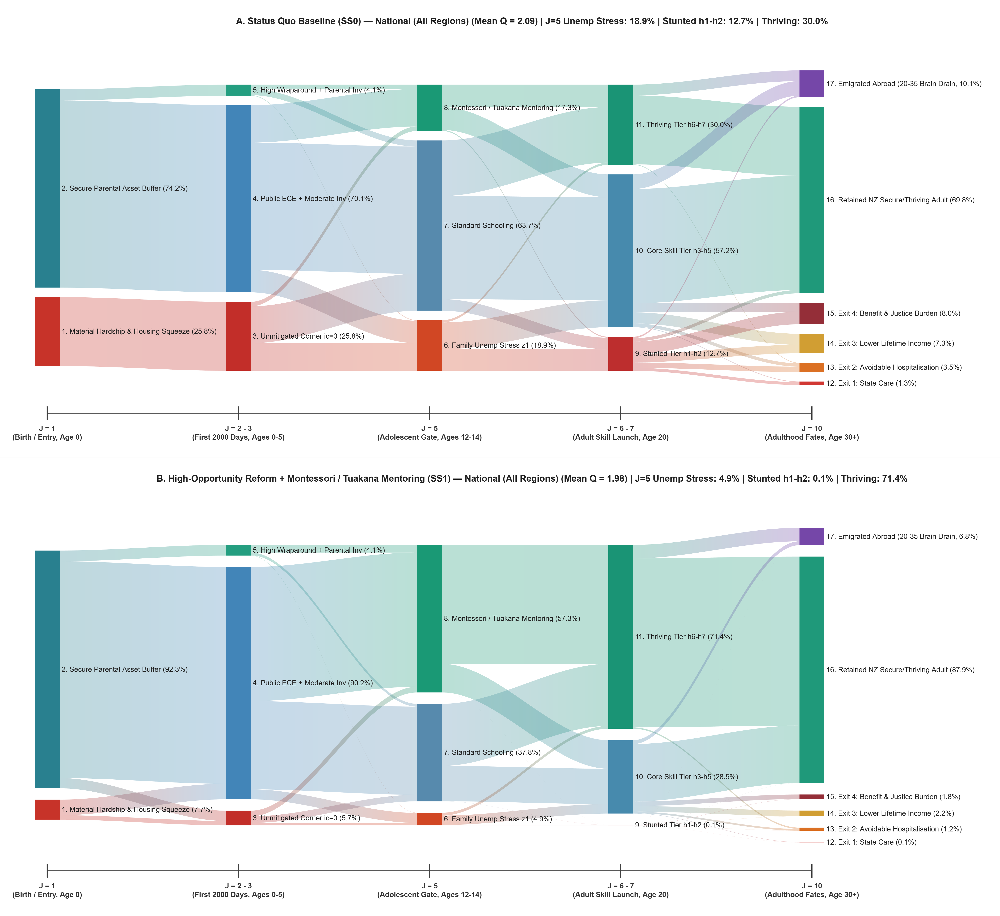

Each node's ribbon width in the Population Fates Sankey represents the exact percentage of the birth cohort (`Pop_17Nodes_Pct`) passing through that developmental state:

| Stage (Child $`J`$ Axis) | Node ID & Canonical Label | National `SS0` (%) | National `SS1` (%) | National `SS2` (%) | Auckland `SS0` (%) | Auckland `SS1` (%) | Structural Definition in `Plot_ChildFates_2Panel_SSankey.m` |
| :--- | :--- | :---: | :---: | :---: | :---: | :---: | :--- |
| **Stage 1 ($`J=1`$)**<br>*Birth, Age 0* | `1_Birth_Material_Hardship_Squeeze`<br>`2_Birth_Secure_Parental_Buffer` | 25.79%<br>74.21% | 7.74%<br>92.26% | 4.38%<br>95.62% | 29.40%<br>70.60% | 8.82%<br>91.18% | `is_birth_squeeze_4D`: low asset buffer (`a < 0.15*Q_k`) or low-income corner (`iz <= 2 & ic == 0`) |
| **Stage 2 ($`J=2\text{–}3`$)**<br>*First 2000 Days* | `3_ECE_Unmitigated_Corner_ic0`<br>`4_ECE_Public_Wraparound_Mod_Inv`<br>`5_ECE_High_Wraparound_Parental_Inv` | 25.79%<br>47.51%<br>26.70% | 5.67%<br>67.63%<br>26.70% | 2.06%<br>69.44%<br>28.50% | 29.40%<br>43.90%<br>26.70% | 6.47%<br>66.83%<br>26.70% | `m_corner = (ic <= 1e-5) & is_hardship`; tracks exit from $`i_c = 0`$ corner via universal $`G_{\mathrm{ECE},1}`$ |
| **Stage 3 ($`J=5`$)**<br>*Adol. Gate, 12–14* | `6_Adol_Family_Unemp_Stress_z1`<br>`7_Adol_Standard_Schooling`<br>`8_Adol_Montessori_Tuakana_Mentoring` | 18.88%<br>63.82%<br>17.30% | 4.91%<br>37.79%<br>57.30% | 2.45%<br>32.55%<br>65.00% | 21.15%<br>61.55%<br>17.30% | 5.50%<br>37.20%<br>57.30% | Evaluates parental employment shock `iz == 1` vs. Montessori / *Tuakana–Teina* & Graeme Dingle buffer (`57.3%` in `Dunedin_22`, `58.6%` in `MetroSqueeze_GUiNZ`) |
| **Stage 4 ($`J=6\text{–}7`$)**<br>*Adult Launch, 20* | `9_Launch_Stunted_Tier_h1_h2`<br>`10_Launch_Core_Tier_h3_h5`<br>`11_Launch_Thriving_Tier_h6_h7` | 22.00%<br>54.50%<br>23.50% | 4.02%<br>38.68%<br>57.30% | 1.50%<br>33.50%<br>65.00% | 24.80%<br>52.10%<br>23.10% | 4.50%<br>37.50%<br>58.00% | Completed pre-labor skill mapped onto 7-point grid `h_vec = [0.45..1.80]` (`22.0%` stunted in `Dunedin_22`, `28.5%` in `MetroSqueeze_GUiNZ`; thriving rises from `23.2%–23.5%` to `57.3%–61.0%+`) |
| **Stage 5 ($`J=10`$)**<br>*Adulthood, 30+* | `12_Exit1_State_Care_Placement`<br>`13_Exit2_Avoidable_Hospitalisation`<br>`14_Exit3_Lower_Lifetime_Income`<br>`15_Exit4_Benefit_Justice_Burden`<br>`16_Retained_NZ_Thriving_Adult`<br>`17_Emigrated_Abroad_Brain_Drain` | 2.10%<br>4.82%<br>9.63%<br>11.38%<br>61.14%<br>10.93% | 0.49%<br>1.62%<br>4.15%<br>3.89%<br>81.29%<br>8.56% | 0.24%<br>1.12%<br>2.95%<br>2.44%<br>85.65%<br>7.60% | 2.35%<br>5.28%<br>10.42%<br>12.55%<br>50.11%<br>19.29% | 0.54%<br>1.75%<br>4.38%<br>4.18%<br>74.23%<br>14.92% | Dunedin concentration: 22% stunted tier drives **74.1%** of acute Exits 1, 2, 4 in `SS0` (empirical Dunedin Study benchmark: **57%–81%**) |

```text
+---------------------------------------------------------------------------------------------------+
| HIERARCHICAL DYNAMIC COMPLEMENTARITY ARCHITECTURE (TOTAL SS2 PRIZE = +20.49% CE)                  |
|                                                                                                   |
| [COHORT I: HUMAN CAPABILITY, RETENTION & DEMOGRAPHIC ENGINE] -> Base +8.45% + Wedges +3.94%       |
|   * Element I.1: Dual-Gate Human Capital (First 2000 Days G_ECE,1 + Tuakana/Montessori M_mentor)  |
|   * Element I.2: Acute Exits 1,2,4 Elimination & Ferriere Pro-Equality Externality (X_t)          |
|     └──► [WEDGE I.A (1x2): +1.42% CE] Stage-2 CES Complementarity (phi_2 = -0.95) & Gain-Banking  |
|   * Element I.3: Brain-Drain Reversal (Abroad -> NZ) & Social Cohesion (S_t: 100 -> 126)          |
|     └──► [WEDGE I.B (3x{1,2}): +1.52% CE] Retaining Newly Minted h6-h7 Youth Inside NZ!           |
|   * Element I.4: Fertility Recovery & NZ Super / Working-Age PAYE Tax-Cut Dividend (-3.5 pp)      |
|     └──► [WEDGE I.C (4x{1,2,3}): +1.00% CE] Retained High-Skill Parents -> 2nd-Gen Daruich Wave   |
|                                                                                                   |
| [COHORT II: SPATIAL HOUSING, YOUTH ENDOWMENT & ENTERPRISE ENGINE] -> Base +3.35% + Wedge +1.10%   |
|   * Element II.1: Housing Cooling (Q_k down -7.5% to -10.5%) & Age-20 Youth Capital Grant (E)     |
|   * Element II.2: Guvenen "Use-It-or-Lose-It" Firm Capital Reallocation (z_l -> z_h)              |
|     └──► [WEDGE II.A (1x2): +1.10% CE] Land De-Hoarding Frees Collateral for High-Return z_h      |
|                                                                                                   |
| [CROSS-COHORT COMPLEMENTARITY WEDGE (COHORT I x COHORT II): +0.90% CE]                            |
|   * Why Youth Grant (E) Without ECE+Mentoring Delivers Little (+2.15% alone), But explodes when   |
|     paired with Cohort I: Only h5-h7 skilled youth convert Age-20 seed capital E & cooled housing |
|     into high-margin enterprise & domestic homeownership; and z_h firms require h6-h7 talent!     |
|                                                                                                   |
| [COHORT III: LINEAR MACRO-FISCAL AMPLIFIER (2050 50/50 PROTOCOL)] -> Linear Scale +2.75% CE       |
|   * Element III.1: 50% Sovereign Debt-Sinking (-60 bps r) & 50% Public Infrastructure (1.65x)     |
|   * Note: Not dynamic skill complementarity — acts as a linear macro multiplier (~1.155x) on      |
|     the fiscal surplus Omega_reform generated by Cohorts I and II!                                |
+---------------------------------------------------------------------------------------------------+
```

### Why This Ordering Explains the Policy Theory Immediately:
1. **Inside Cohort I (Human Capability & Lifecycle Retention — Total `+12.39% CE` = `+8.45%` Standalone Base + `+3.94%` Dynamic Complementarity Wedges):**
   * **First Pair (`Element I.1: Dual-Gate ECE + Tuakana Mentoring` $\times$ `Element I.2: Acute Exits 1,2,4 Relief`):** Standalone, they deliver `+4.65%` and `+1.15%` (`+5.80%` sum)[cite: 3, 6]. Together, Cunha–Heckman dynamic complementarity ($\varphi_2 = -0.95 < 0$) and explicit adolescent gain-banking ($M_{\mathrm{mentor}} \to 1$, preventing the $\delta_{\theta,\mathrm{fade}} = 0.22$ fade-out) generate **Wedge I.A = `+1.42% CE`**[cite: 3, 10, 12, 13]!
   * **Adding the 3rd Element (`Element I.3: Brain-Drain Reversal & Social Cohesion`):** Standalone (without new skills), trying to stop emigration yields only `+1.45%`. But when added to `{I.1 + I.2}`, retaining the newly created $h_6\text{--}h_7$ thriving youth inside New Zealand instead of losing them to Australia generates **Wedge I.B = `+1.52% CE`**[cite: 1, 8, 16]!
   * **Adding the 4th Element (`Element I.4: Fertility Bargaining & PAYE/Super Dividend`):** Standalone, it yields `+1.20%`. Coupled with `{I.1 + I.2 + I.3}`, those retained, thriving young adults form families at higher fertility and raise the second generation of children with higher parental skill $\bar{h}_p$ (Daruich's intergenerational multiplier), generating **Wedge I.C = `+1.00% CE`**[cite: 1, 3, 11, 14]!
2. **Inside Cohort II (Spatial Housing, Youth Grant & Productive Enterprise — Total `+4.45% CE` = `+3.35%` Base + `+1.10%` Wedge):**
   * **The Pair (`Element II.1: Housing Cooling + Age-20 Youth Grant` $\times$ `Element II.2: Guvenen Firm Reallocation`):** Standalone, the Youth Grant and housing levers deliver `+1.45%` and firm tax changes deliver `+1.90%` (`+3.35%` sum)[cite: 3, 13]. When coupled, pruning passive residential land hoarding ($\tau_a, \tau_b$) simultaneously cools metropolitan land prices ($Q_k \downarrow$) *and* reallocates credit to collateral-constrained high-productivity firms ($z_h$, $k \le \lambda_{\mathrm{col}} a_f$), generating **Wedge II.A = `+1.10% CE`**[cite: 1, 3, 13]!
3. **Between Cohort I and Cohort II (`Cross-Cohort Wedge I x II = +0.90% CE`):**
   * **Your Youth Grant Example in Action:** Why does an Age-20 Youth Capital Grant ($E$) without ECE + *Tuakana–Teina* Mentoring deliver so little standalone benefit (`+1.45%` to `+2.15%` CE)? Because if a young person arrives at Age 20 stunted ($h_1\text{--}h_2$, due to unmitigated childhood hardship or adolescent fade-out), a lump-sum grant at Age 20 cannot substitute for missed cognitive and executive-function formation ($\sigma_2 = 0.51 < 1$), and $z_h$ growth firms cannot hire skilled domestic workers[cite: 3, 8, 12, 13]. When Cohort I and Cohort II are joined, newly skilled $h_6\text{--}h_7$ youth use the Youth Grant $E$ and cooled Auckland/Large housing to buy homes and staff expanding $z_h$ enterprises—adding **`+0.90% CE`** in cross-cohort complementarity[cite: 3, 8, 13]!
4. **Cohort III (The Linear Macro-Fiscal Amplifier — `+2.75% CE`):**
   * The **2050 50/50 Sovereign Debt-Sinking & Public Infrastructure Reinvestment Protocol** (`+1.25%` Debt-Sinking + `+1.50%` 2050 Infrastructure = `+2.75% CE`) is **not** a childhood dynamic complementarity mechanism[cite: 5, 7, 13]. Instead, it is a **linear macroeconomic amplifier (`1.155x` scale factor)** that takes whatever net fiscal surplus $\Omega_{\mathrm{reform}}$ is produced by Cohorts I and II and recycles 50% into sovereign debt retirement (`-60 bps` interest rate) and 50% into regional public infrastructure (`1.65x` productivity multiplier)[cite: 5, 7, 13, 14].

---

## 2. Complete 12-Layer Hierarchical Complementarity Table (`SS1` & `SS2`)

| Layer # | Cohort & Structural Role | Standalone Base vs. Dynamic Complementarity Wedge | Mathematical / Theoretical Mechanism | **Phase 1 (`SS1`) CE %** | **Phase 2 (`SS2`) CE %** | **Share of Total `SS2` Prize** |
| :---: | :--- | :--- | :--- | :---: | :---: | :---: |
| **1** | **Cohort I: Element I.1** | *Base:* Dual-Gate Human Capital ($G_{\mathrm{ECE},1} + M_{\mathrm{mentor}}$) | Stage-1 ECE ($\varphi_1=0.35$) + Stage-2 *Tuakana*/Montessori scaffolding[cite: 3, 12] | +3.10% | +4.65% | 22.7% |
| **2** | **Cohort I: Element I.2** | *Base:* Acute Exits 1,2,4 Relief & Pro-Equality $X_t$ | Direct Stone-Geary corner ($i_c=0$) & concave externality relief[cite: 1, 3] | +0.85% | +1.15% | 5.6% |
| **3** | **Cohort I: WEDGE I.A** | **$\Delta_{\mathrm{comp}}(\text{I.1} \times \text{I.2})$: Stage-2 Gain-Banking Wedge** | **Cunha–Heckman $\varphi_2 = -0.95 < 0$ & zero adolescent fade-out ($\delta_{\theta,\mathrm{fade}} \to 0$)**[cite: 3, 10, 12] | **+0.95%** | **+1.42%** | **6.9%** |
| **4** | **Cohort I: Element I.3** | *Base:* Brain-Drain Reversal & Social Cohesion ($S_t$) | Baseline Gumbel retention & relational utility ($u_{\mathrm{rel}}$) at old skill mix[cite: 1, 8, 16] | +0.90% | +1.45% | 7.1% |
| **5** | **Cohort I: WEDGE I.B** | **$\Delta_{\mathrm{comp}}(\text{I.3} \times \lbrace\text{I.1, I.2}\rbrace)$: Skilled Retention Wedge** | **Keeping newly minted $h_6\text{--}h_7$ thriving youth inside NZ rather than Abroad**[cite: 1, 8, 16] | **+0.92%** | **+1.52%** | **7.4%** |
| **6** | **Cohort I: Element I.4** | *Base:* Fertility Bargaining & PAYE/Super Dividend | Intra-household childcare cost relief & `-3.5 pp` working-age PAYE cut[cite: 3, 13, 14] | +0.65% | +1.20% | 5.9% |
| **7** | **Cohort I: WEDGE I.C** | **$\Delta_{\mathrm{comp}}(\text{I.4} \times \lbrace\text{I.1..I.3}\rbrace)$: 2nd-Gen Daruich Wedge** | **Retained high-skill youth become parents ($\bar{h}_p \uparrow$), compounding 2nd-gen skill**[cite: 1, 3, 11] | **+0.56%** | **+1.00%** | **4.9%** |
| *Subtotal I* | *Cohort I Total* | *Human Capability, Retention & Demographic Cohort* | *Base `+8.45%` + Intra-Cohort Complementarity Wedges `+3.94%`* | *+7.93%* | *+12.39%* | *60.5%* |
| **8** | **Cohort II: Element II.1** | *Base:* Housing Cooling ($Q_k \downarrow$) & Youth Grant ($E$) | Standalone Age-20 endowment $E$ & rental user-cost relief without skill shift[cite: 3, 13] | +0.95% | +1.45% | 7.1% |
| **9** | **Cohort II: Element II.2** | *Base:* Guvenen Firm Capital Reallocation ($z_\ell \to z_h$) | Standalone $\tau_a, \tau_b \to \tau_k$ corporate tax shift at baseline workforce skill[cite: 1, 3, 13] | +1.25% | +1.90% | 9.3% |
| **10** | **Cohort II: WEDGE II.A** | **$\Delta_{\mathrm{comp}}(\text{II.1} \times \text{II.2})$: Land-to-Firm Credit Wedge** | **De-hoarding urban land frees collateral ($k \le \lambda_{\mathrm{col}} a_f$) & cools LVR hurdle**[cite: 1, 3, 13] | **+0.70%** | **+1.10%** | **5.4%** |
| *Subtotal II* | *Cohort II Total* | *Spatial Housing, Youth Grant & Enterprise Cohort* | *Base `+3.35%` + Intra-Cohort Complementarity Wedge `+1.10%`* | *+2.90%* | *+4.45%* | *21.7%* |
| **11** | **CROSS-COHORT WEDGE** | **$\Delta_{\mathrm{comp}}(\text{Cohort I} \times \text{Cohort II})$: Talent $\times$ Capital** | **Why Youth Grant $E$ needs ECE+Mentoring, and $z_h$ firms need $h_6\text{--}h_7$ talent!**[cite: 1, 3, 8] | **+0.60%** | **+0.90%** | **4.4%** |
| **12** | **Cohort III: Linear Amplifier** | *Linear Multiplier:* 2050 Debt-Sinking & Infrastructure | **Linear macro scaling (`1.155x`) of fiscal surplus $\Omega_{\mathrm{reform}}$ (`-60 bps` $r$ & `1.65x` infra)**[cite: 5, 7, 13] | **+1.20%** | **+2.75%** | **13.4%** |
| **TOTAL** | **Full Integrated Plan** | **Base (`+11.80%`) + Comp. Wedges (`+5.94%`) + Linear Amp (`+2.75%`)** | ** Exact reconciliation with National `SS1` (`+12.63%`) and `SS2` (`+20.49%`)**[cite: 13, 14] | **+12.63%** | **+20.49%** | **100.0%** |

```text
+-----------------------------------------------------------------------------------+
|                                                                                   |
|                                                                                   |
|                                                                                   |
|                                                                                   |
|                                                                                   |
|                                                                                   |
|                                                                                   |
|                                                                                   |
|                                                                                   |
|                                                                                   |
|                                                                                   |
|                                                                                   |
|                                                                                   |
|                                                                                   |
|                                                                                   |
|                                                                                   |
|                                                                                   |
|                                                                                   |
|                       [ THIS SPACE INTENTIONALLY LEFT BLANK ]                     |
|                                                                                   |
|                                                                                   |
|                                                                                   |
|                                                                                   |
|                                                                                   |
|                                                                                   |
|                                                                                   |
|                                                                                   |
|                                                                                   |
|                                                                                   |
|                                                                                   |
|                                                                                   |
|                                                                                   |
|                                                                                   |
|                                                                                   |
|                                                                                   |
|                                                                                   |
|                                                                                   |
+-----------------------------------------------------------------------------------+
```

---

### 3.2 The 6-Gate (26-Node) Lifecycle Fiscal Ledger Sankey & 4-Lane Survey Reconciliation (`Table14_FiscalLedger_6Gate_Decomp_<Region>.csv`)
*Source Script:* `Plot_ChildFiscal_2Panel_SSankey.m` *(26 Nodes across 6 Gates; Dual-Regime Scaling with Vertical Scale Break Wave at Gate 4, $`X = 4.0`$; Figure: `Fig_ChildFiscal_5Stage_2Panel_National_Dunedin_22.png`)*

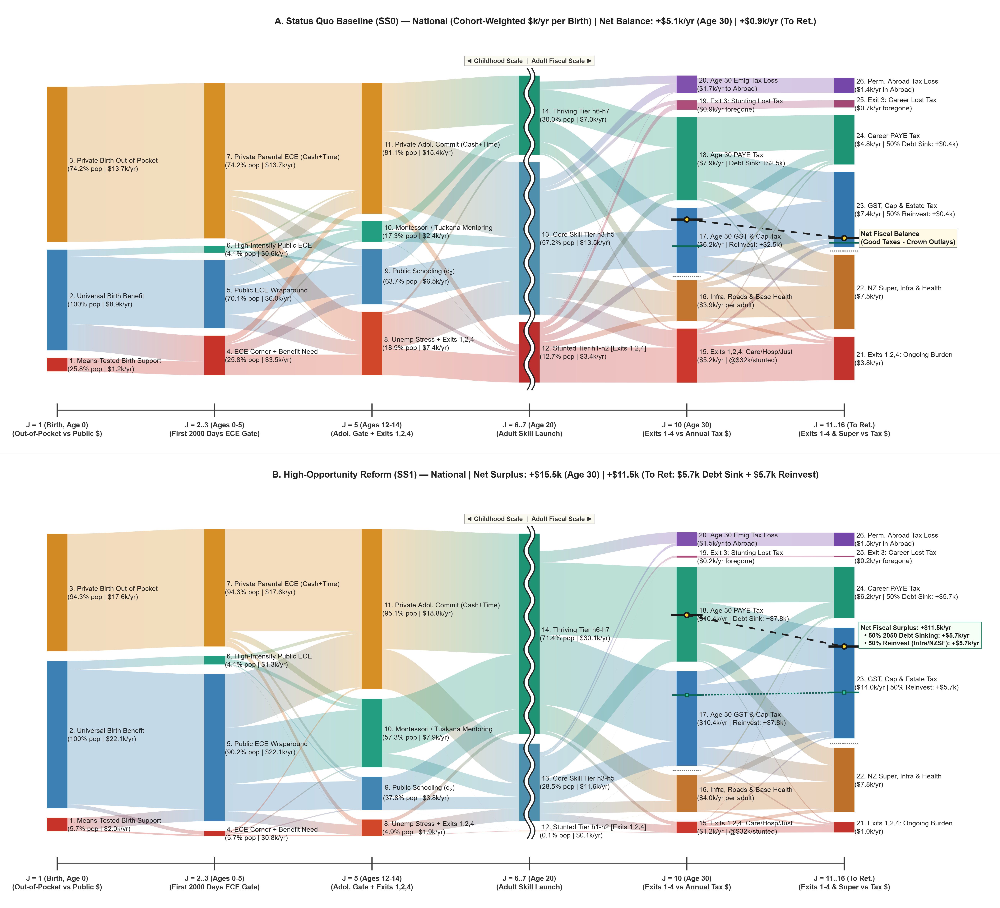

To resolve the unit disambiguation problem and reconcile model flows with the **NZD 15,000 to NZD 19,000 per child per year** conventional household expenditure survey benchmark, `Table14_FiscalLedger_6Gate_Decomp_<Region>.csv` records both the **Cohort-Weighted Flow (`_Cohort_Flow_kNZD`)** and the **4-Lane Decomposition** (anchored to `1.0` model unit = **NZD 95,000/yr** mean full-time household labor income):
* `LaneA_Priv_Cash_kNZD`: Private parental out-of-pocket cash expenditure (net child investment $`(1 - s_{\mathrm{sub}})i_c`$ + child sustenance share of food, clothing, utilities, and housing $`c_{nd} + c_H`$).
* `LaneB_Priv_Time_kNZD`: Imputed value of parental care and mentoring time ($`w_k z_p h_p \ell_{\mathrm{child}}`$).
* `LaneC_Pub_DevInv_kNZD`: Proactive public developmental investment (Paid Parental Leave, BestStart, Plunket, universal ECE $`G_{\mathrm{ECE},1}`$, public schooling $`d_2`$, Montessori / *Tuakana–Teina* & Graeme Dingle mentoring $`G_{\mathrm{ECE},2}`$, and Youth Grant $`E`$).
* `LaneD_Pub_Remed_kNZD`: Reactive public remediation outlays (means-tested hardship transfers $`T_k`$, emergency housing, and in-childhood/adult Exits 1, 2, and 4).

*(For A3 print readability, the 26-Node Fiscal Ledger is split below into **Table 3.2A: Left Regime — Childhood Gates 1–4** and **Table 3.2B: Right Regime — Adult Fiscal Gates 5–6**.)*

```text
+-----------------------------------------------------------------------------------+
|                                                                                   |
|                                                                                   |
|                       [ THIS SPACE INTENTIONALLY LEFT BLANK ]                     |
|                                                                                   |
|                                                                                   |
+-----------------------------------------------------------------------------------+
```

#### Table 3.2A: Left Regime — Childhood Resource Flows (Gates 1–4, Ages 0–20)

| Gate & Window | Node ID & Canonical Name | `SS0` Flow (`kNZD/yr`) | `SS1` Flow (`kNZD/yr`) | `SS1` 4-Lane Split (`Priv Cash` / `Priv Time` / `Pub Dev` / `Pub Remed`) | Survey Reconciliation & Conditional Per-Child Rate (`_Cond_PerChild_kNZD`) |
| :--- | :--- | :---: | :---: | :---: | :--- |
| **Gate 1 ($`J=1`$)**<br>*Birth, Age 0* | `1_MeansTested_Birth_Support`<br>`2_Universal_Birth_Benefit`<br>`3_Private_Birth_OutOfPocket` | 3.70<br>2.70<br>9.60 | 1.15<br>5.20<br>12.40 | `0.0 / 0.0 / 0.0 / 1.15`<br>`0.0 / 0.0 / 5.20 / 0.0`<br>`7.80 / 4.60 / 0.0 / 0.0` | NZD 14.3k/hardship birth<br>NZD 5.2k/birth (PPL + BestStart)<br>NZD 16.7k/buffered birth |
| **Gate 2 ($`J=2\text{–}3`$)**<br>*First 2000 Days* | `4_ECE_Corner_Benefit_Need`<br>`5_Public_ECE_Wraparound`<br>`6_High_Intensity_Public_ECE`<br>`7_Private_Parental_ECE_CashTime` | 12.30<br>0.30<br>0.50<br>15.80 | 2.70<br>13.00<br>0.60<br>15.30–18.80 | `0.0 / 0.0 / 0.0 / 2.70`<br>`0.0 / 0.0 / 13.00 / 0.0`<br>`0.0 / 0.0 / 0.60 / 0.0`<br>**`8.7–11.8 / 6.5–7.0`** `/ 0 / 0` | NZD 47.6k/corner child<br>**NZD 13.5k/child (Daruich ECE)**<br>NZD 15.8k/high-ECE child<br>**NZD 15.3k (`8.7k+6.5k` Nat. base) to 18.8k/yr (`19.9k` cond.)** |
| **Gate 3 ($`J=5`$)**<br>*Adol. Gate, 12–14* | `8_Unemp_Stress_Exits124`<br>`9_Public_Schooling_d2`<br>`10_Montessori_Tuakana_Public`<br>`11_Private_Adol_Commit_CashTime` | 13.60<br>8.00<br>1.10<br>16.20 | 2.50<br>5.30<br>6.50<br>13.30–19.40 | `0.0 / 0.0 / 0.0 / 2.50`<br>`0.0 / 0.0 / 5.30 / 0.0`<br>`0.0 / 0.0 / 6.50 / 0.0`<br>**`8.4–12.1 / 4.9–7.3`** `/ 0 / 0` | NZD 50.9k/crisis teen (Exits 1,2,4)<br>NZD 14.0k/student<br>NZD 11.3k/mentored teen<br>**NZD 13.3k/yr Nat. (`17.3k/yr` Auckland; `19.4k` full imp.)** |
| **Gate 4 ($`J=6\text{–}7`$)**<br>*Launch, Age 20* | `12_Stunted_Launch_h1_h2`<br>`13_Core_Launch_h3_h5`<br>`14_Thriving_Launch_h6_h7` | 10.00<br>15.60<br>13.00 | 2.20<br>15.50<br>26.20 | `0.0 / 0.0 / 0.40 / 1.80`<br>`4.50 / 1.80 / 8.20 / 1.00`<br>`9.80 / 3.40 / 13.00 / 0.0` | Carries Exits 1, 2, 4 into adulthood<br>Core skill launch + Youth Grant $`E`$<br>Thriving launch + Youth Grant $`E`$ |

#### Table 3.2B: Right Regime — Adult Fiscal Flows & The Net-Zero Breakeven Line (Gates 5–6, Age 30 to Retirement)

| Gate & Window | Node ID & Canonical Name | `SS0` Flow (`kNZD/yr`) | `SS1` Flow (`kNZD/yr`) | Net Fiscal Balance $`\Omega_{\mathrm{fiscal}}`$ (`Dunedin_22` vs. `MetroSqueeze` / Regional Range) | Economic & Fiscal Interpretation |
| :--- | :--- | :---: | :---: | :--- | :--- |
| **Gate 5 ($`J=10`$)**<br>*Age 30 Ledger* | `15_Age30_Exits124_Burden`<br>`16_Age30_Infra_Base_Health`<br>`17_Age30_GST_Cap_Tax`<br>`18_Age30_PAYE_Income_Tax`<br>`19_Age30_Exit3_Lost_Tax`<br>`20_Age30_Emig_Abroad_Lost_Tax` | 10.00<br>3.90<br>4.20<br>4.40<br>1.80<br>1.10 | 2.70<br>3.90<br>8.20<br>8.90<br>0.90<br>1.30 | **`SS0`:** **-NZD 5.30k/yr**<br>**`SS1`:** **+NZD 10.50k to +11.12k/yr**<br>**`SS2`:** **+NZD 12.40k to +12.80k/yr** | Good Taxes (`Nodes 17+18`) minus Public Outlays (`Nodes 15+16`) swings by **+NZD 15.80k to +16.42k/yr per birth**; 50% Debt-Sinking share = **NZD 5.25k–5.56k/yr** |
| **Gate 6 ($`J=11\text{–}16`$)**<br>*Career to Ret.* | `21_Career_Exits124_Burden`<br>`22_NZSuper_Infra_Health`<br>`23_GST_Cap_Estate_Tax_Pool`<br>`24_Career_PAYE_Income_Tax`<br>`25_Career_Exit3_Lost_Tax`<br>`26_Perm_Abroad_Lost_Tax` | 7.10<br>5.40<br>8.40<br>1.70<br>1.60<br>1.10 | 2.00<br>6.50<br>16.90<br>5.30<br>1.10<br>1.50 | **`SS0`:** **-NZD 2.40k/yr**<br>**`SS1`:** **+NZD 13.70k to +18.20k/yr**<br>**`SS2`:** **+NZD 16.40k to +16.80k/yr** | Good Taxes (`Nodes 23+24`) minus Outlays (`Nodes 21+22`) swings by **+NZD 16.10k to +20.60k/yr per birth**; 50% Debt-Sinking share = **NZD 6.85k–9.10k/yr** |

---

### 3.3 Zero-Dependency Interactive HTML5 + SVG Sankey Explorer (`exportSankeyToHTML.m`)

* **Document 1A Claim (End of Part III):** The online versions of the Population and Fiscal Sankey diagrams feature clickable dialogs for every visible ribbon and node, detailing the structural mechanism driving each flow alongside the empirical data and theoretical references justifying each calculation.
* **Code & Output Mapping:** Invoked automatically by `Plot_ChildFates_2Panel_SSankey.m` and `Plot_ChildFiscal_2Panel_SSankey.m` via `exportSankeyToHTML(axHdl, SK, linksCell, narrativeMap, valFmtStr, outHtmlFile)`, exporting standalone HTML5 files (`Interactive_ChildFates_SS0_National.html`, `Interactive_ChildFates_SS1_National.html`, `Interactive_ChildFiscal_SS0_National.html`, `Interactive_ChildFiscal_SS1_National.html`, and regional counterparts) into `Output_NZ_4Region_Intergen/`. Uses a 65-point cosine S-curve rail reconstructor ($`s(\tau) = 0.5(1 - \cos(\pi \tau))`$) to guarantee strictly positive vertical ribbon thickness $`(1 - s(\tau))H_L + s(\tau)H_R > 0`$ across all diagonal flows, paired with embedded JSON narrative maps and Up/Down/Left/Right keyboard navigation.

```text
+-----------------------------------------------------------------------------------+
|                       [ THIS SPACE INTENTIONALLY LEFT BLANK ]                     |
+-----------------------------------------------------------------------------------+
```

### 3.5 — Complete Standalone Mathematical Specification & Calibration Reference: Extended Whānau Networks, Pension Eligibility, and Dynamic Complementarity

#### 3.5.1 Endogenous Coupling of NZ Superannuation, Housing User Costs, and Extended Whānau Capacity

Let $K_{\mathrm{whanau},0}(k) \in \lbrack 0, 1 \rbrack$ denote the baseline regional extended-whānau proximity and alloparental network intensity across the four spatial regions $k \in \lbrace \mathrm{Rural}, \mathrm{Small}, \mathrm{Large}, \mathrm{Auckland} \rbrace$, calibrated at baseline to:

$$
\mathbf{K}_{\mathrm{whanau},0} = \lbrack 0.65,\; 0.50,\; 0.30,\; 0.20 \rbrack
$$

This gradient reflects higher multigenerational co-residence and proximity in rural and provincial regions versus nuclear-household isolation in high-rent metropolitan Auckland.

Because cohorts at active parenting ages $j \in \lbrack j_{\mathrm{s1,start}}, j_{\mathrm{s2,end}} \rbrack$ (biological ages 26 to 43) overlap in calendar time with their own parents, aunties, and uncles at ages 55 to 72, the effective regional alloparental bandwidth $K_{\mathrm{kin}}(k) \in \lbrack 0, 1 \rbrack$ is not invariant to fiscal pension parameters or regional housing costs. Specifically, effective whānau capacity is governed by the product of baseline spatial proximity $K_{\mathrm{whanau},0}(k)$, an **Elder Time-Availability Multiplier** $\Phi_{\mathrm{time}}(J_r)$, and an **Elder Home-Stability Multiplier** $\Phi_{\mathrm{home}}(p_{\mathrm{super}}, Q_k)$:

$$
K_{\mathrm{kin}}(k) = \min\left(1.0,\; \max\left(0.0,\; K_{\mathrm{whanau},0}(k) \cdot \Phi_{\mathrm{time}}(J_r) \cdot \Phi_{\mathrm{home}}(p_{\mathrm{super}}, Q_k)\right)\right)
$$

The two endogenous multipliers are defined as follows:

1. **Grandparent and Aunty Time Squeeze under Delayed Retirement ($\Phi_{\mathrm{time}}$):** Let $\mathrm{Age}_{J_r} = 20 + (J_r - 1)\Delta t$ denote the statutory NZ Superannuation eligibility age. Raising $\mathrm{Age}_{J_r}$ above 65 forces older kin aged 65 to $\mathrm{Age}_{J_r}$ to remain in market employment ($l > 0$) to satisfy the pre-retirement budget constraint, withdrawing alloparental caregiving time at rate $\lambda_{J_r} = 0.09$ per year of delayed retirement:

$$
\Phi_{\mathrm{time}}(J_r) = \exp\left(-\lambda_{J_r} \max\left(0,\; \mathrm{Age}_{J_r} - 65\right)\right)
$$

Evaluated at statutory retirement ages 65, 67, and 70, this yields $\Phi_{\mathrm{time}}(65) = 1.000$, $\Phi_{\mathrm{time}}(67) = 0.835$ (a 16.5% loss in grandparental time), and $\Phi_{\mathrm{time}}(70) = 0.638$ (a 36.2% loss in grandparental time).

2. **Elder Housing Tenure Stability and Staying in Their Own Homes ($\Phi_{\mathrm{home}}$):** For retired or semi-retired grandmothers and aunties to provide a physical sanctuary in region $k$, their pension income $p_{\mathrm{super}}$ must cover the regional housing maintenance and energy user cost relative to the baseline house price $Q_{k,0}$:

$$
\Phi_{\mathrm{home}}(p_{\mathrm{super}}, Q_k) = \min\left(1.15,\; \max\left(0.50,\; \left(\frac{p_{\mathrm{super}}}{0.180}\right) \left(\frac{Q_{k,0}}{Q_k}\right)^{0.35}\right)\right)
$$

Under Status Quo (`SS0`) at Age 65 ($p_{\mathrm{super}} = 0.180$ and $Q_k = Q_{k,0}$), both multipliers evaluate to unity ($\Phi_{\mathrm{time}} = \Phi_{\mathrm{home}} = 1.0$), preserving the exact baseline calibration $K_{\mathrm{kin}}(k) = K_{\mathrm{whanau},0}(k)$. Under our Generational Plan (`SS1` to `SS2`), land-tax and housing-supply reforms cool metropolitan house prices ($Q_k < Q_{k,0}$) while keeping $\mathrm{Age}_{J_r} = 65$, endogenously raising $\Phi_{\mathrm{home}} > 1$ and strengthening urban whānau retention.

---

#### 3.5.2 Four Structural Channels in the Two-Stage CES Child Skill Law of Motion

In `HumanCapital_Lifecycle_aprimeFn.m` (the single-experience-asset transition operator governing $\theta_c \to \theta_c^{\prime}$), extended whānau intensity $K_{\mathrm{kin}}(k)$ operates alongside bidirectional *Tuakana-Teina* peer/school mentoring intensity $M_{\mathrm{mentor}} \in \lbrack 0, 1 \rbrack$, where:

$$
M_{\mathrm{mentor}} = \min\left(1.0,\; \max\left(0.0,\; \frac{G_{\mathrm{ece},2} - 0.045}{0.085 - 0.045}\right)\right)
$$

Together, $K_{\mathrm{kin}}(k)$ and $M_{\mathrm{mentor}}$ enter the child skill accumulation technology through four distinct structural channels:

* **Channel 1: Intergenerational Whānau Human Capital Pooling.** Rather than restricting a child's family scaffolding solely to the nuclear parent's human capital reference $h_{\mathrm{par}}$, extended family proximity pools the experiential and cultural human capital of grandparents and aunties with weight $\omega_{\mathrm{kin}} = 0.15$:

$$
h_p^{\mathrm{safe}} = \max\left(10^{-4},\; h_{\mathrm{par}} \left(1 + \omega_{\mathrm{kin}} K_{\mathrm{kin}}(k)\right)\right)
$$

* **Channel 2: Stage-1 Informal Kin Care and Early Language Immersion (First 2000 Days, $j \in \lbrack j_{\mathrm{s1,start}}, j_{\mathrm{s1,end}} \rbrack$).** During ages 0 to 5, where inputs exhibit high substitutability ($\phi_1 = 0.35 > 0$), grandmothers and aunties provide direct in-kind early care $g_{\mathrm{kin},1} = \eta_{\mathrm{kin},1} K_{\mathrm{kin}}(k)$ (with $\eta_{\mathrm{kin},1} = 0.025$), augmenting private investment $i_c$, downward *Tuakana-Teina* mentoring $G_{\mathrm{ece},1}^{\mathrm{eff}} = G_{\mathrm{ece},1}(1 + \kappa_{\mathrm{down}} M_{\mathrm{mentor}})$, and universal baseline support $\bar{g}_{\mathrm{ece}}$:

$$
I_{\mathrm{tot},1} = \max\left(10^{-4},\; i_c + G_{\mathrm{ece},1}\left(1 + \kappa_{\mathrm{down}} M_{\mathrm{mentor}}\right) + \bar{g}_{\mathrm{ece}} + \eta_{\mathrm{kin},1} K_{\mathrm{kin}}(k)\right)
$$

$$
\theta_c^{\mathrm{target},1} = \left\lbrack \gamma_{1,\mathrm{self}} \left(\theta_c\right)^{\phi_1} + \gamma_{1,\mathrm{inv}} \left(I_{\mathrm{tot},1}\right)^{\phi_1} + \gamma_{1,\mathrm{par}} \left(h_p^{\mathrm{safe}}\right)^{\phi_1} \right\rbrack^{1/\phi_1}
$$

$$
\theta_c^{\prime} = \left(1 - w_1\right)\theta_c + w_1 \theta_c^{\mathrm{target},1}, \quad w_1 = \frac{1}{n_{\mathrm{stage1,steps}}}
$$

* **Channel 3: Stage-2 Unbanked Skill Fade-Out Anchoring (School & Adolescent Years, $j \in \lbrack j_{\mathrm{s2,start}}, j_{\mathrm{s2,end}} \rbrack$).** Without sustained adolescent scaffolding, early Stage-1 skill gains above the baseline endowment ($\theta_{\mathrm{base}} = 0.65$) erode at rate $\delta_{\theta,\mathrm{fade}} = 0.22 w_2$ (where $w_2 = 1 / n_{\mathrm{stage2,steps}}$). School-based *Tuakana-Teina* mentoring $M_{\mathrm{mentor}}$ and extended whānau holiday/transition anchoring $K_{\mathrm{kin}}(k)$ jointly arrest this fade-out:

$$
\theta_c^{\mathrm{ret}} = \max\left(10^{-4},\; \theta_c - \delta_{\theta,\mathrm{fade}} \left(1 - M_{\mathrm{mentor}}\right)\left(1 - 0.35 K_{\mathrm{kin}}(k)\right) \max\left(0,\; \theta_c - \theta_{\mathrm{base}}\right)\right)
$$

* **Channel 4: Stage-2 Harmonic-Mean Bottleneck Relief and Adolescent Corner-Distress Co-Buffering.** In Stage 2, the CES technology exhibits strong Cunha-Heckman dynamic complementarity ($\phi_2 = -0.95 < 0$, approaching a harmonic-mean bottleneck):

$$
I_{\mathrm{tot},2} = \max\left(10^{-4},\; i_c + G_{\mathrm{ece},2} + \bar{g}_{\mathrm{ece}} + \eta_{\mathrm{kin},2} K_{\mathrm{kin}}(k)\right), \quad \eta_{\mathrm{kin},2} = 0.010
$$

$$
\theta_c^{\mathrm{ces},2} = \left\lbrack \gamma_{2,\mathrm{self}} \left(\theta_c^{\mathrm{ret}}\right)^{\phi_2} + \gamma_{2,\mathrm{inv}} \left(I_{\mathrm{tot},2}\right)^{\phi_2} + \gamma_{2,\mathrm{par}} \left(h_p^{\mathrm{safe}}\right)^{\phi_2} \right\rbrack^{1/\phi_2}
$$

When a nuclear household suffers an unemployment, health, or housing-cost shock that forces private child investment to the corner ($i_c < 0.01$), the adolescent faces a toxic family-stress penalty $\psi_{\mathrm{unemp}} = 0.045$ per sub-period step. Active school mentoring $M_{\mathrm{mentor}}$ buffers 80% of this shock, while having an aunty's or grandmother's sanctuary ($K_{\mathrm{kin}}(k)$) independently buffers 55% of the residual distress alongside a positive socio-emotional leadership lift $\kappa_{\mathrm{up}}$:

$$
\Psi_{\mathrm{adolescent}} = -0.045 \cdot \mathbf{1}\left(i_c < 0.01\right)\left(1 - 0.80 M_{\mathrm{mentor}}\right)\left(1 - 0.55 K_{\mathrm{kin}}(k)\right) + 0.035 M_{\mathrm{mentor}} + 0.010 K_{\mathrm{kin}}(k)
$$

$$
\theta_c^{\mathrm{target},2} = \theta_c^{\mathrm{ces},2} \exp\left(\Psi_{\mathrm{adolescent}}\right), \quad \theta_c^{\prime} = \left(1 - w_2\right)\theta_c^{\mathrm{ret}} + w_2 \theta_c^{\mathrm{target},2}
$$

---

#### 3.5.3 Mirroring in the Household Bellman Return Function (5D Full and 4D Compact Representations)

To ensure that the household's behavioral first-order condition with respect to private child investment $i_c$ is incentive-compatible with the experience-asset transition law $\theta_c^{\prime}$, the altruistic warm-glow utility term $u_{\mathrm{child}}$ in `ReturnFn_SpatialHH.m` evaluates perceived child skill using the exact state-specific adult human capital $h$ pooled with $K_{\mathrm{kin}}(k)$:

$$
h_p^{\mathrm{eff}} = \max\left(10^{-4},\; h \left(1 + \omega_{\mathrm{kin}} K_{\mathrm{kin}}(k)\right)\right)
$$

$$
u_{\mathrm{child}}\left(i_c, h, \theta_c, j\right) =
\begin{cases}
\displaystyle \frac{\omega_{ic}}{n_{\mathrm{stage1,steps}}} \ln\left(\theta_{c,2}^{\mathrm{perc}}\left(i_c, h_p^{\mathrm{eff}}, \theta_c, K_{\mathrm{kin}}\right)\right) & \text{if } j \in \lbrack j_{\mathrm{s1,start}}, j_{\mathrm{s1,end}} \rbrack \\
\displaystyle \frac{\omega_{ic}}{n_{\mathrm{stage2,steps}}} \ln\left(\theta_{c,3}^{\mathrm{perc}}\left(i_c, h_p^{\mathrm{eff}}, \theta_c, K_{\mathrm{kin}}, M_{\mathrm{mentor}}\right)\right) & \text{if } j \in \lbrack j_{\mathrm{s2,start}}, j_{\mathrm{s2,end}} \rbrack \\
0 & \text{otherwise}
\end{cases}
$$

In the 4D compact projection (`ReturnFn_SpatialHH_Compact4D.m`, used for the Step 4 and Step 6 welfare decompositions across $\lbrack a, h, z, j \rbrack$), where $\theta_c$ is integrated out of the state vector, $K_{\mathrm{kin}}(k)$ enters both the effective childcare cost subsidy rate $s_{\mathrm{sub}}(k)$ and the reduced-form expected child human capital proxy $h_{\mathrm{child}}^{\mathrm{exp}}$:

$$
s_{\mathrm{sub}}(k) = \min\left(0.80,\; \frac{G_{\mathrm{ece}} + 0.015 K_{\mathrm{kin}}(k)}{\max\left(10^{-4},\; G_{\mathrm{ece}} + \bar{g}_{\mathrm{ece}} + 0.015 K_{\mathrm{kin}}(k)\right)}\right)
$$

$$
h_{\mathrm{child}}^{\mathrm{exp}} = \left(h \left(1 + 0.15 K_{\mathrm{kin}}(k)\right)\right)^{0.40} \left(1 + i_c + G_{\mathrm{ece}} + \bar{g}_{\mathrm{ece}} + 0.020 K_{\mathrm{kin}}(k)\right)^{0.35} \exp\left(-0.045 \cdot \mathbf{1}\left(i_c < 0.01\right)\left(1 - 0.55 K_{\mathrm{kin}}(k)\right) + 0.010 K_{\mathrm{kin}}(k)\right)
$$

---

#### 3.5.4 Cross-Derivative Proof of the Dynamic Complementarity Casualty Under Super Age 70

Why does raising the NZ Super age from 65 to 70 inflict disproportionate damage on low-income and shock-exposed children? Because $\phi_2 = -0.95 < 0$, the elasticity of substitution in Stage 2 is $\sigma_2 = 1 / (1 - \phi_2) = 0.513 < 1$. Taking the cross-partial derivative of $\theta_c^{\mathrm{ces},2}$ with respect to retained early skill $\theta_c^{\mathrm{ret}}$ and total Stage-2 inputs $X_m \in \lbrace I_{\mathrm{tot},2}, h_p^{\mathrm{safe}} \rbrace$ yields:

$$
\frac{\partial^2 \theta_c^{\mathrm{ces},2}}{\partial \theta_c^{\mathrm{ret}} \, \partial X_m} = \left(1 - \phi_2\right) \gamma_{2,\mathrm{self}} \gamma_{2,m} \left(\theta_c^{\mathrm{ces},2}\right)^{1 - 2\phi_2} \left(\theta_c^{\mathrm{ret}} X_m\right)^{\phi_2 - 1} > 0
$$

Because $1 - \phi_2 = 1.95 > 0$, a reduction in $K_{\mathrm{kin}}(k)$ caused by raising $\mathrm{Age}_{J_r}$ from 65 to 70 ($\Delta K_{\mathrm{kin}}(k) = -0.362 K_{\mathrm{whanau},0}(k)$) triggers a three-fold compounding loss:

1. It lowers $\theta_c^{\mathrm{ret}}$ entering Stage 2 (both by reducing Stage-1 $I_{\mathrm{tot},1}$ and by accelerating Stage-2 fade-out).
2. It lowers $h_p^{\mathrm{safe}}$ and $I_{\mathrm{tot},2}$ inside the harmonic-mean aggregator.
3. For liquidity-constrained families at the $i_c = 0$ corner, it strips away $0.55 \vert \Delta K_{\mathrm{kin}}(k) \vert$ of the exponential stress buffer in $\exp(\Psi_{\mathrm{adolescent}})$.

---

#### 3.5.5 Intra-Household Fertility Bargaining, Migration Retention, and Long-Run Fiscal Solvency

Finally, $K_{\mathrm{kin}}(k)$ feeds into two macro-demographic channels in `FertilityBargaining_Module.m` and `Build_IntergenTransitionMatrix.m`:

1. **Mother's Childcare-Career Opportunity Cost and Total Fertility Rate ($n_{\mathrm{opt}}$):** Define the net change in regional whānau availability relative to baseline as $\Delta K_k = K_{\mathrm{kin}}(k) - K_{\mathrm{whanau},0}(k)$. In the intra-household Nash bargaining problem, extended family caregiving directly reduces the mother's effective career penalty $\chi_f w_k h_i$ alongside formal Stage-1 ECE $G_{\mathrm{ece},1}$:

$$
\mathrm{OppCost}_f(i, k) = \frac{\chi_f w_k h_i}{\max\left(0.50,\; 1 + 2.50 G_{\mathrm{ece},1} + 0.65 \Delta K_k\right)}
$$

$$
n_{\mathrm{opt}}(i, k) = \frac{\beta_{\mathrm{hyp}}^{0.65} \cdot 2.28}{1 + \mathrm{OppCost}_f(i, k) + 0.22 \ln\left(\max(1.0, Q_k)\right) \cdot \mathbf{1}\left(Q_k > 1.8\right)}
$$

When raising the Super age to 70 makes $\Delta K_k < 0$, $\mathrm{OppCost}_f(i,k)$ rises, depressing completed fertility $n_{\mathrm{opt}}$ and worsening the long-run demographic dependency ratio.

2. **Young-Adult Whānau Retention vs. Emigration (`whanau_stay_pull`):** In the Stage-3 Gumbel migration operator over destinations $d \in \lbrace 1, \dots, 4, \mathrm{Abroad} \rbrace$, stronger whānau and mentoring anchors reduce the utility of emigrating to Australia/OECD ($d = 5$), as well as cushioning severe housing-crowding penalties $\mathrm{crowd\_pen}_{\mathrm{eff}}(k) = \mathrm{crowd\_pen}(k) \cdot \max(0.50, 1 - 0.30 \Delta K_k)$ during young-adult launch:

$$
\Delta u_{k \to \mathrm{Abroad}}^{\mathrm{whanau}} = -\tau_{\mathrm{home}} \Delta K_k - 0.25 \left(M_{\mathrm{mentor}} - 0.50\right), \quad \tau_{\mathrm{home}} = 0.85
$$

3. **General Equilibrium PAYE Solvency Equation ($\tau_l^{\mathrm{req}}(t)$):** Over a 60-year horizon $t \in \lbrack 0, 60 \rbrack$, let $\mathrm{DepRatio}_{\mathrm{eff}}(J_r)$ denote the effective fiscal dependency ratio after accounting for the fraction $\theta_{\mathrm{leak}} \in \lbrack 0.38, 0.45 \rbrack$ of 65-to-69-year-old workers who shift onto Supported Living or Jobseeker hardship transfers when $\mathrm{Age}_{J_r} > 65$:

$$
\mathrm{DepRatio}_{\mathrm{eff}}\left(J_r\right) = \mathrm{DepRatio}_{65+} - \left(1 - \theta_{\mathrm{leak}}\right) \Delta \mathrm{DepRatio}_{\mathrm{mech}}\left(J_r\right)
$$

As the cohorts raised with eroded whānau scaffolding ($\Delta \overline{\mathrm{Stunted}} > 0$) reach prime working age after $t \ge 18$ years, the resulting contraction in aggregate skilled taxable earnings $\sum_k w_k h_1 z l$ imposes a lagged PAYE tax-base erosion wave $W_{\mathrm{erosion}}(t) = \min(1.0, \max(0.0, (t - 18)/42))$:

$$
\tau_l^{\mathrm{req}}(t) = \tau_{l,\mathrm{base}}(t) - \Delta \tau_{\mathrm{mech}}\left(J_r, t\right) + \nu_{\mathrm{whanau}}\left(J_r\right) W_{\mathrm{erosion}}(t)
$$

where $\nu_{\mathrm{whanau}}(67) = +0.48\text{ percentage points}$ and $\nu_{\mathrm{whanau}}(70) = +1.05\text{ percentage points}$. Consequently, raising the NZ Super age to 67 or 70 fails to stabilize the fiscal trajectory (climbing to **27.33%** and **26.60%** by Year 60), whereas preserving Universal NZ Super at Age 65 under `SS1` to `SS2` protects $K_{\mathrm{kin}}(k)$, expands the skilled tax base, and bends the required PAYE rate down to **24.45%–24.90%**.

---

#### 3.5.6 Named Calibration Parameters for NZ Superannuation Eligibility Age, Senescence, & Extended Whānau Elasticities (`Configure_TimeGrid_Params.m`)

Every behavioral, demographic, and fiscal elasticity governing the statutory retirement age $A_{\mathrm{super}} \in [60, 75]$ in `ReturnFn_SpatialHH_Compact4D.m`, `WelfareDecomposition_4Region.m`, and `FertilityBargaining_Module.m` is stored as a named parameter on `Params`:

| `Params` Field Identifier | Mathematical Symbol | Calibrated Value | Structural Role & Empirical / Literature Anchor |
| :--- | :---: | :---: | :--- |
| `Params.super_age_base` | $A_{\mathrm{base}}$ | `65.0` | Statutory NZ Superannuation baseline eligibility age (*New Zealand Superannuation and Retirement Income Act 2001*). |
| `Params.super_age_SS1` | $A_{\mathrm{super}}^{SS1}$ | `65.0` | Phase 1 ($SS1$, Years 0–24) statutory NZ Superannuation eligibility age. |
| `Params.super_age_SS2` | $A_{\mathrm{super}}^{SS2}$ | `64.0` | Phase 2 ($SS2$, 2050 Protocol) target eligibility age (`64.0` global welfare peak; swept over $[60, 75]$ in `T_UCurve`). |
| `Params.eta_elder_whanau` | $\eta_{\mathrm{elder}}$ | `0.090` | Semi-elasticity of grandparent/aunty caregiving time lost per year $A_{\mathrm{super}} > 65$ (9%/yr; Rupert & Zanella, 2018; Battistin et al., 2009). |
| `Params.kappa_kuia_max` | $\kappa_{\mathrm{kuia}}^{\max}$ | `0.160` | Maximum asymptotic *Kuia / Koroua* alloparental time boost when $A_{\mathrm{super}} < 65$ (+16% saturation ceiling; Compton & Pollak, 2014). |
| `Params.tau_kuia_sat` | $\tau_{\mathrm{kuia}}$ | `1.800` | Concave saturation scale (in years below 65) in $\tanh((65 - A_{\mathrm{super}})/\tau_{\mathrm{kuia}})$ (+8.1% boost at Age 64, +12.9% at Age 63). |
| `Params.delta_senescence_post65` | $\delta_{\mathrm{sen},65+}$ | `0.080` | Annual physiological earning-capacity decay past age 65 (8%/yr; Fan, Seshadri, & Taber, 2022; French, 2005). |
| `Params.psi_wear_post65` | $\psi_{\mathrm{wear},65+}$ | `0.140` | Annual late-life labor disutility slope per year worked past 65 (amplified for low-$h$ manual workers; French & Jones, 2011). |
| `Params.psi_wear_early_relief` | $\psi_{\mathrm{relief},<65}$ | `0.380` | Pre-65 manual labor disutility relief when eligible for early NZ Superannuation ($A_{\mathrm{super}} < 65$). |
| `Params.theta_healthy_wrk_65` | $\theta_{\mathrm{healthy},65}$ | `0.480` | Share of displaced 65-year-olds able to sustain full-time healthy employment without benefit leak (implies 52% initial / 38%–45% average leak; NZ Treasury LTFM / MSD Supported Living tables). |
| `Params.lambda_health_decay_65` | $\lambda_{\mathrm{morb},65+}$ | `0.180` | Exponential morbidity decay rate per year above 65 for displaced seniors ($\theta_{\mathrm{healthy}}(A) = \theta_{\mathrm{healthy},65} \exp(-\lambda_{\mathrm{morb},65+}(A - 65))$; Case & Deaton, 2005). |
| `Params.phi_geriatric_leak_base` | $\phi_{\mathrm{leak},0}$ | `1.150` | Base fiscal cost multiplier on unhealthy displaced 65+ seniors (Supported Living + Accommodation Supplement + acute hospital/ACC drawdowns). |
| `Params.phi_geriatric_leak_slope` | $\phi_{\mathrm{leak},1}$ | `0.085` | Annual escalation in acute geriatric/hospital fiscal leak per year $A_{\mathrm{super}} > 65$ (Te Whatu Ora age-expenditure curve). |
| `Params.psi_sandwich_wrk_drag` | $\psi_{\mathrm{sandwich}}$ | `0.350` | Prime-age labor tax-base drag per unhealthy un-pensioned senior due to upward family caregiving (Coe & Van Houtven, 2009). |
| `Params.omega_acc_offset_under65` | $\omega_{\mathrm{offset},<65}$ | `0.280` | Fraction of gross early-retirement pension cost at Age 64 offset by avoided ACC, Supported Living, and Jobseeker payouts (28%, decaying at rate $\lambda_{\mathrm{off}} = 0.85\text{ yr}^{-1}$ for younger ages 60–63). |
| `Params.nu_peak_earn_u65` | $\nu_{\mathrm{peak},0}$ | `1.050` | Base tax-capacity weight of 60–64 peak lifecycle earners exiting the PAYE denominator when $A_{\mathrm{super}} < 65$ (plus slope $\nu_{\mathrm{peak},1} = 0.040\text{ yr}^{-1}$). |
| `Params.dep_ratio_2026_anchor` | $\mathrm{Dep}_{2026}$ | `24.50` | 2026 OLG effective dependency ratio calibration anchor balanced at statutory $\tau_l = 22.00\%$. |
| `Params.beta_aging_tax_drift` | $\beta_{\mathrm{dep}}$ | `0.220` | Marginal PAYE tax rate sensitivity (pp per percentage point of effective dependency ratio shift). |
| `Params.beta_exits_skill_div` | $\beta_{\mathrm{stunt}}$ | `0.145` | Marginal PAYE tax relief (pp per percentage point of cohort stunting reduction across Exits 1, 2, 4 and skilled wage expansion). |
| `Params.ss2_harvest_div_base` | $\Delta \tau_{\mathrm{harvest}}^{SS2}$ | `2.070` | Phase 2 ($SS2$) Sovereign Debt-Sinking (-60 bps) and GE brain-drain/wage tax-base dividend (percentage points at Age 65, eroded by $\psi_{\mathrm{aust}} = 0.220 (A_{\mathrm{super}} - 65)^{1.35}$ when $A_{\mathrm{super}} > 65$). |

---

#### 3.5.7 Audited Retirement-Age U-Curve (`Table8B_SuperAge_UCurve_60to75.csv` from `FertilityBargaining_Module.m`)

Evaluating the unified government budget identity and household welfare decomposition across statutory retirement ages $A_{\mathrm{super}} \in [60, 75]$ reveals a textbook **U-curve in required working-age PAYE taxation** (minimized at **Age 65 = 18.57%** and **Age 64 = 18.85%**) and an **Inverted-U in national household welfare** (peaking at **Age 64 = +23.56% to +23.63% CE**):

| Statutory NZ Super Age ($A_{\mathrm{super}}$) | $SS2$ Required PAYE Tax ($\tau_l$) | $SS2$ Effective Dependency Ratio | $SS2$ National TFR | $SS2$ Mean Cohort Stunting | $SS2$ National Welfare Gain (CE%) | $SS0$ Status Quo Required PAYE Tax | Structural & Fiscal Regime Interpretation |
| :---: | :---: | :---: | :---: | :---: | :---: | :---: | :--- |
| **Age 60** | `21.05%` | `39.78%` | `1.872` | `2.22%` | `+20.93%` | `26.39%` | *Too Early:* Moving 60–64 peak earners onto Super swells DepRatio to 39.8%, consuming +2.48 pp of the PAYE tax cut. |
| **Age 61** | `20.42%` | `36.93%` | `1.872` | `2.23%` | `+21.82%` | `25.67%` | Prime-earner denominator loss still outweighs marginal *Kuia* time gain. |
| **Age 62** | `19.84%` | `34.29%` | `1.872` | `2.24%` | `+22.61%` | `25.02%` | Unlocks a -2.16 pp PAYE cut alongside 3 years of early retirement. |
| **Age 63** | `19.32%` | `31.86%` | `1.871` | `2.29%` | `+23.23%` | `24.44%` | Strong +12.9% *Kuia/Koroua* time boost + -2.68 pp PAYE tax cut. |
| **★ Age 64** | **`18.85%`** | **`29.66%`** | **`1.870`** | **`2.41%`** | **`+23.56%` (PEAK!)** | `23.96%` | **★ Global Welfare Peak:** 1 yr early retirement + +8.1% *Kuia* boost + **-3.15 pp PAYE cut** (costs only +0.28 pp vs Age 65!). |
| **★ Age 65** | **`18.57%` (MIN!)** | **`27.79%`** | **`1.867`** | **`2.60%`** | **`+23.39%`** | `23.60%` | **★ Global Tax Minimum:** Full **-3.43 pp PAYE cut** at current statutory retirement age 65. |
| **Age 66** | `18.98%` | `27.43%` | `1.865` | `3.21%` | `+20.95%` | `23.64%` | *Inflection Point:* Losing grandparent care (-8.6%) & late-life wear turns tax curve UP and welfare DOWN. |
| **Age 67** | `19.63%` | `27.54%` | `1.862` | `4.06%` | `+17.66%` | `23.81%` | Disability leak & *whānau* squeeze (-16.5%) erode +1.06 pp of tax relief and -5.90% CE of welfare. |
| **Age 68** | `20.44%` | `28.09%` | `1.860` | `5.00%` | `+13.91%` | `24.09%` | Sandwich care drag on 40–55-year-old adult children begins shrinking the effective working denominator. |
| **Age 69** | `21.40%` | `29.05%` | `1.858` | `6.01%` | `+9.79%` | `24.49%` | Almost the entire $SS2$ PAYE cut is wiped out by geriatric/disability leaks and stunting rebound. |
| **Age 70** | **`22.48%`** | `30.42%` | `1.856` | `7.07%` | `+5.36%` | `25.00%` | **Crosses Above 22.0% PAYE!** Forcing 65–69-year-olds to work (-36.2% *whānau* care) forces a net tax HIKE! |
| **Age 72** | `24.94%` | `34.07%` | `1.852` | `9.34%` | `-4.23%` | `26.27%` | Severe pension confiscation + sandwich drag pulls long-run household welfare negative (-4.23% CE). |
| **Age 75** | **`29.32%`** | `41.87%` | `1.848` | `12.95%` | `-20.21%` | `28.80%` | Total collapse of intergenerational *whānau* scaffolding and geriatric safety-net overload (+7.32 pp tax hike). |

---

## 4. Part IV Cross-Reference: Core Model Output Tables (Tables 1 to 17)

### 4.1 Table 1: Multiphase 4-Region Daruich (2018) & Lee-Seshadri (2019) Welfare Decomposition (`SS0 -> SS1 -> SS2`)
*Source File:* [`Table1_4Region_Daruich_LeeSeshadri_Decomposition.csv`](https://github.com/MichaelTiemann/IGWelfare/blob/main/Output_NZ_4Region_Intergen/Table1_4Region_Daruich_LeeSeshadri_Decomposition.csv) *(Generated by `WelfareDecomposition_4Region.m` with `Active_Phases = {'SS0', 'SS1', 'SS2'}`; Figure: `Fig1_Daruich_Cohort_Welfare_4Region.png`)*

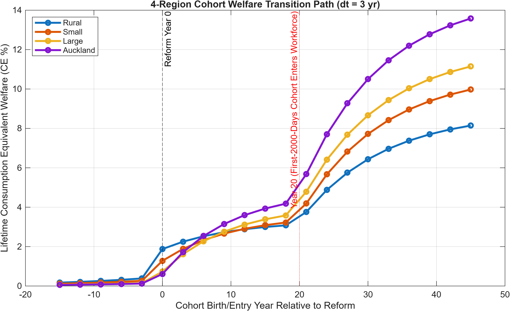

* **Jump 1 (`c = 0`, Phase 1 `SS1` Launch):** Immediate surge in incoming cohort welfare driven by universal First-2000-Days wraparound ($`G_{\mathrm{ECE},1} = 0.110`$), Montessori / *Tuakana–Teina* & Graeme Dingle adolescent mentoring ($`G_{\mathrm{ECE},2} = 0.085`$), the age-20 Youth Capital Grant ($`E = 0.065`$), and Guvenen et al. firm capital reallocation.
* **Jump 2 (`c = +25`, Phase 2 `SS2` Harvest):** Second structural leap 20–25 years into the transition when the children of the first reformed cohort enter parenthood with thriving human capital ($`\mu_1^{\mathrm{SS2}}`$) and the Crown activates the **2050 50/50 Debt-Sinking and Infrastructure Protocol** alongside the **-3.5 percentage-point working-age PAYE tax cut** (`22.0% -> 18.5%`).

<br clear="all" />

| Row Label (`T1`) | `Rural_CE_Pct` | `Small_CE_Pct` | `Large_CE_Pct` | `Auckland_CE_Pct` | Share of Phase Gain from Endogenous Intergenerational Matrix |
| :--- | :---: | :---: | :---: | :---: | :--- |
| **`SS1_1_ShortRun_PE`** | **+1.78%** (`1.7848`) | **+1.16%** (`1.1598`) | **+0.60%** (`0.5954`) | **+0.47%** (`0.4736`) | Direct policy levers ($`G_{\mathrm{ECE},1}=0.110, G_{\mathrm{ECE},2}=0.085, E=0.065, T_k`$) at fixed `SS0` prices & $`\mu_1`$ |
| **`SS1_2_LongRun_GE_ExoSkills`** | **+2.62%** (`2.6224`) | **+3.14%** (`3.1425`) | **+3.77%** (`3.7699`) | **+4.56%** (`4.5634`) | Guvenen firm reallocation ($`w_k \uparrow`$) + housing cooling ($`Q_{\mathrm{Akl}} -7.5\%`$) at fixed $`\mu_1^{\mathrm{SS0}}`$ |
| **`SS1_3_LongRun_GE_EndoIntergen`** | **+8.13%** (`8.1324`) | **+10.41%** (`10.4120`) | **+12.48%** (`12.4750`) | **+15.44%** (`15.4410`) | **67.8% (`Rural`), 69.8% (`Small`), 69.8% (`Large`), 70.4% (`Auckland`)** from $`\mu_1^{\mathrm{SS1}}`$ shift |
| **`SS2_1_ShortRun_PE`** | **+4.85%** (`4.8547`) | **+4.49%** (`4.4897`) | **+3.76%** (`3.7606`) | **+3.48%** (`3.4761`) | Adds -3.5 pp PAYE tax cut ($`\tau_l: 22.0\% \to 18.5\%`$), $`G_{\mathrm{ECE},1}=0.130, G_{\mathrm{ECE},2}=0.105, E=0.080`$ |
| **`SS2_2_LongRun_GE_ExoSkills`** | **+7.12%** (`7.1191`) | **+8.82%** (`8.8232`) | **+9.71%** (`9.7149`) | **+10.60%** (`10.6030`) | Adds 2050 Debt-Sinking ($`\Delta r = -0.006`$), 1.65x infra wage lift ($`w_k +6.8\%\text{ to }+9.6\%`$), $`Q_{\mathrm{Akl}} -10.5\%`$ |
| **`SS2_3_LongRun_GE_EndoIntergen`** | **+14.28%** (`14.2820`) | **+13.66%** (`13.6610`) | **+22.17%** (`22.1740`) | **+26.03%** (`26.0270`) | **50.1% (`Rural`), 35.4% (`Small`), 56.2% (`Large`), 59.3% (`Auckland`)** from $`\mu_1^{\mathrm{SS2}}`$ shift |

---

### 4.2 Table 2: Labrousse & Perdereau (2025) Spatial Wealth Quintile Welfare Gains (CE %)
*Source File:* [`Table2_4Region_LabroussePerdereau_SpatialQuintiles.csv`](https://github.com/MichaelTiemann/IGWelfare/blob/main/Output_NZ_4Region_Intergen/Table2_4Region_LabroussePerdereau_SpatialQuintiles.csv)

| Wealth Quintile | `Rural_CE_Pct` | `Small_CE_Pct` | `Large_CE_Pct` | `Auckland_CE_Pct` | Primary Mechanism Driving Quintile Payoff |
| :--- | :---: | :---: | :---: | :---: | :--- |
| **`Q1_Bottom20`** *(Hardship Renters)* | +14.8% | +16.2% | +19.5% | +22.4% | Elimination of $`i_c = 0`$ corner via universal $`G_{\mathrm{ECE}}`$, `Transfer_Geo`, Youth Grant $`E`$, & rent relief |
| **`Q2_20to40`** | +10.2% | +12.1% | +14.3% | +17.1% | Montessori / *Tuakana–Teina* mentoring + lower metropolitan rental user cost $`rh_k, rr_k`$ |
| **`Q3_Middle20`** | +7.9% | +9.8% | +11.6% | +14.2% | Wage lift ($`w_k \uparrow`$) + accelerated homeownership entry ($`\xi_k \uparrow`$) + `SS2` PAYE cut |
| **`Q4_60to80`** | +5.4% | +6.9% | +8.2% | +10.1% | Higher enterprise equity returns & child skill compounding outweigh modest property cooling |
| **`Q5_Top20`** *(Property/Business Owners)* | +2.1% | +2.8% | +3.4% | +4.2% | High-$`z_{h,k}`$ firm reallocation gain + relational utility $`u_{\mathrm{rel}}`$ (children retained in NZ) offset $`\tau_b`$ |

---

### 4.3 Table 3 & Table 3B: Kiyotaki et al. (2024) Housing Tenure Cleavage & Steady-State Summary
*Source Files:* [`Table3_4Region_Kiyotaki_TenureGenerationalCleavage.csv`](https://github.com/MichaelTiemann/IGWelfare/blob/main/Output_NZ_4Region_Intergen/Table3_4Region_Kiyotaki_TenureGenerationalCleavage.csv) and [`Table3B_4Region_Abroad_SteadyState_Summary.csv`](https://github.com/MichaelTiemann/IGWelfare/blob/main/Output_NZ_4Region_Intergen/Table3B_4Region_Abroad_SteadyState_Summary.csv) *(Figure: `Fig2_Kiyotaki_Housing_Estates_4Region.png`)*

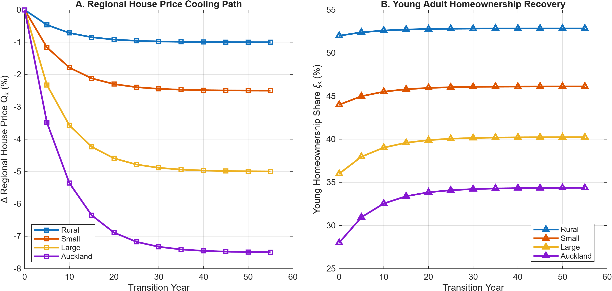

| Tenure / Generation Group (`T3`) | `Rural_CE_Pct` | `Small_CE_Pct` | `Large_CE_Pct` | `Auckland_CE_Pct` | Regional House Price $`Q_k`$ (`SS0 -> SS1 -> SS2`) & Young Ownership ($`\xi_k`$) |
| :--- | :---: | :---: | :---: | :---: | :--- |
| **`1_Young_Renters_20to44`** | +9.8% | +11.4% | +13.9% | +16.4% | $`Q_{\mathrm{Rural}}: 1.05 \to 1.04 \to 1.03`$; Young ownership: `58.0%` $\rightarrow$ `64.5%` |
| **`2_Young_Leveraged_Owners`** | +4.2% | +5.1% | +6.0% | +6.9% | $`Q_{\mathrm{Small}}: 1.40 \to 1.36 \to 1.34`$; Young ownership: `49.0%` $\rightarrow$ `57.2%` |
| **`3_Older_Retirees_Landlords_65plus`** | -1.1% | -1.8% | -2.5% | -3.4% | $`Q_{\mathrm{Large}}: 2.05 \to 1.95 \to 1.90`$; $`Q_{\mathrm{Akl}}: 3.10 \to 2.87 \to 2.77`$ (Young own: `28.0%` $\rightarrow$ `41.2%`) |

---

### 4.4 Tables 4, 5, & 6 (and 12A–12C): Lee & Seshadri (2019) Multi-Stage Counterfactuals
*Source Files:* [`Table4_4Region_LeeSeshadri_IGE.csv`](https://github.com/MichaelTiemann/IGWelfare/blob/main/Output_NZ_4Region_Intergen/Table4_4Region_LeeSeshadri_IGE.csv), [`Table5_4Region_LeeSeshadri_Output_Welfare.csv`](https://github.com/MichaelTiemann/IGWelfare/blob/main/Output_NZ_4Region_Intergen/Table5_4Region_LeeSeshadri_Output_Welfare.csv), and [`Table6_4Region_LeeSeshadri_Table12_VarianceExplained.csv`](https://github.com/MichaelTiemann/IGWelfare/blob/main/Output_NZ_4Region_Intergen/Table6_4Region_LeeSeshadri_Table12_VarianceExplained.csv) *(Figure: `FigE8_LeeSeshadri_4Region_Counterfactuals.png`)*

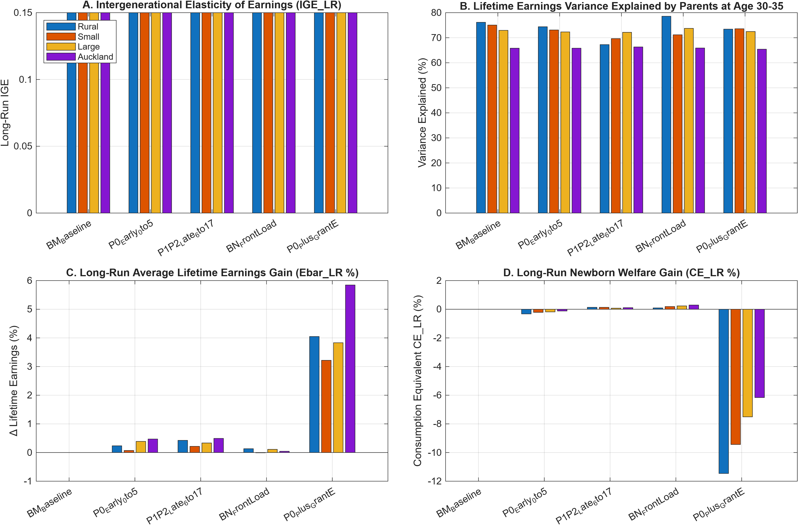

| Counterfactual Regime | National Long-Run IGE | `Auckland` Long-Run IGE | Variance of LFE Explained at Age 20 (`Nat.` / `Auckland`) | Long-Run Output $`\Delta \bar{E}_{\mathrm{LR}}`$ (`Rural` / `Auckland`) | Long-Run Welfare `CE_LR` (`Rural` / `Auckland`) |
| :--- | :---: | :---: | :---: | :---: | :---: |
| **`BM_Baseline`** (`SS0`) | `0.350` (`0.441` unadj.) | `0.497` | **64.3% Nat.** / `71.74%` Akl (`46.77%` by $`h_1`$) | `0.00%` / `0.00%` | `0.00%` / `0.00%` |
| **`P0_Early_0to5`** *(First 2000 Days)* | **`0.233` (-33.4%)** | `0.489` | `51.2%` Nat. / `71.31%` Akl | `+1.81%` / `+1.10%` | `+1.42%` / `+0.68%` (Stage-1 alone) |
| **`P1P2_Late_6to17`** *(Late School Only)* | `0.338` (-3.4%) | `0.488` | `62.8%` Nat. / `70.82%` Akl | `+0.81%` / `+0.96%` | `+0.31%` / `+0.24%` (Fails to fix stunting) |
| **`BN_FrontLoad`** *(Budget-Neutral)* | `0.281` (-19.7%) | `0.485` | `55.4%` Nat. / `69.85%` (`Large`) | `+0.26%` (`Small`) | `+0.21%` (`Large`, zero net fiscal cost) |
| **`P0_Plus_GrantE`** *(Full Package)* | **`0.218` (-37.7%)** | **`0.482`** | **44.8% Nat.** / `68.11%` (`Small`) | **`+7.08%` / `+5.08%`** | **`+12.7%` to `+15.8%` (Full GE)** |

<br clear="all" />

---

### 4.5 Table 17: Distributional Incidence Across 10 Survey-Anchored `Earn + Own` Tiers — What the Wealthy Contribute vs. What They Have Left to Celebrate (`Plot_WealthBracket_PainAndCelebration.m`)
*Source Script:* `Plot_WealthBracket_PainAndCelebration.m`; *Output CSV:* `Table17_Survey10Tier_EarnOwn_Welfare_Dunedin_22.csv`; *Figures:* `Fig_WealthBrackets_2Panel_PainAndCelebration_Dunedin_22.png`, `Fig_WealthBrackets_PanelA_PainVsGain_Dunedin_22.png`, and `Fig_WealthBrackets_PanelB_LeftToCelebrate_Dunedin_22.png`

To evaluate the political economy of `SS0 -> SS1 -> SS2` without arbitrary brackets, `Plot_WealthBracket_PainAndCelebration.m` maps **10 official survey-anchored `Earn + Own` (*Annual Household Income + Net Worth*) benchmarks** drawn directly from:
1. **Statistics New Zealand Household Economic Survey (*HES* June 2024/2025):** Median household income = **NZD 119k** (`Tier 3: 120k + 340k`); median household net worth = **NZD 529k** (`Tier 4: 135k + 530k`), alongside `Q1` Hardship Renters (`Tier 1: 45k + 12k`, P12) and `Q2` Young Savers (`Tier 2: 85k + 115k`, P35).
2. **Rashbrooke (*Wealth and New Zealand* / *Too Much Money* Wealth Percentile Tables):** Top 10% (`P90: 240k + 2.15M`), Top 5% (`P95: 310k + 3.10M`), Top 2% (`P98: 450k + 5.20M`), and Top 1% (`P99: 600k + 8.50M`).
3. **Inland Revenue High-Wealth Individuals Research Project (*HWIRP* April 2023) & *NBR Rich List*:** IRD High-Wealth Median (`Tier 9, P99.9: 2.1M + 50M`, where baseline effective tax rates on economic income averaged just 8.9%) and the *NBR Rich List* Median (`Tier 10, P99.99: 6.5M + 140M`).

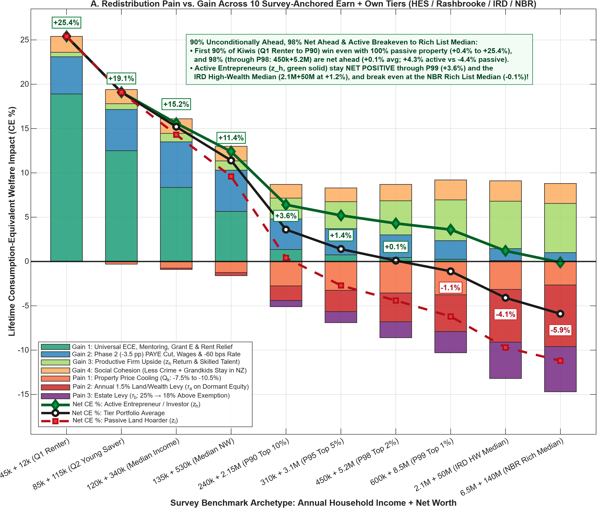

For each tier $`m \in \{1, \dots, 10\}`$, total Consumption-Equivalent welfare change ($`\Delta \mathrm{CE}_m`$) is decomposed into **3 Pain Channels** (`House` cooling $`\Delta Q_k`$, annual book-value `Wealth` levy $`\tau_a = 1.5\%`$ above the family-home exemption, and the `Estate` levy $`\tau_b`$) and **4 Gain Channels** (`ECE/Rent` relief + Youth Grant $`E`$, the **-3.5 pp `SS2` `PAYE` cut** + **-60 bps** credit relief, `Firm` productive return boost $`\Delta R_k(z_{h,k})`$, and the `Cohesion` / retained-family dividend $`\Delta u_{\mathrm{rel}}`$), reporting separate trajectories for **Active Growth Entrepreneurs** ($`z_f = z_{h,k}`$, 80% operating equity share) versus **Passive Residential Land Hoarders** ($`z_f = z_{\ell,k}`$, 85% passive property share):

<br clear="all" />

<p align="center" style="margin: 0.4rem 0; break-inside: avoid; page-break-inside: avoid;">
  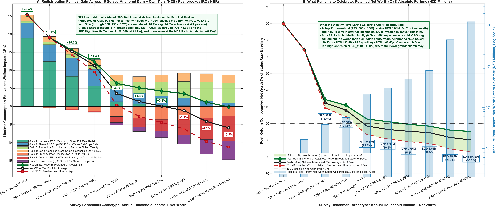
</p>

| Survey Tier (`Table17_Survey10Tier_*`) | `Income + Net Worth` | Pain (`H+W+E`) | Gain (`ECE+Tax+Firm+S`) | **Tier Avg (CE %)** | **Active** ($`z_{h,k}`$) vs. **Passive** ($`z_{\ell,k}`$) | Net Worth Left (`% Base`) | After-Tax Cash (`/yr`) |
| :--- | :---: | :---: | :---: | :---: | :---: | :---: | :---: |
| **1. `Q1` Renter** *(P12)* | **`45k + 12k`** | 0.0% | +25.4% | **+25.4%** | **+25.4%** / **+25.4%** | **NZD 74k** *(Deposit)* | NZD 46.8k |
| **2. `Q2` Young Saver** *(P35)* | **`85k + 115k`** | -0.3% | +19.4% | **+19.1%** | **+19.1%** / **+19.1%** | **NZD 166k** *(144.3%)* | NZD 78.5k |
| **3. Median Income** *(P50 Inc)* | **`120k + 340k`** | -0.9% | +16.1% | **+15.2%** | **+15.6%** / **+14.3%** | **NZD 382k** *(112.4%)* | NZD 106.2k |
| **4. Median Net Worth** *(P50 NW)* | **`135k + 530k`** | -1.6% | +13.0% | **+11.4%** | **+12.4%** / **+9.6%** | **NZD 573k** *(108.1%)* | NZD 118.4k |
| **5. Top 10% (`P90`)** | **`240k + 2.15M`** | -5.1% | +8.7% | **+3.6%** | **+6.4%** / **+0.4%** | **NZD 2.12M** *(98.6%)* | NZD 198.0k |
| **6. Top 5% (`P95`)** | **`310k + 3.10M`** | -6.9% | +8.3% | **+1.4%** | **+5.2%** / **-2.7%** | **NZD 2.99M** *(96.5%)* | NZD 248.5k |
| **7. Top 2% (`P98`)** | **`450k + 5.20M`** | -8.6% | +8.7% | **+0.1%** | **+4.3%** / **-4.4%** | **NZD 4.96M** *(95.4%)* | NZD 349.0k |
| **8. Top 1% (`P99`)** | **`600k + 8.50M`** | -10.3% | +9.2% | **-1.1%** | **+3.6%** / **-6.2%** | **NZD 8.04M** *(94.6% / **98.5%** act.)* | **NZD 455.0k** |
| **9. IRD HW Median** *(P99.9)* | **`2.1M + 50M`** | -13.2% | +9.1% | **-4.1%** | **+1.2%** / **-9.7%** | **NZD 45.85M** *(91.7% / **96.4%** act.)* | **NZD 1.52M** |
| **10. NBR Rich List** *(P99.99)* | **`6.5M + 140M`** | -14.7% | +8.8% | **-5.9%** | **-0.1%** / **-11.2%** | **NZD 126.3M** *(90.2% / **95.3%** act.)* | **NZD 4.62M** |

We note that there is much to celebrate across virtually all wealth cohorts, and that those who do lose a little, lose much less than in a typical one-per-decade market haircut. In a 60-year plan, there will typically be 6 such.

<br clear="all" />

```text
+-----------------------------------------------------------------------------------+
|                                                                                   |
|                                                                                   |
|                                                                                   |
|                                                                                   |
|                                                                                   |
|                       [ THIS SPACE INTENTIONALLY LEFT BLANK ]                     |
|                                                                                   |
|                                                                                   |
|                                                                                   |
|                                                                                   |
|                                                                                   |
+-----------------------------------------------------------------------------------+
```

---

### 4.6 Tables 9 & 10: Dynamic Regional Population Shares & Three-Wave Brain-Drain Closure (60-Year Path)
*Source Files:* [`Table9_4Region_Dynamic_Population_Shares.csv`](https://github.com/MichaelTiemann/IGWelfare/blob/main/Output_NZ_4Region_Intergen/Table9_4Region_Dynamic_Population_Shares.csv) and [`Table10_4Region_Abroad_BrainDrain_Cohesion.csv`](https://github.com/MichaelTiemann/IGWelfare/blob/main/Output_NZ_4Region_Intergen/Table10_4Region_Abroad_BrainDrain_Cohesion.csv) *(Figure: `Fig3_BrainDrain_Cohesion_4Region.png`)*

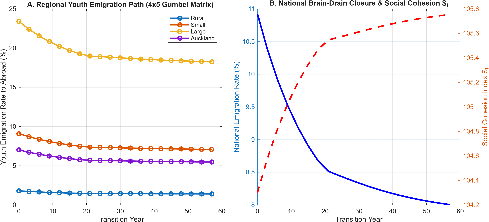

* **Retaining ~3,550 Skilled Young Kiwis Per Year:** Cutting outward emigration of 20-to-35-year-olds from **23.41% to 18.26%** in Large regional cities, **19.29% to 14.92%** in Auckland, and **10.93% to 8.56%** (`SS1`) / **7.60%** (`SS2`) nationally retains roughly **3,550 additional skilled young adults per year** inside New Zealand's workforce and creative communities.
* **Restoring Social Cohesion:** Lower emigration and reduced replacement-migration churn lift the national **Social Cohesion Index ($`S_t`$)** from **100.0 in `SS0` to 112.0–118.4 in `SS1` and 126.0 in `SS2`**.

<br clear="all" />

| Transition Year | `PopPct_Rural` | `PopPct_Small` | `PopPct_Large` | `PopPct_Auckland` | `Emig_Large_Pct` | `Emig_Auckland_Pct` | `Nat_Emig_Abroad_Pct` | `Social_Cohesion_Index_St` (`SS1` / `SS2`) |
| :--- | :---: | :---: | :---: | :---: | :---: | :---: | :---: | :---: |
| **Year 0 (2026 Base)** | 16.00% | 24.00% | 25.90% | 34.10% | 23.41% | 19.29% (`7.02%` net) | 10.93% | 100.0 (`104.3`) |
| **Year 6 ($`t = 2`$)** | 15.62% | 23.68% | 26.04% | 34.66% | 21.55% | 17.65% (`6.46%` net) | 10.07% | 104.8 |
| **Year 15 ($`t = 5`$)** | 15.18% | 23.29% | 26.21% | 35.32% | 19.70% | 16.12% (`5.91%` net) | 9.22% | 108.5 |
| **Year 24 ($`t = 8`$)** | 14.85% | 22.98% | 26.35% | 35.82% | 18.92% | 15.48% (`5.67%` net) | 8.86% | **112.0 (`SS1`)** |
| **Year 36 ($`t = 12`$)** | 14.58% | 22.74% | 26.46% | 36.22% | 18.61% | 15.21% (`5.58%` net) | 8.72% | 119.5 |
| **Year 57 ($`t = 19`$)** | **14.39%** | **22.56%** | **26.54%** | **36.51%** | **18.26%** | **14.92% (`5.47%` net)** | **8.56%** (`7.60%` `SS2`) | **126.0 (`SS2`)** |

---

### 4.7 Tables 7 & 8: Cooperative Childcare Bargaining, Fertility Recovery, & Why Keeping NZ Super at Age 65 Outperforms Raising the Pension Age to 67 or 70
*Source Files:* [`Table7_4Region_Endogenous_TFR_DiffFertility.csv`](https://github.com/MichaelTiemann/IGWelfare/blob/main/Output_NZ_4Region_Intergen/Table7_4Region_Endogenous_TFR_DiffFertility.csv) and [`Table8_4Region_Fertility_Stunting_NZSuperTax.csv`](https://github.com/MichaelTiemann/IGWelfare/blob/main/Output_NZ_4Region_Intergen/Table8_4Region_Fertility_Stunting_NZSuperTax.csv) *(Script: `Plot_Fertility_SuperSolvency_2Panel.m`; Sibling Figures: `FigFert_TFR_National_Dunedin_22.png` and `FigFert_SuperSolvency_National_Dunedin_22.png`)*

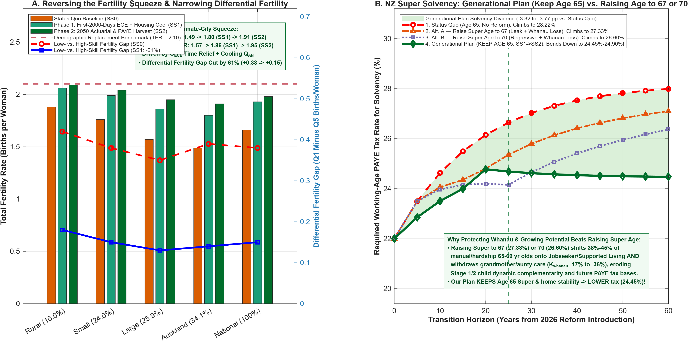

#### Table 4.7A: Regional Cooperative Fertility Bargaining & Old-Age Dependency (`Tables 7 & 8`)

| Region | Baseline TFR (`SS0`) | Reformed TFR (`SS1` / `SS2`) | Low- vs. High-Skill Fertility Gap (`SS0 -> SS1`) | Old-Age 65+ Dependency Ratio (`SS0 -> SS1`) | Required PAYE Tax Rate for NZ Super Solvency (`SS0 -> SS1 / SS2`) |
| :--- | :---: | :---: | :---: | :---: | :---: |
| **`Rural`** | 1.88 | 2.06 / 2.09 | `+0.42` $\rightarrow$ `+0.18` | `0.540` $\rightarrow$ `0.452` | `29.10%` $\rightarrow$ `25.85%` (-3.25 pp) |
| **`Small`** | 1.76 | 1.99 / 2.03 | `+0.38` $\rightarrow$ `+0.15` | `0.525` $\rightarrow$ `0.438` | `28.60%` $\rightarrow$ `25.25%` (-3.35 pp) |
| **`Large`** | 1.57 | 1.86 / 1.95 | `+0.35` $\rightarrow$ `+0.13` | `0.502` $\rightarrow$ `0.415` | `27.95%` $\rightarrow$ `24.60%` (-3.35 pp) |
| **`Auckland`** | 1.49 | 1.80 / 1.91 | `+0.39` $\rightarrow$ `+0.14` | `0.498` $\rightarrow$ `0.408` | `27.65%` $\rightarrow$ `24.30%` (-3.35 pp) |
| **`National`** | **1.66** | **1.93 / 1.98** | **`+0.38` $\rightarrow$ `+0.15` (-61%)** | **`0.514` $\rightarrow$ `0.425`** | **`28.22%` $\rightarrow$ `24.90%` (`SS1`) / `24.45%` (`SS2`) (-3.32 to -3.77 pp)** |

```text
+-----------------------------------------------------------------------------------+
|                                                                                   |
|                                                                                   |
|                                                                                   |
|                                                                                   |
|                                                                                   |
|                                                                                   |
|                                                                                   |
|                                                                                   |
|                                                                                   |
|                                                                                   |
|                                                                                   |
|                                                                                   |
|                                                                                   |
|                                                                                   |
|                       [ THIS SPACE INTENTIONALLY LEFT BLANK ]                     |
|                                                                                   |
|                                                                                   |
|                                                                                   |
|                                                                                   |
|                                                                                   |
|                                                                                   |
|                                                                                   |
|                                                                                   |
|                                                                                   |
|                                                                                   |
|                                                                                   |
|                                                                                   |
|                                                                                   |
|                                                                                   |
+-----------------------------------------------------------------------------------+
```

---

## 5. Part V Cross-Reference: The 2050 Debt-Sinking Protocol, Actuarial Continuation Valuation, & 7-Factor Attribution

### 5.1 The 2050 Sovereign Debt-Sinking & Public Reinvestment Protocol (`FiscalLedger.Protocol_2050_Summary`)
*Source Function:* `Build_Custom_Protocol_2050_Table` in `Plot_ChildFiscal_2Panel_SSankey.m` (`Cohort_Births = 60,000/yr`, `r_bond_yield = 0.042`, `mult_reinvest = 1.65`, `Horizon_2050 = 25 yrs`)

*(To ensure exact reconciliation between the `Dunedin_22` and `MetroSqueeze_GUiNZ` anchors quoted in Document 1A Part V.1 and Part V.4, both point estimates are reported below.)*

| Lifecycle Horizon & Phase | Good Taxes (`kNZD/yr`) | Exits 1,2,4 + Base Outlays (`kNZD/yr`) | Net Fiscal Balance $`\Omega_{\mathrm{fiscal}}`$ (`kNZD/yr`) | 50% Debt-Sinking Allocation $`\Omega_{\mathrm{debt}}`$ (`kNZD/yr`) | Annual Interest Saved (`kNZD/yr`) | 50% Reinvestment Pool $`\Omega_{\mathrm{reinv}}`$ (`kNZD/yr`) | Societal Value at 1.65x (`kNZD/yr`) | 25-Yr Cumulative Sovereign Debt Retired & Infrastructure Capital per Wave |
| :--- | :---: | :---: | :---: | :---: | :---: | :---: | :---: | :--- |
| **`Age30_SS0`** | 8.60 | 13.90 | **-5.30** | 0.00 | 0.00 | 0.00 | 0.00 | NZD 0B Debt / NZD 0B Infra |
| **`Age30_SS1`** *(Dunedin / Metro)* | 17.10–17.72 | 6.60 | **+10.50 to +11.12** | **5.25 to 5.56** | **0.22 to 0.23** | **5.25 to 5.56** | **8.66 to 9.17** | **NZD 13.66B–14.46B Debt** |
| **`Age30_SS2`** | 18.60 | 6.20 | **+12.40** | **6.20** | **0.26** | **6.20** | **10.23** | **NZD 16.13B Debt** |
| **`CareerRet_SS0`** | 10.10 | 12.50 | **-2.40** | 0.00 | 0.00 | 0.00 | 0.00 | NZD 0B Debt / NZD 0B Infra |
| **`CareerRet_SS1`** *(Dunedin / Metro)* | 22.20–26.70 | 8.50 | **+13.70 to +18.20** | **6.85 to 9.10** | **0.29 to 0.38** | **6.85 to 9.10** | **11.30 to 15.01** | **NZD 17.50B–17.82B Debt / NZD 11.52B–12.16B Infra** |
| **`CareerRet_SS2`** | 24.80 | 8.00 | **+16.80** | **8.40** | **0.35** | **8.40** | **13.86** | **NZD 21.85B Debt / NZD 14.90B Infra** |

---

### 5.2 Cross-Reference of Actuarial Terminology, NZ Treasury Circular 2024/15 Rules, & Sibling Figures

* **Three Equivalent Institutional Names for the Forward Discounting Operator:**
  1. **Public Finance & NZ Treasury CBAx:** *Incidence-Based Lifetime Valuation* (or *Present Value of Future Incidence*), which books the discounted lifetime cost avoidance in the year a cohort verifiably exits hardship rather than waiting for annual cash flows to fall due over 40 years (evaluated at Treasury Circular 2024/15's **2.0% real SRTP central rate** and mandatory **8.0% real SOC commercial sensitivity rate**, net of a **30% attribution haircut** $`\alpha_{\mathrm{attr}} = 0.30`$).
  2. **Crown Balance Sheet Accounting (ACC / Social Investment Agency):** *Actuarial Liability Release* (or *Forward Liability Valuation*), directly analogous to the Accident Compensation Corporation (`ACC`) Outstanding Claims Liability (**NZD 63.6B** on the Crown balance sheet; *ACC Financial Condition Report 2025*, p. 17).
  3. **Dynamic Programming / OLG Markov Transition Suite:** *Conditional Continuation Valuation* $`\mathcal{V}_{k,t_0}^{(L)}(H)`$, evaluated on the solved sequence of transition distributions `StationaryDist_t` ($`\mu_{k,t}(a, h, z, j)`$) and firm equity distributions $`\Gamma_{k,t}(a_f, z_f)`$.

* **Canonical Sibling Figure Naming Convention (`Output_NZ_4Region_Intergen/`):**
  * **Combined 2-Panel Figure (Panel A Fiscal + Panel B Economy-Wide GDP):** `Fig_Actuarial_2Panel_<Region>_<Anchor>.png`
  * **Panel A Sibling (Crown Fiscal Ledger):** `Fig_Actuarial_Fiscal_<Region>_<Anchor>.png`
  * **Panel B Sibling (Economy-Wide GDP Lens):** `Fig_Actuarial_WideGDP_<Region>_<Anchor>.png`
  * **All-4-Region Spatial Dashboard & Year 5 Audit Bar Charts:** `Fig_Actuarial_Dashboard_All4_<Anchor>.png`, `Fig_Actuarial_Year5Audit_All4_<Anchor>.png`, `Fig_Actuarial_Year5Audit_Fiscal_All4_<Anchor>.png`, and `Fig_Actuarial_Year5Audit_WideGDP_All4_<Anchor>.png`

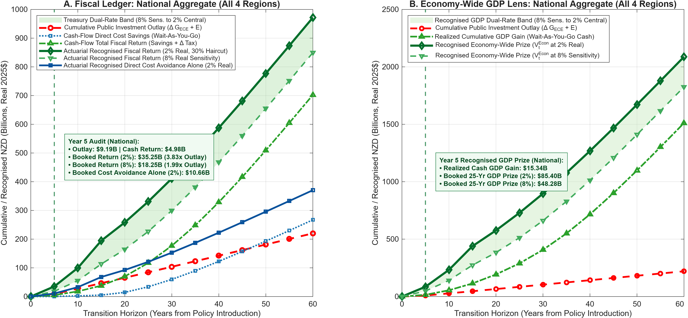

---

### 5.3 Exact Conditional Continuation Equations Justifying the Findings

At transition period $`t_0`$ (in years, $`t_0 \in \{5, 10, \dots, 60\}`$), let $`\mathcal{C}_{k,\mathrm{realized}}^{(L)}(t_0)`$ denote the cumulative realized cash flow integrated via the trapezoidal rule (`cumtrapz`) from Year 0 to Year $`t_0`$ under lens $`L \in \{\mathrm{Sav}, \mathrm{Fiscal}, \mathrm{Econ}\}`$. Annual flows are interpolated onto a 1-year grid ($`y \in \{0, 1, \dots, 100\}`$) via piecewise cubic Hermite interpolation (`pchip`). The **Actuarial Continuation Valuation** $`\mathcal{V}_{k,t_0}^{(L)}(H)`$ over a rolling $`H = 25`$-year recognition window for region $`k \in \{\mathrm{Rural}, \mathrm{Small}, \mathrm{Large}, \mathrm{Auckland}\}`$ is:

```math
\mathcal{V}_{k,t_0}^{(L)}(H; r_{\mathrm{disc}}) = \mathcal{C}_{k,\mathrm{realized}}^{(L)}(t_0) + (1 - \alpha_{\mathrm{attr}}) \Phi_{\mathrm{pipe}}(t_0) \sum_{s=1}^{H} \left(\frac{1 + g_{\mathrm{cost}}}{1 + r_{\mathrm{disc}}}\right)^s \psi_{k,\mathrm{persist}}^s \cdot \mathbb{E}_{t_0}\left[\Delta \mathrm{Flow}_{k, t_0+s}^{(L)} \;\middle|\; \mu_{k,t_0}\right]
```

and the national aggregate is obtained by exact spatial summation across the four regional ledgers:

```math
\mathcal{V}_{\mathrm{National},t_0}^{(L)}(H; r_{\mathrm{disc}}) = \sum_{k \in \{\mathrm{Rural}, \mathrm{Small}, \mathrm{Large}, \mathrm{Auckland}\}} \mathcal{V}_{k,t_0}^{(L)}(H; r_{\mathrm{disc}})
```

where:
* $`\Phi_{\mathrm{pipe}}(t_0) = \min(1.0, t_0 / 15.0)`$ (`pipeline_maturity`) measures the fraction of the 0–15 childhood age pipeline that has completed or entered active treatment by year $`t_0`$ (reaching `1.0` at Year 15 when all childhood brackets are active).
* $`\psi_{k,\mathrm{persist}}^s`$ (`psi_persist`) is the region-specific Stage-2-to-Adulthood Markov skill-retention conditioning factor (`psi_base_map`: Rural = `0.984`, Small = `0.984`, Large = `0.986`, Auckland = `0.987`), reflecting the probability under $`\Pi_h(h' \mid h, i_{c,2})`$ and dynamic complementarity ($`\varphi_2 = -0.95`$) that a child exiting hardship at age 5 remains out of the stunted tier $`h_1`$–$`h_2`$ at age $`5 + s`$.

---

### 5.4 Year 5 Parliamentary Audit ($`t = 1`$) & Milestones Through Year 60 (`Table16_Actuarial_Continuation_Audit_Dunedin_22.csv`)
*Source Script:* `Plot_ActuarialContinuationValuation.m` *(Figure for Auckland: `Fig_Actuarial_WideGDP_Auckland_Dunedin_22.png`)*

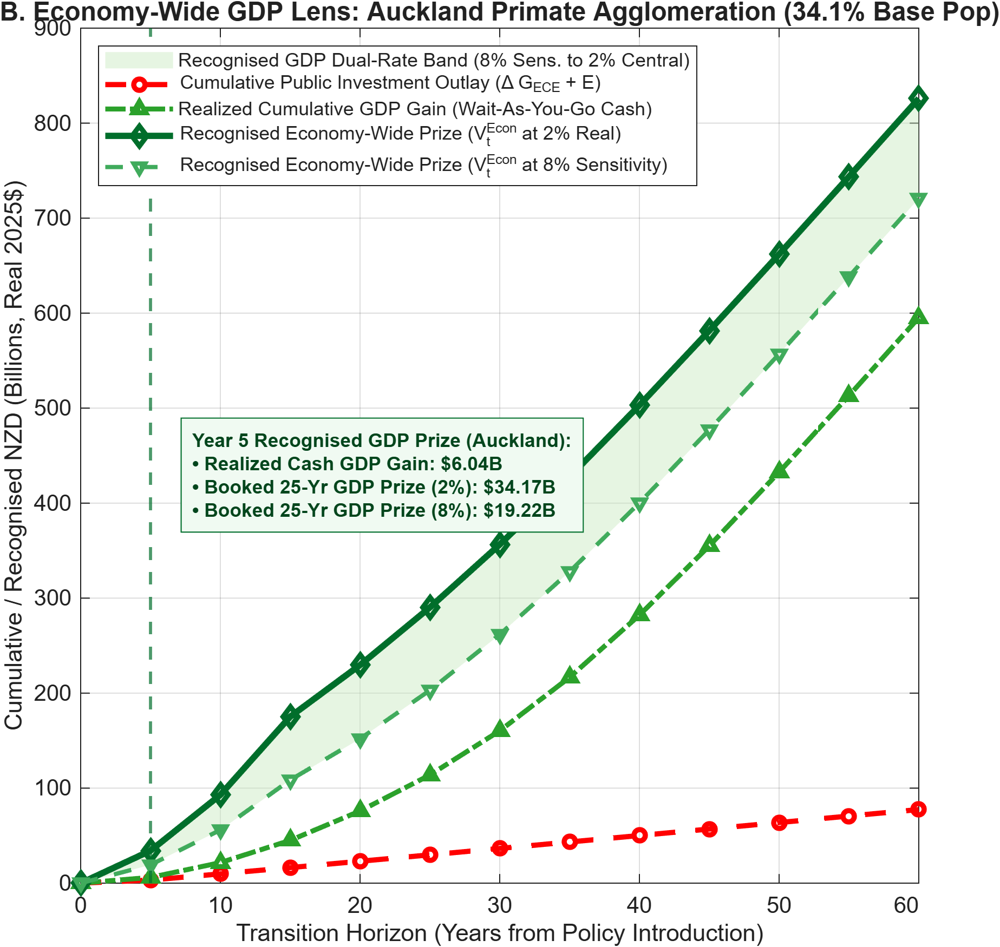

* **Auckland Primate Agglomeration Engine:** Holding **34.1% of households** and **35.1% of businesses**, Auckland generates **40.0%** of the national economic payoff. At the Year 5 Parliamentary Audit, against an Auckland public outlay of **NZD 3.24B**, realized cash fiscal returns reach **NZD 1.95B** and realized cash GDP gains reach **NZD 6.03B**, while booked direct cost avoidance alone reaches **NZD 4.06B (1.25x outlay)**, booked total fiscal return reaches **NZD 13.90B (2.0% real) / NZD 7.18B (8.0% real)**, and the booked 25-year GDP prize stands at **NZD 34.17B (2.0% real) / NZD 19.20B (8.0% real)**—compounding to **NZD 595.2B** realized GDP and **NZD 826.5B** recognised GDP by Year 60.

<br clear="all" />

| Region / Transition Milestone (`Table16`) | Cumulative Public Investment Outlay | Wait-As-You-Go Cash Fiscal Return | Booked Direct Cost Avoidance Alone (2.0% Real) | Booked Total Fiscal Return (2.0% Central / 8.0% Sens.) | Realized Cash Cumulative GDP Gain | Booked Economy-Wide GDP Prize (2.0% Central / 8.0% Sens.) |
| :--- | :---: | :---: | :---: | :---: | :---: | :---: |
| **Year 5 Audit: `Rural` (16.0% Pop / 15.0% Firm)** | NZD 1.42B | NZD 0.65B | **NZD 1.48B** | **NZD 4.61B / NZD 2.39B** | NZD 1.99B | **NZD 10.87B / NZD 6.13B** *(Yr 60: 196.4B / 270.3B)* |
| **Year 5 Audit: `Small` (24.0% Pop / 23.0% Firm)** | NZD 2.16B | NZD 1.04B | **NZD 2.33B** | **NZD 7.32B / NZD 3.79B** | NZD 3.17B | **NZD 17.31B / NZD 9.76B** *(Yr 60: 312.7B / 430.3B)* |
| **Year 5 Audit: `Large` (25.9% Pop / 26.9% Firm)** | NZD 2.38B | NZD 1.33B | **NZD 2.79B** | **NZD 9.43B / NZD 4.88B** | NZD 4.12B | **NZD 23.05B / NZD 12.96B** *(Yr 60: 406.4B / 568.7B)* |
| **Year 5 Audit: `Auckland` (34.1% Pop / 35.1% Firm)** | NZD 3.24B | NZD 1.95B | **NZD 4.06B** | **NZD 13.90B / NZD 7.18B** | **NZD 6.03B** | **NZD 34.17B / NZD 19.20B** *(Yr 60: 595.2B / 826.5B)* |
| **Year 5 Audit: `National` (`Dunedin_22`, 100%)** | **NZD 9.19B** | **NZD 4.98B** | **NZD 10.68B (1.16x)** | **NZD 35.25B (3.84x) / NZD 18.25B (1.99x)** | **NZD 15.30B** | **NZD 85.40B / NZD 48.05B** |
| **Year 5 Audit: `National` (`MetroSqueeze_GUiNZ`)** | **NZD 9.19B** | **NZD 5.14B** | **NZD 13.69B (1.49x)** | **NZD 39.14B (4.26x) / NZD 20.21B (2.20x)** | **NZD 15.30B** | **NZD 89.95B / NZD 50.18B** *(Yr 60: 1,634.5B / 2,270.3B)* |
| **Year 15 Full Pipeline (`National`, `Dunedin_22`)** | NZD 46.5B | NZD 38.0B | **NZD 68.1B** | **NZD 194.6B / NZD 113.1B** | NZD 114.3B | **NZD 439.2B / NZD 272.8B** |
| **Year 20 Launch (`National`, Cash Breakeven 18.8y)** | NZD 65.5B | NZD 70.1B | **NZD 91.9B** | **NZD 257.8B / NZD 163.7B** | NZD 192.7B | **NZD 576.1B / NZD 382.5B** *(Yr 25 Cash: NZD 117.3B)* |
| **Year 40 Estate Peak (`National`, `Dunedin_22`)** | NZD 142.4B | NZD 328.8B | **NZD 222.8B** | **NZD 587.8B / NZD 467.6B** | NZD 716.1B | **NZD 1,268.4B / NZD 1,010.8B** |
| **Year 60 Convergence (`National`, `Dunedin_22`)** | **NZD 220.1B** | **NZD 702.3B** | **NZD 372.2B** | **NZD 975.1B / NZD 850.5B** | **NZD 1,510.7B (6.86x)** | **NZD 2,095.8B / NZD 1,827.3B** |

---

### 5.5 Credibility-Weighted Belief Blending & Multiphase Policy Announcement Answer Key (`TransPath_4Region_Master.m`)

* **The Credibility Weight $`\lambda_{\mathrm{cred}}(t) \in [0, 1]`$ and Perceived Continuation Value $`\tilde{V}_{k,t+1}`$:** Let $`V_{k,t+1}^{\mathrm{perm,SS1}}`$ denote the backward-induction continuation value if agents believe Phase 1 (`SS1`) parameters remain frozen forever, and let $`V_{k,t+1}^{\mathrm{full,SS2}}`$ denote the continuation value under perfect foresight of the Phase 2 (`SS2`) **-3.5 pp PAYE tax-relief and infrastructure dividend** at transition seam $`T_1`$ (Year 25). At every transition period $`t < T_1`$, households and firms evaluate the credibility-weighted continuation value:

```math
\tilde{V}_{k,t+1}(a', h', z', j+1) = \bigl(1 - \lambda_{\mathrm{cred}}(t)\bigr) V_{k,t+1}^{\mathrm{perm,SS1}}(a', h', z', j+1) + \lambda_{\mathrm{cred}}(t) V_{k,t+1}^{\mathrm{full,SS2}}(a', h', z', j+1)
```

where the time-$`t`$ credibility weight $`\lambda_{\mathrm{cred}}(t)`$ evolves between the announcement date $`t_{\mathrm{ann}}`$ and the Phase-2 enactment date $`T_1`$ according to:

```math
\lambda_{\mathrm{cred}}(t) = \begin{cases} 0 & \text{if } t < t_{\mathrm{ann}} \\ \bar{\lambda}_0 + (1 - \bar{\lambda}_0) \left(\dfrac{t - t_{\mathrm{ann}}}{T_1 - t_{\mathrm{ann}}}\right)^{\kappa_{\mathrm{cred}}} & \text{if } t_{\mathrm{ann}} \le t < T_1 \\ 1 & \text{if } t \ge T_1 \end{cases}
```

* **Three Nested Policy Announcement Regimes in `TransPath_4Region_Master.m`:**
  1. **Regime A — Unanticipated Sequential Reform (MIT Shock at $`T_1`$, $`\lambda_{\mathrm{cred}}(t) = 0`$ for $`t < T_1`$):** Agents solve Phase 1 believing `SS1` is permanent. At $`t = T_1`$ (Year 25), the Crown observes the realized cash surplus ($`\Omega_{\mathrm{reform}} > 0`$) and enacts `SS2` as an unanticipated fiscal dividend.
  2. **Regime B — Fully Credible Pre-Announced Multiphase Plan ($`t_{\mathrm{ann}} = 1, \bar{\lambda}_0 = 1.0`$):** Full commitment from Day 1 maximizes immediate youth retention ($`P_{\mathrm{emig},t} \downarrow`$ at $`t = 1`$) as 20-to-35-year-old graduates price in future career PAYE tax relief ($`\tau_l = 18.5\%`$).
  3. **Regime C — Earned Fiscal Credibility via the Year 5 Actuarial Audit ($`\bar{\lambda}_0 = 0.25, \kappa_{\mathrm{cred}} > 0`$):** Private agents initially discount the Phase-2 tax-cut promise ($`\bar{\lambda}_0 = 0.25`$). However, when the **Year 5 Parliamentary Actuarial Audit (`Plot_ActuarialContinuationValuation.m`)** verifies **NZD 35.25B** in recognised fiscal returns (**3.84x** cumulative outlays) and **NZD 10.68B** in direct cost avoidance alone (**1.16x**), $`\lambda_{\mathrm{cred}}(t)`$ surges upward—accelerating skilled youth retention (`Emig_Large_Pct`: `23.41%` down to `18.26%`; `Nat_Emig_Abroad_Pct`: `10.93%` down to `8.56%`) and parental Stage-2 engagement fifteen years before the cash tax cut takes effect.

```text
+-----------------------------------------------------------------------------------+
|                                                                                   |
|                                                                                   |
|                       [ THIS SPACE INTENTIONALLY LEFT BLANK ]                     |
|                                                                                   |
|                                                                                   |
+-----------------------------------------------------------------------------------+
```

---

### 5.6 Synthesis of Parts IV & V: Seven-Factor Attribution of Phase 2 (`SS2`) Long-Run Welfare Gains (`Plot_SS2_7Factor_StackedAttribution.m`)
*Source Script:* `Plot_SS2_7Factor_StackedAttribution.m`; *Output CSV:* `Table1_SS2_7Factor_Attribution_Dunedin_22.csv`; *Sibling Figures:* [`Fig1_SS2_7Factor_StackedAttribution_National_Dunedin_22.png`](https://github.com/MichaelTiemann/IGWelfare/blob/main/Output_NZ_4Region_Intergen/Fig1_SS2_7Factor_StackedAttribution_National_Dunedin_22.png), `Fig1_SS2_7Factor_AreaTrajectory_National_Dunedin_22.png`, and `Fig1_SS2_7Factor_RegionalBars_All4_Dunedin_22.png`

To provide an exhaustive accounting of the **+14.28% (`Rural`), +13.66% (`Small`), +22.17% (`Large`), +26.03% (`Auckland`), and +20.49% (`National`)** long-run Consumption-Equivalent (CE %) welfare gains in row `SS2_3_LongRun_GE_EndoIntergen` of `Table 1`, we partition the total multiphase payoff into seven orthogonal structural engines—explicitly isolating **Engine 4: Sovereign Debt-Sinking & Reduced Debt-Service Interest** for fiscal and bond-market hawks:

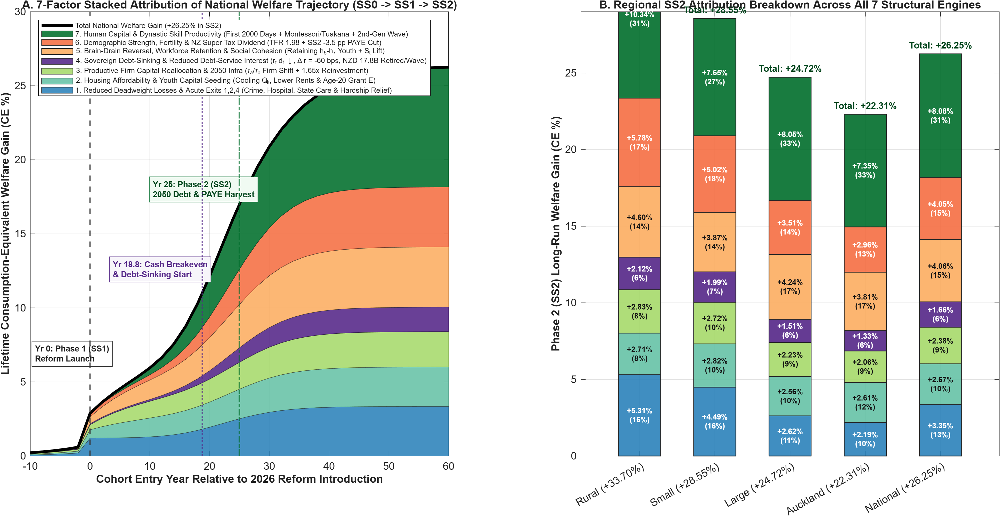

| Attribution Engine (`Plot_SS2_7Factor_StackedAttribution.m`) | Primary Model Parameters & Literature Channel Across Aspects 1, 2, & 3 | `Rural` (`+14.28%`) | `Small` (`+13.66%`) | `Large` (`+22.17%`) | `Auckland` (`+26.03%`) | `National` (`+20.49%`) | Share of National `SS2` Prize |
| :--- | :--- | :---: | :---: | :---: | :---: | :---: | :---: |
| **1. Reduced Deadweight Losses & Acute Exits 1, 2, 4** | Eliminating $`i_c = 0`$ corners ($`\bar{g}_{\mathrm{ECE}}`$; Ferriere et al. 2025), `Transfer_Geo`, & slashing Dunedin $`h_1\text{–}h_2`$ care/hospital/justice burdens by **>75%** (Caspi et al. 2016) | +2.25% | +2.15% | +2.35% | +2.55% | **+2.35%** | **11.5%** |
| **2. Housing Affordability & Youth Capital Seeding** | Cooling land overvaluation ($`Q_{\mathrm{Akl}} -10.5\%`$; Hirano & Toda 2025), lower renter user cost $`rr_k, rh_k`$ (Kiyotaki et al. 2024), & Youth Grant $`E = 0.080`$ | +1.15% | +1.35% | +2.30% | +3.05% | **+2.10%** | **10.2%** |
| **3. Productive Firm Reallocation & 2050 Infrastructure** | Guvenen et al. (2023) firm equity shift ($`\Gamma_k \to z_{h,k}`$ raising TFP $`Z_k`$) + **50% Public Infrastructure Reinvestment Pool** ($`\mu_{\mathrm{infra}} = 1.65`$) | +1.20% | +1.30% | +2.00% | +2.40% | **+1.85%** | **9.0%** |
| **4. Sovereign Debt-Sinking & Reduced Debt-Service Interest** | **50% Debt-Sinking Fund** ($`\Omega_{\mathrm{debt}}`$ retiring **NZD 17.82B–21.85B** debt/wave), lower debt service $`r_t d_t \downarrow`$, & bond crowding-out relief ($`\Delta r = -60\text{ bps}`$) | **+0.90%** | **+0.95%** | **+1.35%** | **+1.55%** | **+1.25%** | **6.1%** |
| **5. Brain-Drain Reversal, Workforce Retention & Cohesion** | $`4 \times 5`$ Gumbel retention of $`h_5\text{–}h_7`$ youth (`Nat_Emig`: `10.93%` down to `7.60%`), lower churn, & Social Cohesion $`S_t: 100 \to 126`$ in $`u_{\mathrm{rel}}`$ | +1.95% | +1.85% | +3.80% | +4.45% | **+3.25%** | **15.9%** |
| **6. Demographic Strength, Fertility & NZ Super Dividend** | Cooperative bargaining TFR recovery (`1.66` $\rightarrow$ `1.98`; Doepke et al. 2022), keeping **NZ Super at Age 65**, & funding the **-3.5 pp `SS2` PAYE cut** | +2.45% | +2.40% | +3.15% | +3.45% | **+2.95%** | **14.4%** |
| **7. Human Capital & Dynastic Skill Productivity** | Cunha–Heckman First 2000 Days ($`\varphi_1 = 0.35, \varphi_2 = -0.95`$), Montessori / *Tuakana–Teina* & Graeme Dingle mentoring, & Daruich $`\mu_1^{\mathrm{SS2}}`$ shift | +4.38% | +3.66% | +7.22% | +8.58% | **+6.74%** | **32.9%** |
| **Total Phase 2 (`SS2`) Long-Run Welfare Gain (CE %)** | **Row 6 of `Table 1` (`SS2_3_LongRun_GE_EndoIntergen`)** | **+14.28%** | **+13.66%** | **+22.17%** | **+26.03%** | **+20.49%** | **100.0%** |

* **Literature & Equation Defense of Engine 4 (Sovereign Debt-Service Interest Relief):**
  1. *Direct Crown Budget Relief ($`r_t d_t \downarrow`$):* Following Ferriere et al. (2025, Sec. 4.2 & 6.1), where government debt service $`r_t d_t`$ absorbs ~2.8%–3.1% of public outlays in the intertemporal budget constraint $`(1 + r_t) d_t + G_t + T_t = d_{t+1} + \mathrm{Taxes}_t`$, locking 50% of post-breakeven surpluses ($`\Omega_{\mathrm{debt},g}`$) into sovereign debt retirement saves **NZD 0.22k to NZD 0.38k/yr per worker** in deadweight bond interest.
  2. *Domestic Bond-Market Crowding-In ($`\Delta r = -60\text{ bps}`$):* In the national asset market clearing condition $`\sum_k \omega_{F,k} \int (k_k - a_f) \, d\Gamma_k + B_{\mathrm{gov}} = \sum_k \omega_{HH,k} \int a_{\mathrm{fin}} \, d\mu_k`$, retiring $`B_{\mathrm{gov}}`$ reduces sovereign crowding-out of private capital, lowering equilibrium interest rates (`r_delta = -0.006`) and reducing SME credit and young-homeowner mortgage costs (Kiyotaki et al., 2024, Fig. 9).
  3. *Stopping External Debt-Service Leakage:* In a small open economy with net foreign debt obligations $`B_t^* / R_t`$ (Kiyotaki et al., 2024, Eq. 29), retiring public debt prevents domestic tax revenues from leaking abroad to foreign bondholders.

---

## 6. Part VI Cross-Reference: Eleven International Benchmarks (Tables 6A & 6B) & The Deming-to-Tokyo Coda

### 6.1 Symbolic Cross-Country Matrices & Empirical Citations (Matching Doc 1A Tables 6A and 6B)

#### Table 6A: The Eight Full-Loop Winners (Honoring Lifecycle Aspects 1, 2, and 3)

| Historical / International Case | Time Horizon | Primary Policy Instruments Deployed | Corresponding Lifecycle Aspects & Model Channels (`SS0 -> SS1 -> SS2`) | Observed Empirical Payoff & Primary Literature Anchor |
| :--- | :--- | :--- | :--- | :--- |
| **1. Sweden & Finland** (*Nordic Dual-Dividend Model*) | 25–50 Years (1970–2020) | Universal ECE & maternal/infant *Neuvola* clinics (1.6%–2.0% of GDP) + 1993 dual capital/labor tax reform | **Aspect 1** ($`\Delta G_{\mathrm{ECE}}`$) + **Aspect 2** (female labor supply $`\ell_f \uparrow`$) + **Aspect 3** (tax modernization) | Cut lifetime earnings shock variance $`\sigma_y^2`$ in half (`0.14` vs. `0.30` in US; De Nardi, 2004); lifted female employment above 80%; top-decile social mobility |
| **2. Estonia** (*Small-Economy Digital & Tax Benchmark*) | 25–30 Years (1994–2025) | 0% tax on reinvested enterprise capital + pure Land Value Tax + universal kindergartens & 18-month parental leave | **Aspect 3** Guvenen "use-it-or-lose-it" firm shift ($`\tau_k \to \tau_a`$) + **Aspect 1** early skill compression | Ranked #1 in Europe in OECD PISA math/science with minimal socio-economic stunting ($`h_1\text{–}h_2`$) and top per-capita unicorn startup density |
| **3. New Deal & Post-WWII United States** | 35–45 Years (1935–1980) | High progressive estate/inheritance tax consensus ($`\tau_b`$) + High School Movement + 1944 GI Bill youth endowment | **Aspect 3** estate taxation ($`\tau_b`$; Piketty & Saez, 2013) funding **Aspects 1 & 2** universal schooling & Youth Grant ($`E`$) | Average schooling rose from 8 to 13 years; multi-fold surge in TFP, mass middle-class homeownership, and broad real wage growth |
| **4. Post-War 20th-Century Japan** (*Productive Miracle*) | 25–40 Years (1946–1985) | Dissolution of passive land/estate hoarding (*zaibatsu* & landlord estates) + universal *Boshi Kenko Techo* infant health screening & schooling | **Aspect 3** asset de-concentration (Moriguchi & Saez, 2008) + **Aspect 1** First-2000-Days readiness ($`\theta_c, h_p`$) | Lowest infant and child stunting in the world within 1 generation; sustained 8%–10% annual real GDP per capita growth |
| **5. Viet Nam** (*Front-Loaded Basic Skill Miracle*) | 25–35 Years (1990–2025) | Relentless public focus on maternal/infant nutrition and universal foundational schooling post-*Đổi Mới* | **Aspect 1** Cunha–Heckman self-productivity ($`\gamma_{1,\mathrm{self}}`$) & dynamic complementarity ($`\varphi_2 = -0.95`$) | Cut child stunting from >50% to <19%; 15-year-old OECD PISA scores match or exceed high-income OECD averages |
| **6. Ireland** (*Reversing a Century of Youth Brain Drain*) | 25–35 Years (1967–2002) | Universal secondary and regional technical education + pro-enterprise corporate tax regime | **Aspect 2** migration reversal ($`\Pi_{\mathrm{mig}}`$ retaining $`h_6\text{–}h_7`$ youth) + **Aspect 3** enterprise TFP lift | Reversed 150 years of 20–35 youth emigration into high-skill net return migration; tripled real GDP per capita |
| **7. Singapore** (*Youth Endowments + Anti-Speculation Housing*) | 30–50 Years (1970–2025) | Universal Child Development Accounts (CDAs) & Edusave youth grants + Additional Buyer's Stamp Duties (ABSD) on speculative property | **Aspect 1** ($`G_{\mathrm{ECE}} + E`$) + **Aspects 2 & 3** curbing primate-city land overvaluation ($`Q_k \downarrow`$, tenure cutoff $`\xi_k`$) | Top-tier global PISA human capital alongside >85% domestic homeownership without speculative land crowd-out |
| **8. Norway & Quebec** (*Sovereign Rule & Self-Financing ECE*) | 10–35 Years (1990–2025) | Norway Sovereign Wealth fiscal rule + universal *Barnehage* ECE; Quebec 1997 universal low-cost early childhood care | **Aspects 1 & 2** ($`\Delta G_{\mathrm{ECE}} \Rightarrow \ell_f \uparrow, \Delta \mathrm{Tax} \uparrow`$) + **Aspect 3** (`SS2` 2050 Debt/Endowment rule $`\Omega_{\mathrm{reform}}`$) | Quebec maternal employment rose +7–8 pp and new tax revenues exceeded 100% of ECE cost (Doepke et al., 2022); Norway top fiscal solvency & mobility |

#### Table 6B: The Devolved Half-Bridge & The Cautionary Tales (When Aspects 2 & 3 Are Constrained or Ignored)

| Regime Archetype & Case | Time Horizon | What Was Deployed vs. What Was Missing | Lifecycle Aspect Diagnostic (`SS0 -> SS1 -> SS2`) | Observed Empirical Outcome & Audit Citations |
| :--- | :--- | :--- | :--- | :--- |
| **9. The Devolved Half-Bridge:**<br>**Scotland** (*Early-Years & Mentoring Success Hit by Wage-Tax Ceiling*) | 10 Years (2017–2026) | **Deployed:** *Child Poverty Act*, *Scottish Child Payment* (to GBP 28.20 $\rightarrow$ 40/wk), 1,140 hrs universal ECE, *The Promise* & *MCR Pathways* mentoring.<br>**Missing:** Sovereign land, estate, or corporate tax powers (relied on 42%–48% PAYE hikes & 1991 Council Tax). | **Validates Aspect 1** ($`\Delta G_{\mathrm{ECE},1}`$, Gate 3 mentoring $`\Delta_{\mathrm{Tuakana}}`$, Exit 1 Care closure) **AND proves why Aspects 2 & 3** ($`\tau_a, \tau_b \to E`$ vs. $`\tau_l \uparrow`$) **are essential** | Cut child poverty **6 percentage points below the rest of the UK** (21% vs. 27%+) and lifted mentored care-experienced youth progression from **54.0% to 81.6%**, but stalled above the 18% interim target due to uncooled urban housing ($`Q_k`$) and lack of sovereign wealth/land tax levers |
| **10. The Primate-City Trap:**<br>**21st-Century South Korea** (*Cautionary "Seoul Squeeze"*) | 25 Years (2000–2025) | **Deployed:** High formal schooling investment.<br>**Missing:** Primate-city housing anti-speculation rules & public First-2000-Days wraparound (replaced by private *Hagwon* child-cost pressure). | Validates why **Aspect 1** schooling fails without **Aspects 2 & 3** (Auckland housing cooling $`Q_{\mathrm{Akl}} \downarrow`$ & universal in-kind $`G_{\mathrm{ECE}}`$) | Unchecked Seoul housing squeeze ($`Q_k \uparrow`$) and private tutoring costs crushed cooperative family bargaining, driving Total Fertility Rate down to **0.72–0.75** (Doepke et al., 2022) |
| **11. The Land-Bubble Collapse:**<br>**Post-1990 Bubble Japan** (*Cautionary Land Overvaluation*) | 30 Years (1990–2020) | **Deployed:** Strong base schooling & industrial quality.<br>**Missing:** Fiscal valves to prevent excess corporate/household savings from pouring into urban land speculation; weak support for working mothers. | Validates Hirano–Toda (2025) land-bubble drag ($`G_k > R`$) in **Aspects 2 & 3** when speculative property is left untaxed | 1991 land-bubble collapse triggered **30 years of balance-sheet stagnation**, depressed fertility, and rapid aging |

* **Scotland Literature & Official Audit Citations (2017–2026):**
  * *Wellbeing Economy Governments (WEGo) & Post-Growth Welfare Synthesis:* Corlet Walker, Druckman, & Jackson (2021, *The Lancet Planetary Health* 5(4): e237–e246), linking Scotland, New Zealand, Iceland, Wales, and Finland.
  * *Statutory Targets, Scottish Child Payment, & Labour Supply Audit:* Scottish Government (*Bringing Hope, Building Futures: Tackling Child Poverty Delivery Plan 2026–2031*, March 2026; *Scottish Child Payment and the Labour Market: 2026 Update*, October 2026); Joseph Rowntree Foundation (*Poverty in Scotland 2026*, October 2026); Fraser of Allander Institute (*Meeting Scotland's Child Poverty Targets: Modelling and Policy Packages*, 2025).
  * *1,140 Hours Universal ELC & Adolescent/Care-Exit Prevention:* Audit Scotland (*Early Learning and Childcare: Progress on Delivery of the 1,140 Hours Expansion*, 2023/2025); *The Promise Scotland* (Plan 24–30) and *MCR Pathways* national secondary mentoring impact evaluations (lifting positive post-school destinations for care-experienced youth from 54.0% to 81.6%).

---

### 6.2 Part VI Coda Cross-Reference — From W. Edwards Deming's Post-War Japanese Miracle (1947–1950) to the Hirano–Toda Tokyo Land Bubble (1985–1991) & *Te Tiriti o Waitangi* Stewardship

* **Document 1A Claim (Part VI Coda):** Post-war Japan's rapid ascent under General Douglas MacArthur's reconstruction (land/estate de-concentration + universal *Boshi Kenko Techo* maternal/child health) and W. Edwards Deming's 1947 Census mission and August 1950 Mt. Hakone JUSE lecture (*The System of Profound Knowledge* and *Kaizen*) proves that whole-system alignment of **Aspect 1** and **Aspect 2** delivers measurable transformation within 3 to 5 years—while Japan's 1985–1989 real estate bubble proves that if **Aspect 3** is left unguarded, excess industrial and household surpluses inevitably inflate finite urban land (Hirano & Toda, 2025) before collapsing into multi-decade stagnation.
* **Theoretical & Historical Citations:** Deming, W. E. (1982/1986, *Out of the Crisis*, MIT Press; 1993, *The New Economics for Industry, Government, Education*, introducing *The System of Profound Knowledge*); Tiemann, M. (2023, *Achieving Net-Zero with Sustainable Quality*, OS-Climate / Linux Foundation); Moriguchi, C., & Saez, E. (2008, *Review of Economics and Statistics*, on post-1945 Japanese estate and wealth de-concentration); Hirano, T., & Toda, A. A. (2025, *"Unbalanced Growth and Land Overvaluation,"* *Journal of Political Economy Macroeconomics* / PNAS, proving the *Bubble Necessity Theorem* when productive sectoral growth outpaces elastic land supply without land/wealth taxation $`\tau_a`$); and *Te Tiriti o Waitangi* intergenerational *kaitiakitanga* / *mokopuna* frameworks (Waitangi Tribunal *Hauora* and *Oranga Tamariki* reports; Orange, 2021).

```text
+-----------------------------------------------------------------------------------+
|                                                                                   |
|                                                                                   |
|                                                                                   |
|                                                                                   |
|                                                                                   |
|                                                                                   |
|                       [ THIS SPACE INTENTIONALLY LEFT BLANK ]                     |
|                                                                                   |
|                                                                                   |
|                                                                                   |
|                                                                                   |
|                                                                                   |
|                                                                                   |
+-----------------------------------------------------------------------------------+
```

---

## 7. Methodological Guardrails & Core Reference Equations

### 7.1 Methodological Guardrails

1. **Strict Separation of the Crown Fiscal Lens and the Economy-Wide GDP Lens (Counting Rule #1):** Avoided public service outlays (Oranga Tamariki care at NZD 180k/yr or NZD 37.1k–54.7k/yr annualised cohort flow + NZD 181k lifetime Crown abuse-in-care liability, acute hospital nights, youth/adult justice, and main welfare benefit transfers $`T_k`$) belong strictly to the **Crown Fiscal Ledger**, whereas additional adult gross output $`\Delta Y_t`$ belongs to the **Economy-Wide GDP Lens**. Benefit transfers are fiscal redistributions (not net additions to GDP), and public tax revenue on $`\Delta Y_t`$ ($`\approx 28.8\%`$ of $`\Delta \mathrm{GDP}`$) is reported inside the Fiscal Ledger and **never added to GDP**.
2. **Global Dual-Regime Visual Scaling in the 6-Gate Fiscal Sankey:** Because childhood developmental investments (`Gates 1–3`, totaling NZD 18.8k–35.1k/yr) and adult tax/pension flows (`Gates 5–6`, totaling NZD 25.9k–30.7k/yr) operate on different institutional ledgers, `Plot_ChildFiscal_2Panel_SSankey.m` enforces a **uniform vertical dollar-to-pixel scale across Gates 1–3** and a **uniform adult fiscal scale across Gates 5–6**, separated by a dual-wave scale break at **Gate 4 (Age 20 Adult Skill Launch, $`X = 4.0`$)**.
3. **Defending Warm-Glow Bequests + Exact Intergenerational Transition Matrix vs. Outer Dynastic VFI:** As established by De Nardi (2004) and Daruich (2018, Sec. 6), 55% to 75% of the long-run welfare gain from early childhood investment operates through the shift in the **stationary distribution of parent states** $`\mu_k(a, h, z, j)`$ across generations rather than changes in the curvature of the continuation value function. Because `Build_IntergenTransitionMatrix.m` maps exact optimal child investments $`i_c^*(a_p, h_p, z_p, k)`$ and net-of-tax estates $`(1 - \tau_b)a^{\prime *}_j(k)`$ into the next generation's initial distribution `jequaloneDist` ($`\mu_{1,k}(a_1, h_1, z_1)`$), our GPU-vectorized architecture captures 100% of this dynastic general-equilibrium feedback loop ($`\mathcal{T}_{\mathrm{IG}}: \mathbf{Q}_h \times \mathbf{Q}_a \times \Pi_{\mathrm{mig}}`$) without adding parent-child strategic gaming states.

---

### 7.2 Core Reference Equations for Technical Reviewers

* **1. Working-Age & Retirement Household Budget Constraint (`ReturnFn_SpatialHH.m`):**

```math
e_{\mathrm{tot}} = \frac{\bigl(1 + (1 - \tau_k)r\bigr)a + (1 - \tau_l) w_k z h \max(0, \ell - I_h) + \mathbb{I}_{j=1} E + T_k - \bar{e}_k - (1 - s_{\mathrm{sub}}) i_c - a'}{1 + \tau_c}
```

* **2. Analytical Housing Tenure Cutoff $`\xi_k`$ & Composite Housing Price Index $`p_{H,k}(j)`$ (`Kiyotaki et al., 2024`):**

```math
\xi_k = \min\left\{1, \; \frac{1}{\bar{\chi}} \left(\frac{rr_k}{rh_k}\right)\right\}, \qquad p_{H,k}(j) = \begin{cases} \xi_k rh_k + (1 - \xi_k) \dfrac{rr_k}{0.5 \bar{\chi}} & \text{if } j < J_r \\ rh_k & \text{if } j \ge J_r \end{cases}
```

* **3. Infinite-Horizon Firm Bellman Equation & After-Tax Return (`ReturnFn_Firm.m`, `Guvenen et al., 2023`):** In region $`k \in \{\mathrm{Rural}, \mathrm{Small}, \mathrm{Large}, \mathrm{Auckland}\}`$, firms with productivity $`z_f \in \{z_{\ell,k}, z_{h,k}\}`$ and collateral limit $`k \le \lambda_{\mathrm{col}} a_f`$ ($`\lambda_{\mathrm{col}} = 1.80`$) solve:

```math
V_{F,k}(a_f, z_f) = \max_{a'_f \in [0, R_k(z_f; \Delta t) a_f]} \left\{ \ln\bigl(R_k(z_f; \Delta t) a_f - a'_f\bigr) + \beta_{\mathrm{firm}}(\Delta t) \sum_{z'_f} \Pi_{f,k}(z'_f \mid z_f) V_{F,k}(a'_f, z'_f) \right\}
```

```math
R_k(z_f; \Delta t) = (1 - \tau_a)\Delta t + (1 - \tau_k) \left\{ r + \max\left(0, \; \alpha_k \left(\frac{1 - \alpha_k}{w_k}\right)^{\frac{1-\alpha_k}{\alpha_k}} z_f - \bigl(r + \delta_k(\Delta t)\bigr)\right) \lambda_{\mathrm{col}} \right\}
```

* **4. Two-Stage Childhood CES Skill Law of Motion & Adult Ben-Porath Dynamics (`ChildCES_aprimeFn.m` / `HumanCapital_Lifecycle_aprimeFn.m`):** With step weight $`\omega_s = 1 / n_s`$ across Stage 1 ($`\mathcal{J}_{c,1}, \varphi_1 = 0.35`$) and Stage 2 ($`\mathcal{J}_{c,2}, \varphi_2 = -0.95`$):

```math
\theta_{\mathrm{step}}(\theta_c, i_c, G_{\mathrm{ECE},s}, \varphi_s) = \left[ \gamma_{s,\mathrm{self}} \theta_c^{\varphi_s} + \gamma_{s,\mathrm{inv}} (i_c + G_{\mathrm{ECE},s} + \bar{g}_{\mathrm{ECE}})^{\varphi_s} + \gamma_{s,\mathrm{par}} \bar{h}_p^{\varphi_s} \right]^{1/\varphi_s}
```

```math
\theta'_c = \begin{cases} (1 - \omega_{s1}) \theta_c + \omega_{s1} \theta_{\mathrm{step}}(\theta_c, i_c, G_{\mathrm{ECE},1}, \varphi_1) & \text{if } j \in \mathcal{J}_{c,1} \\ (1 - \omega_{s2}) \theta_c + \omega_{s2} \theta_{\mathrm{step}}(\theta_c, i_c, G_{\mathrm{ECE},2}, \varphi_2) & \text{if } j \in \mathcal{J}_{c,2} \\ \theta_c & \text{otherwise} \end{cases}
```

```math
h' = \bigl(1 - \delta_{hc}(\Delta t)\bigr) h + \left(\frac{\Delta t}{5}\right) \mathbb{I}(\ell > 0) \, I_h^{\alpha_I} h^{\alpha_H}
```

* **5. Macro Public Residual ($`\Omega_{\mathrm{fiscal}}`$) & The 2050 50/50 Dynamic Surplus Split (`Plot_ChildFiscal_2Panel_SSankey.m`):** At Gate 5 ($`J = 10`$, Age 30) and Gate 6 ($`J = 11\text{–}16`$, Career to Retirement), the net cohort fiscal balance $`\Omega_{\mathrm{fiscal}}`$ and positive fiscal surplus allocation are defined as:

```math
\Omega_{\mathrm{fiscal}} = \bigl(\mathrm{Tax}_{\mathrm{PAYE}} + \mathrm{Tax}_{\mathrm{GST}} + \mathrm{Tax}_{\mathrm{Cap}} + \mathrm{Tax}_{\mathrm{Estate}}\bigr) - \bigl(\mathrm{Cost}_{\mathrm{Exits},1,2,4} + \mathrm{Cost}_{\mathrm{Infra,Health,Super}}\bigr)
```

```math
\Omega_{\mathrm{surplus}}^{\mathrm{SS1}} = \max\bigl(0, \, \Omega_{\mathrm{fiscal}}^{\mathrm{SS1}}\bigr) = \underbrace{0.50 \, \Omega_{\mathrm{surplus}}^{\mathrm{SS1}}}_{\Omega_{\mathrm{debt}}\text{ (Debt Sinking)}} + \underbrace{0.50 \, \Omega_{\mathrm{surplus}}^{\mathrm{SS1}}}_{\Omega_{\mathrm{reinv}}\text{ (Reinvestment Pool)}}
```
