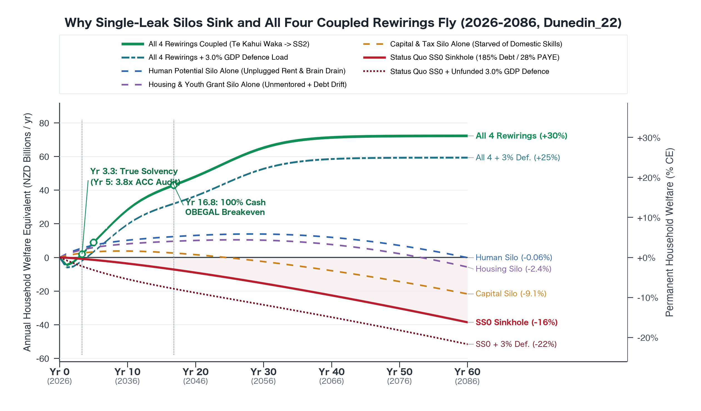

# Flying, Not Floundering: Turning Aotearoa's Four Economic Leaks into One Generational Engine

*Broad-Circulation Executive Case Statement & Guide to the Monograph Suite (4-Region + Abroad, 5-Sector Edition)*

**Author:** [Michael Tiemann](https://github.com/MichaelTiemann) ([mdtiemann@gmail.com](mailto:mdtiemann@gmail.com))  
**Date:** November 2026 | **Code & Replication Repository:** [github.com/MichaelTiemann/IGWelfare](https://github.com/MichaelTiemann/IGWelfare)  
**Disclaimer:** No people nor organizations mentioned herein have endorsed this work unless stated otherwise. This is the work of the author, and all errors and omissions are his alone.

*A shared foundation for Everyday Whānau, Philanthropists, Iwi & Community Leaders, Entrepreneurs & Growth Investors, Energy & Infrastructure Builders, Policy-Makers, Economists, and Creatives & Storytellers*

> *"We have found our new gold. We are standing in the river. We need only lift it up to become rich beyond imagination."*

---

## 1. Two Reports Looking Through Opposite Ends of an 80-Year Telescope

Two landmark assessments currently sit on New Zealand's national desk, and almost nobody is reading them together.

At one end of the table, the New Zealand Treasury's *Long-term Fiscal Statement (He Tirohanga Mokopuna 2025)* and 2026 background papers show the national accounts on a path to fiscal exhaustion. Under status quo policy settings (`SS0`), demographic aging and rising healthcare and pension costs drive net Crown debt toward **185%–200% of GDP**, eroding household welfare by **-16.21% in Consumption-Equivalent (`CE%`) terms** (roughly **-NZD 38.6 billion per year**). Compounding that trajectory is an emerging geopolitical pressure to lift defence spending by **150%—from 1.2% to 3.0% of GDP** (+NZD 8.0B/yr)—which deepens the welfare sinkhole to **-21.69% CE**. Confronted with this arithmetic, conventional fiscal management offers only two austerity knobs: hiking working-age PAYE taxes toward **28.2%–30.7%** (or nearly doubling GST), or raising the New Zealand Superannuation age to the point where a large share of manual, rural, Māori, and Pasifika workers never collect it.

At the other end of the table, [Barnardos Aotearoa](Document%201A.md), the 50-year *Dunedin Multidisciplinary Health and Development Study*, and *Growing Up in New Zealand* document a human crisis that has been compounding since the 1980s. Roughly **25.1% of New Zealand newborns** begin life in early vulnerability—split between **9.5% in Material & Severe Material Hardship** and **15.6% in the Residual After-Housing-Costs (`AHC`) Squeeze**, where metropolitan rents absorb family incomes and nuclear households lack extended *whānau* care buffering. Compounded by a **20.4%–20.6%** adolescent distress bottleneck at ages 12–14, **22.0% to 23.5% of every birth cohort** launches into adulthood struggling (`h1–h2`). Remedying the downstream consequences in Oranga Tamariki state care, avoidable hospital admissions, justice, and long-term benefits already costs the Crown **NZD 17.7 billion every year**—on a trajectory toward **NZD 28.5 billion/yr by 2050**.

These two reports are not describing a "fiscal problem" and a separate "social problem." **They are looking at the exact same broken economic engine from opposite ends of an 80-year telescope.**

### The 30-Second Premise: Stop Financing Leaks, Start Financing Engines

Strip away the jargon, and New Zealand's predicament—and its way out—reduces to three facts anyone can test against kitchen-table experience:

1. **Aotearoa isn't poor; we are leaking cash out of four holes in the hull:** Every year, we send nearly **NZD 20 billion** offshore to burn imported fossil fuels at 30% physical efficiency while letting water pipes rot until they burst; we spend **NZD 180,000/yr** per child in acute state care instead of **NZD 500–13,000/yr** on early wraparound and teen belonging; we bid up **NZD 1.6 trillion** of existing residential land against our own children while exporting a fifth of our young urban graduates to Australia; and we steer the country with a **3-year cash ledger** that books deferred maintenance as "savings" and **6-year partisan repeal swings** that tear up what the last government built.
2. **Every one of those four leaks can be closed with the same balance-sheet logic pioneered on energy by *Rewiring Aotearoa*:** Mike Casey and his colleagues at the independent clean-electrification organization *Rewiring Aotearoa*—a vital inspiration, partner, and leading voice in demonstrating how rapid solar-led electrification delivers over **NZD 10 billion per year** in permanent energy savings—won support across all six parliamentary parties because they didn't lead with moral scolding. They showed a simple **balance-sheet flip**: when a household or farm swaps recurring imported petrol and gas bills for a heat pump, EV, rooftop solar, and battery, domestic electrons do nearly three times the useful physical work per joule ($`e_N = 0.88`$ vs. $`e_F = 0.30`$). Finance the upfront asset cleanly, and the household is cash-flow positive from Day 1. **That exact conversion—replacing an expensive recurring operating burn with a high-return domestic asset—governs our human, enterprise, infrastructure, and fiscal leaks as well.**
3. **If we fix only one leak, we still sink; if we repair all four in sequence, we fly on foils:** When a single-issue coalition plugs just one hole in isolation, the gains pour out the other three holes and get swallowed by the rising fiscal tide. When we close **all four leaks together** across a disciplined 13-wave rollout (*Te Kāhui Waka*), the hull lifts onto hydrofoils—retiring net Crown debt down to **21%–22% of GDP**, cutting working-age PAYE taxes to **18.25%**, lowering universal New Zealand Superannuation to **Age 64**, and lifting permanent household wellbeing by **+24.7% to +31.6% CE (+NZD 59B to +NZD 75B per year)**.

---

## 2. Repairing the Hull: Four Coupled Foils—And Why Single-Leak Fixes Cannot Win

Stepping back from isolated policy debates makes visible why piecemeal reforms keep stalling. Repairing our national hull—and lifting it out of the fiscal drag—requires **Four Coupled Foils**. Each foil plugs a major economic leak on its own, yet none can succeed against the demographic sinkhole without the other three:

| The Four Coupled Foils | The Recurring Status Quo Leak (`SS0` Burn) | The Upfront Capital Switch (`SS1` → `SS2` Engine) | Why Plugging This Leak Alone Fails (Cross-Hole Leakage) |
| :--- | :--- | :--- | :--- |
| **1. Clean Energy & Public Networks** *(Physical & Foreign-Exchange Foil)* | Sending ~NZD 19.5B/yr offshore for ~30%-efficiency oil/coal while deferring water/grid upkeep until pipes burst at 5x–10x emergency cost (or fire-selling monopolies). | Rapid household, farm, & freight electrification (*Rewiring Aotearoa* blueprint, ~88% work) + Ostrom/commercial-board public asset turnaround (avoiding a -NZD 176.4B privatization loss). | Saves ~NZD 11B/yr in fuel bills, cuts sovereign spreads by ~60 bps, and slashes 2065 debt tail risk **7-fold**—**but** cheap domestic electrons sit underutilized if young founders (`z_h`) flee 3.1x urban rents or a 3-year government sells the grid for unbacked tax cuts. |
| **2. Human Potential & Civic Belonging** *(Lifecycle & Workforce Foil)* | Paying NZD 180k/yr for state care, NZD 14k per avoidable hospitalisation, and NZD 450k+ per detached youth—trapping ~25% of frontline staff in crisis wards. | Universal First-2,000-Days wraparound (*Te Korowai Mokopuna* / *Whānau Ora*), Ages 12–14 *Tuakana–Teina* mentoring, and a NZD 500/yr *Joiner Passport* into local clubs & arts. | Cuts acute crisis exits by over 75% and internally frees **~65,000 skilled staff** into prevention—**but** with uncooled metropolitan rents and capital-starved local firms, NZ pays 20 years of upbringing capex just to train talent for Sydney and Melbourne (**-0.06% CE** alone vs. LTFM). |
| **3. Productive Capital & Regional Enterprise** *(Enterprise Engine Foil)* | Taxing working wages and reinvested business profits while rewarding passive land hoarding (61% of retained top talent pulled into `z_l` speculation; 19%–23% metro youth brain drain). | Cut corporate tax (20% → 12%) in 1-to-1 lockstep with a 10-yr 1.5% Land Value Levy ramp (above family-home & Civic Space offsets) + 25% estate rebalance + mentored Age-20 Youth Grants. | Flips retained top talent from 61% passive speculators to **88% active `z_h` builders** (52% of the whole cohort)—**but** expanding firms stall in a domestic skill shortage (**-9.12% CE** alone), and Day-1 grants to unmentored youth leak NZD 3.8B into skill mismatch (**-2.40% CE** alone). |
| **4. Honest Crown Books & Citizen Compact** *(Actuarial & Governance Foil)* | 3-year cash `OBEGAL` myopia (counting deferred upkeep as "savings" and crisis wards as "GDP") + 6-year partisan "Stop–Go" repeal swings that destroy **84.2%** of long-run gains. | ACC-style Actuarial Continuation Accounting (`3.84x` Year-5 ROI) + `50/50` Debt/Infra Surplus Rule + **Two-Key Contingent Gates** + **Five Citizens' Assemblies** (`Green`/`Amber`/`Red` buffers). | Trying to "solve debt first" via early cuts or Age-70 Super boomerangs (**-6.80% to -10.55% CE**) as 38%–52% leak onto disability support and *kuia* care drops 36%; conversely, without ACC rules and contingent citizen locks, future coalitions raid the pipes at Year 6. |

  
*Figure 1C.1: Steady-state annual public/trim-tab investment seeds (below zero) versus annual household and biophysical payoffs (above zero, `1.0% CE = NZD 2.38B/yr`). Evaluated in isolated silos (Columns 1–4), the four engines generate ~NZD 40B/yr (`+16.6% CE`)—barely offsetting the `-NZD 39B/yr` (`-16.2% CE`) LTFM demographic sinkhole (Column 5). Sequenced together (Column 6), avoided crisis remediation (`+NZD 13.5B/yr`) turns net ongoing fiscal outlays cash-positive after Year 16.8 while cross-lane synergies add **+NZD 36B/yr** on top of the standalone levers, lifting the total national prize to **+NZD 60B–75B/yr (+25% to +32% CE)**.*

Notice what Figure 1C.1 reveals for both clean-electrification advocates and social/enterprise reformers:
* **Electrification (`Foil 1`, championed by *Rewiring Aotearoa*) is our fastest macroeconomic shock absorber:** Shifting homes, farms, and freight from imported diesel and gas (`~NZD 19.5B/yr`) to firmed domestic solar and renewable electricity compresses fossil imports to `~NZD 5.5B/yr`, shields regional families from global oil and exchange-rate spikes, cuts baseline 2065 Net Crown Debt by ~20%, and narrows severe downside debt tail risk **seven-fold** (a ~35% debt reduction under repeated global shocks).
* **Coupling all four foils (`Foils 1 + 2 + 3 + 4`) multiplies that ~NZD 10B–11B/yr energy dividend into a +NZD 60B–75B/yr national wealth engine:** Pairing *Rewiring Aotearoa*'s **~NZD 10B–11B/yr** electrification savings with thriving, mentored young adults (`Foil 2`), capital rotated out of passive land banking into `z_h` export enterprises (`Foil 3`), and honest actuarial governance (`Foil 4`) unlocks an **additional +NZD 50B to +NZD 64B per year**—because **roughly half to 60% of the entire generational dividend lives in the complementarity wedges between the four foils**, and only exists when capability precedes capital ($`A \prec B`$, never reversed).

---

## 3. What We Measure, Apollo 13 Physics, and Getting Aotearoa "Up on Foils"

If closing all four leaks solves New Zealand's fiscal and social crises simultaneously, why hasn't Parliament already done it? Because **what we measure governs what we manage**—and right now, our fiscal instrument panel is wired backwards.

Under existing Crown accounting conventions, a highway bridge is capitalized as a long-term asset, a workplace injury under the Accident Compensation Corporation (`ACC`) is tracked with a 25-year actuarial liability, and **human capability is booked as a pure three-year consumption expense with zero balance-sheet value**. As Treasury candidly documented in its February 2026 disclosure ([`OIA 20250878`](Document%201B.md#3-treasury-oia-20250878-ltfm-cbax--acc-institutional-lexicon)), Crown macro models (`FSM`, `LTFM`) contain zero cohort-level micro data, allowing short-term budgets to record an immediate *"NZD 1 billion less bad"* cash `OBEGAL` balance by deferring pipe renewals, trimming early childhood wraparound, or cutting community arts—even when every **NZD 1 billion** of deferred maintenance quietly compounds like an untreated tooth cavity into **NZD 5 to NZD 12 billion** of downstream hospital, state-care, prison, and burst-main bills ([Document 1F](Document%201F.md)).

Worse still, in a high-inertia lifecycle system, investing upstream creates a predictable **10.6-year optical lag** (`Non-Minimum-Phase` trim-tab physics in [Document 2B §7.7.2](Document%202B.md)): **True National Solvency (`Net Fiscal + Foreign Exchange + Care Balance`) crosses breakeven at Year 3.3**, whereas conventional Crown cash `OBEGAL` does not cross zero until **Year 13.9–16.8**. Judging generational renewal on a 3-year cash `OBEGAL` window mistakes the natural stern kick of turning a ship for failure—trapping New Zealand in 6-year "Stop–Go" reversals.

### Bending the Rulebook Like Apollo 13 and Emirates Team New Zealand

When the oxygen tank ruptured aboard **Apollo 13**, nobody argued over whether the carbon-dioxide scrubber was a "left-wing" or "right-wing" part, and nobody pretended that switching off the altimeter would slow the rate of descent. Every specialist brought hard physics to the table to build a working system from the parts on board.

In 2012, **Emirates Team New Zealand** achieved the same kind of systems breakthrough inside the America's Cup rulebook. International rules strictly capped how wide a catamaran's daggerboard could extend horizontally, so rival syndicates assumed hulls had to plow through heavy water in displacement mode. Kiwi engineers noticed what orthodoxy missed: *the rules capped how wide the board could be, but said nothing about whether it had to be straight.* By curving the daggerboard into an L-shaped lifting **front hydrofoil**—and coupling it to a **wing-sail power plant** and a **rear T-foil stabilizer**—they lifted the entire hull out of the water.

Crucially, a curved front foil alone would have pitch-poled the boat. It only flew because all surfaces worked together:

  
*Figure 1C.2: 60-year household welfare trajectories (`2026–2086`, `% CE` relative to 2026). Every single-leak silo (dashed curves) is eventually pulled underwater by open leaks and the compounding `SS0` LTFM sinkhole (`-16.2% CE`, or `-21.7% CE` with `3%` GDP defence). Uniting all four foils (`Te Kāhui Waka`, bold emerald) crosses True Solvency at Year 3.3, achieves `3.84x` audited ACC return at Year 5, crosses `100%` cash breakeven at Year 16.8, and sustains `+25% to +32% CE`—carrying a full `3.0%` GDP defence commitment (`+21.2% CE`) in stride.*

### Headline Proof of Lift Across Our 5-Sector, 4-Region + Abroad Engine

Evaluated across **26,901 discrete household states per age and region** ([Document 2T](Document%202T.md)) within our open-source **5-Sector Biophysical-Exergy & Atkinson–Waring Care Engine** ([Documents 2A](Document%202A.md) & [2B](Document%202B.md)), coupling all four foils transforms every indicator on the national dashboard:

* **Audited Solvency Inside One Parliamentary Term:** Against **NZD 9.19B** invested over the first five years, ACC-style actuarial valuation at Treasury's official 2.0% real discount rate (net of a 30% attribution haircut) locks in **NZD 35.25B in total fiscal returns (`3.84x` outlay)**—and achieves **`1.16x` breakeven (`NZD 10.68B`) from direct cost avoidance alone** (`1.99x` even at a punitive 8.0% commercial hurdle rate).
* **Closing the Crisis Pipeline & Releasing Frontline Staff:** Compresses struggling Age-20 youth launches from **22.0% down to 4.0% (`SS1`) and 1.5% (`SS2`)**, nearly triples thriving youth launches (**23.5% to 65.0%**), cuts reactive social remediation by **over 75%** (down to **NZD 4.2B/yr**), and **internally releases ~65,000 skilled `Sector 4A` nurses, teachers, and social workers** from crisis firefighting into preventative care without igniting wage inflation.
* **Cooling Housing, Retaining Talent, & Scaling Builders:** Cools Auckland house-price-to-income overvaluation by **-7.5% to -10.5%**, lifts young Auckland homeownership from **28.0% to 41.2%**, retains **3,550+ skilled young Kiwis per year**, and expands productive enterprise builders (`z_h`) more than seven-fold from **6.8%–7.1% of the cohort to 52.0%**.
* **Exergy Foreign-Exchange Shield & Public-Asset Turnaround:** Electrifying heat and transport (`2.93x` useful work) slashes fossil imports from `~NZD 19.5B/yr` to `~NZD 5.5B/yr`—more than covering the foreign-exchange cost of a **3.0%-of-GDP defence commitment** while lifting Net Foreign Assets—and Ostrom public-stewardship turnaround avoids the **-NZD 176.4B societal loss** of fire-sale privatization, amplifying a **`~NZD 2.9B/yr` Trim-Tab seed by `51.9x` by 2050**.
* **Starting XV Canonical Baseline + Voluntary Impact Bench:** Even when cautious institutions, independent school trusts, passive property portfolios, or holdout councils wait `3–6 years` to observe verified IDI outcomes before opting in, the **Starting XV** baseline retires net Crown debt to **21%–22% of GDP**, cuts working-age PAYE taxes by **-3.75 percentage points (to 18.25%)**, and **lowers universal NZ Superannuation from 65 to 64** (unlocking a **+8.1% *kuia / koroua* caregiving dividend**). And across 40–60 years, the net portfolio adjustment asked of the top 1% of passive landholders (**retaining 90.2%–94.6% of baseline net worth**, while **active `z_h` entrepreneurs stay net positive up to NZD 50M and break even at the NZD 140M Rich List median**) is smaller than a single routine once-a-decade market crash.

---

## 4. A Polycentric Commons: Roles for Every Sector, Fairness for Every Kiwi

Transforming a whole political economy does not mean choosing between suffocating Wellington bureaucracy and asset-stripping privatization. As Nobel Laureate **Elinor Ostrom** proved, complex commons thrive when governed *polycentrically*—when public stewards, private builders, *iwi*, community trusts, and everyday citizens operate under honest shared metrics:

* **The Crown, Parliament, & Treasury** enact ACC/CBAx actuarial accounting alongside cash `OBEGAL`, phase the 10-year land-to-enterprise tax rotation (`+0.15%/yr` LVT paired 1-for-1 with `20% -> 12%` corporate tax cuts), and guard the statutory `50/50` debt-sinking and infrastructure pools.
* **Philanthropy, Iwi, & Grassroots Communities** (*Whānau Ora*, Barnardos, Graeme Dingle Foundation, and local sports, arts, *māra kai*, and conservation clubs energized by the **NZD 500 Joiner Passport** at `25.5x` ROI) deliver high-trust *manaakitanga* and *Tuakana–Teina* mentoring—paired with an open *Te Ōhanga Māori* co-design socket anchored to *"He iti te matakahi, pakaru rikiriki te tōtara"* (*Though the wedge is small, the mighty tōtara is split*), inviting Māori leaders to choose which high-leverage wedges (*matakahi*) to sharpen and wield first without Crown prescription.
* **Entrepreneurs, Farmers, Clean-Energy Pioneers, & Growth Investors** (building alongside *Rewiring Aotearoa*'s solar and electrification movement) deploy domestic capital, retained graduates, and cheap solar electrons into `z_h` operating ventures, clean manufacturing, and regional food hubs (`1.60x–2.16x` local multipliers) because building productive enterprises is finally the highest-return game in New Zealand.
* **Whānau, Parents, & Grandparents (*Kuia / Koroua*)** gain cooler rents, unhurried family time, and universal retirement security at Age 64 to anchor the next generation—leaving **90% of New Zealand households unconditionally ahead** and households through the **98th percentile** positive or breakeven.
* **Everyday Citizens via Five Contingent Citizens' Assemblies** ([Document 1F](Document%201F.md)) deliberate across the five connected domains using sortition, locking their mandates together via ranged contingent contracts (`Assume X -> Deliver U`) and pre-agreed `Green` / `Amber` / `Red` shock stabilizers—giving MPs across all parties **credible political permission** to enact the whole compact without backroom cherry-picking.

---

## 5. Reader's Compass: Progressive Disclosure Across the Suite

Every volume in this repository is built on one spine—**honest measurement**—so readers can spend 5 minutes here or drill all the way down to the line-item MATLAB/Octave equations and CSV receipts:

| Depth & Audience | Core Question Answered | Primary Volume(s) |
| :--- | :--- | :--- |
| **For Everybody & Coalition Builders** *(15 mins)* | Why do single-issue advocacy silos lose against the LTFM sinkhole, and how do our four policy constituencies win together? | **[Document 3](Document%203.md): Leaving Our Silos, Lifting All Boats** |
| **For Sector & Team Leaders** *(20 mins)* | Which team do I join (Philanthropy/Iwi, Venture/Business, Policy, Economists, Creatives), and what do 12 international benchmarks prove? | **[Document 1A](Document%201A.md): Strategic Monograph & Team Briefings** |
| **For Implementation & Sequencing Stewards** *(15 mins)* | How do the 13 *Te Kāhui Waka* waves eliminate hiring bottlenecks, cut Year-3 risk by 75%, and govern `Plans A, B, and C`? | **[Document 1D](Document%201D.md): Sequencing & Orbital Launch Plans** |
| **For Community, Creative, & Democratic Leaders** *(15 mins)* | How do we cure loneliness via grassroots clubs (`25.5x` Joiner ROI) and lock in multi-party durability via Five Citizens' Assemblies? | **[Document 1E](Document%201E.md) (Civic Mycelium) & [Document 1F](Document%201F.md) (Assembly Compact)** |
| **For Treasury, Audit, & Financial Analysts** *(Audit Ref)* | Where are the 29-node Fiscal Sankey receipts, 10-tier wealth tables, `OIA 20250878` / `CBAx` reconciliations, and Age 60–75 Super U-curves? | **[Document 1B](Document%201B.md): Strategy & Policy Answer Key** |
| **For Quantitative Economists & Engineers** *(Full Math)* | How are the 8-PType Bellman operators, 5-sector Keen–Labrousse exergy & Waring satellites, BCH commutators, and "Thick" distributions solved? | **[Documents 2A](Document%202A.md), [2B](Document%202B.md), & [2T](Document%202T.md): Technical Specifications** |
| **Instant Lookup Across All Terms & Ledgers** | Quick dictionary of all 10 `src/ledgers/` modules, Nobel foundations, 5 sectors, 5 Assemblies, boat-to-control-theory math, and OECD peer stats. | **[GLOSSARY.md](GLOSSARY.md): Master Glossary & Ledger Index** |

---

## 6. Flying, Not Floundering: Why I Know This Works

In 1987, getting a compiler to generate code for a new microprocessor architecture cost millions of dollars and took years to accomplish. I found that I could port the GNU C compiler to a new architecture in a matter of weeks (and later days, and sometimes hours), generating code that outperformed the vendor's own compiler. I was convinced that such a competitive advantage warranted commercial success, but the idea was flatly rejected by the economic and entrepreneurial orthodoxy of the day, for two reasons:
1. Nobody will pay money for free software.
2. Everybody knows it is illegal to use the Internet for commerce—only research.

The fact that nobody thought it would succeed (after I pitched the idea for two years) convinced me that we would have no competition—and with no competition, how could we lose? With that confidence, I recruited two co-founders who went "all-in" with me, each matching the USD 2,000 that was all the money in my checking account.

We bent the curve in two ways: (1) I argued that as a Stanford graduate student, it was legitimate research to test whether we could bootstrap a company selling support for free software using the Internet for support and distribution, and (2) we positioned the company—[Cygnus Support](https://en.wikipedia.org/wiki/Cygnus_Solutions)—with the four-word double-entendre: *"We make free software affordable."*

When we started Cygnus in 1989, I used to joke—in all seriousness—that someday an economist would win the Nobel Prize for explaining the theoretical basis of why our company worked. As I later detailed in [The (awesome) economics of open source](https://opensource.com/article/18/9/awesome-economics-open-source), open source exceeded expectations yet again when not one, but four Nobel Laureates in Economics validated the exact mechanisms we were pioneering in practice: removing transaction-cost barriers and aligning relational governance (**Ronald Coase**, 1991, and **Oliver Williamson**, 2009), governing a shared commons polycentrically (**Elinor Ostrom**, 2009), and compounding non-rival knowledge (**Paul Romer**, 2018)—joined across the lifecycle equations of this monograph by **James Heckman** (2000), **Kenneth Arrow** (1972), **Gary Becker** (1992, extended by **Marilyn Waring**), and **Amartya Sen** and **Joseph Stiglitz** (1998, 2001).

We founded Cygnus with USD 6,000, and 10 years later sold it to Red Hat for well over USD 600M. Twenty years after that, Red Hat sold to IBM for USD 34B, and IBM's stock price has since doubled. Together, we pioneered the business model for open source, which became the rocket fuel that powered the Internet into the mainstream.

I share this not to look back, but because I see the exact same inflection point in front of Aotearoa New Zealand today. Today's orthodoxy tells New Zealanders the exact inverse lie of 1989—that ending child hardship, electrifying every home and farm, maintaining our pipes, and keeping universal Superannuation at Age 64–65 are "unaffordable." In reality, **plugging those four leaks together is the most affordable investment a nation can make.**

Stepping outside established orthodoxy takes courage—living a new life always costs you the old one. Adopting ACC-style actuarial accounting, rotating capital from passive land hoarding into productive builders and clean domestic electrons, and trusting polycentric community and citizen governance gives Aotearoa the tools and the permission to get up on foils. Now comes the discipline of learning by doing: the only way to learn is to begin, the only way to win is by learning, and the only way to begin is by beginning. When the math is right and the time is right, we can change the game.