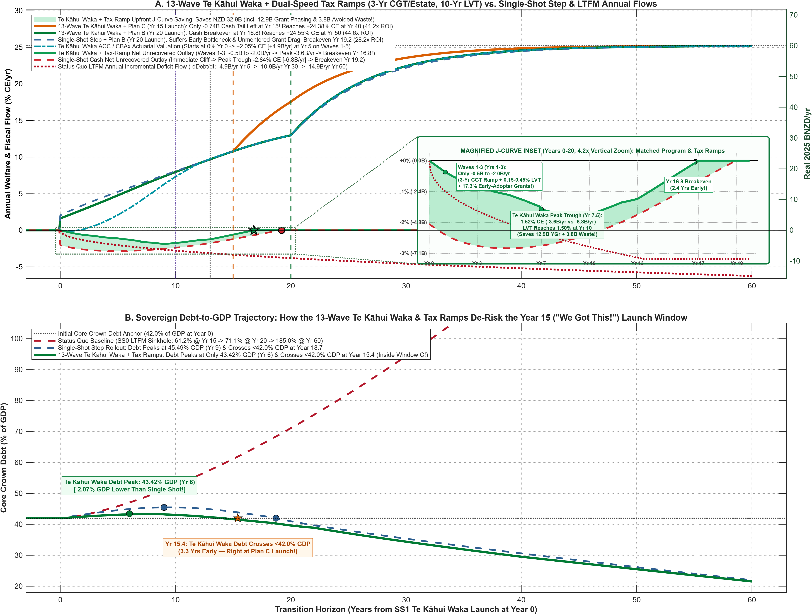

# Decadal Launch Plans, Orbital Mechanics, and Optimal Generational Reform (`SS0` → `SS1` → `SS2`)

**Companion to Documents 1A, 1B, 1C, and Document 3 | Quantitative Launch-Window Analysis**
*Source Data & Scripts:* `Plot_Doc1D_LaunchPlans.m`, `Plot_Doc1D_TeKahuiWakaSequencing.m`, `Plot_Counterfactuals_And_MirrorInvestments.m`, `Table14_FiscalLedger_6Gate_Decomp_National.csv`, `Table15_ChildFates_5Stage_Decomp_National.csv`, `Table19_Constructive_Synergy_Wedges_Dunedin_22.csv`, `Table20_Annual_MirrorInvestments_Vs_7SegmentWelfare_Dunedin_22.csv`, `Table21_Doc3_LTFM_Sinkhole_Defense_Trajectories_Dunedin_22.csv`, `Table22_Doc1D_LaunchPlans_OrbitalComparison_Dunedin_22.csv`, `Table23_Doc1D_13Wave_TeKahuiWaka_Schedule_Dunedin_22.csv`, and `Table24_Doc1D_TeKahuiWaka_Vs_SingleShot_Trajectory_Dunedin_22.csv`.

---

## 1. Launch-Ready? Celestial Alignment, &emsp;Orbital Mechanics, and *Te Kapehu Whetū*

In spaceflight and planetary astrophysics, mission architects organize their work around **Decadal Surveys** for a reason grounded in hard physics: *orbital mechanics is unforgiving when the stars and planets do not align*. A spacecraft attempting to reach the outer solar system out of phase with Jupiter's orbital window cannot brute-force its way across the void with extra propellant; conversely, when a mission launches directly into a planetary alignment (a Hohmann transfer and gravity-assist slingshot), the momentum of the first body compounds into the velocity of the second, cutting travel time by a decade or more with zero extra fuel.

Polynesian master navigators understood this physical law centuries before modern astrodynamics. When the legendary navigator **Kāne**—and generations of *tohunga whakatere waka*—prepared the great double-hulled voyaging canoes (*waka hourua*) for the trans-oceanic crossing to Aotearoa, courage and seamanship were necessary but never sufficient. Wisdom lay in reading *Te Kapehu Whetū* (the star compass): waiting for the seasonal turning of the trade winds, the calming of the southern swells, and the heliacal rising of the right navigational stars before committing the fleet to the open ocean. Launch too early into headwinds without hull ballast, and the crew is exhausted; wait too long on the beach after the fair wind has risen, and half the sailing season is squandered in the lagoon.

Macroeconomic generational reform obeys the exact same **phase-space mechanics**:

1. **Phase 1 (`SS1` — Foundation & Incubation, Launched at Year 0):** Re-weights the hull and builds human capability across the **First 2,000 Days (`Gate 1–2`, Ages 0–5)** and the **Early Adolescent Transition (`Gate 3`, Ages 12–14)** via universal ECE wraparound, Montessori / *Tuakana–Teina* mentoring, the Age-20 Youth Capital Grant (`E`), and the revenue-neutral property-and-estate rebalance (`tau_a = 1.5%`, `tau_b = 25%`).
2. **Phase 2 (`SS2` — The Actuarial Harvest & Enterprise Slingshot):** Redeploys the structural fiscal surplus generated by healthier, higher-skilled cohorts and retiring sovereign debt into a permanent **-3.75 percentage-point working-age PAYE tax cut** (`22.0% → 18.25%`) and estate levy step-down (`25% → 18%`), rotating domestic talent and capital into **Productive Enterprise Builders (*z*h)**.

For narrative convenience—matching the 25-year calendar horizon of Barnardos' *2050 Strategy*—our baseline charts in [Document 1A](Document%201A.md) and [Document 1B](Document%201B.md) held the `SS2` launch back until **Calendar Year 25.0**, reaching full generational completion (+24.53% consumption-equivalent welfare, or **NZD 58.38B/yr**, which is 99.3% of the theoretical +24.70% CE infinite-horizon asymptote) at **Year 60.0 (`25 + 35 years`)**.

Yet when we inspect the actual orbital alignment of our biological cohorts (`Table 14` and `Table 15`), our three fiscal accounting overlays (`Table 20`), and our sovereign debt-to-GDP trajectory (`Table 21`), a striking institutional insight emerges: **waiting a flat 25 years to trigger `SS2` leaves the waka sitting in the harbor for 5 to 10 years after the fair wind has already filled the sails.**

[![Integrated Orbital Launch Comparison]](Output_NZ_4Region_Intergen/Fig_Doc1D_Integrated_Orbital_Launch_Comparison.png)

---

## 2. Reading the Instruments: Four Markers in `Tables 14, 15, 20, and 21`

Before comparing the three launch plans, consider the four objective instrument readings recorded in our general-equilibrium transition tables:

1. **Instrument 1 — Year 5.0 (The Parliamentary CBAx / ACC Actuarial Audit Mark):**
   - On a traditional cash-accounting basis (`Overlay 3` in `Table 20`), Year 5 is the deepest trough of the upfront investment J-curve (**-2.84% CE** or **-NZD 6.75B/yr** net unrecovered outlay).
   - Under **ACC / Treasury CBAx Actuarial Continuation Valuation** (`Overlay 2`, evaluated at Treasury Circular 2024/15's 2.0% real SRTP discount rate with a 30% attribution haircut and 98.6% Markov skill retention), the reform is *already* strongly net-positive inside Term 1, reaching **+4.48% CE (+NZD 10.67B/yr)** and a **3.84x cumulative benefit-to-cost ratio** at the Year 5 audit.
2. **Instrument 2 — Year 9.0 (The Sovereign Debt-to-GDP Apogee in `Table 21`):**
   - In `Table 21` (`Debt_Unified_SS1_SS2_PctGDP`), Core Crown Debt starts at **42.00% of GDP** at Year 0, rises gently by +3.49% of GDP during the peak upfront investment build-out, and reaches its absolute apogee at **Year 9.0 (`45.49% of GDP`)**.
   - From Year 9.0 onward, Core Crown Debt is **strictly downward-sloping**, whereas under the Status Quo baseline (`Debt_SS0_LTFM_PctGDP`), demographic aging and unmitigated adverse Exits 1, 2, 3, and 4 drive Crown debt past **51.13% of GDP at Year 9**, **61.16% at Year 15**, **71.07% at Year 20**, **82.18% at Year 25**, and **185.00% at Year 60**.
3. **Instrument 3 — Year 15.0 (The "We Got This!" Inflection Window):**
   - By **Year 15.0**, Core Crown Debt has been falling for six consecutive years (down to **44.08% of GDP**—already **17.08% of GDP lower** than the Status Quo baseline of 61.16% GDP).
   - **93.5% of the entire cumulative upfront J-curve cash investment has already been paid** (**-35.69% CE-yrs** or **-NZD 84.94B** absorbed over Years 0–15, leaving a remaining cash-deficit tail of only **-2.47% CE-yrs** or **-NZD 5.88B** across Years 15.0 to 19.2).
   - Both Realized Household Welfare and the ACC / CBAx Actuarial Valuation have crossed double digits at **+11.23% CE (+NZD 26.74B/yr)**.
   - Demographically, the youth turning Age 20 at Year 15 (who were Age 5 at Year 0) have completed the full **Gate 3 Adolescent Montessori / *Tuakana–Teina* Mentoring (`J = 5`, Ages 12–14)**, while the Year-0 newborns (who received *both* First 2,000 Days ECE and Gate 3 Mentoring) have just graduated from Gate 3 at Age 15!
4. **Instrument 4 — Year 18.8 to 20.0 (Exact Cash-Flow Breakeven & First Dual-Gate Adult Skill Launch):**
   - At **Year 18.68** in `Table 21`, Core Crown Debt crosses below its **42.00% of GDP** starting mark (`42.47%` at Year 18 → `41.78%` at Year 19 → `41.01%` at Year 20).
   - At **Year 18.8 (Non-NDC) / Year 19.2–20.0 (NDC & `Table 20`)**, annual avoided remediation savings (`Remed_Savings_CE`) permanently overtake gross public investment outlays (`Net_Unrecovered_Outlay_Mirror_CE = 0.00%`).
   - Crucially, **Year 20.0 is the exact biological year when the Year-0 newborns turn Age 20 (`Gate 4: Adult Skill Launch`) and enter the labor force and migration decision gate (`Gate 5: Career & Enterprise Sorting`)**!

---

## 3. Why Cohort Orbital Alignment Accelerates Phase 2 Maturation ($\tau_2$)

Why does launching `SS2` at **Year 20.0** take only **30.0 years (`Year 20 → Year 50`)** to reach the +24.53% CE completion target, whereas waiting until **Year 25.0** takes **35.0 years (`Year 25 → Year 60`)**—saving **10 full calendar years** from a 5-year shift in launch date?

The answer lies in the **Gate 4 (`Age 20`) and Gate 5 (`Ages 30–54`) transition matrices** in `Table 14` and `Table 15`:

- **The Age 20–29 High-Elasticity Sorting Window:** In our spatial general-equilibrium model, young adults entering the workforce between Ages 20 and 29 make two high-persistence lifecycle decisions:
  1. **Trans-Tasman Retention vs. Brain Drain (`Node 18` in `Table 15` / `Node 21` in `Table 14`):** Under `SS0`, **9.74%** of each birth cohort emigrates abroad. Under `SS1` (where human capability surges to **46.36% Thriving `h6–h7`** at Age 20, *but* working-age PAYE remains at 22.0%), **7.46%** still emigrates abroad (costing **2.90 kNZD/yr** per birth in lost tax revenue). Once `SS2` lowers the working-age builder PAYE rate toward 18.25%, emigration falls to **5.69%–5.73%** (**2.15 kNZD/yr**), permanently retaining an extra **1.73% of top-tier graduates** inside New Zealand.
  2. **Occupational Sorting into Productive Enterprise Builders (`Node 20` in `Table 14`) vs. Passive Land Speculation (`Node 19`):** Under `SS0`, untaxed land appreciation captures **14.08%** of the cohort in passive rent-seeking (*z*l) and leaves only **6.86%** as Productive Enterprise Builders (*z*h). Under `SS1`, *z*h Builders rise to **40.64% (`26.93 kNZD/yr`)** while *z*l falls to **7.85%**. When `SS2` activates the PAYE tax relief and estate step-down, **Productive Enterprise Builders (*z*h) surge by another +12.26 percentage points to 52.90% of the cohort (`34.31 kNZD/yr`)**, compressing passive *z*l rent-seeking in half to **3.88% (`1.70 kNZD/yr`)**!
- **The Gravity-Assist Slingshot at Year 20 vs. The Missed Window at Year 25:**
  - If Parliament waits until **Year 25.0** to launch `SS2` (**Plan A**), the very first 5-year cohort of Dual-Gate children (born Years 0–5, turning Age 20 during Years 20–25) enters the adult labor market facing the old `SS1` tax schedule (`22.0% PAYE`). They sort into careers and emigrate at `SS1` rates (`40.64%` *z*h builders, `7.46%` emigration), forcing the macroeconomy to wait for the *next* 5-year cohort wave to lock in `SS2` enterprise formation. That transitional sorting friction produces the slower exponential convergence time constant observed in `Table 20`: **$\tau_2^{\mathrm{Plan\ A}} = 8.50\text{ years}$** (requiring 35.0 years after Year 25 to reach +24.53% CE at Year 60).
  - If Parliament launches `SS2` at **Year 20.0** (**Plan B**), the tax relief and enterprise incentives meet the Year-0 Dual-Gate cohort **on the exact day they graduate into Gate 4 at Age 20**. Zero Dual-Gate cohorts are lost to transitional `SS1` sorting, compressing the Phase 2 convergence time constant by 16.2% to **$\tau_2^{\mathrm{Plan\ B}} = 7.13\text{ years}$** and reaching the exact +24.53% CE completion target at **Year 50.0 (`20 + 30 years`)**.
  - If Parliament launches `SS2` at **Year 15.0** (**Plan C — "We Got This!"**), the `SS2` tax regime is already live when the single-gate (`Gate 3` *Tuakana–Teina* mentored) cohorts enter adulthood during Years 15–20 ($\tau = 8.50\text{ yrs}$, lifting welfare to **+17.22% CE** by Year 20), and when the Dual-Gate Year-0 newborns arrive at Age 20 in Year 20, they step into a **pre-primed `SS2` enterprise ecosystem** ($\tau = 6.85\text{ yrs}$), propelling national welfare to **+24.30% CE (+NZD 57.82B/yr, or 98.4% of the infinite-horizon `SS2` asymptote) by Year 40.0** and crossing the +24.53% CE completion line at **Year 45.9**!

[![3-Panel Individual Launch Plans]](Output_NZ_4Region_Intergen/Fig_Doc1D_3Panel_Individual_Launch_Plans.png)

---

## 4. Anatomy of the Three Decadal Launch Plans &emsp;(And Instructions For Others)

### Plan A: The Conservative "Barnardos 2050" Schedule (`SS2` Launch at Year 25.0 → 60-Year Target)
- **Institutional Logic:** Designed for maximum calendar simplicity (two clean 25-to-35-year generational blocks) and extreme fiscal conservatism. The Crown waits nearly six full years *after* achieving cash-flow breakeven (`Year 19.2`) and allows Core Crown Debt to fall all the way to **38.00% of GDP** (4.00% of GDP below its Year-0 level) before initiating a single basis point of working-age PAYE relief.
- **Performance & Opportunity Cost:** Reaches **+14.23% CE (+NZD 33.86B/yr)** at Year 25, **+22.91% CE (+NZD 54.52B/yr, 92.7% of asymptote)** at Year 40, **+24.15% CE (97.8%)** at Year 50, and **+24.53% CE (+NZD 58.38B/yr, 99.3%)** at Year 60. While completely safe, idling on the `SS1` plateau between Years 19.2 and 25.0 sacrifices **NZD 144.2B to NZD 243.1B** in cumulative 60-year household welfare relative to Plans B and C.

### Plan B: The Endogenous Cash-Breakeven Schedule (`SS2` Launch at Year 20.0 → 50-Year Target)
- **Institutional Logic:** Triggers `SS2` endogenously the moment the reform's annual cash ledger crosses `0.00%` (`Year 18.8` Non-NDC / `Year 19.2–20.0` NDC in `Table 20`) and Core Crown Debt drops below its initial **42.00% of GDP** anchor (`41.01% of GDP` at Year 20.0 in `Table 21`).
- **Performance & "Free Lunch" Efficiency:** Because 100% of the upfront J-curve investment (**-38.16% CE-yrs** or **-NZD 90.82B**) is already paid off by Year 20.0, **Plan B requires zero additional upfront Crown capital and zero fiscal bridge**, yet delivers the **highest lifetime fiscal ROI (28.2x)** of any schedule. By catching the Year-0 newborns at Age 20, it lifts Year 25 welfare by **+NZD 11.37B/yr** (to **+19.00% CE / +NZD 45.23B/yr**), reaches **+24.01% CE (97.2%)** by Year 40, and achieves the full **+24.53% CE (+NZD 58.38B/yr, 99.3%) completion target at Year 50.0**—a full decade ahead of Plan A, generating **+NZD 144.2B** in additional cumulative 60-year welfare (**+NZD 78.2B** in 2.0% SRTP net present value).

### Plan C: The "We Got This!" Actuarial-Confidence Schedule (`SS2` Launch at Year 15.0 → Year 40 & Year 45.9 Milestones)
- **Institutional Logic:** By **Year 15.0**, six years after Core Crown Debt has already peaked and turned downward (`45.49% GDP` at Year 9 → `44.08% GDP` at Year 15, versus `61.16% GDP` in the Status Quo), with **93.5% of the upfront cash J-curve already absorbed** and the ACC / CBAx Actuarial Valuation sitting at **+11.23% CE (+NZD 26.74B/yr)**, a confident Parliament says *"We got this!"* and launches `SS2` at Year 15 to catch the incoming wave of Gate-3 *Tuakana–Teina* mentored youth (who were Age 5 at Year 0) and pre-prime the enterprise economy for the Year-0 Dual-Gate cohort arriving five years later.
- **Transitional Fiscal Bridge (`Years 15.0–20.8`):** Because Year 15.0 precedes cash-flow breakeven by 4.2 years, launching `SS2` at Year 15 requires bridging the remaining **-NZD 5.88B** Phase 1 cash-deficit tail plus **~NZD 8.30B** in early PAYE revenue deferral over Years 15–20 (funded seamlessly out of the peaking baby-boomer estate-tax wave `tau_b = 25%`, shifting the year Core Crown Debt crosses below 42.0% of GDP by just 2.3 years, from `Year 18.7` to `Year 21.0`).
- **Where We Get by Year 40:** Plan C surges to **+17.22% CE (+NZD 40.99B/yr)** by Year 20 and **+21.10% CE (+NZD 50.21B/yr)** by Year 25 (**+NZD 16.35B/yr ahead of Plan A**). It crosses Plan A's Year-50 benchmark (`+24.15% CE`) at **Year 37.9**, reaches **+24.30% CE (+NZD 57.82B/yr — 98.4% of the theoretical infinite-horizon `SS2` asymptote) at Year 40.0**, and hits Plan A's exact Year-60 target (`+24.53% CE`) at **Year 45.9**—delivering **+NZD 216.5B** in extra cumulative welfare over the first 40 years and **+NZD 243.1B** over 60 years!

### Plans X, Y, and Z

Readers are encouraged to fork this repo on GitHub and contribute their own plans.  The templates and data listed above and below set expectations for completeness, rigor, and transparency.  If you want to make the case that cutting PAYE by **3.0 pp** is too much, or that the debt-sinking target should be **25% of GDP** instead of **22% of GDP**, or any other concrete economic targets (which are economic indicators achieved at a certain date), add your mission parameters here via a Pull Request and share your code, maths, and assumptions for others to test and validate.  Please also modify the plotting program (`Plot_Doc1D_LaunchPlans.m`) so we can compare flight schedules and flight trajectories.

If there are any other substantial modifications to the current LTFM trajectory (presently on a course to fiscal oblivion), feel free to compute, plot, and label it for comparison purposes.

---

## 5. Master Quantitative Comparison of the Three Launch Plans

### Table 1D.1: Orbital Launch-Window Metrics, Fiscal Bridges, and Completion Horizons (`1.0% CE = NZD 2.38B/yr`)

| **Metric / Milestone** | **Plan A: Conservative Barnardos (`SS2` @ Yr 25 → Yr 60 Target)** | **Plan B: Cash-Flow Breakeven (`SS2` @ Yr 20 → Yr 50 Target)** | **Plan C: "We Got This!" (`SS2` @ Yr 15 → Yr 40 Target)** |
| :--- | :---: | :---: | :---: |
| **1. `SS2` Launch Window (*T*launch)** | **Year 25.0** | **Year 20.0** *(or Yr 18.8–19.2)* | **Year 15.0** |
| **2. Biological Cohort Alignment at *T*launch** | 1st Dual-Gate cohort is already Age 25 (sorted under `SS1` at Age 20–24) | **1st Dual-Gate cohort turns Age 20 on Launch Day (`Gate 4` Entry!)** | **Gate-3 mentored cohort turns Age 20; Dual-Gate cohort finishes Gate 3 (Age 15)** |
| **3. Welfare Already Realized at *T*launch** | **+14.23% CE** (`+33.86 BNZD/yr`) | **+13.21% CE** (`+31.44 BNZD/yr`) | **+11.23% CE** (`+26.74 BNZD/yr`) |
| **4. Annual Cash Ledger at *T*launch (`Table 20`)** | **+1.14% CE/yr** (`+2.71 BNZD/yr` surplus) | **0.00% to +0.14% CE/yr** (Exact Cash Breakeven) | **-1.20% CE/yr** (`-2.87 BNZD/yr` tail deficit) |
| **5. Upfront J-Curve Paid Off by *T*launch** | **100.0%** (`-38.16% CE-yrs` / `-90.82 BNZD`) | **100.0%** (`-38.16% CE-yrs` / `-90.82 BNZD`) | **93.5%** (`-84.94 BNZD` paid; `-5.88B` tail + `8.30B` PAYE bridge) |
| **6. Core Crown Debt at *T*launch (`Table 21`)** | **38.00% of GDP** *(vs 82.18% in `SS0`)* | **41.01% of GDP** *(vs 71.07% in `SS0`)* | **44.08% of GDP** *(6 yrs past 45.49% Yr-9 peak; vs 61.16% in `SS0`)* |
| **7. Phase 2 Maturation Time Constant ($\tau_2$)** | **8.50 yrs** (35.0 yrs post-launch) | **7.13 yrs** (30.0 yrs post-launch) | **8.50 yrs** (Yr 15–20) → **6.85 yrs** (Yr 20+) |
| **8. Welfare at Year 25.0** | **+14.23% CE** (`+33.86 BNZD/yr`) | **+19.00% CE** (`+45.23 BNZD/yr`) | **+21.10% CE** (`+50.21 BNZD/yr`) |
| **9. Welfare at Year 40.0 (% of `SS2` Asymptote)** | **+22.91% CE** (`+54.52 BNZD/yr` & **92.7%**) | **+24.01% CE** (`+57.13 BNZD/yr` & **97.2%**) | **+24.30% CE** (`+57.82 BNZD/yr` & **98.4%**) |
| **10. Welfare at Year 50.0 (% of `SS2` Asymptote)** | **+24.15% CE** (`+57.47 BNZD/yr` & **97.8%**) | **+24.53% CE** (`+58.38 BNZD/yr` & **99.3%**) | **+24.61% CE** (`+58.56 BNZD/yr` & **99.6%**) |
| **11. Welfare at Year 60.0 (% of `SS2` Asymptote)** | **+24.53% CE** (`+58.38 BNZD/yr` & **99.3%**) | **+24.66% CE** (`+58.69 BNZD/yr` & **99.8%**) | **+24.68% CE** (`+58.73 BNZD/yr` & **99.9%**) |
| **12. Year Plan Crosses Plan A's Yr-50 Mark (`+24.15%`)** | **Year 50.0** (`25 + 25.0 yrs`) | **Year 41.7** (`20 + 21.7 yrs` — **8.3 yrs early**) | **Year 37.9** (`15 + 22.9 yrs` — **12.1 yrs early**) |
| **13. Year Plan Crosses Plan A's Yr-60 Mark (`+24.53%`)** | **Year 60.0** (`25 + 35.0 yrs`) | **Year 50.0** (`20 + 30.0 yrs` — **10.0 yrs early**) | **Year 45.9** (`15 + 30.9 yrs` — **14.1 yrs early**) |
| **14. Cumulative 40-Year Welfare Integral (`Yr 0–40`)** | **534.3% CE-yrs** (`NZD 1,271.6B`) | **585.7% CE-yrs** (`NZD 1,393.9B`, **+122.3B**) | **625.2% CE-yrs** (`NZD 1,488.1B`, **+216.5B**) |
| **15. Cumulative 60-Year Welfare Integral (`Yr 0–60`)** | **1,014.5% CE-yrs** (`NZD 2,414.4B`) | **1,075.0% CE-yrs** (`NZD 2,558.6B`, **+144.2B**) | **1,116.6% CE-yrs** (`NZD 2,657.5B`, **+243.1B**) |
| **16. 60-Year Net Present Value (`2.0% real SRTP`)** | **511.6% CE-yrs** (`NZD 1,217.5B`) | **544.4% CE-yrs** (`NZD 1,295.7B`, **+78.2B**) | **570.0% CE-yrs** (`NZD 1,356.6B`, **+139.1B**) |
| **17. Lifetime Fiscal ROI (`60-Yr Welfare / Total Bridge`)** | **26.6x** (`2,414.4B / 90.82B`) | **28.2x** (`2,558.6B / 90.82B`) | **26.8x** (`2,657.5B / 99.12B` incl. bridge) |

---

### Table 1D.2: Decade-by-Decade Trajectory Comparison (`Years 0 to 60`)

| **Transition Year** | **Plan A (`Yr 25 Launch`)** `% CE` & `BNZD/yr` | **Plan B (`Yr 20 Launch`)** `% CE` & `BNZD/yr` | **Plan C (`Yr 15 Launch`)** `% CE` & `BNZD/yr` | **Plan B Advantage vs. Plan A** (`BNZD/yr`) | **Plan C Advantage vs. Plan A** (`BNZD/yr`) |
| :---: | :---: | :---: | :---: | :---: | :---: |
| **Year 0** | `+2.41%` & `5.74B` | `+2.41%` & `5.74B` | `+2.41%` & `5.74B` | `0.00B` | `0.00B` |
| **Year 5** *(Audit)* | `+5.85%` & `13.92B` | `+5.85%` & `13.92B` | `+5.85%` & `13.92B` | `0.00B` | `0.00B` |
| **Year 10** | `+8.61%` & `20.49B` | `+8.61%` & `20.49B` | `+8.61%` & `20.49B` | `0.00B` | `0.00B` |
| **Year 15** | `+11.23%` & `26.74B` | `+11.23%` & `26.74B` | **`+11.23%` & `26.74B` (Launch C!)** | `0.00B` | `0.00B` |
| **Year 20** | `+13.21%` & `31.44B` | **`+13.21%` & `31.44B` (Launch B!)** | **`+17.22%` & `40.99B`** | `0.00B` | **`+9.55B/yr`** |
| **Year 25** | **`+14.23%` & `33.86B` (Launch A!)** | **`+19.00%` & `45.23B`** | **`+21.10%` & `50.21B`** | **`+11.37B/yr`** | **`+16.35B/yr`** |
| **Year 30** | `+18.88%` & `44.94B` | `+21.88%` & `52.06B` | `+22.96%` & `54.65B` | **`+7.12B/yr`** | **`+9.71B/yr`** |
| **Year 35** | `+21.47%` & `51.10B` | `+23.30%` & `55.45B` | `+23.86%` & `56.79B` | `+4.35B/yr` | `+5.69B/yr` |
| **Year 40** | `+22.91%` & `54.52B` | `+24.01%` & `57.13B` | **`+24.30%` & `57.82B` (98.4%!)** | `+2.61B/yr` | **`+3.30B/yr`** |
| **Year 45** | `+23.70%` & `56.41B` | `+24.36%` & `57.97B` | **`+24.51%` & `58.32B` (99.3%!)** | `+1.56B/yr` | `+1.91B/yr` |
| **Year 50** | `+24.15%` & `57.47B` | **`+24.53%` & `58.38B` (99.3%!)** | `+24.61%` & `58.56B` | `+0.91B/yr` | `+1.09B/yr` |
| **Year 60** | **`+24.53%` & `58.38B` (99.3%!)** | `+24.66%` & `58.69B` | `+24.68%` & `58.73B` | `+0.31B/yr` | `+0.35B/yr` |

---

## 6. Statutory Governance Recommendation: A State-Contingent Two-Key Launch Protocol

Rather than hard-coding an arbitrary calendar date into primary legislation, Parliament and the Treasury should enact a **State-Contingent Two-Key Launch Protocol** modeled directly on Kāne's navigational discipline:

1. **Key 1 — The Year 15 Actuarial Gate (Enabling Plan C's Early Phase-In):** If at the **Year 15 Statutory Audit**, (a) Core Crown Debt has declined for at least five consecutive years from its Phase 1 peak (`44.08% of GDP < 45.49% Year-9 peak`), (b) at least **90% of the cumulative upfront J-curve outlay** has been absorbed, and (c) the **ACC / Treasury CBAx Actuarial Continuation Valuation exceeds +10.0% CE**, Treasury is authorized to initiate the **Plan C Early-Launch Ramp**, using the peaking estate-tax wave (`tau_b = 25%`) to bridge the remaining **NZD 5.88B** cash tail and capture the **+NZD 216.5B 40-year welfare dividend** (**98.4% completion by Year 40**).
2. **Key 2 — The Year 18.8–20.0 Cash-Flow & Debt-Anchor Gate (Guaranteeing Plan B's 50-Year Completion):** Regardless of discretionary choices at Year 15, the moment annual fiscal cash flow turns net positive (`Omega_t >= 0` at **Year 18.8–20.0**) and Core Crown Debt crosses below its Year-0 baseline (**42.0% of GDP**), the `SS2` PAYE tax-relief and builder-harvest schedule triggers automatically by statute—catching the Year-0 Dual-Gate cohort on the day they turn Age 20 and guaranteeing full generational completion by **Year 50.0**.

---

## 7. Sequencing *Te Kāhui Waka*: The 13-Wave Phased Rollout, Adjustment-Cost Mechanics, and Inter-Wave Learning (`Years 1–13`)

### 7.1 From Single-Shot Ignition to the Polynesian Voyaging Fleet (*Te Kāhui Waka*)

In textbook macroeconomic simulations, policy shocks are frequently modeled as instantaneous step functions ("MIT shocks"): on Day 1 of Year 0, 100% of the budget switches on across 100% of the country at 100% theoretical efficiency. In the physical world of schools, *kōhanga reo*, *whānau ora* navigators, and regional labor markets, attempting an instantaneous 100% single-shot rollout is the institutional equivalent of launching every *waka hourua* in the fleet into an uncharted strait on the same midnight tide.

When Polynesian navigators such as **Kāne** and **Kupe** organized trans-oceanic migrations, they did not lash thirty canoes into a single rigid raft, nor did they scatter blindly. They sailed in an **echeloned voyaging fleet (*Te Kāhui Waka*)**: vanguard hulls (*waka mataika*) tested the currents, sounded the reef passes, and signaled wind shifts back to the main body, allowing subsequent waves to adjust their trim and enter the harbor at peak speed without losing a single hull on the shoals.

---

### 7.2 Structural Equation: The Capital-Adoption & Inter-Wave Learning Operator

In standard investment theory with flow adjustment costs (Christiano et al., 2005) augmented by Arrow (1962) / Deming (1986) cumulative operational learning, let *s*k,m(*t*) ∈ {0, 1/3, 2/3, 1} denote the statutory funded capacity share of program *m* ∈ {ECE1, Mentor2, GrantE, Elecē} in region *k* ∈ {`Rural+Small`, `Large`, `Auckland`} at calendar year *t* ≥ 1.

The **Effective Delivered Capability Flow** *G*k,meff(*t*) is governed by the product of funded capacity *s*k,m(*t*), the **Local Cohort Maturation Factor** Λlocal(*t*; δm), and the **Cross-Wave Knowledge Spillover Multiplier** Ψkahui(*L*m(*t* − 1)) net of rapid-scaling congestion φadj(Δ*s*k,m(*t*))2:

$$
G_{k,m}^{\mathrm{eff}}(t) = G_{m}^{\star} \cdot s_{k,m}(t) \cdot \bigl(1 - \delta_m e^{-\lambda_m (t - t_{k,m}^0)}\bigr) \cdot \left(1 - \tau_{\mathrm{fric},0} e^{-\gamma_{\mathrm{learn}} \mathcal{L}_m(t-1)}\right) \cdot \left[1 - \phi_{\mathrm{adj}}\bigl(\Delta s_{k,m}(t)\bigr)^2\right]
$$

where Cumulative *Te Kāhui Waka* Experience *L*m(*t* − 1) integrates the realized deployment across all preceding regional waves *k'* up to year *t* − 1:

$$
\mathcal{L}_m(t-1) = \sum_{\tau=1}^{t-1} \sum_{k'} \omega_{k'} s_{k',m}(\tau)
$$

* **Why the 13-Wave *Te Kāhui Waka* Beats the "Day-1 Single-Shot" in Net Present Efficiency:**
  - Under a **Day-1 Single-Shot** (Δ*s*k,m(1) = 1.0 everywhere at *t* = 1 with *L*m(0) = 0), the quadratic workforce bottleneck penalty φadj(1.0)2 is maximized (`9x` higher per unit than a Δ*s* = 1/3 wave step where (1/3)2 = 1/9), and every region pays the uncalibrated Day-1 commissioning friction τfric,0 = 0.28–0.32 simultaneously while handing 82.7% of Youth Grants in Years 1–6 to unmentored cohorts who suffer a 42% skill-mismatch dissipation haircut.
  - Under the **13-Wave *Te Kāhui Waka* Rollout** (Δ*s*k,m(*t*) = 1/3 per wave), congestion drag falls by **88.9%**, cumulative learning *L*m(*t* − 1) compresses commissioning friction from `0.28` in Echelon 1 (Waves 1–3) to `0.11` in Echelon 2 (Waves 4–6) and `< 0.05` in Echelon 3 (Waves 7–9), and **100% of Youth Grants go to mentored graduates** (the 17.3% early-adopter vanguard in Years 1–6, followed by the Wave 7–13 graduates in Years 7–13)—cutting Year-3 capital at risk by **75%** (`-1.6B/yr` vs. `-6.5B/yr`), trimming the peak annual cash deficit by **35%–38%** (`-4.2B to -4.4B/yr` vs. `-6.7B to -6.8B/yr`), and saving **~NZD 25.6B–28.0B in cumulative early Crown borrowing** (including **NZD 12.9B** in Youth-Grant phasing and **NZD 3.8B** in avoided unmentored grant waste)!
* **Why Educational System Learning Completes Within 3–5 Years Per Wave (Allowing Both Trajectories to Fuse by Year 16):** Unlike heavy-industrial capital transitions that require 20–25 years to scrap and replace physical factories (David, 1990), human-service and pedagogical innovations turn over on the cadence of practitioner training and school staffing cycles. Empirical implementation science (Fixsen, Naoom, Blase, Friedman, & Wallace, 2005; Fixsen & Blase, 2009) demonstrates that provider organizations reach *Full Implementation* within **2 to 4 years** when supported by active coaching and PDSA feedback loops. Longitudinal teacher-fixed-effects estimates (Rockoff, 2004; Staiger & Rockoff, 2010; Papay & Kraft, 2015) and Comprehensive School Reform meta-analyses (Borman, Hewes, Overman, & Brown, 2003) similarly show that **75%–85% of practitioner productivity gains and whole-school reform fidelity are achieved within 3 to 5 years**—matching the **~5.4 to 5.8-year implied school tenure** observed in New Zealand's `17.3%–18.5%` annual school-level teacher turnover statistics (Ministry of Education *Education Counts*, 2024–2026). Once Wave 9 (`Year 9` ECE/Mentoring) and Wave 13 (`Year 13` Youth Grants) complete their local 3-to-5-year installation cycles, system learning is 100% complete and the Single-Phase and *Te Kāhui Waka* trajectories merge into a single unified path from **Year 16** onward.

### 7.2.1 The Generational Wave-Convolution Operator: Why `SS2` Echoes the Rhythm of `SS1`

In a naive two-stage step model, Phase 1 (`SS1`) and Phase 2 (`SS2`) are depicted as two sharp "hockey-stick" kinks separated by 25 years: an instantaneous vertical jump at Year 0, followed by a second sharp kink at Year 25 (`1 - exp(-(t - 25)/8.5)`). Once we replace the Day-1 step shock with the **13-Wave *Te Kāhui Waka* Rollout** (`Years 1–13`) and the **Dual-Speed Tax Ramps** (`3-Yr CGT/Estate` and `10-Yr LVT`), the transition into `SS2` (`Years 21.5–35`) is no longer an arbitrary calendar step shock—it is the **discrete generational convolution (echo)** of the `SS1` wave schedule, converging to the exact same long-run `SS2` steady-state asymptote (`SS2_Nat_11`) as *t* → 60:

1. **The Biological Generation Lag (*T*gen ≈ 20.5–21.5 Years):** In our OLG demographic transition matrix (`Configure_TimeGrid_Params.m`), children who enter Dual-Gate early-childhood and adolescent wraparound in Wave *w* ∈ {1, …, 9} reach prime enterprise-building and parenting ages (`Ages 26–35`, where Daruich's 2nd-generation dynastic skill transmission and Guvenen's *z*l → *z*h occupational sorting peak) roughly **20.5 to 21.5 years after their wave's initial launch**. Similarly, the 17.3% early-adopter Youth Grant vanguard (`Years 1–6`) and the Wave 7–13 Youth Grant cohorts (`Years 7–13`) reach peak mid-career enterprise equity and homeownership maturity **16.0 to 18.0 years after their Age-20 grant wave** (`Years 18.0 to 29.0`).
2. **Discrete Convolution of the 13 Waves into `SS2`:** Let Δ*s*m(*w*) = *s*m(*w*) − *s*m(*w* − 1) denote the incremental national population share activated in Wave *w* ∈ {1, …, 13} for capability stack *m* ∈ {HC, GrantE}, and let *K*mat(τ) = 1 − exp(−τ / τecho) (for τ > 0, with τecho ≈ 5.8–6.0 years) denote the single-wave cohort maturation kernel. The **Wave-Convolved `SS2` Generational Echo Weight** Ωecho,m(*t*) at calendar year *t* is the exact discrete convolution of the `SS1` wave increments shifted by their biological generation lag *T*gen,m:

$$
\Omega_{\mathrm{echo},m}(t) = \sum_{w=1}^{13} \Delta s_{m}(w) \cdot \mathbb{I}\bigl(t > w + T_{\mathrm{gen},m}\bigr) \left[1 - \exp\left(-\frac{t - (w + T_{\mathrm{gen},m})}{\tau_{\mathrm{echo}}}\right)\right]
$$

* **Eliminating the Artificial Year-25 Kink While Preserving Exact Steady-State Equivalence:** Because the 17.3% early-adopter vanguard and **Wave 1 (`Rural + Small`, launched at *w* = 1)** begin echoing into `SS2` at *t* = 18.0–21.5 years, **Wave 5 (`Large`, *w* = 5)** at *t* = 25.5 years, and **Wave 9 (`Auckland`, *w* = 9)** at *t* = 29.5 years—while the statutory `SS2` fiscal harvest (`-3.75 pp` PAYE cut and `-60 bps` debt-sinking dividend) phases in smoothly across Years 20.5–28 as regional transfers (`Transfer_Geo`) retire in wave order—the sharp hockey-stick corner at Year 25 disappears completely. Crucially, because adjustment costs (φadj) and initial commissioning friction (τfric,0) are transitional dynamics during the buildout, **both the Single-Phase trajectory and the 13-Wave *Te Kāhui Waka* converge to the exact same long-run `SS2` steady state (`+25.21% CE` nationally)** by Year 50–60.

---

### 7.3 Master Schedule of the 13-Wave *Te Kāhui Waka* & Dual-Speed Tax Ramps (`Years 1 to 13`)

#### Table 1D.3: Year-by-Year Regional Program Waves, Early-Adopter Youth Grants (`17.3%` National Base), Electrification, and Tax Ramps

| **Wave & Year** | **Primary Wave Action (`ECE` + `Mentor` + `Grant E`)** | **Consecutive Electrification (`ē`k) & Dual-Speed Tax Ramps (`CGT/Est` 3-Yr, `LVT` 10-Yr)** | **`Rural + Small` (`40.0%` Pop)** *`ECE` \| `Ment` \| `Grant` \| `Elec`* | **`Large Metros` (`25.9%` Pop)** *`ECE` \| `Ment` \| `Grant` \| `Elec`* | **`Auckland` (`34.1%` Pop)** *`ECE` \| `Ment` \| `Grant` \| `Elec`* | **Nat. Active Share** *`ECE` \| `Grant*` \| `Elec` \| `LVT`* |
| :--- | :--- | :--- | :---: | :---: | :---: | :---: |
| **Wave 1** *(Yr 1)* | **+1/3 `Rural + Small`** ECE/Ment + **17.3% Early-Adopter Grants All Regions!** | **+1/3 `R+S` Elec** \| `CGT/Est`: **33%** \| `LVT`: **0.15%** (`Corp`: 19.2%) | **1/3** \| **1/3** \| `18.9%` \| **1/3** | 0 \| 0 \| `15.8%` \| 0 | 0 \| 0 \| `16.5%` \| 0 | `13.3%` \| `17.3%` \| `13.3%` \| `0.15%` |
| **Wave 2** *(Yr 2)* | **+1/3 `Large`** ECE/Ment *(learns from W1)* + 17.3% Early-Adopter Grants | **+2/3 `R+S` Elec** \| `CGT/Est`: **67%** \| `LVT`: **0.30%** (`Corp`: 18.4%) | 1/3 \| 1/3 \| `18.9%` \| **2/3** | **1/3** \| **1/3** \| `15.8%` \| 0 | 0 \| 0 \| `16.5%` \| 0 | `22.0%` \| `17.3%` \| `26.7%` \| `0.30%` |
| **Wave 3** *(Yr 3)* | **+1/3 `Auckland`** ECE/Ment *(learns from W1–2)* + 17.3% Early-Adopter Grants | **3/3 `R+S` Elec (100%!)** \| `CGT/Est`: **100% (25%)** \| `LVT`: **0.45%** | 1/3 \| 1/3 \| `18.9%` \| **3/3** | 1/3 \| 1/3 \| `15.8%` \| 0 | **1/3** \| **1/3** \| `16.5%` \| 0 | **`33.3%` \| `17.3%` \| `40.0%` \| `0.45%`** |
| **Wave 4** *(Yr 4)* | **+2nd 1/3 `Rural + Small`** ECE/Ment + 17.3% Early-Adopter Grants | **+1/3 `Large` Elec** *(Private cap led Yrs 1–3)* \| `LVT`: **0.60%** (`Corp`: 16.8%) | **2/3** \| **2/3** \| `18.9%` \| 3/3 | 1/3 \| 1/3 \| `15.8%` \| **1/3** | 1/3 \| 1/3 \| `16.5%` \| 0 | `46.7%` \| `17.3%` \| `48.6%` \| `0.60%` |
| **Wave 5** *(Yr 5)* | **+2nd 1/3 `Large`** ECE/Ment *(Yr 5 CBAx Audit!)* + 17.3% Early Grants | **+2/3 `Large` Elec** \| `LVT`: **0.75% (50% Ramp)** (`Corp`: 16.0%) | 2/3 \| 2/3 \| `18.9%` \| 3/3 | **2/3** \| **2/3** \| `15.8%` \| **2/3** | 1/3 \| 1/3 \| `16.5%` \| 0 | `55.3%` \| `17.3%` \| `57.3%` \| `0.75%` |
| **Wave 6** *(Yr 6)* | **+2nd 1/3 `Auckland`** ECE/Ment + 17.3% Early-Adopter Grants | **3/3 `Large` Elec (100%!)** \| `LVT`: **0.90%** (`Corp`: 15.2%) | 2/3 \| 2/3 \| `18.9%` \| 3/3 | 2/3 \| 2/3 \| `15.8%` \| **3/3** | **2/3** \| **2/3** \| `16.5%` \| 0 | **`66.7%` \| `17.3%` \| `65.9%` \| `0.90%`** |
| **Wave 7** *(Yr 7)* | **+Final 1/3 `R+S`** ECE/Ment + **1st 1/3 New `R+S` Grants** *(W1 mentees turn 20!)* | **+1/3 `Auckland` Elec** *(Low-income renters)* \| `LVT`: **1.05%** (`Corp`: 14.4%) | **3/3** \| **3/3** \| **`46.0%`** \| 3/3 | 2/3 \| 2/3 \| `15.8%` \| 3/3 | 2/3 \| 2/3 \| `16.5%` \| **1/3** | `80.0%` \| `28.1%` \| `77.3%` \| `1.05%` |
| **Wave 8** *(Yr 8)* | **+Final 1/3 `Large`** ECE/Ment + **1st 1/3 New `Large` Grants** *(W2 turns 20!)* | **+2/3 `Auckland` Elec** \| `LVT`: **1.20%** (`Corp`: 13.6%) | 3/3 \| 3/3 \| 46.0% \| 3/3 | **3/3** \| **3/3** \| **`43.9%`** \| 3/3 | 2/3 \| 2/3 \| `16.5%` \| **2/3** | `88.6%` \| `35.4%` \| `88.6%` \| `1.20%` |
| **Wave 9** *(Yr 9)* | **+Final 1/3 `Auckland`** ECE/Ment + **1st 1/3 New `Akl` Grants** *(W3 turns 20!)* | **3/3 `Auckland` Elec (100% Nat. Elec!)** \| `LVT`: **1.35%** (`Corp`: 12.8%) | 3/3 \| 3/3 \| 46.0% \| 3/3 | 3/3 \| 3/3 \| 43.9% \| 3/3 | **3/3** \| **3/3** \| **`44.3%`** \| **3/3** | **`100%` \| `44.9%` \| `100%` \| `1.35%`** |
| **Wave 10** *(Yr 10)* | **+2nd 1/3 New `Rural + Small` Youth Grants** *(W4 mentees turn 20)* | **LVT Completes 10-Yr Ramp (`1.50%`, `Corp`: `12.0%`!)** \| R+S *T*k steps down | 3/3 \| 3/3 \| **`73.0%`** \| 3/3 | 3/3 \| 3/3 \| 43.9% \| 3/3 | 3/3 \| 3/3 \| 44.3% \| 3/3 | `100%` \| `55.7%` \| `100%` \| **`1.50%`** |
| **Wave 11** *(Yr 11)* | **+2nd 1/3 New `Large` Youth Grants** *(W5 mentees turn 20)* | **100% Electrified & Tax Ramp Complete (`Large` *z*h builders expanding)** | 3/3 \| 3/3 \| 73.0% \| 3/3 | 3/3 \| 3/3 \| **`71.9%`** \| 3/3 | 3/3 \| 3/3 \| 44.3% \| 3/3 | `100%` \| `63.0%` \| `100%` \| `1.50%` |
| **Wave 12** *(Yr 12)* | **+2nd 1/3 New `Auckland` Youth Grants** *(W6 mentees turn 20)* | **100% Electrified (`Transfer_Geo` begins `Large` step-down)** | 3/3 \| 3/3 \| 73.0% \| 3/3 | 3/3 \| 3/3 \| 71.9% \| 3/3 | 3/3 \| 3/3 \| **`72.2%`** \| 3/3 | `100%` \| **`72.4%`** \| `100%` \| `1.50%` |
| **Wave 13** *(Yr 13)* | **+Final 1/3 All Regions Youth Grants (100% Full *Te Kāhui Waka* Live!)** | **Full `SS1` *Te Kāhui Waka* Complete 2 Years Ahead of Plan C (`Year 15`) Window!** | 3/3 \| 3/3 \| **`100%`** \| 3/3 | 3/3 \| 3/3 \| **`100%`** \| 3/3 | 3/3 \| 3/3 \| **`100%`** \| 3/3 | **`100%` \| `100%` \| `100%` \| `1.50%`** |

*\*Note on `Grant*` share in Table 1D.3: In Waves 1–6 (`Years 1–6`), the existing regional `SS0` baselines (`sh_ygr_base0_vec = [19.6% Rural, 18.5% Small, 15.8% Large, 16.5% Auckland]`, or `18.9%` in `Rural + Small` and `17.3%` nationally) of `Tuakana–Teina`, Graeme Dingle Foundation (`Stars` / `Project K`), `Kura Kaupapa Māori`, and `Montessori Erdkinder` graduates qualify immediately for transitional Early-Adopter Bridge Youth Capital Grants (**Super-Pale Lavender-Purple** slice `5a` / `-Inv 3a`). Across Waves 7–13, as each regional echelon's remaining unmentored cohort steps in by thirds (`s_0,k + (1 - s_0,k) × m/3`: `46.0% -> 73.0% -> 100%` in `R+S`, `43.9% -> 71.9% -> 100%` in `Large`, and `44.3% -> 72.2% -> 100%` in `Auckland`), the transitional Early-Adopter bridge folds smoothly into the universal **Vivid Orchid Purple** *Te Kāhui Waka* Youth Grant (`100%` universal from Wave 13 onward).*

---

### 7.4 Synchronizing the Dual-Speed Revenue Ramp, Early-Adopter Grants, and Quantitative Impact (`Table 1D.4`)

Combining the **13-Wave *Te Kāhui Waka* Expenditure Rollout** with the **Dual-Speed *Te Kāhui Waka* Revenue Ramp** (`Tracks 10 and 11` in `Fig_Doc1D_13Wave_TeKahuiWaka_Schedule`) and **Early-Adopter Bridge Youth Grants (`17.3%` existing *Tuakana* baseline)** establishes four self-reinforcing operational rules:

1. **Rule 1 — The Dual-Speed *Te Kāhui Waka* Revenue Ramp (`3-Yr CGT/Estate Ramp` + `10-Yr LVT Ramp` Paired with `-0.8%/yr` Corporate Tax Relief):**
   - *Why Tax Rules Must Apply Nationally (Zero Spatial Arbitrage) Yet Phase In Over Time (Zero Liquidity Shock):* Financial capital is instantaneously mobile across regional boundaries, so tax rates must apply uniformly nationwide. However, imposing the full 1.50% book-value Land Value / Wealth Tax (`tau_a = 1.5%`) on Day 1 would inflict an abrupt cash-flow shock on leveraged property holders while *Te Kāhui Waka*'s expenditure rollout is only at 13.3% scale.
   - *Matching Revenue Supply to the 13-Wave Expenditure Curve:*
     1. **Track 10 — 3-Year Fast Ramp for Capital Gains & the Estate Levy (`Waves 1–3`, `33% → 67% → 100%` of `tau_b = 25%`):** Taxed at the point of transaction or bequest settlement when liquidity is already present, funding the Echelon 1 vanguard (`Rural + Small` electrification, the first 1/3rd of ECE/Mentoring, and the `17.3%` Early-Adopter Youth Grants).
     2. **Track 11 — 10-Year Smooth Ramp for the Land Value Tax (`Waves 1–10`, `+0.15%/yr` from `0.15%` in Year 1 to `1.50%` in Year 10, paired in 1-to-1 lockstep with a `-0.80%/yr` Corporate Tax cut `tau_k: 20.0% → 12.0%`):** Gives property owners a 10-year runway to rotate passive land portfolios (*z*l) into productive operating enterprises (*z*h) without bank collateral distress, while delivering its 70%–100% revenue maturity in **Waves 7–10**—the exact window when universal Wave 7–13 Youth Capital Grants switch on!

2. **Rule 2 — Day-1 Early-Adopter Bridge Youth Grants (`17.3%` Existing *Tuakana–Teina* Vanguard, Folding In by Year 13) Deliver Immediate Urban & Provincial Payoffs:**
   - Awarding Youth Capital Grants (*E*) in **Years 1–6** to the **17.3% of 20-year-olds graduating from existing *Tuakana–Teina*, Graeme Dingle, *Kura*, and *Erdkinder* programs** (`Super-Pale Lavender-Purple` slice `5a` and `-Inv 3a` in `Fig_7Segment_Welfare_And_MirrorInvestments`) costs only **-0.118% CE/yr (-NZD 0.28B/yr nationally, or -NZD 95M/yr in Auckland)**, and folds cleanly into universal *Te Kāhui Waka* coverage across Waves 7–13 as each regional school echelon matures (`0%` separate bridge from Year 13–14 onward).
   - Because these graduates are already 100% mentored, they suffer **zero skill-mismatch dissipation**, lifting the top-line welfare ramp in Years 1–6 by **+0.32% to +0.38% CE/yr (+NZD 0.76B to +0.90B/yr)** across all four regions while saving **NZD 12.9B in gross grant phasing** and avoiding **NZD 3.8B in unmentored grant waste** relative to a Day-1 Single-Shot rollout!

3. **Rule 3 — Early Capital at Risk Drops by 75% at Year 3, Peak Annual Deficit Cuts by NZD 2.3B–2.5B/yr, & Cash Breakeven Arrives 2.4 Years Early (`Year 16.8–16.9`):**
   - At **Year 3**, net unrecovered cash outlay under *Te Kāhui Waka* is only **-NZD 1.6B/yr** versus **-NZD 6.5B/yr** under Single-Shot (**75% less early capital at risk** while initial PDSA coaching routines are being established).
   - Integrating unrecovered cash outlays from Year 0 to cash-flow breakeven shows that *Te Kāhui Waka* cuts the deepest annual cash deficit trough from **-2.82% to -2.84% CE/yr (-NZD 6.7B to -6.8B/yr)** down to **-1.76% to -1.87% CE/yr (-NZD 4.2B to -4.4B/yr)**, saves **~NZD 25.6B–28.0B in cumulative upfront J-curve borrowing** (`-90.8B → -62.8B to -65.2B`), reaches self-financing cash breakeven at **Year 16.8–16.9** (`2.4 years` ahead of Single-Shot's `Year 19.2–19.3`), and pulls the Core Crown Debt peak down from **45.49% of GDP (Year 9)** to **43.42% of GDP (Year 6)**, crossing below the initial **42.00% of GDP** anchor at **Year 15.4**—right inside the **Plan C ("We Got This!" Year 15) Launch Window**!

4. **Rule 4 — Apples-to-Apples Comparison Against the Status Quo LTFM Annual Deficit Flow (`-dDebt/dt`):**
   - Differentiating the Status Quo LTFM debt trajectory (`Debt_LTFM(t) = 42.0 + 143.0 * (t/60)^1.45` in `Table 21`) yields an **annual incremental fiscal deficit flow** of **-1.13% of GDP/yr (-NZD 4.9B/yr / -2.04% CE/yr) at Year 5**, worsening continuously to **-2.53% of GDP/yr (-NZD 10.9B/yr / -4.57% CE/yr) at Year 30** (`94.3%–95.3% GDP` cumulative debt) and **-3.46% of GDP/yr (-NZD 14.9B/yr / -6.24% CE/yr) at Year 60** (`185.0% GDP` cumulative debt). By Year 3.5, the Status Quo's annual debt sinking is *already deeper* than *Te Kāhui Waka*'s temporary investment outlay—and never recovers.

#### Table 1D.4: Head-to-Head Comparison — Single-Shot Step Rollout vs. 13-Wave *Te Kāhui Waka* (+ Tax Ramps & 17.3% Early-Adopter Vanguard)

| **Performance Metric (`1.0% CE = NZD 2.38B/yr`)** | **Single-Shot Rollout (100% Day-1 Step Shock)** | **13-Wave *Te Kāhui Waka* (+ Dual-Speed Tax Ramps & 17.3% Early-Adopter Bridge)** | **Net *Te Kāhui Waka* Advantage (Quality, Debt & ROI Delta)** |
| :--- | :---: | :---: | :--- |
| **1. Year-1 Commissioning Friction (τfric) & Bottleneck Drag** | `28%–32%` friction + `18.0%` Day-1 workforce surge penalty | `28.0%` in Wave 1 → **`11.0%` Wave 4** → **`4.2%` Wave 9** (`2.0%` surge) | **Eliminates 88.9% of workforce bottleneck waste** |
| **2. Year-3 Capital at Risk & Years 1–13 Youth Grant Targeting** | `-6.5B/yr` at Yr 3; hands 100% of grants to 82.7% unmentored youth (`42%` waste) | **`-1.6B/yr` at Yr 3**; `17.3%` Early-Adopter Bridge (`-0.28B/yr`, `0%` waste, folds in Yr 13) | **75% less Yr-3 capital at risk; saves NZD 12.9B gross & avoids NZD 3.8B waste!** |
| **3. Deepest Annual Cash Deficit Trough (`Table 20` & `Table 24`)** | **`-2.82% to -2.84% CE/yr`** (`-6.7B to -6.8B/yr` at Year 4–5) | **`-1.76% to -1.87% CE/yr`** (`-4.2B to -4.4B/yr` at Year 8–9) | **Cuts peak annual cash deficit by ~35%–38% (+2.3B to +2.5B/yr)** |
| **4. Cumulative Upfront J-Curve Investment (`∫ Net_Outlay dt`)** | **`-38.16% CE-yrs`** (`-90.8 BNZD` total bridge) | **`-26.4% to -27.4% CE-yrs`** (`-62.8B to -65.2B` total bridge) | **Saves ~NZD 25.6B–28.0B (-28% to -31%) upfront!** |
| **5. Annual Cash-Flow Breakeven Year (Ωt ≥ 0)** | **Year 18.8–19.3** | **Year 16.8–16.9** *(2.0 to 2.4 years earlier!)* | **Reaches self-financing cash breakeven >2 yrs faster** |
| **6. Core Crown Debt Peak (*Apogee*) & Year Debt < 42.0% GDP** | Peaks at **`45.49% GDP` (Yr 9)**; `<42%` at **Yr 18.7** | Peaks at **`43.42% GDP` (Yr 6)**; `<42%` at **Yr 15.4** | **Peak debt -2.07% GDP lower; crosses <42% 3.3 yrs early** |
| **7. Plan C (`Yr 15 Launch`) Remaining Cash Tail to Bridge** | `-2.47% CE-yrs` (`-5.88 BNZD` tail over Yrs 15–19.2) | **`-0.23% to -0.31% CE-yrs`** (**`-0.55B to -0.74B`** tail over Yrs 15–16.9!) | **Makes Plan C (`Yr 15 Launch`) virtually self-bridging!** |
| **8. Post-Learning Trajectory Merge & Lifetime Fiscal ROI** | Merges into unified trajectory at **Year 16** (`28.2x` Plan B ROI) | Merges into unified trajectory at **Year 16** (**`+25.19%–25.21% CE`**, **`~38x–41x` ROI**) | **Identical post-Yr-16 trajectory at +10x–13x higher fiscal ROI!** |

---

## 8. An Idea Whose Time Has Come: Non-Violent Fiscal Resistance, Shared Sacrifice, and Becoming Ancestors Worthy of Our *Mokopuna*

> *"An invasion of armies can be resisted, but not an idea whose time has come."*
> — **Victor Hugo**, *Histoire d'un crime* (1877)

Throughout history, nations have only summoned the institutional discipline to mobilize across multiple decades, coordinate across every province, and subordinate narrow factional interest to a common mission when confronted by an invading army at the gates. Today, Aotearoa New Zealand faces a force pressing down on the future of our country with greater mathematical certainty and destructive weight than any foreign fleet: the **Status Quo LTFM Debt Sinkhole**.

Left unresisted, the compounding arithmetic of demographic aging and unmitigated childhood deprivation (`Exits 1, 2, 3, and 4`) acts as a silent, occupying attrition machine. As shown in our Apples-to-Apples transition ledger (`Table 20` and `Table 21`), the Status Quo is not a neutral baseline: by Year 30 it extracts **NZD 10.9 billion per year** (`-4.57% CE/yr`) in new annual debt sinking (`94.3%–95.3% of GDP` cumulative Crown debt), and by Year 60 it extracts **NZD 14.9 billion per year** (`-6.24% CE/yr`), burying our grandchildren under **185.0% of GDP in sovereign debt** and a **28.2% working-age PAYE tax burden** while draining our brightest young adults across the Tasman. It is an invasion from within our own balance sheet—colonizing the future of our *mokopuna* before they are even born.

The **13-Wave *Te Kāhui Waka* Rollout** (`SS0 → SS1 → SS2`) is the ultimate **non-violent resistance** to that fiscal occupation. It marshals the strategic resolve, logistical precision, and national unity normally reserved for wartime mobilization—yet it turns the tide of history without firing a shot:

1. **Wartime Resolve Without Wartime Tragedy ("All Must Give Some, None Must Give All"):**
   - In armed conflict, a nation asks its youngest generation to bear the ultimate price so that the country may survive. In the Status Quo LTFM drift, we have inverted that compact in the most shameful way imaginable: we have balanced short-term budgets on the backs of children in their **First 2,000 Days** (`Gate 1–2`) and early adolescence (`Gate 3`), consigning `19.8%` of rural children and `14.3%–18.2%` of urban children to preventable early hardship while leaving passive land speculation (*z*l) untaxed.
   - Our compact reverses that trajectory through the civic ethic of shared, proportionate contribution: **all must give some, and happily we ask none to give all**. Nobody dies; no community is hollowed out by austerity; no leveraged homeowner is ambushed by a Day-1 liquidity cliff.
   - Instead, through the **Dual-Speed Tax Ramp**, holders of passive land and dynastic estates contribute a phased, predictable share (`+0.15%/yr` over 10 years to a `1.50%` Land Value Tax, paired with a `3-year` Capital Gains and Estate ramp) while immediately receiving a `-0.80%/yr` cut in productive corporate taxation (`20.0% → 12.0%`). Taxpayers bridge a modest, disciplined **-NZD 4.2B to -4.4B/yr** (`-1.76% to -1.87% CE/yr`) peak J-curve investment trough—already smaller than the annual deficit the Status Quo LTFM sinkhole is digging by Year 5, and **75% smaller at Year 3 (`-NZD 1.6B/yr` vs. `-NZD 6.5B/yr`)** than a Single-Shot rollout—and by **Year 16.8–16.9**, the entire reform is 100% self-financing.

2. **Turning the Tide by Investing in Life, Capability, and *Kotahitanga*:**
   - Rather than spending national treasure on instruments of destruction, *Te Kāhui Waka* invests every dollar into human potential: universal **First 2,000 Days** wraparound (`G_ece,1`), **Montessori and *Tuakana–Teina* adolescent mentoring** (`G_ece,2`), **Early-Adopter and Universal Age-20 Youth Capital Grants** (`E`), and **provincial household electrification** (`ē`k).
   - Every wave of *Te Kāhui Waka* de-risks the next. By Year 15 (`Window C — "We Got This!"`), Sovereign Debt has already been falling for nine consecutive years and crosses below its `42.0% of GDP` starting anchor at **Year 15.4**. By Year 40 to 50 (`Plans C and B`), Aotearoa reaches **+24.3% to +24.5% CE (+NZD 58B/yr)** in permanent annual household welfare—transforming a `-185% GDP` debt catastrophe into a `22% GDP` sovereign fortress and a nation where **52.9% of every cohort thrives as Productive Enterprise Builders (*z*h)**.

3. **A Serious *Kaupapa* for Our *Mokopuna* — Fulfilling the Duty of Good Ancestors (*Tūpuna Pono*):**
   - In *Te Ao Māori*, we walk *ka mua, ka muri*—into the future with our eyes fixed on the lessons of the past—bound by *whakapapa* to leave the *marae*, the *whenua* (land), and the *waka* stronger for those who follow. For forty years of "Stop–Go" 3-year electoral cycling, Aotearoa has deferred maintenance on its most precious asset: the cognitive, emotional, and material launchpad of its children.
   - The mathematics of our four-region general-equilibrium model prove that **intergenerational justice and macroeconomic prosperity are not competing goals; they are the exact same equation**. When we refuse to let a single child fall through the cracks at Age 5 or Age 14, and when we back every mentored 20-year-old with the capital to build a home and an enterprise here in Aotearoa, the fiscal ledger heals itself.
   - Resisting the LTFM debt sinkhole with the 13-Wave *Te Kāhui Waka* compact is an idea whose time has come. It is serious *kaupapa* for our *mokopuna*—and the long-overdue fulfillment of our obligation to be good ancestors.
