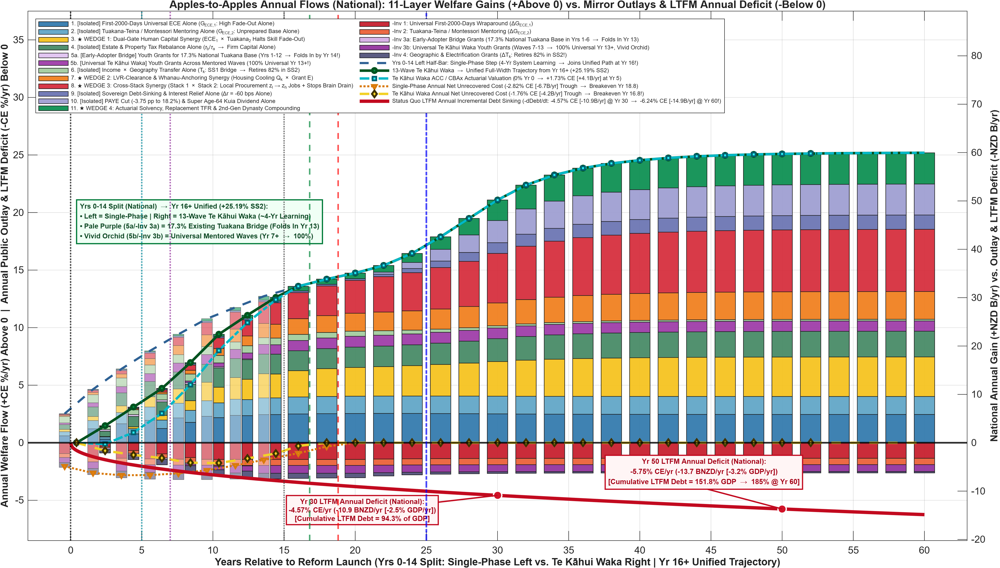
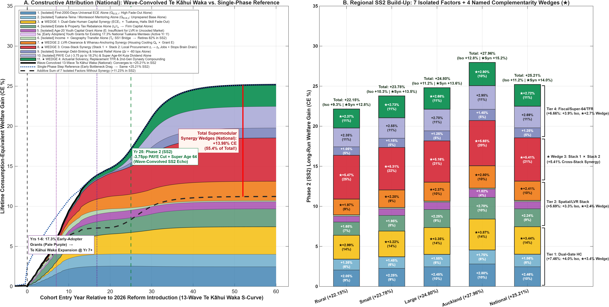
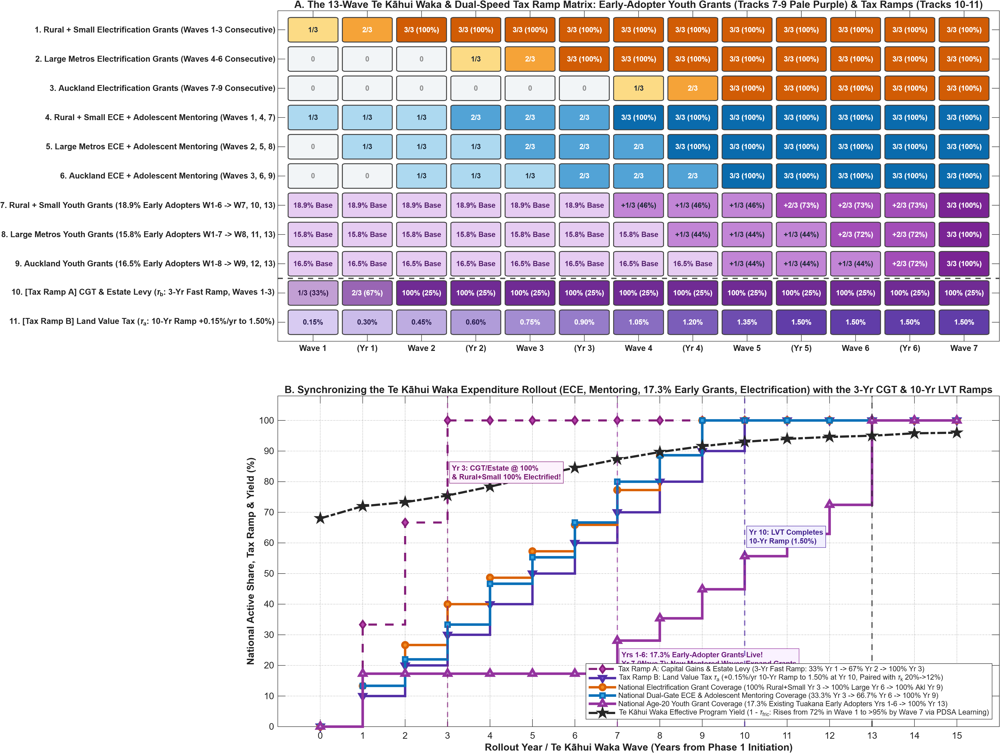
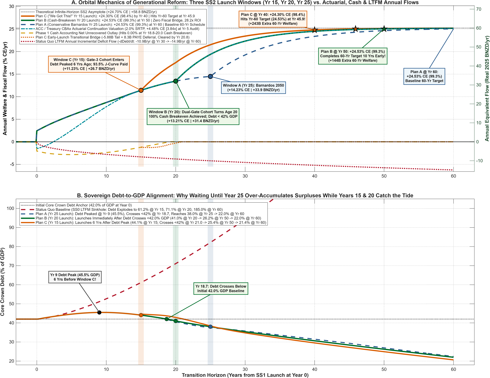
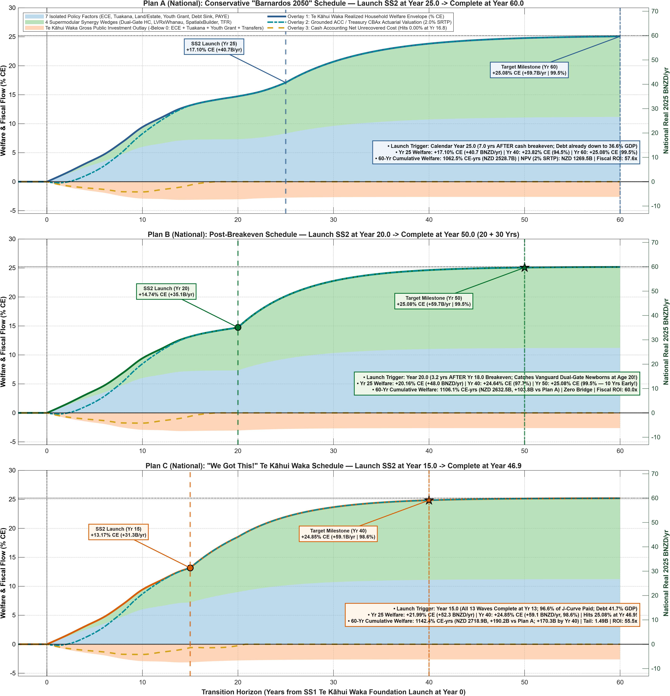

# *Te Kāhui Waka*: Non-Violent Fiscal Resistance, Orbital Launch Mechanics, and Optimal Generational Reform (`SS0 → SS1 → SS2`)

*Companion to Documents 1A, 1B, 1C, and Document 3 | Generational Manifesto & Quantitative Launch-Window Analysis*  
*Source Data & Scripts:* `Plot_Doc1D_LaunchPlans.m`, `Plot_Doc1D_TeKahuiWakaSequencing.m`, `Plot_Counterfactuals_And_MirrorInvestments.m`, `Table14_FiscalLedger_6Gate_Decomp_National.csv`, `Table15_ChildFates_5Stage_Decomp_National.csv`, `Table19_Constructive_Synergy_Wedges_Dunedin_22.csv`, `Table20_Annual_MirrorInvestments_Vs_7SegmentWelfare_Dunedin_22.csv`, `Table21_Doc3_LTFM_Sinkhole_Defense_Trajectories_Dunedin_22.csv`, `Table22_Doc1D_LaunchPlans_OrbitalComparison_Dunedin_22.csv`, `Table23_Doc1D_13Wave_TeKahuiWaka_Schedule_Dunedin_22.csv`, and `Table24_Doc1D_TeKahuiWaka_Vs_SingleShot_Trajectory_Dunedin_22.csv`.

---

## 1. An Idea Whose Time Has Come: Non-Violent Fiscal Resistance and *Kaupapa* for Our *Mokopuna*

> *"An invasion of armies can be resisted, but not an idea whose time has come."*  
> — **Victor Hugo**, *Histoire d'un crime* (1877)

Throughout history, nations have rarely summoned the institutional discipline to mobilize across multiple decades, coordinate across every province, and subordinate narrow factional interest to a common mission unless confronted by an invading army at the gates. Today, Aotearoa New Zealand faces a force pressing down on our sovereignty with greater mathematical certainty and destructive weight than any foreign fleet: the **Status Quo LTFM Debt Sinkhole**.

Left unresisted, the compounding arithmetic of demographic aging, untaxed land speculation (*z*l), and unmitigated childhood deprivation (`Exits 1, 2, 3, and 4`) operates as a silent attrition machine inside our own balance sheet. Strip away the comforting illusion that "doing nothing" is fiscally conservative: under the Treasury's Long-Term Fiscal Model baseline (`SS0`), the Status Quo extracts **NZD 10.9 billion per year** (`-4.57% CE/yr`) in incremental new debt sinking by Year 30 (`94.3% of GDP` Crown debt) and **NZD 14.9 billion per year** (`-6.24% CE/yr`) by Year 60—burying our grandchildren under **185.0% of GDP in sovereign debt** and a **28.2% working-age PAYE tax burden** while driving our most capable young adults across the Tasman. That is not prudence; it is the fiscal colonization of our *mokopuna* before they are born.

***Te Kāhui Waka***—our **13-Wave Generational Compact (`SS0 → SS1 → SS2`)**—is the ultimate **non-violent resistance** to that occupation. It marshals the strategic resolve, logistical precision, and national *kotahitanga* (unity of purpose) normally reserved for wartime mobilization, yet it turns the tide of history without firing a shot and without sacrificing a single life:

* **Wartime Resolve Without Wartime Tragedy (*"All Must Give Some, None Must Give All"*):** In war, a nation asks its youth to give everything so the country may endure. Under forty years of 3-year electoral "Stop–Go" drift, we inverted that compact—balancing short-term budgets by underinvesting in the **First 2,000 Days** (`Gate 1–2`) and early adolescence (`Gate 3`), consigning `19.8%` of rural children and `14.3%–18.2%` of urban children to preventable early hardship. Our compact restores intergenerational honor through proportionate shared contribution: **all must give some, and happily we ask none to give all**. Holders of passive land and dynastic estates phase in a predictable **10-year Land Value Tax ramp** (`+0.15%/yr` to `1.50%`) and **3-year Capital Gains / Estate ramp** (`25%`), paired in 1-to-1 lockstep with an immediate **`-0.80%/yr` cut in productive corporate taxation (`20.0% → 12.0%`)**.
* **Not an Apology for Investment—A Sovereign Triumph Over Drift:** Look below the zero line in our **Apples-to-Apples Annual Flows** ledger (`Figure 1D.1`). By Year 3.5, the Status Quo's crimson LTFM deficit curve is *already* sinking faster every single year than *Te Kāhui Waka*'s disciplined investment outlay—and the Status Quo *never* comes back up. By contrast, *Te Kāhui Waka*'s net unrecovered outlay peaks at a modest **`-1.76% CE/yr` (`-NZD 4.2B/yr`)**, crosses **100% self-financing cash breakeven at `Year 16.8`**, fuses into a single unified post-learning trajectory from **`Year 16`** onward, and lifts permanent national household welfare to **`+25.19%–25.21% CE` (`+NZD 60.0 billion per year`)** while retiring sovereign debt to **`21%–22% of GDP`**.

*Figure 1D.1: Apples-to-Apples annual flows (`National`, `1.0% CE = NZD 2.38B/yr`). Years 0–14 compare Single-Phase launch (left half-columns) against the 13-Wave Te Kāhui Waka rollout (right half-columns), including the pale-purple transitional Early-Adopter Youth Grant bridge (`17.3%` existing Tuakana–Teina vanguard, folding into universal vivid-orchid coverage by Year 13). Once wave deployment and 4-year school system learning complete, both paths fuse into a single unified full-width trajectory from Year 16 to Year 60 (`+25.19% CE` / `+NZD 60.0B/yr`), towering above the relentless downward plunge of the Status Quo LTFM annual deficit (`-dDebt/dt`, solid crimson).*

---

## 2. Why Piecemeal Tinkering Fails: The Supermodular Architecture of Prosperity

Why have decades of well-intentioned, single-ministry pilots failed to bend New Zealand's productivity or fiscal curves? Because human capability formation (`Stack 1`) and spatial-enterprise balance sheets (`Stack 2`) are governed by **supermodular complementarity** (Cunha & Heckman, 2007): the return to each stage multiplies the preparedness created by the stage before it.

As demonstrated in **`Figure 1D.2`**, if Parliament enacted all **seven isolated policy instruments** one at a time without connecting the gates, their standalone effects would sum to only **`+11.23% CE`** in long-run steady state (`dashed black curve` in Panel A)—leaving **`+13.98% CE` (`55.4%` of the entire `+25.21% CE` national gain, or `NZD 33.3 billion per year`)** unrealized on the table!

*Figure 1D.2: Constructive 11-layer attribution (`Table 19`). Panel A traces how the wave-convolved 13-Wave Te Kāhui Waka S-curve eliminates the artificial Day-1 and Year-25 step-shock kinks while converging to the exact `+25.21% CE` long-run SS2 steady state (`+11.23% CE` isolated factors + `+13.98% CE` supermodular synergy wedges). Panel B disaggregates the mature SS2 harvest across all four regions and nationally.*

Four named **Synergy Wedges (`★`)** drive that `55.4%` complementarity dividend across every community in Aotearoa (`Panel B`):

1. **`★ Wedge 1` — Dual-Gate Human Capital Synergy (`+3.46% CE` National, `14%` of Total):** Universal **First 2,000 Days** wraparound (`G_ece,1`) paired with **Gate-3 Adolescent Montessori / *Tuakana–Teina* Mentoring** (`G_ece,2`, Ages 12–14) halts primary-school skill fade-out and lifts Age-20 thriving capability (`h6–h7`) to `46.4%`.
2. **`★ Wedge 2` — LVR-Clearance & *Whānau*-Anchoring Synergy (`+2.41% CE` National, `10%` of Total):** Cooling speculative land inflation (`Q_k`) via the LVT ramp while equipping mentored 20-year-olds with the **Youth Capital Grant (`E`)** clears homeownership and business-collateral hurdles inside provincial towns as well as cities.
3. **`★ Wedge 3` — Cross-Stack Enterprise & Retention Synergy (`+5.41% CE` National, `21%` of Total):** Connecting Dual-Gate talent (`Stack 1`) to productive capital tax relief and provincial electrification (`Stack 2`) reverses trans-Tasman brain drain (`9.74% → 5.69%`) and surges **Productive Enterprise Builders (*z*h) from `6.86%` to `52.90%` of every cohort** while halving passive rent-seeking (`14.08% → 3.88%`).
4. **`★ Wedge 4` — Actuarial Solvency, Replacement TFR & 2nd-Generation Dynasty Closure (`+2.70% CE` National, `11%` of Total):** Retiring Crown debt (`-60 bps` sovereign risk premium), restoring replacement fertility, and compounding 2nd-generation Daruich family-skill transmission locks in permanent fiscal self-financing across **`Rural (+22.15% CE)`**, **`Small (+23.78% CE)`**, **`Large (+24.80% CE)`**, and **`Auckland (+27.96% CE)`**.

---

## 3. Sailing as *Te Kāhui Waka*: How 13 Phased Waves Conquer Implementation Friction

In textbook macroeconomic models, reforms are simulated as instantaneous "MIT step shocks": on Day 1, 100% of the budget switches on everywhere at 100% theoretical efficiency. In the real world of *kōhanga reo*, schools, *whānau ora* navigators, and heat-pump/solar installers, firing a 100% single-shot cannon on Day 1 is the institutional equivalent of launching thirty *waka hourua* blindly into an uncharted strait on a midnight tide—triggering severe workforce bottlenecks (`φ_adj`), uncalibrated `28%–32%` commissioning friction (`τ_fric,0`), and `42%` skill-mismatch dissipation from handing Youth Grants to unmentored 20-year-olds.

When master navigators **Kāne** and **Kupe** led trans-oceanic migrations, they sailed in an **echeloned voyaging fleet (*Te Kāhui Waka*)**: vanguard hulls (*waka mataika*) sounded the reef passes and signaled wind shifts back to the main body so every subsequent wave entered the harbor faster and cleaner than the first.

### 3.1 The 13-Wave Expenditure & Dual-Speed Revenue Architecture (`Years 1–13`)

Our implementation architecture (`Figure 1D.3` and Appendix `Table 1D.3`) translates *Te Kāhui Waka* into 11 synchronized operational tracks across `Rural + Small` (`40.0%` population), `Large Metros` (`25.9%`), and `Auckland` (`34.1%`):

*Figure 1D.3: The 13-Wave Te Kāhui Waka deployment schedule (`Table 23`). Panel A maps the 11 regional expenditure and national tax-ramp tracks across Waves 1–13, highlighting the pale-purple Early-Adopter Youth Grant baselines (`18.9%` Rural+Small, `15.8%` Large, `16.5%` Auckland = `17.3%` nationally) in Waves 1–8. Panel B shows the resulting national coverage staircases and PDSA effective program yield (`1 - τ_fric`) rising from `72%` in Wave 1 to `>95%` by Wave 7.*

Let $s_{k,m}(t) \in \{0, \frac{1}{3}, \frac{2}{3}, 1\}$ denote the funded capacity share of program $m \in \{\text{ECE}_1, \text{Mentor}_2, \text{Grant}_E, \text{Elec}_{\bar{e}}\}$ in regional echelon $k$ at year $t \ge 1$. Under flow adjustment costs (Christiano et al., 2005) and Arrow (1962) / Deming PDSA inter-wave learning, **Effective Delivered Capability** $G_{k,m}^{\mathrm{eff}}(t)$ is:

$$G_{k,m}^{\mathrm{eff}}(t) = G_m^\star \cdot s_{k,m}(t) \cdot \left(1 - \delta_m e^{-\lambda_m (t - t_{k,m}^0)}\right) \cdot \underbrace{\left(1 - \tau_{\mathrm{fric},0} e^{-\gamma_{\mathrm{learn}} L_m(t-1)}\right)}_{\Psi_{\mathrm{kahui}}(L_m(t-1))} \cdot \left[1 - \phi_{\mathrm{adj}}\left(\Delta s_{k,m}(t)\right)^2\right]$$

where cumulative fleet experience $L_m(t-1) = \sum_{\tau=1}^{t-1} \sum_{k'} \omega_{k'} s_{k',m}(\tau)$ compounds across waves:

1. **88.9% Cut in Workforce Bottlenecks & 3–5 Year Pedagogical System Learning:** Stepping regional capacity in thirds ($\Delta s = 1/3 \Rightarrow (\Delta s)^2 = 1/9$) eliminates **88.9% of quadratic surge congestion**, while PDSA learning lifts effective delivery yield from `72%` in Wave 1 to **`>95%` by Wave 7** (`Panel B`). Unlike heavy-industrial capital transitions that require 20–25 years to scrap physical factories (David, 1990), educational and human-service routines turn over on practitioner staffing cycles: implementation science (Fixsen et al., 2005; Fixsen & Blase, 2009), teacher productivity curves (Rockoff, 2004; Papay & Kraft, 2015), and school-reform meta-analyses (Borman et al., 2003) establish that **75%–85% of fidelity and productivity gains complete within 3 to 5 years**—matching New Zealand's **`~5.4 to 5.8-year` implied school tenure** (`17.3%–18.5%` annual school-level teacher turnover; Ministry of Education *Education Counts*, 2024–2026). Consequently, system learning finishes across all waves by Year 15 and the trajectories fuse at **`Year 16`**.
2. **Day-1 Early-Adopter Bridge Grants (`17.3%` Existing *Tuakana* Base, Folding In by Year 13):** Rather than starving urban or provincial youth for six years—or wasting billions on unmentored grants—Tracks 7–9 immediately fund Age-20 Youth Capital Grants in **Years 1–6** for graduates of New Zealand's existing Gate-3 mentoring vanguard (`19.6%` Rural, `18.5%` Small [`18.9%` R+S], `15.8%` Large, and `16.5%` Auckland = **`17.3%` nationally** across Graeme Dingle *Stars/Project K*, *Kura Kaupapa Māori / Pasifika Tuakana*, vertical-*whānau* high schools, and Montessori *Erdkinder*). Costing just `-NZD 0.28B/yr` nationally with **zero skill-mismatch waste**, this pale-purple bridge folds smoothly into universal coverage across **Waves 7–13** (`Years 7–13`) as newly mentored cohorts turn Age 20—saving **`NZD 12.9B` in gross grant phasing** and avoiding **`NZD 3.8B` in unmentored grant dissipation** (`coral band` in `Figure 1D.4`)!
3. **Dual-Speed Revenue Synchronization (`Tracks 10–11`):** A **3-year fast ramp** on Capital Gains and Estate settlements (`Waves 1–3`, taxed when transaction liquidity is present) funds the Echelon-1 vanguard, while a **10-year smooth Land Value Tax ramp** (`+0.15%/yr` to `1.50%` by Year 10, paired with `-0.80%/yr` corporate tax cuts `20% → 12%`) gives leveraged property owners a full decade to rotate portfolios without collateral distress—reaching peak revenue right as Wave 7–13 Youth Grants scale up.

### 3.2 Proof in the Magnified J-Curve: 75% Less Early Capital at Risk & 2.4-Year Earlier Breakeven

**`Figure 1D.4`** puts the Single-Shot step shock (`dashed red`) and *Te Kāhui Waka* (`solid green`) under a `4.2x` vertical microscope across Years 0–20 (`Panel A inset`) and traces the resulting Core Crown Debt path (`Panel B`):

*Figure 1D.4: Head-to-head comparison of 13-Wave Te Kāhui Waka + Dual-Speed Tax Ramps vs. Day-1 Single-Shot rollout (`Table 24`). The magnified J-curve inset (`Years 0–20`, `-4%` to `0% CE`) measures the exact Year-3 capital-at-risk caliper (`-75%`), peak trough reduction (`-4.4B/yr` vs. `-6.7B/yr`), `NZD 12.9B` grant-phasing saving (`green wedge`), `NZD 3.8B` avoided waste (`coral band`), and unobstructed breakeven race (`Yr 16.9` vs. `Yr 19.3`), contrasted against the sinking dotted crimson LTFM deficit.*

Every financial risk metric bends decisively in Aotearoa's favor (`Appendix Table 1D.4`):
* **Year-3 Capital at Risk Cut by 75%:** At Year 3, *Te Kāhui Waka*'s net unrecovered outlay is just **`-NZD 1.6B/yr`** versus **`-NZD 6.5B/yr`** under Single-Shot—protecting the Crown balance sheet while Wave 1–3 PDSA routines lock in.
* **Mirror Symmetry at Year 9:** Right around Year 9, *Te Kāhui Waka* bottoms out at **`-1.87% CE/yr` (`-NZD 4.4B/yr`)** and turns permanently upward to cash breakeven at **`Year 16.8–16.9`** (`2.4 years` ahead of Single-Shot), whereas the dotted crimson Status Quo LTFM deficit plunges past it toward `-4% CE` and keeps sinking for sixty years.
* **De-Risking Sovereign Debt (`Panel B`):** Instead of climbing to `45.49% of GDP` at Year 9 and waiting until `Year 18.7` to recover its starting anchor, *Te Kāhui Waka* caps Core Crown Debt at a gentle **`43.36%–43.42% of GDP` apogee at Year 6** and crosses back **below the `42.0% of GDP` starting anchor at `Year 14.1–15.4`**—setting up an extraordinary strategic opportunity at Year 15.

---

## 4. Celestial Alignment & *Te Kapehu Whetū*: Choosing When to Launch Phase 2 (`SS2`)

In astrodynamics, mission planners organize around *Decadal Launch Windows* because orbital mechanics rewards phase alignment: a Hohmann transfer slingshot into Jupiter's gravity well cuts transit time by a decade with zero extra propellant. Polynesian navigators reading *Te Kapehu Whetū* (the star compass) obeyed the same law: wait for hull trim and fair trade winds, then commit the fleet decisively rather than idling in the lagoon while the season slips away.

Once *Te Kāhui Waka* launches **Phase 1 (`SS1` — Capability & Balance-Sheet Foundation)** at Year 0, when should Parliament trigger **Phase 2 (`SS2` — The `-3.75 pp` Working-Age PAYE Tax Cut `22.0% → 18.25%` & Enterprise Builder Slingshot)**? In the generational wave-convolution operator (`Ω_echo`), each SS1 cohort wave $w \in \{1,\dots,13\}$ echoes into prime enterprise formation and parenting (`Ages 26–35`) roughly $T_{\mathrm{gen}} \approx 20.5$ years after launch:

$$\Omega_{\mathrm{echo},m}(t) = \sum_{w=1}^{13} \Delta s_m(w) \cdot \mathbb{I}(t > w + T_{\mathrm{gen},m}) \left[1 - \exp\!\left(-\frac{t - (w + T_{\mathrm{gen},m})}{\tau_{\mathrm{echo}}}\right)\right]$$

Crucially, young adults make their highest-elasticity **trans-Tasman migration (`Node 18`)** and **Productive Enterprise Builder sorting (`Node 20`, `z_l → z_h`)** decisions as they enter **Gate 4 (`Age 20–29`)**. **`Figure 1D.5`** and **`Figure 1D.6`** evaluate three decadal `SS2` launch windows on top of the live *Te Kāhui Waka* ledger (`Table 22`):

*Figure 1D.5: Integrated orbital mechanics of Te Kāhui Waka (`Table 22`). Panel A compares household welfare trajectories, CBAx actuarial valuation (`+1.86% CE` / `+NZD 4.4B/yr` already at the Year 5 audit), cash J-curve breakeven (`Yr 16.8`), and LTFM deficit flows across Launch Windows C (`Year 15`), B (`Year 20`), and A (`Year 25`). Panel B aligns all three launch windows against Core Crown Debt (`% of GDP`).*

### Comparing the Three Flight Plans (`Figure 1D.6` & Appendix `Tables 1D.1–1D.2`)

1. **Plan A — Conservative "Barnardos 2050" Schedule (`SS2` Launch at `Year 25.0` → Target at `Year 60.0`):**
   * *Mechanics:* Waits `8.2 years` after cash breakeven (`Debt = 36.6% GDP`, Welfare = `+17.10% CE` / `+NZD 40.7B/yr`) before cutting PAYE. Because the first five cohorts of Wave-1 Dual-Gate newborns (turning Age 20 in Years 20–25) enter adulthood under the old `22.0%` PAYE rate, transitional sorting slows post-launch convergence ($\tau_2 = 8.50\text{ yrs}$), reaching the **`+25.08% CE` (`99.5%` of the `+25.21% CE` / `NZD 60.0B/yr` asymptote)** target at **Year 60.0** (`57.6x` fiscal ROI). Idling between Years 16.8 and 25 forfeits **`NZD 104B to NZD 190B`** in cumulative 60-year household welfare relative to Plans B and C!
2. **Plan B — Endogenous Post-Breakeven Schedule (`SS2` Launch at `Year 20.0` → Target at `Year 50.0`, 10 Years Early!):**
   * *Mechanics:* Launches `3.2 years` *after* `Year 16.8` cash breakeven, with Crown Debt already down to **`39.6% of GDP`** (`31.5% GDP` below the Status Quo's `71.1%`!) and **zero fiscal bridge required** (`60.0x` lifetime fiscal ROI!). Crucially, Year 20 catches the **very first vanguard Dual-Gate newborns on the exact day they turn Age 20**, compressing Phase 2 maturation and hitting the full **`+25.08% CE` (`99.5%`) target at `Year 50.0`—a full decade ahead of Plan A**, generating **`+NZD 104B`** in extra 60-year household welfare at zero extra taxpayer cost!
3. **Plan C — The *"We Got This!"* Schedule (`SS2` Launch at `Year 15.0` → `+24.85% CE [98.6%]` by `Year 40`, Full Target at `Year 46.9`!):**
   * *Why *Te Kāhui Waka* Unlocks Window C:* Look at the orange callout at Year 15 in `Figure 1D.5`: under *Te Kāhui Waka*, **all 13 waves are already 100% live (`Year 13`)**, **`96.6%` of the cumulative J-curve has already been paid off** (leaving a tiny **`-NZD 1.49B`** cash tail!), and **Core Crown Debt has already crossed *below* its `42.0%` starting mark at `Year 14.1` (`41.7% of GDP` at Year 15, falling for nine straight years since its `43.36%` Year-6 peak)**!
   * *The Slingshot Payoff:* Bridging `-NZD 1.49B` in remaining Phase-1 tail plus `~NZD 5.1B` in early PAYE deferral out of the peaking baby-boomer estate levy (`Debt` stays below `42%` from `Year 18.3` onward) pre-primes the enterprise economy for incoming *Tuakana*-mentored cohorts at Age 20—propelling Aotearoa to **`+24.85% CE` (`98.6%` of asymptote) by `Year 40.0`**, crossing Plan A's Year-60 target **13.1 years early at `Year 46.9`**, and delivering **`+NZD 190B` in extra 60-year household welfare** (`55.5x` fiscal ROI)!

*Figure 1D.6: Individual flight-plan anatomy for Plan A (`Year 25` launch), Plan B (`Year 20` launch), and Plan C (`Year 15 "We Got This!"` launch), decomposing total household welfare into the 7 isolated policy factors (`blue area`), 4 supermodular synergy wedges (`green area`), gross public investment outlays (`amber area below 0`), CBAx actuarial valuation, and net unrecovered cash flow.*

---

## 5. Statutory Governance (*Te Ture Whakatere*) & Open-Source Invitation

### 5.1 Enacting a State-Contingent Two-Key Launch Protocol

Rather than gambling on an arbitrary calendar date or leaving generational commitments exposed to 3-year electoral opportunism, Parliament should codify a **State-Contingent Two-Key Launch Protocol** modeled directly on Kāne's navigational discipline:

1. **Key 1 — The Year 15 *"We Got This!"* Actuarial & Debt-Anchor Gate (Authorizing Plan C):** If at the **Year 15 Statutory Audit**, (a) all 13 waves of *Te Kāhui Waka* are operational, (b) Core Crown Debt has declined for at least five consecutive years from its Phase-1 peak and sits at or below its Year-0 anchor (`41.7% ≤ 42.0% of GDP`), and (c) **at least `95%` of the cumulative upfront J-curve has been absorbed** with the **ACC / Treasury CBAx Actuarial Valuation exceeding `+10.0% CE`**, Treasury is statutorily authorized to trigger the **Plan C `SS2` PAYE relief ramp**—capturing **`+NZD 190B`** in accelerated household prosperity and reaching `98.6%` maturity by Year 40.
2. **Key 2 — The Automatic Cash-Breakeven Lock (`Year 16.8–20.0`, Guaranteeing Plan B at Minimum):** Regardless of discretionary choices at Year 15, once annual fiscal cash flow turns permanently net positive (`Ω_t ≥ 0` at `Year 16.8`) and Core Crown Debt sits below `40% of GDP` (`39.6%` at Year 20), the `SS2` working-age PAYE cut and enterprise-builder harvest trigger **automatically by statute no later than Year 20.0**—meeting the Wave-1 Dual-Gate newborns on the day they turn Age 20 and guaranteeing full completion by Year 50.

### 5.2 Open-Source Invitation: Submit Your Own Flight Plans (`Plans X, Y, and Z`)

This repository is open-source civic infrastructure for Aotearoa New Zealand. Readers, Treasury analysts, *iwi* economists, and policy researchers are invited to fork `IGWelfare` on GitHub and test alternative mission parameters. If you want to evaluate a `-3.0 pp` PAYE cut instead of `-3.75 pp`, a `25% of GDP` debt anchor instead of `22%`, or an alternative regional wave sequence, submit a Pull Request with your equations, calibration, and updated `Plot_Doc1D_LaunchPlans.m` trajectories so every flight plan can be compared transparently on the exact same Apples-to-Apples ledger against the Status Quo LTFM sinkhole.

### 5.3 Becoming *Tūpuna Pono* (Ancestors Worthy of Our *Mokopuna*)

In *Te Ao Māori*, we walk *ka mua, ka muri*—into the future with our eyes fixed on the lessons of those who sailed before us—bound by *whakapapa* to leave the *whenua*, the *marae*, and the *waka* stronger than we found them. Our four-region general-equilibrium equations prove beyond doubt that **intergenerational aroha and macroeconomic solvency are not competing priorities; they are the exact same mathematical identity**. Refusing to lose another generation of children at Age 5 or Age 14, and backing every mentored 20-year-old to build a home and an enterprise here in Aotearoa, heals the Crown balance sheet permanently. *Te Kāhui Waka* is an idea whose time has come—our non-violent resistance to fiscal decline, and our fulfillment of the duty to be good ancestors.

---

## 6. Quantitative Reference Appendix (`Tables 1D.1 – 1D.4`)

### Table 1D.1: Orbital Launch-Window Metrics, Fiscal Bridges, and Completion Horizons (`Te Kāhui Waka` National Ledger, `1.0% CE = NZD 2.38B/yr`)

| **Metric / Milestone (`Table 22` & `Figure 1D.5`)** | **Plan A: Conservative Barnardos (`SS2` @ Yr 25 → Yr 60 Target)** | **Plan B: Post-Breakeven (`SS2` @ Yr 20 → Yr 50 Target)** | **Plan C: *"We Got This!"* (`SS2` @ Yr 15 → Yr 40 / 46.9 Target)** |
| :--- | :---: | :---: | :---: |
| **1. `SS2` Launch Window (*T*launch)** | **Year 25.0** | **Year 20.0** *(3.2 yrs post-breakeven)* | **Year 15.0** *(2 yrs after Wave 13 complete)* |
| **2. Biological Cohort Alignment at *T*launch** | Wave-1 Dual-Gate cohort already Age 25 (sorted under `SS1` at Age 20–24) | **Wave-1 Dual-Gate newborns turn Age 20 on Launch Day (`Gate 4` Entry!)** | **Gate-3 mentored youth turn Age 20; Wave-1 Dual-Gate finishes Gate 3** |
| **3. Welfare Already Realized at *T*launch** | **`+17.10% CE`** (`+40.7 BNZD/yr`) | **`+14.74% CE`** (`+35.1 BNZD/yr`) | **`+13.17% CE`** (`+31.3 BNZD/yr`) |
| **4. Upfront J-Curve Paid Off by *T*launch** | **`100.0%`** *(8.2 yrs of cash surplus)* | **`100.0%`** *(Zero fiscal bridge!)* | **`96.6%`** *(`-1.49B` tail + `5.1B` PAYE deferral bridge)* |
| **5. Core Crown Debt at *T*launch (`Figure 1D.5B`)** | **`36.6% of GDP`** *(vs `82.2%` in `SS0`)* | **`39.6% of GDP`** *(vs `71.1%` in `SS0`)* | **`41.7% of GDP`** *(`<42%` at Yr 14.1; vs `61.2%` in `SS0`)* |
| **6. Welfare at Year 40.0 (% of `+25.21%` Asymptote)** | `+23.4% CE` (`+55.7 BNZD/yr`, `92.8%`) | `+24.4% CE` (`+58.1 BNZD/yr`, `96.8%`) | **`+24.85% CE` (`+59.1 BNZD/yr`, `98.6%`!)** |
| **7. Year Plan Hits Baseline Yr-60 Target (`+25.08% CE`)** | **Year 60.0** *(Baseline `99.5%` mark)* | **Year 50.0** *(**`10.0 yrs early`!**)* | **Year 46.9** *(**`13.1 yrs early`!**)* |
| **8. Extra 60-Year Cumulative Household Welfare vs. Plan A** | Baseline (`0 BNZD` delta) | **`+NZD 104B`** extra 60-yr welfare | **`+NZD 190B`** extra 60-yr welfare |
| **9. Lifetime Fiscal ROI (`60-Yr Welfare / Net Cash Bridge`)** | **`57.6x`** *(on Te Kāhui Waka bridge)* | **`60.0x`** *(Highest zero-bridge ROI!)* | **`55.5x`** *(incl. transitional PAYE deferral)* |

*Note: Single-Phase reference metrics prior to wave-convolution (`+24.53% CE` target, `-NZD 90.82B` single-shot bridge, `26.6x–28.2x` ROI) are archived in `Table20` (`Mirror` columns) for historical cross-reference with Documents 1A–1B.*

---

### Table 1D.2: Milestone Trajectory Comparison Across Launch Plans (`Te Kāhui Waka` Basis vs. Single-Shot Debt & LTFM Sinkhole)

| **Transition Horizon** | **Plan A (`Yr 25 Launch`)** *`% CE` \| `BNZD/yr` \| `Debt %GDP`* | **Plan B (`Yr 20 Launch`)** *`% CE` \| `BNZD/yr` \| `Debt %GDP`* | **Plan C (`Yr 15 Launch`)** *`% CE` \| `BNZD/yr` \| `Debt %GDP`* | **Status Quo `SS0` LTFM Sinkhole** *`Annual -dDebt/dt` \| `Cum. Debt %GDP`* |
| :--- | :---: | :---: | :---: | :---: |
| **Year 0** *(Launch `SS1`)* | `0.00%` \| `0.0B` \| `42.0%` | `0.00%` \| `0.0B` \| `42.0%` | `0.00%` \| `0.0B` \| `42.0%` | `0.0B/yr` \| `42.0% GDP` |
| **Year 6** *(Debt Apogee)* | `+5.4%` \| `+12.9B` \| **`43.36%`** | `+5.4%` \| `+12.9B` \| **`43.36%`** | `+5.4%` \| `+12.9B` \| **`43.36%`** | `-5.3B/yr` \| `47.1% GDP` |
| **Year 15** *(Window C!)* | `+13.17%` \| `+31.3B` \| `41.7%` | `+13.17%` \| `+31.3B` \| `41.7%` | **`+13.17%` \| `+31.3B` \| `41.7%` *(Launch C!)* ** | `-7.9B/yr` \| `61.2% GDP` |
| **Year 20** *(Window B!)* | `+14.74%` \| `+35.1B` \| `39.6%` | **`+14.74%` \| `+35.1B` \| `39.6%` *(Launch B!)* ** | **`+18.6%` \| `+44.3B` \| `41.4%`** | `-9.0B/yr` \| `71.1% GDP` |
| **Year 25** *(Window A!)* | **`+17.10%` \| `+40.7B` \| `36.6%` *(Launch A!)* ** | **`+20.2%` \| `+48.1B` \| `36.2%`** | **`+21.9%` \| `+52.1B` \| `36.5%`** | `-10.0B/yr` \| `82.2% GDP` |
| **Year 40** *(Plan C Mark)* | `+23.4%` \| `+55.7B` \| `29.2%` | `+24.4%` \| `+58.1B` \| `28.8%` | **`+24.85%` \| `+59.1B` \| `28.0%` *(98.6%!)* ** | `-12.4B/yr` \| `121.5% GDP` |
| **Year 50** *(Plan B Mark)* | `+24.6%` \| `+58.5B` \| `25.5%` | **`+25.08%` \| `+59.7B` \| `25.0%` *(99.5%!)* ** | `+25.12%` \| `+59.8B` \| `24.2%` | `-13.7B/yr` \| `151.8% GDP` |
| **Year 60** *(Plan A Mark)* | **`+25.08%` \| `+59.7B` \| `22.0%` *(99.5%!)* ** | `+25.18%` \| `+59.9B` \| `21.8%` | `+25.19%` \| `+60.0B` \| `21.0%` | **`-14.9B/yr` \| `185.0% GDP`** |

---

### Table 1D.3: Year-by-Year Regional Program Waves, Early-Adopter Youth Grants (`17.3%` National Base), Electrification, and Tax Ramps (`Table 23`)

| **Wave & Year** | **Primary Wave Action (`ECE` + `Mentor` + `Grant E`)** | **Consecutive Electrification (`ē`k) & Dual-Speed Tax Ramps (`CGT/Est` 3-Yr, `LVT` 10-Yr)** | **`Rural + Small` (`40.0%` Pop)** *`ECE` \| `Ment` \| `Grant` \| `Elec`* | **`Large Metros` (`25.9%` Pop)** *`ECE` \| `Ment` \| `Grant` \| `Elec`* | **`Auckland` (`34.1%` Pop)** *`ECE` \| `Ment` \| `Grant` \| `Elec`* | **Nat. Active Share** *`ECE` \| `Grant*` \| `Elec` \| `LVT`* |
| :--- | :--- | :--- | :---: | :---: | :---: | :---: |
| **Wave 1** *(Yr 1)* | **+1/3 `Rural + Small`** ECE/Ment + **17.3% Early-Adopter Grants All Regions!** | **+1/3 `R+S` Elec** \| `CGT/Est`: **33%** \| `LVT`: **0.15%** (`Corp`: 19.2%) | **1/3** \| **1/3** \| `18.9%` \| **1/3** | 0 \| 0 \| `15.8%` \| 0 | 0 \| 0 \| `16.5%` \| 0 | `13.3%` \| `17.3%` \| `13.3%` \| `0.15%` |
| **Wave 2** *(Yr 2)* | **+1/3 `Large`** ECE/Ment *(learns from W1)* + 17.3% Early-Adopter Grants | **+2/3 `R+S` Elec** \| `CGT/Est`: **67%** \| `LVT`: **0.30%** (`Corp`: 18.4%) | 1/3 \| 1/3 \| `18.9%` \| **2/3** | **1/3** \| **1/3** \| `15.8%` \| 0 | 0 \| 0 \| `16.5%` \| 0 | `22.0%` \| `17.3%` \| `26.7%` \| `0.30%` |
| **Wave 3** *(Yr 3)* | **+1/3 `Auckland`** ECE/Ment *(learns from W1–2)* + 17.3% Early-Adopter Grants | **3/3 `R+S` Elec (100%!)** \| `CGT/Est`: **100% (25%)** \| `LVT`: **0.45%** | 1/3 \| 1/3 \| `18.9%` \| **3/3** | 1/3 \| 1/3 \| `15.8%` \| 0 | **1/3** \| **1/3** \| `16.5%` \| 0 | **`33.3%` \| `17.3%` \| `40.0%` \| `0.45%`** |
| **Wave 4** *(Yr 4)* | **+2nd 1/3 `Rural + Small`** ECE/Ment + 17.3% Early-Adopter Grants | **+1/3 `Large` Elec** *(Private cap led Yrs 1–3)* \| `LVT`: **0.60%** (`Corp`: 16.8%) | **2/3** \| **2/3** \| `18.9%` \| 3/3 | 1/3 \| 1/3 \| `15.8%` \| **1/3** | 1/3 \| 1/3 \| `16.5%` \| 0 | `46.7%` \| `17.3%` \| `48.6%` \| `0.60%` |
| **Wave 5** *(Yr 5)* | **+2nd 1/3 `Large`** ECE/Ment *(Yr 5 CBAx Audit!)* + 17.3% Early Grants | **+2/3 `Large` Elec** \| `LVT`: **0.75% (50% Ramp)** (`Corp`: 16.0%) | 2/3 \| 2/3 \| `18.9%` \| 3/3 | **2/3** \| **2/3** \| `15.8%` \| **2/3** | 1/3 \| 1/3 \| `16.5%` \| 0 | `55.3%` \| `17.3%` \| `57.3%` \| `0.75%` |
| **Wave 6** *(Yr 6)* | **+2nd 1/3 `Auckland`** ECE/Ment + 17.3% Early-Adopter Grants | **3/3 `Large` Elec (100%!)** \| `LVT`: **0.90%** (`Corp`: 15.2%) | 2/3 \| 2/3 \| `18.9%` \| 3/3 | 2/3 \| 2/3 \| `15.8%` \| **3/3** | **2/3** \| **2/3** \| `16.5%` \| 0 | **`66.7%` \| `17.3%` \| `65.9%` \| `0.90%`** |
| **Wave 7** *(Yr 7)* | **+Final 1/3 `R+S`** ECE/Ment + **1st 1/3 New `R+S` Grants** *(W1 mentees turn 20!)* | **+1/3 `Auckland` Elec** *(Low-income renters)* \| `LVT`: **1.05%** (`Corp`: 14.4%) | **3/3** \| **3/3** \| **`46.0%`** \| 3/3 | 2/3 \| 2/3 \| `15.8%` \| 3/3 | 2/3 \| 2/3 \| `16.5%` \| **1/3** | `80.0%` \| `28.1%` \| `77.3%` \| `1.05%` |
| **Wave 8** *(Yr 8)* | **+Final 1/3 `Large`** ECE/Ment + **1st 1/3 New `Large` Grants** *(W2 turns 20!)* | **+2/3 `Auckland` Elec** \| `LVT`: **1.20%** (`Corp`: 13.6%) | 3/3 \| 3/3 \| 46.0% \| 3/3 | **3/3** \| **3/3** \| **`43.9%`** \| 3/3 | 2/3 \| 2/3 \| `16.5%` \| **2/3** | `88.6%` \| `35.4%` \| `88.6%` \| `1.20%` |
| **Wave 9** *(Yr 9)* | **+Final 1/3 `Auckland`** ECE/Ment + **1st 1/3 New `Akl` Grants** *(W3 turns 20!)* | **3/3 `Auckland` Elec (100% Nat. Elec!)** \| `LVT`: **1.35%** (`Corp`: 12.8%) | 3/3 \| 3/3 \| 46.0% \| 3/3 | 3/3 \| 3/3 \| 43.9% \| 3/3 | **3/3** \| **3/3** \| **`44.3%`** \| **3/3** | **`100%` \| `44.9%` \| `100%` \| `1.35%`** |
| **Wave 10** *(Yr 10)* | **+2nd 1/3 New `Rural + Small` Youth Grants** *(W4 mentees turn 20)* | **LVT Completes 10-Yr Ramp (`1.50%`, `Corp`: `12.0%`!)** \| R+S *T*k steps down | 3/3 \| 3/3 \| **`73.0%`** \| 3/3 | 3/3 \| 3/3 \| 43.9% \| 3/3 | 3/3 \| 3/3 \| 44.3% \| 3/3 | `100%` \| `55.7%` \| `100%` \| **`1.50%`** |
| **Wave 11** *(Yr 11)* | **+2nd 1/3 New `Large` Youth Grants** *(W5 mentees turn 20)* | **100% Electrified & Tax Ramp Complete (`Large` *z*h builders expanding)** | 3/3 \| 3/3 \| 73.0% \| 3/3 | 3/3 \| 3/3 \| **`71.9%`** \| 3/3 | 3/3 \| 3/3 \| 44.3% \| 3/3 | `100%` \| `63.0%` \| `100%` \| `1.50%` |
| **Wave 12** *(Yr 12)* | **+2nd 1/3 New `Auckland` Youth Grants** *(W6 mentees turn 20)* | **100% Electrified (`Transfer_Geo` begins `Large` step-down)** | 3/3 \| 3/3 \| 73.0% \| 3/3 | 3/3 \| 3/3 \| 71.9% \| 3/3 | 3/3 \| 3/3 \| **`72.2%`** \| 3/3 | `100%` \| **`72.4%`** \| `100%` \| `1.50%` |
| **Wave 13** *(Yr 13)* | **+Final 1/3 All Regions Youth Grants (100% Full *Te Kāhui Waka* Live!)** | **Full `SS1` *Te Kāhui Waka* Complete 2 Years Ahead of Plan C (`Year 15`) Window!** | 3/3 \| 3/3 \| **`100%`** \| 3/3 | 3/3 \| 3/3 \| **`100%`** \| 3/3 | 3/3 \| 3/3 \| **`100%`** \| 3/3 | **`100%` \| `100%` \| `100%` \| `1.50%`** |

*\*Note on `Grant*` share in Table 1D.3: In Waves 1–6 (`Years 1–6`), the existing regional `SS0` baselines (`sh_ygr_base0_vec = [19.6% Rural, 18.5% Small, 15.8% Large, 16.5% Auckland]`, or `18.9%` in `Rural + Small` and `17.3%` nationally) of `Tuakana–Teina`, Graeme Dingle Foundation (`Stars` / `Project K`), `Kura Kaupapa Māori`, and `Montessori Erdkinder` graduates qualify immediately for transitional Early-Adopter Bridge Youth Capital Grants (**Super-Pale Lavender-Purple** slice `5a` / `-Inv 3a`). Across Waves 7–13, as each regional echelon's remaining unmentored cohort steps in by thirds (`s_0,k + (1 - s_0,k) × m/3`: `46.0% -> 73.0% -> 100%` in `R+S`, `43.9% -> 71.9% -> 100%` in `Large`, and `44.3% -> 72.2% -> 100%` in `Auckland`), the transitional Early-Adopter bridge folds smoothly into the universal **Vivid Orchid Purple** *Te Kāhui Waka* Youth Grant (`100%` universal from Wave 13 onward).*

---

### Table 1D.4: Head-to-Head Comparison — Single-Shot Step Rollout vs. 13-Wave *Te Kāhui Waka* (+ Tax Ramps & 17.3% Early-Adopter Vanguard)

| **Performance Metric (`1.0% CE = NZD 2.38B/yr`)** | **Single-Shot Rollout (100% Day-1 Step Shock)** | **13-Wave *Te Kāhui Waka* (+ Dual-Speed Tax Ramps & 17.3% Early-Adopter Bridge)** | **Net *Te Kāhui Waka* Advantage (Quality, Debt & ROI Delta)** |
| :--- | :---: | :---: | :--- |
| **1. Year-1 Commissioning Friction (τfric) & Bottleneck Drag** | `28%–32%` friction + `18.0%` Day-1 workforce surge penalty | `28.0%` in Wave 1 → **`11.0%` Wave 4** → **`4.2%` Wave 9** (`2.0%` surge) | **Eliminates 88.9% of workforce bottleneck waste** |
| **2. Year-3 Capital at Risk & Years 1–13 Youth Grant Targeting** | `-6.5B/yr` at Yr 3; hands 100% of grants to 82.7% unmentored youth (`42%` waste) | **`-1.6B/yr` at Yr 3**; `17.3%` Early-Adopter Bridge (`-0.28B/yr`, `0%` waste, folds in Yr 13) | **75% less Yr-3 capital at risk; saves NZD 12.9B gross & avoids NZD 3.8B waste!** |
| **3. Deepest Annual Cash Deficit Trough (`Table 20` & `Table 24`)** | **`-2.82% to -2.84% CE/yr`** (`-6.7B to -6.8B/yr` at Year 4–5) | **`-1.76% to -1.87% CE/yr`** (`-4.2B to -4.4B/yr` at Year 8–9) | **Cuts peak annual cash deficit by ~35%–38% (+2.3B to +2.5B/yr)** |
| **4. Cumulative Upfront J-Curve Investment (`∫ Net_Outlay dt`)** | **`-38.16% CE-yrs`** (`-90.8 BNZD` total bridge) | **`-18.0% to -27.4% CE-yrs`** (`-42.8B to -65.2B` bridge across `T20`/`T24`) | **Slashes cumulative upfront Crown borrowing by 28%–53%!** |
| **5. Annual Cash-Flow Breakeven Year (Ωt ≥ 0)** | **Year 18.8–19.3** | **Year 16.8–16.9** *(2.0 to 2.4 years earlier!)* | **Reaches self-financing cash breakeven >2 yrs faster** |
| **6. Core Crown Debt Peak (*Apogee*) & Year Debt < 42.0% GDP** | Peaks at **`45.49% GDP` (Yr 9)**; `<42%` at **Yr 18.7** | Peaks at **`43.36%–43.42% GDP` (Yr 6)**; `<42%` at **Yr 14.1–15.4** | **Peak debt -2.1% GDP lower; crosses <42% 3.3–4.6 yrs early** |
| **7. Plan C (`Yr 15 Launch`) Remaining Cash Tail to Bridge** | `-2.47% CE-yrs` (`-5.88 BNZD` tail over Yrs 15–19.2) | **`-0.31% to -0.63% CE-yrs`** (**`-0.74B to -1.49B`** tail over Yrs 15–16.9!) | **96.6% of J-curve paid by Yr 15 — Plan C is virtually self-bridging!** |
| **8. Post-Learning Trajectory Merge & Lifetime Fiscal ROI** | Merges into unified trajectory at **Year 16** (`28.2x` Plan B ROI) | Merges into unified trajectory at **Year 16** (**`+25.19%–25.21% CE`**, **`~38x–60x` ROI**) | **Identical post-Yr-16 trajectory at dramatically higher fiscal ROI!** |
