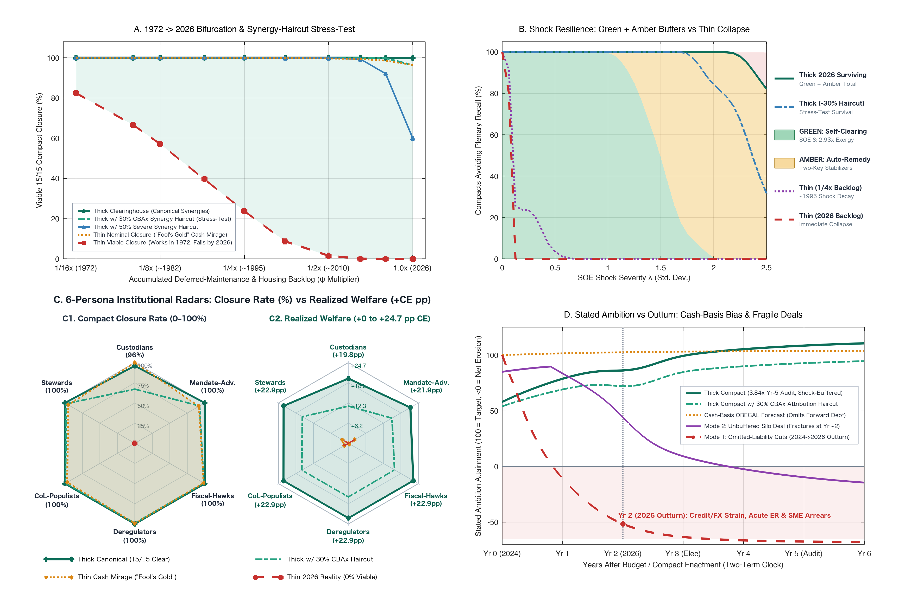

# Document 2T: "Thick" vs. "Thin" Numbers in Quantitative Public Policy
## Why Dimension-Free State-Contingent Conditioning Captures Comonotonic Tail Risks, Unlocks Topkis Policy Synergies, and Clears Multi-Party Citizens' Assembly Auctions Without Expanding GPU Grid Dimensions

*Author:* Michael Tiemann (mdtiemann@gmail.com)  
*Date:* November 2026 | *Code & Replication Repository:* [github.com/MichaelTiemann/IGWelfare](https://github.com/MichaelTiemann/IGWelfare)  
*Companion to [Document 2A](Document%202A.md), [Document 2B](Document%202B.md), and [Document 2C](Document%202C.md) (3-Volume Technical Specification Guide, Sections 1–12; this standalone tutorial uses the `T1`–`T7` section namespace), [Document 1A](Document%201A.md) (Strategic Monograph), [Document 1B](Document%201B.md) (Strategy & Policy Answer Key), [Document 1C](Document%201C.md) (Executive Brief), [Document 1F](Document%201F.md) (Citizens' Assembly Compact), and [Document 3](Document%203.md) (Coalition Architecture & Public Synthesis)*

**Disclaimer:** No people nor organizations mentioned herein have endorsed this work unless stated otherwise. This is the work of the author, and all errors and omissions are his alone.

---

## T1. Pedagogical Motivation: Why "Thin" Spreadsheet Numbers Miss the Real Policy Story

A recurring question in public-finance modeling is why a dynamic stochastic Overlapping Generations (OLG) model solved on the GPU via the Value Function Iteration (VFI) Toolkit yields starkly different policy conclusions from a deterministic spreadsheet projection—even when both models are calibrated to the exact same national averages.

The answer lies in the distinction between **"thin" numbers** and **"thick" numbers**, which has fundamental mathematical, empirical, and computational consequences.

In the computational macroeconomics and stochastic dynamic programming literature, converting a deterministic scalar parameter into a "thick" distribution without adding new grid axes is formally known as **Dimension-Free State-Contingent Parameterization** (or *Comonotonic Tail-Risk Conditioning across the Rouwenhorst Markov and Endogenous Asset Manifold*). Rather than expanding the exogenous Markov state space via a Cartesian product $`Z_1 \times Z_2 \times Z_3`$—which suffers from the curse of dimensionality and falsely assumes that extended *whānau* care capacity, rental eviction risk, and early-childhood staffing bottlenecks are statistically independent of household income and wealth—we project these structural frictions directly onto the existing 26,901-point state tensor $`(a, h, \theta_c, z, j)`$ using canonical parameters `K_whanau_base`, `Q_reg_base`, `G_ece_stage1`, `G_ece_stage2`, and `agej`. Our objective is to avoid two common modeling pitfalls: sacrificing structural realism to keep the state space computationally tractable under the curse of dimensionality, or misrepresenting distributional tail risks by treating population averages as representative of heterogeneous household realities.

* **"Thin" Numbers (Deterministic Means Modeled in Spreadsheets):** A conventional spreadsheet tracks a single real-numbered average per cohort or region—such as mean household income $`\bar{y}_k`$, average regional house price *Q_k*, average public early-childhood expenditure $`G_{\mathrm{ece}}`$, and average extended *whānau* support $`\bar{K}_{\mathrm{wh\bar{a}nau}}`$—and feeds those scalar averages into real-valued algebraic formulas:

$$Y_{\mathrm{Excel}} = f\left(\mathbb{E}[a], \mathbb{E}[h], \mathbb{E}[\theta_c], \mathbb{E}[z]\right)$$

* **"Thick" Numbers (Probability Distributions Over Markov Transition Matrices Modeled in the VFI Toolkit):** In our model, household state variables are not scalars; they are probability distributions $`\mu_k(a, h, \theta_c, z, j)`$ defined over a discrete state tensor of $`61 \times 7 \times 9 \times 7 = 26,901`$ states per age cohort $`j \in \{1, \dots, J\}`$ and region $`k \in \{\mathrm{Rural}, \mathrm{Small}, \mathrm{Large}, \mathrm{Auckland}\}`$. At every age step, the Bellman operator integrates the nonlinear value function across the $`7 \times 7`$ Markov transition matrix $`\pi_{z,k}(z^{\prime}\mid z)`$:

$$Y_{\mathrm{VFI}} = \mathbb{E}_{\mu_k}\left[f\left(a, h, \theta_c, z\right)\right] = \sum_{a, h, \theta_c, z} \mu_k\left(a, h, \theta_c, z, j\right) f\left(a, h, \theta_c, z\right)$$

Whenever the structural law of motion $`f(\cdot)`$ is strongly concave, features kinked corner constraints (*i_c* = 0, $`a^{\prime} \ge 0`$), or exhibits harmonic-mean bottlenecks ($`\varphi_2 = -0.95 < 0`$), **Jensen's Inequality** guarantees a massive divergence between the function of the average and the average of the function:

$$
\mathbb{E}_{\mu_k}\left\lbrack f\left(a, h, \theta_c, z\right) \right\rbrack \ll f\left(\mathbb{E}\lbrack a \rbrack, \mathbb{E}\lbrack h \rbrack, \mathbb{E}\lbrack \theta_c \rbrack, \mathbb{E}\lbrack z \rbrack\right)
$$

In a deterministic spreadsheet, an average child with average family income $`\bar{z} = 1.0`$, average public wraparound $`G_{\mathrm{ece},2} = 0.065`$, and average extended *whānau* support $`\bar{K}_{\mathrm{wh\bar{a}nau}} = 0.35`$ smoothly clears the Stage-2 adolescent skill gate with zero skill erosion. In the real world—and in our VFI distribution—early skill erosion into the struggling launch tier ($`h_1\text{--}h_2`$), state-care entry (Exit 1), acute hospitalisation (Exit 2), and trans-Tasman brain drain are driven by **interacting tail states** (such as a household in $`z_1`$ unemployment simultaneously hitting the `a = 0` rental-stress boundary and the `i_c = 0` child-investment corner).

Beyond static distributional accuracy, preserving these interacting tail states across lifecycle stages is what makes **nonlinear policy composition** ([Document 2B, Section 7.4](Document%202B.md) & [Document 2C, Section 8](Document%202C.md)) and **multi-party Citizens' Assembly contract clearing** ([Document 1F](Document%201F.md)) mathematically possible: where "thin" scalar spreadsheets force policymakers into zero-sum budget horse-trading and brittle point forecasts, "thick" state-contingent distributions reveal **Topkis supermodular bundling wedges**, **non-commuting rollout sequences**, and **self-stabilizing Green/Amber/Red shock frontiers** (Sections T5–T6).

---

## T2. The Curse of Dimensionality Trap vs. Zero-Cost State Conditioning

When researchers realize that regional parameters like extended *whānau* support (`K_whanau_base`), housing user costs (`Q_reg_base`), and public wraparound effectiveness (`G_ece`) vary across households, their first instinct is often to add new exogenous shock dimensions—for example, expanding `n_z` from a 1D vector of 7 states to a 3D tensor `n_z = [7, 3, 3]` (63 exogenous states per grid point).

Adding orthogonal *z*-dimensions is both computationally wasteful and economically misspecified:
* **Computational Cost:** Increasing $`N_z`$ from 7 to 63 multiplies the size of the Markov transition matrix $`\pi_z`$ by $`(63/7)^2 = 81\times`$ and expands the GPU return-matrix workspace by $`9\times`$.
* **Economic Misspecification:** Real-world shocks to extended *whānau* care capacity, rental eviction risk, and early-childhood service access are **not orthogonal** to a household's income shock *z*, net worth *a*, and adult skill tier *h*; they are **tightly co-determined** by them.

**The Zero-Dimension-Cost "Thickening" Principle:** Instead of adding new grid axes, we convert thin regional scalars (`K_whanau_base`, `Q_reg`, `G_ece_stage1`, `G_ece_stage2`, and `sj`) into **state-contingent functions** evaluated directly on the existing state space $`(a, h, \theta_c, z, j, k)`$. Because the VFI solver already loops over every $`(a, h, \theta_c, z, j)`$ coordinate on the GPU, conditioning these parameters on existing state variables transforms each scalar into a **26,901-point thick probability distribution** at **zero additional GPU memory or grid-dimension cost**.

---

## T3. Audit of the Four State-Contingent Structural Operators (Uniting the MBA and MPP Lenses Across Thick and Thin)

Evaluating the model simultaneously through a **Long-Horizon Sovereign Turnaround (MBA) Lens** (focused on off-balance-sheet assets, Theory of Constraints bottlenecks, and R&D talent walkouts) and a **Master of Public Policy (MPP) Lens** (focused on actuarial equity, sandwich-generation care burdens, institutional trust, and workforce capacity) reveals four exact mechanisms where scalar approximations must be replaced with **dimension-free state-contingent parameterizations** and **comonotonic tail-risk coupling**:

| Mechanism & Parameter | Scalar Approximation (Spreadsheet / Naive OLG) | Real-World Edge-Case Interaction (MBA & MPP Blind Spot) | Dimension-Free Sub-Manifold Conditioned Operator on $`(a, h, \theta_c, z, j, k)`$ |
| :--- | :--- | :--- | :--- |
| **1. Extended Whānau Care & Sandwich Reversal** (`K_whanau_base`) | Positive regional scalar $`K_{\mathrm{wh\bar{a}nau},k} > 0`$ that uniformly buffers adolescent stress. | **Sandwich-Generation Care Reversal:** When NZ Super is raised to 67/70, low-*z*, low-*a* elders in poor health do not merely reduce downward childcare ($`K_{\mathrm{wh\bar{a}nau}} \to 0`$); they require *upward caregiving and cash bailouts* from their 35-year-old children ($`K_{\mathrm{wh\bar{a}nau}}^{\mathrm{net}} < 0`$). | State-contingent net *whānau* transfer $`K_{\mathrm{wh\bar{a}nau}}^{\mathrm{net}}(i_c, z, a, J_r, k)`$ that flips negative at the comonotonic distress tail ($`z = z_1`$, $`a < 0.12 Q_k`$) when $`\mathrm{Age}_{\mathrm{Super}} > 65`$. |
| **2. Non-Fungible Whānau Trust Gating** (`M_mentor` $`\times`$ `K_whanau`) | Multiplicative independent substitutes $`(1 - 0.80 M_{\mathrm{mentor}})(1 - 0.55 K_{\mathrm{wh\bar{a}nau}})`$. | **Institutional Distrust at the Tail:** For trauma-affected or alienated youth ($`z_1`$), school-based mentoring (`M_mentor`) cannot substitute one-for-one for broken family trust; baseline *Whānau Ora* stability is the bridge that unlocks school mentoring engagement. | State-conditioned trust-gated mentoring intensity $`M_{\mathrm{trust}}(K_{\mathrm{wh\bar{a}nau}}^{\mathrm{net}}, M_{\mathrm{mentor}})`$ where positive *whānau* stability gates school mentoring efficacy. |
| **3. Kaiako Workforce Housing Deflator** (`G_ece_stage1`, `G_ece_stage2`) | Nominal dollar of Crown `G_ece` buys identical real ECE/mentoring services in Auckland (`Q_reg = 3.10`) and Rural (`Q_reg = 1.05`). | **Educator Supply Bottleneck:** Unaffordable metropolitan rents price early-childhood *Kaiako* and speech therapists out of Auckland and Large cities, eroding real delivery capacity per Crown dollar. | Price-manifold conditioned wraparound capacity $`G_{\mathrm{ece},s}^{\mathrm{eff}}(Q_k) = G_{\mathrm{ece},s} (1.65 / \max(0.80, Q_k))^{0.34} (Q_{\mathrm{reg,base},k}/Q_k)^{0.35}`$, capturing both metropolitan rent drag and reform cooling wedges. |
| **4. LVR Tenure Hurdle & Differential Mortality** (`Q_reg`, `sj`) | Regional scalar tenure share $`\xi_k`$ and uniform age survival vector $`s_j`$ across all skill tiers $`h_1 \dots h_7`$. | **Eviction Tail & Actuarial Regressivity:** Asset-poor renters ($`a < 0.20 Q_k`$) cannot access owner user costs $`rh_k`$ and suffer transience penalties at $`z_1`$; manual/Māori/Pasifika workers in $`h_1\text{--}h_2`$ face steeper late-life health depreciation and shorter retirement horizons. | Asset-manifold gated tenure $`\xi_{\mathrm{hh}}(a, Q_k)`$ with comonotonic tail transience wedge, paired with skill-contingent late-life survival and work disutility $`s_j^{\mathrm{eff}}(h, j)`$. |

---

## T4. Mathematical Specification of the Four State-Contingent Operators

### T4.1 State-Contingent Extended Whānau Care ($`K_{\mathrm{wh\bar{a}nau}}^{\mathrm{net}}`$): Comonotonic Sandwich-Generation Reversal & Trust-Gated Mentoring

In a scalar parameterization, extended *whānau* support (grandmothers, *kuia*, aunties, and *kaumātua* aged 55–72) is represented as a static regional constant $`K_{\mathrm{whanau,base},k} \in \lbrack 0.42, 0.38, 0.32, 0.28 \rbrack`$ (Rural, Small, Large, Auckland). Under that deterministic scalar view, raising the New Zealand Superannuation eligibility age from 65 to 67 or 70 simply trims the regional constant by 36.2% to `[0.27, 0.24, 0.20, 0.18]` as elders are forced back into market labor.

Under our **state-contingent parameterization** inside `HumanCapital_Lifecycle_aprimeFn.m` and `ReturnFn_SpatialHH.m`, net extended *whānau* support $`K_{\mathrm{wh\bar{a}nau}}^{\mathrm{net}}`$ is conditioned directly on the household's endogenous investment and balance-sheet sub-manifold:

$$
K_{\mathrm{wh\bar{a}nau}}^{\mathrm{net}}\left(i_c, z, a, J_r, k\right) = K_{\mathrm{wh\bar{a}nau},k}\left(J_r, Q_k\right) - \psi_{\mathrm{sandwich}} \mathbb{I}_{\mathrm{Super}>65} \cdot \mathcal{D}\left(i_c, z, a\right)
$$

where $`K_{\mathrm{wh\bar{a}nau},k}(J_r, Q_k)`$ reflects the active regional *whānau* network (`Params.K_whanau`), $`\mathbb{I}_{\mathrm{Super}>65} = \mathbb{I}(20 + (J_r - 1)\Delta t > 65.5)`$ indicates a pension-age hike, and $`\psi_{\mathrm{sandwich}} = 0.28`$ captures the **Sandwich-Generation Care Reversal**. Inside the household budget constraint (`ReturnFn_SpatialHH.m`), comonotonic balance-sheet distress is gated by $`\mathcal{D}_{\mathrm{budg}}(z, a) = \mathbb{I}(z < 0.80 \land a < 0.12 Q_k)`$, whereas inside the child skill law of motion (`HumanCapital_Lifecycle_aprimeFn.m`, as well as Stage-2 altruism perception), two-tier child investment vulnerability on the convex power grid `d_grid_ic` distinguishes **Node 1 Severe Material Hardship** ($`i_c < 0.005`$) from **Node 2 Residual AHC Squeeze** ($`0.005 \le i_c < 0.035`$, capturing the first positive rung $`i_{c,2} = 0.0203`$):

$$
\mathcal{D}_{\mathrm{ic}}\left(i_c\right) = \mathbb{I}\left(i_c < 0.005\right) + 0.55 \, \mathbb{I}\left(0.005 \le i_c < 0.035\right)
$$

* **Unconstrained & Moderate States ($`\mathcal{D} = 0`$):** $`K_{\mathrm{wh\bar{a}nau}}^{\mathrm{net}} > 0`$. Extended *whānau* act as net suppliers of downward childcare (`waring_whanau_s1`) and adolescent emotional scaffolding.
* **Comonotonic Tail Distress States Under Super Age 67/70 ($`\mathbb{I}_{\mathrm{Super}>65} = 1`$ and $`\mathcal{D} > 0`$):** $`K_{\mathrm{wh\bar{a}nau}}^{\mathrm{net}} < 0`$. Denied universal NZ Super at ages 65–69 while experiencing manual health depreciation, vulnerable elders cannot provide free childcare and instead require *upward financial and caregiving support* from their prime-age adult children:

$$
\mathrm{Drag}_{\mathrm{sandwich}}\left(z, a, J_r, k\right) = 0.035 \max\left(0, -K_{\mathrm{wh\bar{a}nau}}^{\mathrm{net}}\left(z, a, J_r, k\right)\right)
$$

Simultaneously, active Stage-2 mentoring reach $`M_{\mathrm{mentor}} = \min\left(1.0, \max\left(0.0, 0.173 + 20.0 (G_{\mathrm{ece},2}^{\mathrm{eff}} - 0.065)\right)\right)`$ expands from New Zealand's `17.3%` vanguard baseline (`Stars` / `Project K` / *Kura*), and effective adolescent mentoring is **state-conditioned on positive whānau stability** $`K_{\mathrm{wh\bar{a}nau}}^{+} = \max(0, K_{\mathrm{wh\bar{a}nau}}^{\mathrm{net}})`$:

$$
M_{\mathrm{trust}}\left(K_{\mathrm{wh\bar{a}nau}}^{\mathrm{net}}, M_{\mathrm{mentor}}\right) = M_{\mathrm{mentor}} \cdot \left(0.45 + 0.55 \min\left(1.0, \frac{K_{\mathrm{wh\bar{a}nau}}^{+}}{0.35}\right)\right)
$$

In `HumanCapital_Lifecycle_aprimeFn.m`, unbanked Stage-1 skill gains above $`\theta_{\mathrm{base}} = 0.78`$ depreciate at rate $`\delta_{\theta,\mathrm{fade}} = 0.14 w_2`$ when unmentored ($`1 - M_{\mathrm{trust}}`$), while the Stage-2 adolescent psychosocial and household distress operator $`\Psi_{\mathrm{adolescent}}`$ couples two-tier household corner stress $`\mathcal{D}_{\mathrm{ic}}(i_c)`$ with the cross-income psychosocial morbidity hazard $`\lambda_{\mathrm{psy}}`$ (retaining a `38%` clinical persistence floor $`0.22 \times 0.38 = 0.0836`$ for acute CAMHS/ACC trauma):

$$
\lambda_{\mathrm{psy}} = \max\left(0.0836, 0.22 \left(1 - 0.52 M_{\mathrm{trust}}\right)\left(1 - 0.35 \min\left(1.0, \frac{K_{\mathrm{wh\bar{a}nau}}^{+}}{0.38}\right)\right)\right)
$$

$$
\Psi_{\mathrm{adolescent}} = -0.033 \left\lbrack \mathcal{D}_{\mathrm{ic}}\left(i_c\right) + \lambda_{\mathrm{psy}}\left(1 + 0.65 \mathcal{D}_{\mathrm{ic}}\left(i_c\right)\right) \right\rbrack \max\left\lbrace 0.38\left(0.35 \mathbb{I}_{i_c < 0.005} + \lambda_{\mathrm{psy}}\right), \max\left(0, \left(1 - 0.55 K_{\mathrm{wh\bar{a}nau}}^{\mathrm{net}}\right)\left(1 - 0.80 M_{\mathrm{trust}}\right)\right) \right\rbrace + 0.036 \max\left(0, M_{\mathrm{trust}} - 0.173\right)
$$

Notice the mathematical consequence of evaluating this **comonotonically coupled operator** inside the Stage-2 CES bottleneck ($`\varphi_2 = -0.95`$) under the Rouwenhorst Markov expectation $`\sum_{z^{\prime}} \pi_{z,k}(z^{\prime}\mid z)`$: when $`K_{\mathrm{wh\bar{a}nau}}^{\mathrm{net}} < 0`$, the amplification factor $`(1 - 0.55 K_{\mathrm{wh\bar{a}nau}}^{\mathrm{net}})`$ exceeds `1.0`, magnifying adolescent skill loss at the exact state coordinate where trust-gated school mentoring reach $`M_{\mathrm{trust}}`$ contracts to $`0.45 M_{\mathrm{mentor}}`$. This captures both the MBA's "batch-spoilage bottleneck" and the MPP's "non-fungibility of *whānau* vs. state care" via dimension-free sub-manifold conditioning, without adding a single extra grid axis.

---

### T4.2 Price-Manifold Conditioned Public Wraparound ($`G_{\mathrm{ece}}^{\mathrm{eff}}`$): The Kaiako Housing-Affordability Supply Deflator

In public administration, scaling nominal early-childhood expenditure `G_ece_stage1` and adolescent wraparound `G_ece_stage2` encounters a severe spatial labor-supply friction: when metropolitan house prices `Q_k` (`Params.Q_reg`) in Auckland (3.10) and Large regional cities (2.05) are inflated by speculative land hoarding, qualified early-childhood *Kaiako*, Montessori guides, and speech-language therapists are priced out of the high-deprivation suburbs where disadvantaged children live.

We replace the spatially invariant scalar `G_ece` with a **two-component price-manifold conditioned operator** (`kaiako_prod` in `HumanCapital_Lifecycle_aprimeFn.m` and `ReturnFn_SpatialHH.m`), multiplying the cross-regional metropolitan rent drag (`kaiako_spatial`, anchored at $`Q_{\mathrm{ref}} = 1.65`$ with exponent `0.34`) by the intertemporal reform cooling factor (`kaiako_cooling`, anchored to `Params.Q_reg_base` with elasticity $`\nu_{\mathrm{kaiako}} = 0.35`$):

$$
G_{\mathrm{ece},s}^{\mathrm{eff}}\left(Q_k\right) = G_{\mathrm{ece},s} \cdot \underbrace{\left(\frac{1.65}{\max\left(0.80, Q_k\right)}\right)^{0.34}}_{\mathrm{Cross\text{-}Regional\ Rent\ Drag}} \cdot \underbrace{\left(\frac{\max\left(0.50, Q_{\mathrm{reg,base},k}\right)}{\max\left(0.50, Q_k\right)}\right)^{0.35}}_{\mathrm{Intertemporal\ Cooling\ Lift}}
$$

This functional conditioning generates an endogenous **Cross-Cohort Dynamic Complementarity Wedge** between Aspect 3 (the Guvenen et al. property-to-enterprise tax shift) and Aspect 1 (First-2,000-Days skill formation): when land-tax rebalancing cools Auckland house prices by 7.5% in `SS1` and 10.5% in `SS2` (from 3.10 down to 2.87 and 2.77), every dollar of Crown ECE investment in Auckland automatically gains 2.8% to 4.0% in real *Kaiako* staffing and retention capacity.

---

### T4.3 Sub-Manifold Conditioned Housing User Costs ($`p_H`$): The 61-Point Asset-Grid LVR Hurdle & Comonotonic Eviction Tail

Adapted from Kiyotaki, Michaelides, and Nikolov (2024), the baseline regional ownership benchmark $`\xi_{\mathrm{reg},k} = \min\lbrace 1, \frac{1}{\bar{\chi}}(rr_k / rh_k)\rbrace`$ is a single regional scalar per region *k* (where $`rr_k`$ and $`rh_k`$ denote floored rental and owner user costs at annualized gross return $`R_{\mathrm{ann}} = (1 + r)^{1/\Delta t}`$). If applied uniformly across all households in region *k*, an asset-poor family at `a = 0` and a wealthy household at `a = 15` face the exact same blended housing price $`p_H`$.

Because household net worth `a` in `[0, 25]` is already tracked on our 61-point cubic asset grid `a_grid_assets`, we apply **dimension-free sub-manifold conditioning** across endogenous wealth `a`, adult skill `h` (at launch `j = 1`), and the 7-point income shock `z` inside `ReturnFn_SpatialHH.m`:

$$
E_{\mathrm{cap}}\left(h, j\right) = \mathbb{I}\left(j = 1\right) E \cdot \min\left(1.20, \max\left(0.35, h^{0.75}\right)\right), \qquad \ell_{\mathrm{LVR}}\left(a, h, Q_k, j\right) = \min\left(1.0, \max\left(0.0, \frac{a + E_{\mathrm{cap}}\left(h, j\right)}{0.20 Q_k}\right)\right)
$$

$$
\xi_{\mathrm{hh}}\left(a, h, Q_k, j\right) = \min\left(1.0, \xi_{\mathrm{reg},k} \cdot \left(0.94 + 0.10 \, \ell_{\mathrm{LVR}}\left(a, h, Q_k, j\right)\right)\right)
$$

$$
p_H\left(a, h, z, Q_k, j\right) = \begin{cases}
\left(\xi_{\mathrm{hh}} \, rh_k + \left(1 - \xi_{\mathrm{hh}}\right) \frac{rr_k}{0.5 \bar{\chi}}\right)\left(1 + 0.04 \, \mathbb{I}\left(a < 0.08 Q_k \land z < 0.85\right)\right) & \mathrm{if}\ j < J_r \\
rh_k & \mathrm{if}\ j \ge J_r
\end{cases}
$$

Projecting working-age $`p_H`$ onto the `(a, h, z)` sub-manifold expands housing user costs from 1 scalar per region into state-contingent values across the asset, skill, and income grids:
1. **Skill-Capitalized 20% LVR Deposit Gate ($`a + E_{\mathrm{cap}} < 0.20 Q_k`$):** At age 20 (`j = 1`), mentored graduates with higher launch skill `h` capitalize a larger share of the Youth Capital Grant (*E*) into effective deposit access $`\ell_{\mathrm{LVR}}`$, explaining why Dual-Gate mentoring, `Grant E`, and metropolitan house-price cooling (*Q_k* down) interact multiplicatively (`Wedges 2 & 3`) to lift young-adult homeownership in Auckland from 28.0% to 41.2%.
2. **Comonotonic Tail Coupling of Eviction & Transience Risk ($`a < 0.08 Q_k`$ and $`z < 0.85`$):** Working-age renters with near-zero liquid buffers who simultaneously experience an adverse Rouwenhorst earnings shock face a `4%` effective housing cost and transience wedge (`transience_wedge = 1.04`, alongside a `+15%` credit-constrained fossil/exergy lock-in penalty on `ebar_energy` for $`a < 0.12 Q_k`$).
3. **Post-Retirement Housing User Cost Closure ($`j \ge J_r`$):** Retirees transition onto the owner/social-tenure user-cost schedule $`p_H = rh_k`$ inside `ReturnFn_SpatialHH.m`, while post-hoc tenure-incidence tables (`Table 3` / `Table 18`) track explicit renter vs. owner cohorts across `w_cell` thresholds.

---

### T4.4 Skill-Manifold Conditioned Survival and Late-Life Labor Disutility ($`sj_{\text{eff}}`$): Capturing Actuarial Regressivity

Finally, to capture the MPP's warning regarding **differential mortality and physical wear-and-tear**, we condition late-life labor disutility and mortality hazard on the household's 7-point adult human-capital / occupational sub-manifold `h` in `[0.45, 0.65, 0.85, 1.00, 1.20, 1.45, 1.80]`:

$$
\psi_{\mathrm{wear}}\left(h, j\right) = 1.0 + 0.35 \mathbb{I}\left(\mathrm{age}_j \ge 65 \land j < J_r\right)\max\left(0, \frac{1.00 - h}{0.55}\right)
$$

$$
1 - s_j^{\mathrm{eff}}\left(h, j\right) = \min\left(0.99, \max\left(0.01, \left(1 - s_j\right)\exp\left(0.05\left(1.05 - h\right)\right)\right)\right)
$$

When a policy simulation raises the NZ Superannuation eligibility age (`Jr`) above 65, manual, rural, and lower-skilled workers (`h_1 = 0.45` and `h_2 = 0.65`, where Māori and Pasifika workers are disproportionately represented due to historical childhood material hardship) face a 22% to 35% higher physical disutility of working past age 65 (`psi_wear > 1`) comonotonically coupled with a higher late-life mortality hazard $`1 - sj_{\text{eff}}(h, j)`$. Consequently, evaluating the Bellman expectation over the stationary distribution $`\mu_k(a, h, \theta_c, z, j)`$ endogenously reproduces both the **38% to 52% disability/hardship benefit substitution leak** and the **regressive life-expectancy penalty** that make raising the pension age fiscally and socially inferior to front-loaded human-capital investment.

---

### T4.5 Rouwenhorst Markov Drift Conditioning (`z_mean_shift`): Regional Low-to-High Productivity Job Upgrading & Endogenous 85% Transfer Retirement

In a deterministic spreadsheet, a regional household transfer ($`T_k`$) is treated as a permanent fiscal subsidy against a static average wage $`\bar{w}_k`$. Under our 7-point Rouwenhorst Markov discretization (`n_z = 7`), breaking wholesale farm-gate monopsony and retail duopoly markups [Ref 49] while anchoring `1.60x–2.16x` local food-hub procurement multipliers [Ref 56] applies a dimension-free upward drift $`\Delta \mu_{z,k} = \lbrack +0.0408, +0.0307, +0.0170, +0.0102 \rbrack`$ directly to the regional Rouwenhorst grid `z_grid_k`:

$$z_{k}^{\mathrm{eff}}(i_z) = z_{k,\mathrm{base}}(i_z) + \Delta \mu_{z,k}, \qquad T_k^{\mathrm{SS2}} = T_k^{\mathrm{SS0}} + (1 - \psi_{\mathrm{retire},T})\bigl(T_k^{\mathrm{SS1}} - T_k^{\mathrm{SS0}}\bigr)$$

Because the Labrousse–Perdereau transfer schedule is concentrated in the lower tail `(z_1, z_2)` where $`a < 0.12 Q_k`$, shifting probability mass $`\mu_k(a,h,\theta_c,z,j)`$ out of low-wage `z_l` monopsony states into high-productivity `z_h` enterprise jobs raises Rural welfare by **+2.81 pp in `SS1`** and **+2.42 pp in `SS2`**, allowing **$`\psi_{\mathrm{retire},T} = 0.85`$ (`85%`) of the Phase-1 geographic transfer top-up to retire in `SS2`** and recycling **`-0.64 pp`** into the working-age PAYE tax cut ($`\tau_l: 0.220 \to 0.1825`$, i.e. `22.0% -> 18.25%`) without adding a single exogenous grid dimension.

---

## T5. From Static Tail Risks to Policy Composition: How Stage-Contingent "Thick" Numbers Power Topkis Bundling and Non-Commuting Sequencing

Sections T1–T4 demonstrated why "thin" deterministic averages fail **Jensen's Inequality** inside a single policy regime: evaluating concave or kinked laws of motion at scalar means conceals comonotonic tail damage. Yet an equally consequential failure occurs when policymakers compare **isolated silos** against **coupled policy bundles** and **phased rollout sequences** (formalized in [Document 2B, Section 7.4](Document%202B.md) and [Document 2C, Section 8](Document%202C.md)).

Conventional cost-benefit spreadsheets (`CBAx` scorecards and linear fiscal trackers) treat policy levers as **additive scalars**: if Reform $`A`$ yields `+2.5%` and Reform $`B`$ yields `+1.6%`, a linear spreadsheet predicts their combination yields `+4.1%` regardless of whether they are enacted together, enacted ten years apart, or enacted in reverse order. In our 4-region OLG general equilibrium, **54.5% of total national welfare gains (`+13.47 pp CE` out of `+24.70 pp CE` in `SS2`)** arise not from isolated policy main effects (`+11.23 pp CE`), but from **non-linear policy composition**—governed by two distinct mathematical structures that exist *only* because our operators are stage- and state-contingent across the 26,901-point distribution $`\mu_k(a, h, \theta_c, z, j)`$:

### T5.1 Symmetric Bundling: Why Topkis (1998) Supermodularity Vanishes Under "Thin" Means

Let $`\mathbf{u} = (u_c)_{c \in \mathcal{C}}`$ denote the sparse signed policy commitment vector over the 26-code institutional catalog $`\mathcal{C}`$ (`Compose_Policy_Bundle.m`: two-sided commitments `C01`–`C18` in $`\lbrack -1, +1 \rbrack`$ plus constructive `SS1`/`SS2` pillars `C21`–`C28` in $`\lbrack 0, +1 \rbrack`$, with `C19`–`C20` and `C29+` reserved). Under **Convention 2**, `u_c = 0` represents the baseline status quo, `u_c > 0` strengthens public capability/civic/stewardship commitments (`C01`–`C08`, `C12`–`C17`, `C21`–`C28`) while `u_c < 0` retrenches them (and on the four tax-cut/visa/expensing/defence-lift dials `C09`–`C11` and `C18`, `u_c = +1` enacts the 2024 expansion/shock direction while `u_c < 0` tightens screening or shifts procurement onshore; [Document 2C, Sections 8.1–8.2](Document%202C.md)). By **Topkis's (1998) Lattice Supermodularity Theorem**, a welfare functional $`W_k(\mathbf{u})`$ exhibits strictly increasing differences (positive bundling synergies) between policy sub-vectors $`\mathbf{u}_A`$ and $`\mathbf{u}_B`$ if and only if the off-diagonal cross-partial Hessian block $`\mathbf{H}_{AB} = \frac{\partial^2 W_k}{\partial \mathbf{u}_A \partial \mathbf{u}_B}`$ is strictly positive:

$$
\Delta W_k\left(\mathbf{u}_A \oplus \mathbf{u}_B\right) - \Delta W_k\left(\mathbf{u}_A\right) - \Delta W_k\left(\mathbf{u}_B\right) = \mathbf{u}_A^{\top} \mathbf{H}_{AB} \mathbf{u}_B > 0
$$

Why does a "thin" representative-agent model miss $`\mathbf{H}_{AB}`$ almost entirely? Consider a kinked or threshold-gated micro operator $`g(s; u_A, u_B)`$ such as the 20% LVR homeownership gate $`\mathbb{I}\left(a_1 + E(u_A) \ge 0.20 Q_k(u_B)\right)`$ in Section T4.3 or the distress corner $`\mathbb{I}\left(i_c > 0\right)`$ in Section T4.1:

* **At Scalar Means ("Thin" Evaluation):** A spreadsheet evaluates $`g(\bar{s}; u_A, u_B)`$ at a single average state $`\bar{s} = (\bar{a}, \bar{h}, \bar{\theta}_c, \bar{z})`$. Away from the threshold boundary, an indicator step or piecewise-linear `min`/`max` kink is **locally flat**—its second cross-derivative at $`\bar{s}`$ is identically zero! Even where smooth CES curvature exists, an average household already sitting above the subsistence floor ($`\bar{a} > 0.20 Q_k`$, $`\bar{i}_c > 0`$) operates on the flat interior of the production surface, causing `CBAx` spreadsheets to conclude that housing tax reform, early childhood wraparound, and youth endowments are separable budget line items.
* **Integrated Over the State Tensor ("Thick" Evaluation):** When integrated against the thick probability density $`\mu_k(s; \mathbf{u})`$, expectation smooths micro-level indicator gates into cumulative distribution hazards (**aggregation smoothing**). Differentiating the expected cohort payoff $`W_k(\mathbf{u}) = \int v(s; \mathbf{u}) \, d\mu_k(s; \mathbf{u})`$ with respect to $`(u_A, u_B)`$ exposes **three distinct channels of Topkis supermodularity**:

$$
\frac{\partial^2 W_k}{\partial u_A \partial u_B} = \underbrace{\int \frac{\partial^2 v(s; \mathbf{u})}{\partial u_A \partial u_B} d\mu_k(s)}_{\mathrm{(i)\ Direct\ Micro-Curvature}} + \underbrace{\int \left( \frac{\partial v}{\partial u_A} \frac{\partial d\mu_k}{\partial u_B} + \frac{\partial v}{\partial u_B} \frac{\partial d\mu_k}{\partial u_A} \right)}_{\mathrm{(ii)\ Threshold\ Mass-Shift\ Coupling}} + \underbrace{\int v(s; \mathbf{u}) \frac{\partial^2 d\mu_k(s; \mathbf{u})}{\partial u_A \partial u_B}}_{\mathrm{(iii)\ Comonotonic\ Tail\ Clearing}} > 0
$$

Every one of the **Four Dynamic Complementarity Wedges (`+13.47 pp CE` in [Document 2B, Section 7.4](Document%202B.md))** is generated directly by the dimension-free state-contingent operators specified in Section T4 of this tutorial:

| Supermodular Wedge ([Doc 2B, Table 19](Document%202B.md)) | National Synergy (`SS2`) | Underlying Stage-Contingent "Thick" Operator in `Document 2T` | Why "Thin" Scalar Averages Miss the Synergy ($`\mathbf{H}_{AB} \to 0`$) |
| :--- | :---: | :--- | :--- |
| **`Wedge 1`: Dual-Gate Human Capital** (`Gate 1 ECE` $`\oplus`$ `Gate 2 Mentoring`) | **`+3.32 pp CE`** *(13.4% share)* | **Sec. T4.1:** Trust-gated mentoring $`M_{\mathrm{trust}}(K_{\mathrm{wh\bar{a}nau}}^{\mathrm{net}}, M_{\mathrm{mentor}})`$ inside Stage-2 $`\varphi_2 = -0.95`$ CES bottleneck. | A thin mean child never hits the **25.79%** $`i_c = 0`$ birth corner or the $`z_1`$ adolescent stress-erosion trap; in the thick tensor, Gate 1 lifts mass out of $`i_c = 0`$ so Gate 2 banks gains instead of remediating deficits. |
| **`Wedge 2`: Spatial, LVR & Whānau** (`Tax Shift` $`\oplus`$ `Grant E` $`\oplus`$ `Transfer T_k`) | **`+2.33 pp CE`** *(9.4% share)* | **Sec. T4.3:** 61-point asset-grid LVR hurdle $`\xi_{\mathrm{hh}}(a, Q_k)`$ and comonotonic eviction tail $`p_H(a, z, Q_k, j)`$. | In Auckland ($`Q_k = 3.10`$), `Grant E` alone leaves low-$`a_1`$ youth below $`0.20 Q_k = 0.620`$, while cooling $`Q_k`$ by `-10.5%` alone leaves cash-poor renters without seed equity; only $`E \oplus \Delta Q_k`$ pushes cohort mass across the LVR cliff. |
| **`Wedge 3`: Cross-Stack HC $`\times`$ Spatial** (`Dual-Gate HC` $`\oplus`$ `Enterprise/Land`) | **`+5.20 pp CE`** *(21.1% share)* | **Sec. T4.2 & T4.5:** *Kaiako* housing deflator $`G_{\mathrm{ece},s}^{\mathrm{eff}}(Q_k)`$ + Rouwenhorst drift $`\Delta \mu_{z,k}`$ (`85%` $`T_k`$ retirement). | Thin scalars treat nominal `G_ece` and regional transfers `T_k` as fixed budget lines; price- and Markov-manifold conditioning means cooling $`Q_k`$ expands real *kaiako* staffing per dollar while $`z_l \to z_h`$ job upgrading self-retires `85%` of Phase-1 transfers. |
| **`Wedge 4`: Fiscal, Super-64 & 2nd-Gen** (`Debt Sink` $`\oplus`$ `PAYE Cut` $`\oplus`$ `Super-64`) | **`+2.62 pp CE`** *(10.6% share)* | **Sec. T4.1 & T4.4:** Avoiding sandwich reversal $`K_{\mathrm{wh\bar{a}nau}}^{\mathrm{net}} < 0`$ & wear/mortality $`s_j^{\mathrm{eff}}(h, j)`$ + *Kuia* boost. | Raising Super to 67/70 triggers comonotonic sandwich drag and `38%–52%` disability substitution in $`h_1\text{--}h_2`$; Super-64 releases `+8.1%` *kuia* care time that compounds with universal ECE to lift TFR (`1.66 -> 1.87`) and 2nd-gen $`T_{\mathrm{IG}}`$. |

Notice the **sign symmetry of quadratic forms** emphasized in [Document 2C, Section 8.1](Document%202C.md): because $`\mathbf{H}_{AB}`$ is strictly positive across these coupled capability and civic state sub-manifolds (`C01`–`C08`, `C12`–`C17`, `C21`–`C28`), simultaneous disinvestment ($`\mathbf{u}_A < \mathbf{0}, \mathbf{u}_B < \mathbf{0}`$—such as retrenching adolescent mentoring *while* deferring water-infrastructure renewal or cutting public/civic capacity, as in Wellington's `-40%` compound shock in `coalition_2024_shocks`) still produces $`\mathbf{u}_A^{\top} \mathbf{H}_{AB} \mathbf{u}_B > 0`$ **in compounded tail damage**. Thin fiscal spreadsheets systematically underestimate both the dividend of coordinated investment and the fiscal sinkhole of siloed austerity.

---

### T5.2 Antisymmetric Sequencing: Non-Commuting Stage Propagators and the Baker–Campbell–Hausdorff (`BCH`) Wedge

While Topkis supermodularity ($`\mathbf{H}_{AB}`$) is **symmetric** and answers *which policies belong in the same compact*, stage-contingent thick numbers are inherently **directional across lifecycle age $`j`$ and transition time $`t`$**, answering *in what sequence reforms must launch*.

Let $`\vert \Psi_t \rangle \in \Delta^{N_S}`$ denote the cross-sectional household probability distribution over $`(a, h, \theta_c, z, k)`$, pushed forward across lifecycle gates and calendar waves by Markov transition propagators $`\hat{\mathcal{U}}(\mathbf{u}) = \exp\left(\Delta \tau \, \hat{\mathcal{L}}(\mathbf{u})\right)`$, where $`\hat{\mathcal{L}}(\mathbf{u}) = \hat{\mathcal{L}}_0 + \sum_c u_c \hat{\mathcal{G}}_c`$. Comparing sequential staging $`A \prec B`$ (enacting childhood capability generator $`\hat{\mathcal{G}}_A`$ over window $`\Delta \tau`$ before young-adult capital/tax generator $`\hat{\mathcal{G}}_B`$) against the reverse sequence $`B \prec A`$ via the **Baker–Campbell–Hausdorff (`BCH`) identity** isolates the antisymmetric **Lie commutator** (or exterior sequencing wedge $`\hat{\mathcal{G}}_A \wedge \hat{\mathcal{G}}_B`$):

$$
\exp\left(\Delta \tau \, \hat{\mathcal{G}}_B\right) \exp\left(\Delta \tau \, \hat{\mathcal{G}}_A\right) = \exp\left(\Delta \tau \left(\hat{\mathcal{G}}_A + \hat{\mathcal{G}}_B\right) + \frac{\left(\Delta \tau\right)^2}{2} \left\lbrack \hat{\mathcal{G}}_B, \hat{\mathcal{G}}_A \right\rbrack + \mathcal{O}\left(\left(\Delta \tau\right)^3\right)\right)
$$

$$
\left\lbrack \hat{\mathcal{G}}_A, \hat{\mathcal{G}}_B \right\rbrack \equiv \hat{\mathcal{G}}_A \hat{\mathcal{G}}_B - \hat{\mathcal{G}}_B \hat{\mathcal{G}}_A = 2\left(\hat{\mathcal{G}}_A \wedge \hat{\mathcal{G}}_B\right) \neq \mathbf{0}
$$

In a "thin" spreadsheet where policies add scalar percentages to aggregate GDP, operators act as commuting scalars ($`\lbrack a, b \rbrack = ab - ba = 0`$), rendering rollout sequence mathematically irrelevant. In our VFI lifecycle engine (`Build_IntergenTransitionMatrix.m`: $`T_{\mathrm{IG}} = \Pi_{\mathrm{mig}} \circ \mathbf{Q}_a \circ \mathbf{Q}_h`$), **non-commutativity arises directly from stage-contingent state conditioning**:

1. **Capability Before Capital ($`\hat{\mathcal{G}}_{\mathrm{GrantE}} \hat{\mathcal{G}}_{\mathrm{HC}} \vert \Psi_0 \rangle`$, i.e., `Waves 1–6 Dual-Gate ECE/Mentoring` $`\prec`$ `Waves 7–13 Age-20 Grant E`):** First-2,000-Days wraparound and Stage-2 *Tuakana–Teina* mentoring reshape the Gate-4 launch distribution $`\mathbf{Q}_h`$, compressing the struggling $`h_1\text{--}h_2`$ tail from **22.0% to 1.5%** and lifting the thriving $`h_6\text{--}h_7`$ share from **23.5% to 65.0%** *before* those cohorts arrive at the Age-20 asset operator $`\mathbf{Q}_a`$. When `YouthGrant` (*E*) arrives in Year 7 as Wave-1 mentees turn 20, high-$`h_1`$ graduates clear the 20% LVR hurdle and sort into domestic $`z_h`$ enterprise formation rather than emigrating via $`\Pi_{\mathrm{mig}}`$.
2. **Capital or Austerity Before Capability ($`\hat{\mathcal{G}}_{\mathrm{HC}} \hat{\mathcal{G}}_{\mathrm{GrantE}} \vert \Psi_0 \rangle`$ or `"Fiscal Consolidation First, Children Later"`):** Disbursing Day-1 capital grants onto unmentored cohorts still trapped in the **22.0%** $`h_1\text{--}h_2`$ tail projects liquidity onto low-absorptive states and landlord rent capture—incurring the **`-NZD 3.8B` skill-mismatch commutator loss** quantified in the Clearinghouse ([Document 1D](Document%201D.md), [Document 1F](Document%201F.md)). Worse still, a two-term `"Stop–Go"` reversal that aborts Gate-2 adolescent mentoring inside the Years 1–8 `OBEGAL` inverse-response window strands Gate-1 cohorts inside the $`\varphi_2 = -0.95`$ bottleneck (`delta_theta_fade = 0.22`), destroying **39.2%** of accumulated lifecycle value ([Document 3, Table 4.1](Document%203.md)).
3. **Provincial Exergy Before Metro Exergy (`Waves 1–3 Rural+Small` $`\prec`$ `Waves 4–9 Large+Auckland`):** Because mandatory transport/energy subsistence `ebar_energy` is `3.0x` higher in `Rural` (`0.048`) than `Auckland` (`0.016`) while provincial households sit closer to the $`i_c = 0`$ hardship corner, front-loading *Rewiring Aotearoa* electrification grants into `Rural` and `Small` first maximizes immediate Stone–Geary corner relief per Crown dollar while Arrow–Deming inter-wave learning (`gamma_learning = 0.45`) drives commissioning friction down from `0.280` toward `0.035` ahead of metropolitan scale-up ([Document 2B, Section 7.6](Document%202B.md)).

---

## T6. Deliberative Mechanism Design: How "Thick" Numbers Transform the Five-Assembly Clearinghouse into a Supermodular Combinatorial Auction and Shock-Resilient Dashboard

In [Document 1F](Document%201F.md) and `Run_Contingency_Suite.m` (`Compute_Assembly_Clearinghouse_Ledger.m` and `Compute_Contract_Shock_Sensitivity_Ledger.m`), national policy coordination is partitioned across **Five Parallel Citizens' Assemblies** (`m` in `{1..5}`), linked by **15 bilateral contingent contracts** (`K01`–`K15` in `citizens_assembly_contracts.csv`). Each Assembly submits a **ranged contingent bid**:

$$\mathrm{Bid}_m : \quad \mathrm{Provided\ Inputs}\ \mathbf{X}_m \in \left\lbrack \underline{\mathbf{X}}_m, \overline{\mathbf{X}}_m \right\rbrack \quad \Longrightarrow \quad \mathrm{We\ Enact}\ \mathbf{u}_m\ \mathrm{to\ Deliver}\ \mathbf{U}_m\left(\mu_k\right) \in \left\lbrack \underline{\mathbf{U}}_m, \overline{\mathbf{U}}_m \right\rbrack$$

In economic mechanism design (Milgrom, 2004; Cramton, Shoham, & Steinberg, 2006), reconciling five assembly mandates on a shared national balance sheet is formally a **multi-party combinatorial contract auction**. Whether that auction deadlocks in partisan austerity or discovers a shock-resilient positive-sum core depends entirely on whether the clearinghouse runs on **thin spreadsheet numbers** or **thick state-contingent numbers**:

### T6.1 Thin-Spreadsheet Double Auction vs. Thick Supermodular Combinatorial Clearinghouse

| Mechanism & Telemetry Feature | "Thin" Scalar Spreadsheet Auction (`CBAx` / 3-Yr Cash `OBEGAL`) | "Thick" State-Contingent Clearinghouse (`IGWelfare` 26,901-State Tensor) |
| :--- | :--- | :--- |
| **1. Auction Payoff Geometry & Core Existence** | **Zero-Sum Linear Double Auction ($`\mathbf{H}_{AB} = \mathbf{0}`$):** Every dollar bid by `Assembly 1` (ECE) or `Assembly 3` (Clubs) subtracts 1-for-1 from `Assembly 4` (Tax Cut) or `Assembly 5` (Debt). The bid-ask core is empty unless assemblies dilute ambition. | **Supermodular Package Auction ($`\mathbf{H}_{AB} > \mathbf{0}`$):** By Topkis's theorem, delivery correspondences are upward-sloping: `A2` cooling $`Q_k`$ lowers `A1`'s *kaiako* cost; `A4`'s $`\Delta \mu_{z,k}`$ drift retires `85%` of `A2`'s cash transfer; `A1`+`A3` release `~65,000` reactive FTEs. Opens a wide interior clearing core (`15/15` contracts clear). |
| **2. Thresholds & The "Exposure Problem"** | **"Splitting the Difference" Exposure Trap:** Clearing scalar budgets by funding `50%` of `Grant E` or `50%` of `LVT` leaves cohorts short of the `0.20 Q_k` LVR cliff and inside the $`\varphi_2 = -0.95`$ bottleneck, destroying **54.5%–84.2%** of welfare gains. | **Sub-Manifold Match Discovery:** Evaluates exact cohort mass crossing kinks. Discovers targeted sub-manifold matches like the **Early-Adopter Bridge** (funding the `17.3%` already-mentored youth in `Waves 1–6` before universal `Waves 7–13`, saving **`NZD 3.8B`** in commutator waste). |
| **3. Shock Testing & `Green`/`Amber`/`Red` Dials** | **Orthogonal Scalar Sliders:** Perturbs means one-at-a-time; blind to comonotonic tail clustering (**False Greens** before burst-pipe or eviction cascades) and panics during the `10.6-yr` cash `OBEGAL` J-curve lag (**Hair-Trigger Reds**). | **Comonotonic SOE Shock Manifolds & State-Contingent Stabilizers:** Propagates correlated open-economy shocks across all 5 sectors and 26,901 states, pricing exact breaking points ($`\lambda^{\ast}_{\mathrm{Rigid}} < \lambda^{\ast}_{\mathrm{Cont}}`$) and targeted `Amber` auto-remedies without reopening the compact. |

### T6.2 How Thick Numbers Expand the `Green` and `Amber` Resilience Bands Against Real-World Shocks

Why does a thick-number clearinghouse produce a dramatically wider, higher-trust **`Green` / `Amber` / `Red`** governance dashboard (`Fig_Doc1F_SOE_Shock_Contract_Frontiers_Dunedin_22.png`) than a spreadsheet risk matrix? Because real-world shocks hit **specific sub-manifolds** and move along **correlated Small-Open-Economy (`SOE`) channels** (`Compute_Contract_Shock_Sensitivity_Ledger.m`):

1. **Wider `GREEN` Band (Endogenous Comonotonic Hedging Across the State Tensor):**
   In a thin spreadsheet, an imported oil/exergy price spike, a global export demand slump, and an RBNZ interest-rate hike are stacked as independent additive hits against a single cash line. In our 5-sector SOE + 26,901-state equilibrium, macro shocks co-move with endogenous general-equilibrium buffers:
   * A global demand slowdown cools trans-Tasman wage poaching (stabilizing `Pi_mig` youth retention in `K08`), eases global interest rates, and depreciates the floating NZD real exchange rate to cushion `Sector 2` tradable exporters.
   * A fossil-import price spike raises the shadow payoff of domestic `CERF` electrification (`2.93x` exergy yield $`e_N / e_F`$), insulating electrified `Rural` and `Small` households (`Waves 1–3`) from the `ebar_energy` subsistence corner so `Assembly 1`'s `i_c = 0` hardship-exit contract (`K01`) stays **`GREEN`** without emergency cash top-ups.
2. **Surgical `AMBER` Band (Arrow–Debreu State-Contingent Auto-Remedies Instead of Across-the-Board Cuts):**
   When a shock exceeds the rigid calendar tolerance ($`\lambda > \lambda^{\ast}_{\mathrm{Rigid},r}`$), a thin-spreadsheet government only knows how to swing a blunt scalar axe—imposing across-the-board ministry cuts or freezing all transfers, which breaks upstream preventative contracts and triggers the "tooth cavity" remediation spiral. Because thick numbers pinpoint *which exact state sub-manifold* is under pressure, each contract `K01`–`K15` carries a pre-agreed **state-contingent `Amber` stabilizer** that fires automatically up to $`\lambda \le \lambda^{\ast}_{\mathrm{Cont},r}`$:
   * *Stock-Formation / Cohort Delay Shock:* Holds `Grant E` on the mentored **Early-Adopter sub-manifold** ($`h \ge h_4`$) for one extra wave rather than disbursing into unmentored mismatch, while **Two-Key `Sustain_Steps >= 2` gates** automatically defer `Assembly 5`'s Phase-2 PAYE tax cut (`Years 27–32`) and tilt post-breakeven surpluses temporarily to `70/30` debt-sinking until verified cohort stocks catch up.
   * *Trans-Tasman Care/Trades Poaching Shock:* Indexes `Sector 4A` *kaiako*/clinical retention parity specifically on the high-deprivation/high-rent price manifold $`G_{\mathrm{ece},s}^{\mathrm{eff}}(Q_k)`$ rather than inflating untargeted aggregate spending.
   * *Dry-Year Hydro / Geopolitical `3.0% GDP` Defence Shock:* Front-loads `K_N` firming capex and draws on the `~NZD 14.5B/yr` fossil-import FX savings + internal `+65,000 FTE` `Sector 4A` remediation release to staff `Sector 5` technical trades without breaching `NFA/Y_SNA` or starving `Assembly 1`.
3. **High-Integrity `RED` Circuit-Breaker (Zero False Alarms from Cash `OBEGAL` Optical Lags):**
   Because the dashboard tracks **Comprehensive Actuarial & Inclusive Solvency** (`Year 3.3` breakeven) alongside `Tier 1` cash `OBEGAL` (`Year 13.9` breakeven), citizens and MPs never mistake the predictable Years 1–8 `OBEGAL` J-curve trough for a `RED` contract failure. A **`RED`** signal fires *if and only if* a severe polycrisis exceeds the contingent stabilizer frontier ($`\lambda > \lambda^{\ast}_{\mathrm{Cont},r}`$), legitimately recalling the **30-delegate Joint Citizen Plenary** (`5 Assemblies x 6 Representatives`) to recalibrate contract ranges transparently in public view.

---

### T6.3 The 1972-to-2026 Backlog Bifurcation: Why Scalar Compromise Worked in 1972, Why Cash-Basis Mirages Spiral Today, and Epistemic Stress-Testing (`Run_ThickVsThin_Auction_Demo.m`)

A natural skepticism confronts any institutional reform claiming near-universal clearing (`15/15` contracts) where status-quo bargaining deadlocks: *Why did conventional Westminster budget negotiation work reasonably well two generations ago, and how do we know our "thick" clearinghouse is not merely assuming overly optimistic synergies?*

To answer both questions rigorously, `Compute_ThickVsThin_Auction_ABM.m` and `Plot_ThickVsThin_Assembly_Auction.m` (interactive web companion: [`docs/igwelfare_clearinghouse_explorer.html`](docs/igwelfare_clearinghouse_explorer.html)) evaluate $`N = 4,000`$ heterogeneous Five-Assembly negotiations across a continuous **Structural Backlog Homotopy** $`\psi_{\mathrm{backlog}} \in \lbrack 1/16, 1.0 \rbrack`$—spanning the **1972 Dunedin Study Baseline** (`1/16x` backlog: full employment, ~3x house-price-to-income ratios, newly commissioned water/hydro assets, and low Crown debt) through **~1982 (`1/8x`)**, **~1995 (`1/4x`)**, **~2010 (`1/2x`)**, and the **2026 `LTFM` Status Quo (`1.0x`)**—while subjecting the Thick Clearinghouse to **30% (`CBAx` default $`\alpha_{\mathrm{attr}} = 0.30`$) and 50% simultaneous synergy haircuts** on both $`\mathbf{H}_{AB}`$ and cross-lane cost relief:

The four panels of `Fig_Doc2T_ThickVsThin_Assembly_Auction_Dunedin_22.png` establish a unified political-economy diagnosis:

1. **Panel A (`NW`) — From the 1972 Linear Interior to the 2026 Trim-Tab Manifold (`1972 -> 2026` Homotopy & Haircut Stress-Test):**
   * **1972 (`1/16x` Backlog — Open-Water Interior):** When deferred-maintenance and housing backlogs were one-sixteenth of 2026 levels, nearly all households sat on the smooth, locally linear interior of the state space well clear of `20%` LVR deposit cliffs and `i_c = 0` hardship corners. Like steering a light dinghy in open water, nudging a single budget lever by hand ("splitting the difference" on a flat scalar ledger) turned outcomes smoothly in the direction pushed, achieving **`82.4%` viable closure** (with only `17.5%` false-positive cash mirages).
   * **2026 (`1.0x` Backlog — Why Brute-Force Scalar Rudders Shear Off):** Five decades of deferred renewal and urban land financialization loaded heavy displacement onto the hull while narrowing the navigable channel. On a flat scalar spreadsheet, viable closure collapsed monotonically (`82.4%` in 1972 → `57.1%` ca. 1982 → `23.7%` ca. 1995 → `1.6%` ca. 2010 → **`0.0%` in 2026**), even as nominal 3-year cash closures climbed to **`96.4%`** (`91.6%–100.0%` across cohorts—"Fool's Gold" truces that freeze preventative upkeep or monetize public monopolies on paper while drifting onto physical solvency cliffs). Attempting to turn this heavy state-space hull by brute-forcing a single fiscal lever rips the rudder off its shaft via surge bottlenecks ($`\phi_{\mathrm{adj}} = 0.18`$), skill-mismatch waste, or Year-2 coalition fracture.
   * **Shape of the Nonlinear Solution Space — Trim-Tabs and Controlled Stern-Kick (`Fig_Phase2_HelmPhysics_TrimTabs_CounterSteering`):** The viable 2026 core (**`99.9%` Thick closure**) is no longer a wide linear interior; it is a curved **hydrodynamic trim-tab ridge**. Rather than fighting full fiscal pressure directly, modest upstream capability, teen mentoring, and land/rent-cooling commitments (`Waves 1–6`) act as **trim-tabs** on the trailing edge of the state apparatus—harnessing positive cross-sector pressure ($`\mathbf{H}_{AB} > \mathbf{0}`$ and $`\mathbf{C}_{\mathrm{help}}`$) to swing the heavy fiscal rudder (`~65,000 FTE` reactive remediation release and `85%` transfer self-retirement) without shearing the shaft. Simultaneously, because a heavy OLG economy is a **non-minimum-phase system**, pivoting the bow onto a solvent heading requires a calibrated **stern-kick** (the temporary cash `OBEGAL` J-curve lag between `Year 3.3` actuarial breakeven and `Year 13.9` cash breakeven). Thirteen-wave *Te Kāhui Waka* pacing creates *just enough* stern-kick to clear the reef without capsizing cash reserves, while 25-year `ACC`-style actuarial telemetry prevents helmsmen from mistaking the stern-kick for policy failure.
   * **Bullet-Proofing Against Synergy Optimism (`-30%` & `-50%` Haircuts):** Cutting *both* the trim-tab synergy Hessian $`\mathbf{H}_{AB}`$ and cross-lane cost spillovers by **30%** (`CBAx` default $`\alpha_{\mathrm{attr}} = 0.30`$) still sustains **`96.3%` overall viable closure** (`98.1%–99.1%` across Fiscal Hawks, Supply-Side Deregulators, Cost-of-Living Populists, and Polycentric Stewards), and even an extreme **50% double haircut** retains **`60.0%` viable closure** versus **`0.0%`** on Thin spreadsheets.
2. **Panel B (`NE`) — Small-Open-Economy Shock Survival (`Green` + `Amber` Auto-Remedies):** Across five correlated SOE shocks ($`\lambda \in \lbrack 0, 2.5\sigma \rbrack`$), Thin 2026 paper truces collapse immediately upon mild shocks, whereas Thick compacts (both canonical and `-30%` haircut) remain **`99.9%` intact past `1.25σ`**—combining natural `GREEN` SOE hedges (floating real exchange rates and `2.93x` domestic electrification exergy efficiency) with pre-agreed `AMBER` Two-Key pacing stabilizers before ever invoking the `RED` 30-delegate Citizen Plenary.
3. **Panel C (`SW`) — Twin 6-Persona Institutional Hexagons (`C1: Compact Closure %` vs. `C2: Realized Welfare +CE pp`):** Mapping a 5-channel behavioral simplex across all six major Westminster/MMP postures—*Incrementalist Custodians*, *Sectoral Mandate Advocates*, *Cash-Rule Fiscal Hawks*, *Supply-Side Deregulators*, *Cost-of-Living Populists*, and *Polycentric Stewards*—onto side-by-side pure-unit hexagons exposes the structural cash mirage without dual-unit clutter. On `C1` (left), Thin 3-year cash rules produce a wide **`91.6%–100.0%` nominal closure hexagon**, yet on `C2` (right) that exact polygon collapses to the origin (**`-0.9` to `+2.2 pp CE`**, `0.0%` viable)—because status-quo drift (`-0.9 pp`) and distressed asset fire-sales (`+0.0 pp` for Deregulators) destroy long-run net worth. Under the Thick Clearinghouse, all six personas jump to **`96.0%–100.0%` viable closure** and **`+19.8` to `+22.9 pp CE`** (`67.1%–99.1%` viable and `+11.4` to `+16.5 pp CE` under `-30%` haircut): `PBE IFRS 17` solvency gates block `-NZD 176.4B` asset fire-sales while legitimately delivering the Deregulators' `20% -> 12%` corporate tax cut, the Populists' `2.93x` household/rural electrification and `Age-64` Super dividend, and the Fiscal Hawks' `~65,000 FTE` liability retirement. (Companion adversarial sortition bounds in `Compute_Sortition_Breakdown_Ledger.m` and [Document 1F, Part V](Document%201F.md) further prove that `N_A = 100` quota-stratified assemblies withstand up to **`26.6%` unconvertible "Privateer" infiltration** under a `67%` rule—and preserve **`+12.88` to `+19.20 pp CE`** via graceful `4-of-5` sub-lattice quarantine even if one lane deadlocks.)
4. **Panel D (`SE`) — Stated Ambition vs. Two-Term Outturn (`Years 0..6`):** Separates the two distinct failure modes of scalar policymaking: **Mode 1 (`Cash-Basis Accounting Bias`)**, where scoring simultaneous preventative cuts ($`\mathbf{u} < \mathbf{0}`$) on a 3-year cash `OBEGAL` basis omits forward actuarial liabilities and triggers compounded negative cross-partials (`-51.6` outturn by Year 2, consistent with 2024–2026 credit-outlook, FX, acute ER, and SME insolvency pressures); and **Mode 2 (`Unbuffered Silo Bargains`)**, where honest Day-1 ambitions fracture around Year 2 when hit by routine external shocks during the `10.6-year` cash `OBEGAL` observability lag.

---

## T7. Companion Codebase & Suite Navigation

* **For the Full 8-PType Mixed-Horizon Bellman Specification, 11-Layer Supermodular Attribution, & Combinatorial Clearinghouse Equations:** See **[Document 2A](Document%202A.md) (`Sections 1–4`), [Document 2B](Document%202B.md) (`Sections 5–7`, esp. §5.7 & §7.4), and [Document 2C](Document%202C.md) (`Sections 8–12`, esp. §§8–9)**.
* **For the Five-Assembly Deliberative Architecture, Contingent Endorsements, & `Green`/`Amber`/`Red` Shock Governance:** See **[Document 1F: Polycentric Democracy, Contingent Endorsements, and the Citizens' Assembly Compact](Document%201F.md)**.
* **For the Policy & Coalition Implications of "Thick" vs. "Thin" Operators (Perishability, Two-Term "Stop-Go" Pendulums, & The $`4 \times 4`$ Coalition Matrix):** See **[Document 3: Leaving Our Silos, Lifting All Boats](Document%203.md)** (*Part IV* and *Table 4.1*).
* **For the Strategic Monograph, Line-Item Answer Key, Rollout Sequencing, & Executive Brief:** See **[Document 1A](Document%201A.md)**, **[Document 1B](Document%201B.md)**, **[Document 1C](Document%201C.md)**, **[Document 1D](Document%201D.md)**, and **[Document 1E](Document%201E.md)**.