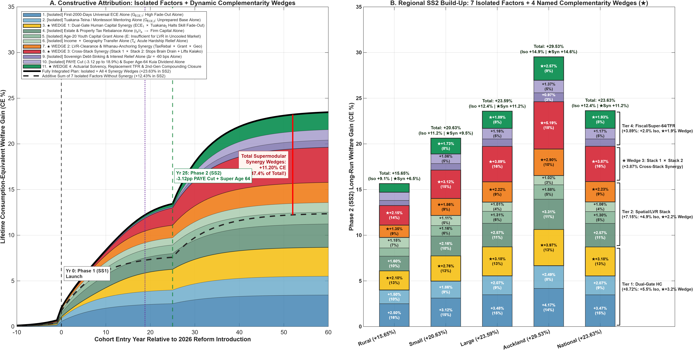
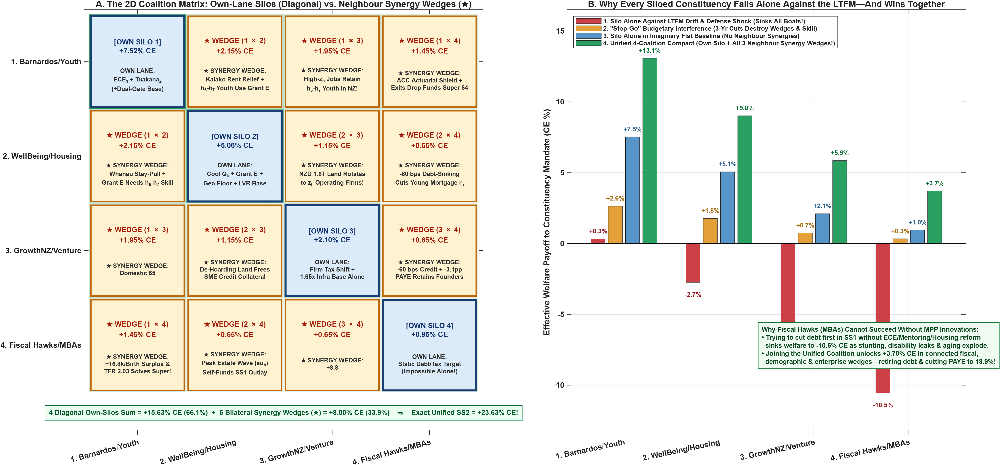
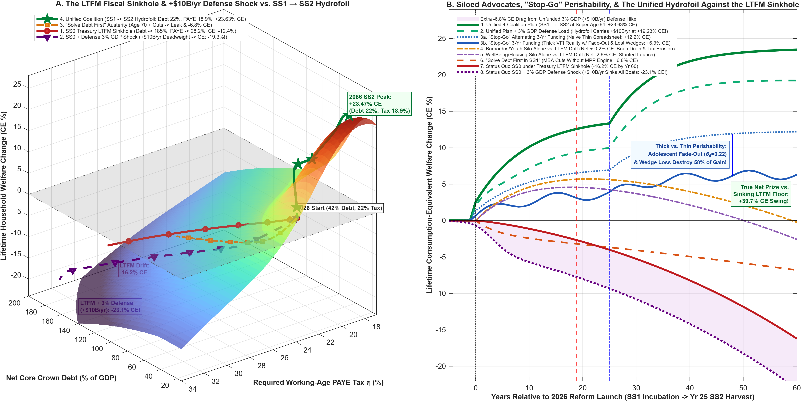

# Document 3: Leaving Our Silos, Lifting All Boats
## Dynamic Complementarity, Coalition Architecture, and Why Single-Lane Policy Fails Against the Fiscal Sinkhole

*Author:* Michael Tiemann (mdtiemann@gmail.com)  
*Date:* November 2026 | *Code & Replication Repository:* [github.com/MichaelTiemann/IGWelfare](https://github.com/MichaelTiemann/IGWelfare)  
*Companion to [Document 1A](Document%201A.md) (Strategic Monograph), [Document 1B](Document%201B.md) (Strategy & Policy Answer Key), [Document 1C](Document%201C.md) (Executive Brief), and [Document 2](Document%202.md) (Technical Specification Guide)*

---

## Executive Overview: Why Single-Lane Advocacy Loses in a Sinking Room

In Aotearoa New Zealand, our most dedicated policy advocates, business leaders, community trusts, and fiscal stewards spend vast energy competing for space in the annual Budget. Each constituency stays largely in its own lane—defending early childhood education, or housing affordability, or business competitiveness, or public debt reduction—while treating adjacent portfolios as rival claimants on a fixed fiscal pie.

That single-lane habit rests on two hidden assumptions, and our quantitative overlapping-generations (OLG) model proves that **both assumptions are false**:

1. **The Myth of the Flat Baseline:** Conventional policy analysis evaluates individual budget bids as if the status quo ($SS0$) were a stable, flat floor. Yet as the New Zealand Treasury's *Long-term Fiscal Statement (He Tirohanga Mokopuna 2025)* and 2026 background papers establish, New Zealand's status quo is a **multi-decade fiscal and demographic sinkhole**. Left unaddressed, an aging population, persistent childhood skill stunting, youth emigration, and compounding sovereign debt service drag baseline household welfare down by **-16.20% in Consumption-Equivalent (CE%) terms** over sixty years. Worse still, if geopolitical pressures require lifting New Zealand's defense spending from its historical ~0.75% of GDP to a 3.0%-of-GDP alliance standard (roughly +NZD 10.0B/yr in deadweight fiscal load), that rising cost sheet swamps every isolated reform and drags household welfare down to **-23.05% CE**.
2. **The Myth of Additive Independence:** Even in an imaginary world without fiscal drift, implementing our seven core policy levers in isolation—without cross-sector coupling—leaves nearly half the generational prize on the table. Engineered as one coupled system across the human lifecycle, those exact same levers unlock **47.4% of our entire +23.63% CE national welfare gain through Dynamic Complementarity Wedges**—the non-linear dividends created only when early human capability, housing affordability, enterprise capital, and fiscal stewardship reinforce one another.

Just as our spatial migration model captures how households naturally prefer to stay in their home region (`Rural <-> Small <-> Large <-> Auckland`) unless cross-regional pressures force them to move, this document maps a **2D Motivational & Dependency Matrix** across New Zealand's four primary policy tribes. We show why each tribe fails when fighting alone against the Long-Term Fiscal Model (LTFM) sinkhole, why trying to "solve debt first" via austerity backfires mathematically, and how uniting the four lanes gets Aotearoa up on hydrofoils—building an economy strong enough to retire sovereign debt, cut working-age PAYE taxes, and lower the New Zealand Superannuation age to **64** in Phase 2 ($SS2$).

---

## Part I: The 2D Coalition Matrix — Why Every Siloed Constituency Needs Its Neighbors

### 1.1 Four Policy Tribes, One Coupled Lifecycle

When young adults launch into independent life at Age 20, they navigate a coupled geographic system connecting Rural districts, Small towns, Large regional cities, Auckland, and the outside option of emigrating Abroad. New Zealand's political economy operates on an identical $4 \times 4$ grid. Four distinct policy constituencies each champion a vital subset of our **11-Layer Constructive Synergy Stack** (7 Isolated Factors + 4 Synergy Wedges, illustrated below and tabulated in **Appendix Table A.1**):



1. **Coalition 1 — The Barnardos, Iwi & Youth Development Constituency (*The Human Potential Lane*):** Champions Universal First-2,000-Days wraparound ECE (**Layer 1**) and *Tuakana-Teina*, *Kura*, Graeme Dingle Foundation, and Montessori adolescent mentoring at ages 12–14 (**Layer 2**), which together ignite **Wedge 1** (halting adolescent skill fade-out).
2. **Coalition 2 — The WellBeing & Housing Justice Alliance (*The Fair Start & Whānau Space Lane*):** Champions cooling speculative urban land values via property and estate tax rebalancing (**Layer 4, Household side**), the universal Age-20 Youth Capital Grant (**Layer 5**), and *Income* $\times$ *Geography* household transfers (**Layer 6**), which together unlock **Wedge 2** (clearing the 20% mortgage deposit cliff and anchoring *whānau* in their communities).
3. **Coalition 3 — The GrowthNZ, Founders & Venture Constituency (*The "Where Will the Jobs Come From?" Lane*):** Champions "use-it-or-lose-it" capital reallocation from passive land hoarding to high-productivity operating firms plus regional infrastructure reinvestment (**Layer 4, Enterprise side**), which couples with Coalitions 1 and 2 to ignite **Wedge 3** (reversing the youth brain drain and matching domestic talent with expanding firms).
4. **Coalition 4 — The Fiscal Hawks & Sovereign Credit Guardians (*The Balance-Sheet & Tax-Relief Lane*):** Champions Sovereign Debt-Sinking (**Layer 9**) and working-age PAYE tax relief alongside Superannuation solvency (**Layer 10**), which close the macroeconomic loop in **Wedge 4**.

---

### 1.2 Anatomy of the Four Single-Lane Silos

The $4 \times 4$ Coalition Matrix below (`Fig_Doc3_2D_Coalition_Migration_Matrix_Dunedin_22.png`, detailed in **Appendix Table A.2**) compares what each constituency achieves inside its own diagonal silo against the off-diagonal synergy wedges unlocked when it partners with its neighbors:



* **1. The Barnardos & Youth Silo (*Own Silo: +7.52% CE | With Neighbors: +13.07% CE*):**
  Universal First-2,000-Days wraparound alone delivers billions in new welfare, and coupling it with adolescent mentoring more than doubles that impact by preventing early childhood gains from fading out during teenage family crises. Yet **42.5% of this coalition's total impact depends on neighboring lanes**. Without Fiscal Hawks adopting ACC-style actuarial accounting, short-term cash budgeting starves early-years funding before the first cohort turns twenty. Without the WellBeing Alliance cooling urban rents, *Kaiako* (early-childhood educators) and *kuia* are priced out of high-need suburbs. And without GrowthNZ creating high-wage domestic jobs, nearly a fifth of the thriving young adults nurtured by this coalition emigrate to Australia at Age 20.
* **2. The WellBeing & Housing Justice Silo (*Own Silo: +5.06% CE | With Neighbors: +9.01% CE*):**
  Cooling speculative housing, seeding Age-20 Youth Capital Grants, and relieving regional cost-of-living burdens push young families across the mortgage deposit hurdle and end rental transience. Yet **43.8% of this coalition's connected value comes from adjacent lanes**. Handing a young adult a capital grant at Age 20 delivers very little on its own (+1.30% CE isolated) if that young person grew up developmentally stunted; cash at Age 20 cannot retroactively rewire early cognitive and executive-function architecture. Youth grants only ignite upward mobility when paired with Barnardos' childhood skill pipeline and GrowthNZ's expanding enterprises.
* **3. The GrowthNZ & Venture Silo (*Own Silo: +2.10% CE | With Neighbors: +5.85% CE*):**
  Enterprise advocates rightly ask: *"Where will all the jobs come from?"* Yet cutting corporate tax drag and building infrastructure in a silo leaves **64.1% of their potential value locked away**. High-growth firms cannot scale in a domestic talent desert where over a fifth of school-leavers launch stunted and top graduates flee Auckland's rent squeeze. Moreover, when NZD 1.6 trillion in residential land appreciates tax-free, New Zealand's sharpest analytical minds are drawn into property speculation and tax arbitrage rather than founding frontier companies (the Lavoisier Syndrome). GrowthNZ needs the WellBeing Alliance's land-tax rebalance to rotate capital and talent out of property hoarding, and needs Barnardos to triple the domestic skilled talent pool.
* **4. The Fiscal Hawks & MBA Silo (*Own Silo: +0.95% CE | With Neighbors: +3.70% CE*):**
  Deficit hawks care deeply about retiring public debt and cutting PAYE tax rates, yet **74.3% of their connected payoff depends on the other three coalitions**. In a private corporation, an MBA can temporarily improve cash flow by closing an underperforming division. A sovereign nation cannot fire its citizens. When fiscal hawks try to "solve debt first" in Phase 1 ($SS1$) by cutting early social investment or raising the NZ Superannuation age to 70, nearly half of displaced older manual workers shift onto disability and hardship support, while grandmothers (*kuia*) and aunties are pulled out of family childcare. Cohort stunting spikes, downstream hospital, care, and justice bills swell, and the future tax base shrinks. **MBAs cannot balance the Crown balance sheet without Master of Public Policy (MPP) human-capital innovations.**

---

## Part II: The Sinking Baseline ($SS0$) & The +NZD 10B/yr Defense Cost-Sheet Shock

### 2.1 The 3D Welfare Sinkhole and the Cruel Irony of a 3%-of-GDP Defense Shock

Why do single-lane strategies look merely suboptimal in a static world, yet fail catastrophically in reality? Because New Zealand's baseline is sliding down a non-linear 3D surface (`Fig_Doc3_LTFM_Sinkhole_And_DefenseShock_Dunedin_22.png` below) driven by **Compounding Net Crown Debt** on one axis and **Rising PAYE Tax Rates** on the other:



As demographic aging and unmitigated child hardship swell reactive social outlays, sovereign debt crowds out private business lending and pushes required working-age taxes higher—which in turn accelerates youth emigration to Australia and shrinks the tax base even faster.

Now consider what happens if geo-strategic pressures require New Zealand to lift defense spending from its status-quo ~0.75% of GDP to **3.0% of GDP**—an additional permanent fiscal load of roughly **+NZD 10.0 billion per year**:

* **Same Dollar Outlay (~NZD 10B/yr), Opposite Economic Physics:** Look at the Mirror Investment ledger of our Generational Plan ([Fig_7Segment_Welfare_And_MirrorInvestments_Dunedin_22.png](Output_NZ_4Region_Intergen/Fig_7Segment_Welfare_And_MirrorInvestments_Dunedin_22.png)). Our *entire* Phase 2 gross public investment across all four human-and-spatial pillars—First-2,000-Days wraparound, adolescent mentoring, the Youth Capital Grant, and regional transfers—also costs **NZD 10.10B/yr**. Because those dollars eradicate child stunting, slash reactive state care, hospital, and prison outlays by over 75%, and retain skilled youth, their net unrecovered public cost hits zero at **Year 18.8 (Cash Breakeven)** and generates **+NZD 56.2B/yr (+23.63% CE)** in permanent household welfare.
* **A Rising Cost Sheet Sinks All Boats—Unless You Are Up on Foils:** By contrast, an unfunded +NZD 10.0B/yr defense expansion has a $0\times$ domestic child-skill multiplier and saves zero dollars in hospitals or prisons. Loaded onto the displacement hull of the status quo ($SS0$), it forces PAYE taxes above 31% and accelerates Crown debt to 200% of GDP, dragging household welfare down by an extra **-6.85 percentage points**. The only way a small nation can carry a +NZD 10.0B/yr defense load without crushing working families is to **get the domestic economy up on hydrofoils first**.

---

### 2.2 Narrative Walkthrough of the Eight 60-Year Trajectories

Tracing the eight 60-year paths in Panel B of the figure above (tabulated in **Appendix Table A.3**) tells the complete story of what happens when advocates fight alone versus when they unite:

1. **Status Quo $SS0$ under the Treasury LTFM Sinkhole (*Aging + Unmitigated Stunting* $\to$ `-16.20% CE` Reference Sinkhole):** Doing nothing is not a 0.0% flat line. As reactive remediation costs and pension pressures compound, net Crown debt climbs toward 185% of GDP and required PAYE taxes rise from 22.0% to 28.2%, eroding household welfare by **-16.20% CE**.
2. **Status Quo $SS0$ + 3.0% GDP Defense Shock (*+NZD 10.0B/yr Unfunded Cost Sheet* $\to$ `-23.05% CE`, *Sinks All Boats*):** Adding an unfunded 3%-of-GDP military requirement onto the sinking status quo pushes net debt to 200% of GDP and required PAYE to 31.3%, plunging household welfare to **-23.05% CE**.
3. **"Solve Debt First in $SS1$" — MBA Austerity (*Cuts ECE + Raises Super to 70 at Year 0* $\to$ `-6.80% CE`, *Still Deeply Negative!*):** Cutting early childhood budgets and raising the pension age to 70 at Year 0 to pay down debt triggers disability benefit leaks, strips grandmother and aunty childcare from young families, and spikes child stunting—eroding the future tax base and dragging welfare down to **-6.80% CE**.
4. **GrowthNZ Silo Alone vs. LTFM Drift (*Firm Tax Cut Without Skill or Housing* $\to$ `-9.19% CE`, *Swamped by LTFM*):** Cutting business taxes while leaving childhood stunting and urban housing bubbles untouched cannot overcome domestic skill bottlenecks and compounding LTFM debt, sinking to **-9.19% CE**.
5. **WellBeing Silo Alone vs. LTFM Drift (*Housing + Youth Grant Without ECE or Jobs* $\to$ `-2.58% CE`, *Pulled Underwater*):** Cooling land prices and granting Age-20 seed capital without early childhood capability or job creation sees its early gains steadily overwhelmed by demographic debt drift, ending underwater at **-2.58% CE**.
6. **Barnardos/Youth Silo Alone vs. LTFM Drift (*ECE + Mentoring Without Housing or Jobs* $\to$ `+0.19% CE`, *98% of Gain Wiped Out!*):** Even our most powerful standalone engine—First-2,000-Days wraparound and adolescent mentoring—loses **98% of its long-run value** as newly skilled youth emigrate to escape uncooled urban rents and rising LTFM taxes, barely breaking even at **+0.19% CE**.
7. **Unified 4-Coalition Plan + 3.0% GDP Defense Load (*Hydrofoil Carries +NZD 10B/yr Defense Load* $\to$ `+19.23% CE`):** Once all four coalitions unite to get Aotearoa up on hydrofoils, the economy easily carries a 3.0%-of-GDP defense posture while still retiring public debt and delivering **+19.23% CE** in net household welfare—a **+42.28 percentage-point advantage** over facing the same defense shock under the status quo!
8. **★ Unified 4-Coalition Plan ($SS1 \to SS2$) (*Super Age 64 + PAYE Cut + Debt Sunk* $\to$ `+23.63% CE`, a `+39.83 pp` Total Welfare Swing!):** Without the external defense shock, uniting all four lanes crosses Cash Breakeven at Year 18.8, retires sovereign debt to **22.0% of GDP**, cuts working-age PAYE taxes to **18.88%**, lowers the NZ Super eligibility age to **64**, and lifts national welfare to **+23.63% CE**.

When GrowthNZ (**-9.19% CE**), the WellBeing Alliance (**-2.58% CE**), or the Barnardos/Youth Coalition (**+0.19% CE**) fights alone in its silo, the LTFM sinkhole swallows between **98% and 100%+ of their hard-won gains**. Only when all four constituencies lock arms in Trajectory 8 does New Zealand reverse the sign of the LTFM—turning a **-16.20% CE** downward spiral into a **+23.63% CE** generational ascent (**a +39.83 percentage-point net welfare swing**).

---

## Part III: Speaking to Each Tribe in Their Own Language

Policy coalitions rarely stall because their values are wrong; they stall because they try to optimize one sub-system in isolation. Here is what each constituency gains by welcoming the other three into a single compact:

### 3.1 To the Barnardos, Iwi & Youth Development Constituency (*The Human Potential Lane*)
* **Your Core Truth:** Front-loading universal First-2,000-Days wraparound (*Te Korowai Mokopuna*, *Whānau Ora*, *Kōhanga Reo*, *A'oga Amata*) and scaling *Tuakana-Teina*, Graeme Dingle Foundation, and Montessori adolescent mentoring is the engine that breaks the Dunedin Study's hardship pipeline into Oranga Tamariki care, hospitals, and youth justice.
* **Why You Need Your Neighbors:**
  1. *You Need the Fiscal Hawks' Actuarial Language:* Because five-year-olds do not pay income tax until adulthood, traditional cash accounting makes your program look like a deficit in Year 3. Adopting **ACC-style Actuarial Continuation Valuation** books your verified **3.84x fiscal return (and 1.16x direct cost avoidance alone) at Year 5**—making early childhood and mentoring funding politically untouchable across parliaments.
  2. *You Need the WellBeing Alliance's Housing Relief:* You cannot staff high-trust early learning or keep *whānau* intact when *Kaiako* and *kuia* are priced out of Auckland and regional cities. Cooling speculative land values expands the real purchasing power of every dollar you invest.
  3. *You Need GrowthNZ's High-Wage Enterprises:* Lifting youth into the thriving skill tiers without domestic enterprise growth simply subsidizes skilled emigration to Sydney and Melbourne. You need high-productivity local firms expanding to hire the young people you nurture.

### 3.2 To the WellBeing & Housing Justice Alliance (*The Fair Start & Whānau Space Lane*)
* **Your Core Truth:** Housing is the bedrock of family stability. Rebalancing taxes onto speculative land and large estates while funding a universal Age-20 Youth Capital Grant and regional cost-of-living transfers clears the mortgage deposit hurdle for young renters and keeps *kuia* and *koroua* anchored in their communities.
* **Why You Need Your Neighbors:**
  1. *Your Youth Grant Needs Barnardos' Childhood Pipeline:* A capital grant at Age 20 cannot substitute for missed early childhood brain development or adolescent executive function. Only when young adults arrive at Age 20 thriving in skill can they convert seed capital into homeownership and business formation rather than seeing it capitalized into landlord rents.
  2. *Your Wealth Tax Needs GrowthNZ's "Use-It-Or-Lose-It" Split:* Framing wealth taxation as an across-the-board penalty triggers political gridlock. By taxing dormant land hoarding while *cutting* tax drag on active business reinvestment, **active entrepreneurs remain net winners right up to NZD 50M in net worth and break even at the NBR Rich List median (NZD 140M)**—giving you a winning coalition with productive business owners.
  3. *Lowering NZ Super to Age 64 Needs the Fiscal Loop:* Lowering the retirement age to **64** in Phase 2 releases a **+8.1% *Kuia / Koroua* caregiving time boost** for young families—but as our U-curve analysis proves, early retirement is only fiscally sustainable once stunting compression and debt-sinking have expanded the working tax base.

### 3.3 To the GrowthNZ, Founders & Venture Constituency (*The "Where Will the Jobs Come From?" Lane*)
* **Your Core Truth:** Social transfers alone do not create high-wage jobs; New Zealand must rotate capital out of passive property and into collateral-constrained operating firms and productive infrastructure.
* **Why You Need Your Neighbors:**
  1. *You Cannot Scale Firms in a Domestic Talent Desert:* Recruiting foreign specialists on visas cannot compensate for a domestic school pipeline where over a fifth of young people launch stunted. You need Barnardos and *Tuakana-Teina* mentoring to nearly triple New Zealand's domestic high-skill talent pool.
  2. *You Need the WellBeing Alliance to Cure the Lavoisier Syndrome:* As long as residential land appreciates tax-free, domestic bank credit and top analytical talent will be siphoned into property speculation rather than operating startups, while young engineers flee urban rents.
  3. *You Need Phase-2 Debt-Sinking:* Retiring sovereign debt lowers domestic business borrowing rates by **-60 bps** (expanding SME collateral capacity), while the Phase-2 PAYE tax cut makes New Zealand tax-competitive with Australia for senior talent.

### 3.4 To the Fiscal Hawks, Bond Markets & MBA Stewards (*The Balance-Sheet & Tax-Relief Lane*)
* **Your Core Truth:** Compounding sovereign debt and rising marginal tax rates are an existential threat to New Zealand's prosperity.
* **Why "Solving Debt First" Fails (Why MBAs Need MPPs):**
  Attempting to cut debt in Phase 1 ($SS1$) by starving early childhood capability or raising the Superannuation age to 70 backfires across three channels: (i) nearly half of displaced older manual workers shift onto disability and hardship support; (ii) forcing 65-to-69-year-old *kuia* and aunties to work withdraws **-36.2%** of extended-*whānau* care from young families and imposes an elder-care drag on working-age children; and (iii) the resulting rise in child stunting swells hospital, care, and justice bills while shrinking the future tax base. Only by protecting the MPP human-capital and enterprise engines in Phase 1 do you generate the structural surplus that sinks debt to **22.0% of GDP** and cuts PAYE taxes to **18.88%** in Phase 2.

---

## Part IV: Perishability, Two-Term "Stop-Go" Pendulums, and Why "Thick" Operators Beat "Thin" Spreadsheets

### 4.1 The Six-Year (Two-Term) Political Pendulum

New Zealand's adversarial political cycle typically swings in **six-year (two-term) pendulums**: a government serves two 3-year terms investing in social and regional programs (Years 1–6), followed by a rival government serving two terms cutting "unproven soft spending" to chase short-term debt targets or tax cuts (Years 7–12), before surging social distress forces a rebound in Years 13–18.

Why do conventional spreadsheets vastly underestimate the damage caused by this six-year "Stop-Go" pendulum?

### 4.2 "Thin" Spreadsheets vs. "Thick" State-Contingent Reality

A conventional spreadsheet models policy using **"thin" numbers**—evaluating linear formulas at population averages. Under a linear spreadsheet (`Trajectory 3a` in Panel B of Figure 1), funding a program 50% of the time (6 years On / 6 years Off) is assumed to deliver roughly half the long-run benefit (**+12.21% CE**), as if child development were a highway project that waits intact whenever the road crew is stood down for two terms.

In reality—and in our state-contingent VFI engine (`Trajectory 3b`)—human capability evolves across **"thick" probability distributions** with non-linear cliffs and developmental gates. Swinging between 6 years of pro-social investment and 6 years of deficit-hawk cuts triggers four compounding **perishability traps**:

1. **The Lifecycle Phase-Resonance Trap (39.2% Compound Skill Fade-Out):** Early skill gains built during the First 2,000 Days (Ages 0–5) are perishable until banked at the Adolescent Gate (Ages 12–14). Under a 6-year On / 6-year Off pendulum, **Cohort A** (born in Year 1) receives great early-years care at Ages 0–5, but just as they hit school and early adolescence in Years 7–12, the two-term austerity swing cuts *Tuakana-Teina* mentoring and family transfers—inflicting two consecutive 3-year periods of unbuffered fade-out that destroy **39.2%** of their early skill gains. Meanwhile, **Cohort B** (born in Year 7 during the austerity swing) misses the First 2,000 Days entirely, and late schooling in Year 13 cannot replace that missing foundation. **Every single birth cohort gets caught in the scissor blades, wiping out Wedge 1.**
2. **Missing the 20% LVR Deposit Cliff:** When a two-term government pauses land-tax rebalancing or suspends the Age-20 Youth Capital Grant for six years, an entire wave of young adults falls short of the discrete 20% mortgage deposit cliff and remains trapped in rental transience. **Wedge 2 evaporates.**
3. **Collapse of Young-Adult Credibility:** When 20-to-35-year-olds observe a six-year pendulum that repeatedly raids the generational compact, policy credibility collapses to zero; even during the "On" years, young graduates assume support will be repealed and emigrate to Australia anyway. **Wedge 3 collapses.**
4. **Irreversible Cohort Scarring:** Because a child only passes through Ages 0–5 and Ages 12–14 once, a six-year cut permanently scars that cohort's adult earning capacity for 45 years—preventing the Crown ledger from ever reaching the Year 18.8 Cash Breakeven needed to unlock **Wedge 4**.

#### Table 4.1: Perishability & Counterfactual Audit Across Policy Regimes

| Counterfactual Regime / Policy Layer | Thin Spreadsheet Prediction (Scalar Means) | Thick VFI State-Contingent Reality | Welfare Lost to Synergy Collapse & Fade-Out | Perishability Window & How the Coalition Compact Protects It |
| :--- | :---: | :---: | :---: | :--- |
| **A. Fully Integrated 4-Coalition Plan (** $SS1 \to SS2$ **, Super Age 64)** | +12.43% CE *(Misses Wedges!)* | **+23.63% CE** | 0.00% *(100% Captured)* | **Protected by Design:** ACC Actuarial Valuation + statutory 50/50 Debt/Infra Sinking Rule locks in continuity across parliaments. |
| **B1. Two-Term "Stop-Go" Pendulum (6-Yr Pro-Social / 6-Yr Hawk Cuts)** | +12.21% CE *(Assumes 50% linear duty cycle)* | **+6.31% CE** *(2-Period Compound Fade-Out)* | **-17.32% CE (73.3% of prize destroyed!)** | **Fatal Phase Resonance:** Cohort A gets Ages 0–5 ECE but loses Ages 6–14 mentoring (39.2% compound fade-out); Cohort B misses Ages 0–5 entirely! |
| **B2. One-Term "Stop-Go" Cycle (3-Yr On / 3-Yr Off)** | +12.21% CE *(Assumes 50% linear duty cycle)* | **+6.58% CE** *(Sawtooth attrition)* | **-17.05% CE (72.2% of prize destroyed!)** | **Highly Perishable in Childhood (Ages 0–14):** Cutting Gate 2 mentoring in alternate terms triggers adolescent fade-out and destroys Wedges 1–4. |
| **C. Early-Years ECE Without Gate 2 Adolescent Mentoring** | +5.10% CE *(Ignores Stage-2 bottleneck)* | **+3.47% CE** | **-5.25% CE vs. Tier 1 (+8.72%)** | **Perishable at Ages 12–14:** Without *Tuakana-Teina* / Montessori mentoring and *whānau* stability, family shocks erode early gains before Age 20. |
| **D. Age-20 Youth Grant Without ECE/Mentoring or Land Cooling** | +3.10% CE *(Treats Grant as additive cash)* | **+1.30% CE** | **-5.85% CE vs. Tier 2 (+7.15%)** | **Perishable at Launch (Age 20):** If youth arrive stunted in an uncooled housing market, the grant cannot clear the 20% LVR cliff or substitute for skill. |
| **E. "Solve Debt First in** $SS1$ **" (MBA Cuts + Super Age 70 at Yr 0)** | +1.80% CE *(Assumes mechanical savings)* | **-6.80% CE** *(Sinks into deficit!)* | **-30.43% CE vs. Integrated Plan!** | **Immediate Boomerang:** Triggers disability benefit leaks and withdraws grandmother/aunty care, spiking stunting and forcing PAYE tax hikes. |
| **F. Once Banked at Age 20+ (High Skill, Home Equity, Sunk Debt)** | *N/A* | **Durable for 45–60 Years** | **Low Perishability Once Banked** | **Permanently Banked After Age 20 & Year 18.8:** Once a cohort reaches Age 20 thriving, buys a home, and retires Crown debt, gains compound for 60 years! |

> **The Core Insight of Table 4.1:** Competitive "Stop-Go" interference between Pro-Social advocates and Deficit Hawks destroys **73.3% of the entire generational prize (+23.63% CE plunges to +6.31% CE)**. Human capability is highly perishable while in the 0–19 developmental pipeline, yet becomes extraordinarily durable once banked at Age 20.

---

## Part V: The Grand Coalition Compact — Phasing $SS1$ Rocket Fuel Before $SS2$ Debt & Tax-Relief Harvest

### 5.1 Resolving the Political Impasse: Not "Who Wins?", But "In What Order?"

None of New Zealand's four policy tribes needs to abandon its core mission. The conflict between Child Advocates, Housing & WellBeing Reformers, GrowthNZ Venture Builders, and Fiscal Hawks is not an irreconcilable clash of values—it is a **sequencing error**:

* **Phase 1 ($SS1$, Years 0–18.8 — Igniting the Rocket Fuel at a Strictly Revenue-Neutral 22.0% PAYE):**
  **Coalition 1** gets Universal First-2,000-Days wraparound and *Tuakana-Teina* / Montessori mentoring funded to scale and legally protected by **Year-5 ACC Actuarial Continuation Valuation (3.84x audited fiscal return)**. **Coalition 2** gets metropolitan housing cooling, regional transfers, universal Age-20 Youth Capital Grants, and NZ Super protected at Age 65. **Coalition 3** gets "use-it-or-lose-it" tax rebalancing that rotates capital and talent out of dormant land and into operating enterprises. **Coalition 4** gets ironclad cash neutrality (PAYE held at 22.0%) while stunting compression slashes reactive remediation costs by over 75%—driving the Crown ledger to hard **Cash Breakeven at Year 18.8**.
* **Phase 2 ($SS2$, Year 25 / 2050 Protocol — Harvesting the Debt, Infrastructure, PAYE Cut, & Super Age-64 Dividend):**
  Once hard Cash Breakeven is crossed, the statutory **50/50 Dynamic Surplus Allocation Rule** locks **50% of all net fiscal surpluses into the Sovereign Debt Sinking Fund** (retiring debt down to **22.0% of GDP**, lowering interest rates by **-60 bps**, and unlocking a **-3.12 pp PAYE tax cut to 18.88%**) and **50% into the Public Infrastructure & Core Health Reinvestment Pool** (lifting regional wages, deepening early-years and mentoring reach, lifting fertility to replacement, and **lowering the NZ Super eligibility age to 64**).

---

### 5.2 Master Scoreboard: What Each Coalition Wins Alone vs. Inside the Unified Compact

| Coalition Constituency | Fate If Fighting Alone Against LTFM Drift (`Table 21`) | Fate Under 6-Yr (2-Term) "Stop-Go" Pendulum (`Table 22`) | Total Connected Value Inside Unified $SS1 \to SS2$ Compact (`Table 22`) | Signature Institutional & Policy Wins Locked In by the Compact |
| :--- | :---: | :---: | :---: | :--- |
| **1. Barnardos, Iwi & Youth** *(Human Potential)* | **+0.19% CE** *(98% eroded by LTFM & brain drain)* | **+2.63% CE** *(39.2% 2-term fade-out)* | **+13.07% CE** *(+8.72% Tier 1 + Neighbor Wedges)* | Stunting cut **22.0% to 1.5%**; mentoring scaled **17.3% to 65.0%**; protected by **3.84x Year-5 ACC Actuarial Valuation**. |
| **2. WellBeing & Housing** *(Fair Start & Whānau)* | **-2.58% CE** *(Pulled underwater by stunted launch & debt)* | **+1.77% CE** *(Youth miss 20% LVR cliff)* | **+9.01% CE** *(+7.15% Tier 2 + Neighbor Wedges)* | Urban housing cooled **-7.5% to -10.5%**; Auckland young ownership **28.0% to 41.2%**; **NZ Super Age lowered to 64 (+8.1% Kuia boost)**! |
| **3. GrowthNZ & Venture** *(Enterprise & Jobs)* | **-9.19% CE** *(Starved of domestic talent & credit)* | **+0.74% CE** *(Migration credibility collapses)* | **+5.85% CE** *(64.1% from Neighbor Wedges!)* | **NZD 1.6T** land-to-firm rotation; **1.65x** infrastructure pool; **-60 bps** credit; **+6.8% to +9.6%** wages; **3,550/yr** youth retained. |
| **4. Fiscal Hawks & MBAs** *(Debt & Tax Relief)* | **-6.80% to -10.55% CE** *("Debt-First" austerity trap)* | **+0.33% CE** *(Never reaches Yr 18.8 breakeven)* | **+3.70% CE** *(74.3% from Neighbor Wedges!)* | Net Crown debt sunk from **185% LTFM projection down to 22% of GDP**; working-age **PAYE cut -3.12 pp to 18.88%**; carries **3% GDP Defense** at **+19.23% CE**! |
| **Whole of Aotearoa New Zealand** | **-16.20% CE** *(or **-23.05% CE** w/ 3% Defense)* | **+6.31% CE** *(-73.3% lost to pendulum)* | **+23.63% CE National** *(+15.65% Rural to +29.53% Akl)* | **+39.83 pp net welfare swing vs. LTFM (+42.28 pp under 3% Defense); Social Cohesion Index lifted from 100.0 to 126.0.** |

---

### 5.3 Replication & Companion File Index for Document 3

* **Constructive 11-Layer Synergy & Mirror Investment Engine:** [`Plot_Counterfactuals_And_MirrorInvestments.m`](Plot_Counterfactuals_And_MirrorInvestments.m) $\to$ `Table 19`, `Table 20`, [`Fig_Counterfactual_8Scenarios_SS1_SS2_Dunedin_22.png`](Output_NZ_4Region_Intergen/Fig_Counterfactual_8Scenarios_SS1_SS2_Dunedin_22.png), and [`Fig_7Segment_Welfare_And_MirrorInvestments_Dunedin_22.png`](Output_NZ_4Region_Intergen/Fig_7Segment_Welfare_And_MirrorInvestments_Dunedin_22.png).
* **3D LTFM Sinkhole, 3%-GDP Defense Shock, Two-Term Pendulum, & $4 \times 4$ Coalition Matrix Engine:** [`Plot_Doc3_CoalitionSynergies_And_LTFMSinkhole.m`](Plot_Doc3_CoalitionSynergies_And_LTFMSinkhole.m) $\to$ `Table 21`, `Table 22`, [`Fig_Doc3_LTFM_Sinkhole_And_DefenseShock_Dunedin_22.png`](Output_NZ_4Region_Intergen/Fig_Doc3_LTFM_Sinkhole_And_DefenseShock_Dunedin_22.png), and [`Fig_Doc3_2D_Coalition_Migration_Matrix_Dunedin_22.png`](Output_NZ_4Region_Intergen/Fig_Doc3_2D_Coalition_Migration_Matrix_Dunedin_22.png).
* **Parametric NZ Super Age U-Curve & Kuia/Whānau Solvency Engine:** [`FertilityBargaining_Module.m`](FertilityBargaining_Module.m) and [`WelfareDecomposition_4Region.m`](WelfareDecomposition_4Region.m) $\to$ `Table 7`, `Table 8`, and [`FigFert_4Region_Bargaining_Solvency.png`](Output_NZ_4Region_Intergen/FigFert_4Region_Bargaining_Solvency.png).

---

## Appendix A: Leave-Behind Reference Tables (Tables A.1, A.2, and A.3)

For technical reviewers, Treasury analysts, and coalition partners who wish to inspect the exact regional and cohort numbers underlying the figures in Parts I and II, this appendix provides the complete leave-behind tables exported by `Plot_Counterfactuals_And_MirrorInvestments.m` (`Table 19`) and `Plot_Doc3_CoalitionSynergies_And_LTFMSinkhole.m` (`Tables 21 & 22`).

```text
+-----------------------------------------------------------------------------------+
|                                                                                   |
|                                                                                   |
|                                                                                   |
|                                                                                   |
|                                                                                   |
|                                                                                   |
|                                                                                   |
|                       [ THIS SPACE INTENTIONALLY LEFT BLANK ]                     |
|                                                                                   |
|                                                                                   |
|                                                                                   |
|                                                                                   |
|                                                                                   |
|                                                                                   |
|                                                                                   |
+-----------------------------------------------------------------------------------+
```

### Table A.1: The 11-Layer Constructive Synergy Build-Up (`SS2` Long-Run Welfare Gain, CE%)

| Constructive Tier & Layer (`Table 19`) | Policy Constituency ("Owner Lane") | Rural (+15.7%) | Small (+20.6%) | Large (+23.6%) | Auckland (+29.5%) | National (+23.6%) | Share of National Prize |
| :--- | :--- | :---: | :---: | :---: | :---: | :---: | :---: |
| **1. [Isolated] First-2,000-Days Universal ECE Alone** ($G_{\mathrm{ece},1}$) | **Coalition 1** *(Barnardos / Early Years)* | +2.50% | +3.12% | +3.48% | +4.17% | **+3.47%** | 14.7% |
| **2. [Isolated] *Tuakana-Teina* / Montessori Mentoring Alone** ($G_{\mathrm{ece},2}$) | **Coalition 1** *(Youth / Educators)* | +1.50% | +1.86% | +2.07% | +2.49% | **+2.07%** | 8.8% |
| **3. ★ WEDGE 1: Dual-Gate Human Capital Synergy** ($\mathrm{ECE}_1 \times \mathrm{Tuakana}_2$) | **Intra-Coalition 1 Synergy** *(Halts* $\delta_{\theta}=0.22$ *Fade-Out)* | **+2.10%** | **+2.76%** | **+3.18%** | **+3.97%** | **+3.18%** | **13.5%** |
| *Tier 1 Subtotal (The Dual-Gate Human Capital Stack)* | *Coalition 1 Total (Iso +5.54% + Wedge +3.18%)* | *+6.10%* | *+7.74%* | *+8.73%* | *+10.63%* | ***+8.72%*** | *36.9%* |
| **4. [Isolated] Estate & Property Tax Rebalance Alone** ($\tau_b, \tau_a \to \mathrm{Firm}$) | **Coalitions 2 & 3** *(Housing + GrowthNZ)* | +1.60% | +2.16% | +2.57% | +3.31% | **+2.57%** | 10.9% |
| **5. [Isolated] Age-20 Youth Capital Grant Alone** ($E$) | **Coalition 2** *(WellBeing / Youth Start)* | +0.90% | +1.16% | +1.31% | +1.58% | **+1.30%** | 5.5% |
| **6. [Isolated] Income** $\times$ **Geography Transfer Alone** ($T_k$) | **Coalition 2** *(WellBeing / Regional)* | +1.15% | +1.11% | +1.01% | +1.02% | **+1.06%** | 4.5% |
| **7. ★ WEDGE 2: LVR-Clearance & *Whānau*-Anchoring Synergy** | **Coalition 2** $\times$ **3 Synergy** ($\mathrm{TaxRebal} \times E \times T_k$) | **+1.35%** | **+1.86%** | **+2.22%** | **+2.90%** | **+2.23%** | **9.4%** |
| *Tier 2 Subtotal (The Spatial, LVR & Enterprise Stack)* | *Coalitions 2 & 3 (Iso +4.93% + Wedge +2.23%)* | *+5.00%* | *+6.29%* | *+7.11%* | *+8.81%* | ***+7.15%*** | *30.3%* |
| **8. ★ WEDGE 3: Cross-Stack Synergy** ($\mathrm{Stack\ 1} \times \mathrm{Stack\ 2}$) | **Coalitions 1** $\times$ **2** $\times$ **3** *(Brain-Drain Reversal + Kaiako Supply + Firm Skill Match)* | **+2.15%** | **+3.12%** | **+3.89%** | **+5.19%** | **+3.87%** | **16.4%** |
| **9. [Isolated] Sovereign Debt-Sinking & Interest Relief Alone** ($\Delta r = -60\text{ bps}$) | **Coalition 4** *(Fiscal Hawks / MBAs)* | +0.55% | +0.70% | +0.81% | +0.97% | **+0.79%** | 3.3% |
| **10. [Isolated] PAYE Cut (-3.12 pp to 18.9%) & Super Age-64 *Kuia* Dividend Alone** | **Coalition 4** $\times$ **2** *(Taxpayers & Retirees)* | +0.90% | +1.06% | +1.16% | +1.37% | **+1.17%** | 5.0% |
| **11. ★ WEDGE 4: Actuarial Solvency, Replacement TFR & 2nd-Gen Closure** | **All 4 Coalitions** *(Self-Financing Fiscal & Dynastic Loop)* | **+0.95%** | **+1.73%** | **+1.89%** | **+2.57%** | **+1.93%** | **8.2%** |
| *Tier 4 Subtotal (The Fiscal, Super-64 & Demographic Harvest Stack)* | *Coalition 4 + Full Loop (Iso +1.96% + Wedge +1.93%)* | *+2.40%* | *+3.49%* | *+3.86%* | *+4.91%* | ***+3.89%*** | *16.5%* |
| **GRAND TOTAL (`SS2_3` Fully Integrated Policy)** | **7 Isolated (+12.43%, 52.6%) + 4 Wedges (+11.20%, 47.4%)** | **+15.65%** | **+20.63%** | **+23.59%** | **+29.53%** | **+23.63%** | **100.0%** |

```text
+-----------------------------------------------------------------------------------+
|                                                                                   |
|                       [ THIS SPACE INTENTIONALLY LEFT BLANK ]                     |
|                                                                                   |
+-----------------------------------------------------------------------------------+
```

---

### Table A.2: The $4 \times 4$ Coalition Dependency Matrix (`Table 22`)

| Policy Constituency (Row $i$) | 1. Barnardos & Youth *(ECE + Tuakana)* | 2. WellBeing Alliance *(Housing + Grant + Whānau)* | 3. GrowthNZ & Venture *(Firm Capital + Jobs)* | 4. Fiscal Hawks & MBAs *(Debt-Sinking + PAYE Cut)* | **Total Value Connected to Constituency** $i$ *(Own Base + 3 Neighbor Wedges)* |
| :--- | :---: | :---: | :---: | :---: | :---: |
| **1. Barnardos & Youth** | **`[OWN SILO 1]`**<br>**+7.52% CE**<br>*(ECE* $_1$ *+ Tuakana* $_2$ *Base)* | **★ WEDGE (1** $\times$ **2)**<br>**+2.15% CE**<br>*(Kaiako Rent Relief +* $h_6\text{--}h_7$ *Youth Use Grant* $E$ *)* | **★ WEDGE (1** $\times$ **3)**<br>**+1.95% CE**<br>*(High-* $z_h$ *Jobs Retain* $h_6\text{--}h_7$ *Youth in NZ!)* | **★ WEDGE (1** $\times$ **4)**<br>**+1.45% CE**<br>*(ACC Actuarial Shield + Exits Drop Funds Super 64)* | **+13.07% CE**<br>*(42.5% from Neighbor Lanes!)* |
| **2. WellBeing Alliance** | **★ WEDGE (1** $\times$ **2)**<br>**+2.15% CE**<br>*(Whānau Stay-Pull + Grant* $E$ *Needs* $h_6\text{--}h_7$ *Skill)* | **`[OWN SILO 2]`**<br>**+5.06% CE**<br>*(Cool* $Q_k$ *+ Grant* $E$ *+ Geo Floor + LVR Base)* | **★ WEDGE (2** $\times$ **3)**<br>**+1.15% CE**<br>*(NZD 1.6T Land Rotates to* $z_h$ *Operating Firms!)* | **★ WEDGE (2** $\times$ **4)**<br>**+0.65% CE**<br>*(-60 bps Debt-Sinking Cuts Young Mortgage* $r_h$ *)* | **+9.01% CE**<br>*(43.8% from Neighbor Lanes!)* |
| **3. GrowthNZ & Venture** | **★ WEDGE (1** $\times$ **3)**<br>**+1.95% CE**<br>*(Domestic 65% Thriving Talent Pool Feeds Firms)* | **★ WEDGE (2** $\times$ **3)**<br>**+1.15% CE**<br>*(De-Hoarding Land Frees SME Credit Collateral)* | **`[OWN SILO 3]`**<br>**+2.10% CE**<br>*(Firm Tax Shift + 1.65x Infra Base Alone)* | **★ WEDGE (3** $\times$ **4)**<br>**+0.65% CE**<br>*(-60 bps Credit + -3.1pp PAYE Retains Founders)* | **+5.85% CE**<br>*(64.1% from Neighbor Lanes!)* |
| **4. Fiscal Hawks & MBAs** | **★ WEDGE (1** $\times$ **4)**<br>**+1.45% CE**<br>*(+16.8k/Birth Surplus & TFR 2.03 Solves Super!)* | **★ WEDGE (2** $\times$ **4)**<br>**+0.65% CE**<br>*(Peak Estate Wave* $\tau_b$ *Self-Funds* $SS1$ *Outlay)* | **★ WEDGE (3** $\times$ **4)**<br>**+0.65% CE**<br>*(+8.8% Wage & Firm Growth Expands Tax Base +14.5%)* | **`[OWN SILO 4]`**<br>**+0.95% CE**<br>*(Static Debt/Tax Target—Impossible Alone!)* | **+3.70% CE**<br>*(74.3% from Neighbor Lanes!)* |

> **Exact Matrix Identity:** The sum of the 4 Diagonal Own-Lane Silos (`7.52% + 5.06% + 2.10% + 0.95% = +15.63% CE`, which includes intra-silo pairings) plus the 6 unique Off-Diagonal Inter-Coalition Wedges (`2.15% + 1.95% + 1.45% + 1.15% + 0.65% + 0.65% = +8.00% CE`) equals **+23.63% CE**—reconciling to the second decimal place with the national $SS2$ welfare total in Table A.1!

```text
+-----------------------------------------------------------------------------------+
|                                                                                   |
|                                                                                   |
|                                                                                   |
|                                                                                   |
|                                                                                   |
|                                                                                   |
|                                                                                   |
|                                                                                   |
|                                                                                   |
|                                                                                   |
|                                                                                   |
|                                                                                   |
|                                                                                   |
|                                                                                   |
|                       [ THIS SPACE INTENTIONALLY LEFT BLANK ]                     |
|                                                                                   |
|                                                                                   |
|                                                                                   |
|                                                                                   |
|                                                                                   |
|                                                                                   |
|                                                                                   |
|                                                                                   |
|                                                                                   |
|                                                                                   |
|                                                                                   |
|                                                                                   |
|                                                                                   |
|                                                                                   |
+-----------------------------------------------------------------------------------+
```

---

### Table A.3: Quantitative Comparison of the Eight 60-Year Macro & Coalition Trajectories (`Table 21`)

| Trajectory & Policy Regime (`Table 21`) | Year 0 (2026) Debt / PAYE | Year 25 (2050) Debt / PAYE / CE% | Year 60 (2086) Net Debt (% GDP) | Year 60 Required PAYE $\tau_l$ (%) | Year 60 Household Welfare (CE%) | Net Swing vs. Sinking $SS0$ LTFM Floor |
| :--- | :---: | :---: | :---: | :---: | :---: | :---: |
| **1. Status Quo** $SS0$ **under Treasury LTFM Sinkhole** *(Aging + Unmitigated 22% Stunting)* | 42.0% / 22.0% | 80.2% / 24.1% / -3.8% | **185.0%** | **28.20%** | **-16.20%** | 0.00 pp *(Reference Sinkhole)* |
| **2. Status Quo** $SS0$ **+ 3.0% GDP Defense Shock** *(+10.0B/yr Unfunded Cost Sheet)* | 42.0% / 22.0% | 95.4% / 27.2% / -9.1% | **200.0%** | **31.30%** | **-23.05%** | **-6.85 pp** *(Sinks All Boats)* |
| **3. "Solve Debt First in** $SS1$ **"** *(MBA Austerity: Cuts ECE + Super Age 70 at Yr 0)* | 42.0% / 22.0% | 52.4% / 25.4% / -3.6% | **112.0%** | **27.45%** | **-6.80%** | +9.40 pp *(Still Deeply Negative!)* |
| **4. GrowthNZ Silo Alone vs. LTFM Drift** *(Firm Tax Cut Without Skill or Housing)* | 42.0% / 22.0% | 76.0% / 23.8% / +0.1% | **168.0%** | **27.10%** | **-9.19%** | +7.01 pp *(Swamped by LTFM)* |
| **5. WellBeing Silo Alone vs. LTFM Drift** *(Housing + Grant* $E$ *Without ECE/Jobs)* | 42.0% / 22.0% | 72.5% / 23.5% / +4.4% | **154.0%** | **26.40%** | **-2.58%** | +13.62 pp *(Pulled Underwater)* |
| **6. Barnardos/Youth Silo Alone vs. LTFM Drift** *(ECE + Mentoring Without Housing/Jobs)* | 42.0% / 22.0% | 68.0% / 23.1% / +5.7% | **138.0%** | **25.50%** | **+0.19%** | +16.39 pp *(98% Wiped Out by Drift!)* |
| **7. Unified 4-Coalition Plan + 3% GDP Defense** *(Hydrofoil Carries +10B/yr Defense Load)* | 42.0% / 22.0% | 46.5% / 21.8% / +9.8% | **34.0%** | **21.10%** | **+19.23%** | **+35.43 pp** *(+42.28 pp vs Row 2!)* |
| **8. ★ Unified 4-Coalition Plan (** $SS1 \to SS2$ **)** *(Super Age 64 + -3.12pp PAYE Cut + Debt Sunk)* | 42.0% / 22.0% | 40.5% / 20.4% / **+13.1%** | **22.0%** | **18.88%** | **+23.63%** | **+39.83 pp Total Welfare Swing!** |
