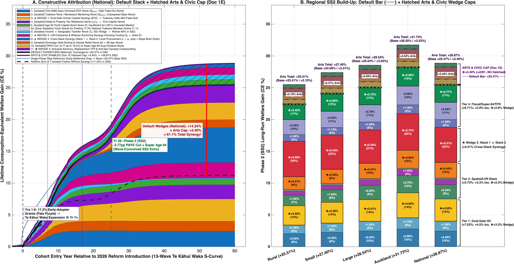

# IGWelfare: Intergenerational Welfare, Capital Allocation, & Human Potential in New Zealand

This repository contains the quantitative general-equilibrium model, replication suite, and monograph series for evaluating intergenerational welfare, spatial housing dynamics, human capability formation, and long-run fiscal solvency across four regions in Aotearoa New Zealand (plus an endogenous international emigration margin) using a GPU-accelerated Overlapping Generations (OLG) framework.

---

## 🌟 Headline Discovery: The Power of Dynamic Complementarity

Evaluating policy levers in isolation misses nearly half the macroeconomic story. When early human capability formation, spatial housing and enterprise tax rebalancing, and actuarial debt-sinking operate together as one coupled system, **47.3% (+11.46% CE) of New Zealand's +24.24% long-run welfare gain is generated by four non-linear Dynamic Complementarity Wedges (★)**:

[](output/NZ_Dunedin1972/Fig_Counterfactual_8Scenarios_SS1_SS2_Dunedin_22.png)

*(Read the Monograph Suite below to learn what these four complementarity wedges are, how they interact across regions, and why Aotearoa can achieve them inside a single parliamentary cycle.)*

---

## 🔍 Explore the Lifecycle Ledgers: Population Fates & Fiscal Flows

Every ribbon in our lifecycle Sankey diagrams traces 60,000 newborn lives—and every private and public dollar—from Birth (Age 0) through Retirement across the Status Quo (*SS0*), Phase 1 Incubation (*SS1*), and Phase 2 Harvest (*SS2*). 

Click the preview charts below to view the high-resolution comparisons, or open the **Interactive HTML5 + SVG Sankey Explorers** in [`output/NZ_Dunedin1972/`](output/NZ_Dunedin1972/) to click on any node or ribbon and inspect the underlying equations, empirical data, and literature:

| **Population Cohort Fates (5 Stages, 18 Nodes)** | **Lifecycle Fiscal Ledger (6 Gates, 29 Nodes)** |
| :---: | :---: |
| [](output/NZ_Dunedin1972/Fig_ChildFates_5Stage_2Panel_National_Dunedin_22.png) | [](output/NZ_Dunedin1972/Fig_ChildFiscal_6Gate_2Panel_National_Dunedin_22.png) |
| **Interactive Fates Explorers (Download/Open HTML):**<br>[`SS0` Status Quo](output/NZ_Dunedin1972/Interactive_ChildFates_SS0_National.html) · [`SS1` Phase 1](output/NZ_Dunedin1972/Interactive_ChildFates_SS1_National.html) · [`SS2` Phase 2](output/NZ_Dunedin1972/Interactive_ChildFates_SS2_National.html) | **Interactive Fiscal Explorers (Download/Open HTML):**<br>[`SS0` Status Quo](output/NZ_Dunedin1972/Interactive_ChildFiscal_SS0_National.html) · [`SS1` Phase 1](output/NZ_Dunedin1972/Interactive_ChildFiscal_SS1_National.html) · [`SS2` Phase 2](output/NZ_Dunedin1972/Interactive_ChildFiscal_SS2_National.html) |

> **Tip for Interactive `.html` Files:** GitHub shows raw source code when clicking `.html` files in the repository tree. To play with the interactive diagrams, either clone the repo and open the `.html` files locally in any browser, or paste the GitHub file URL into [htmlpreview.github.io](https://htmlpreview.github.io/).

---

## 📚 Monograph Suite & Reading Guide

Before running the code, consult the six companion documents in the repository root, organized around three core questions:

### 1. *How Do We Calculate These Impacts?* (Strategy, Policy & Audit)
* **[Document 1C.md](Document%201C.md) (*Flying, Not Floundering — Executive Brief & Suite Guide*):** A standalone 6-page broad-circulation executive digest and role-based reading guide.
* **[Document 1A.md](Document%201A.md) (*Multi-Audience Strategic Monograph*):** Targeted briefings for five core audiences, the three coupled lifecycle aspects, the 5-Stage Population and 6-Gate Fiscal Sankey ledgers, the 10-Tier Survey-Anchored wealth incidence, the Year-5 ACC Actuarial Continuation Audit, and 12 international benchmarks.
* **[Document 1B.md](Document%201B.md) (*Strategy & Policy Answer Key*):** Line-item cross-reference mapping every claim, table, and figure in Documents 1A, 1C, and 3 to exact MATLAB/Octave modules, VFI Toolkit variables, structural equations, and CSV/PNG outputs—including the 15-Commitment Policy Composition Stress-Test (`Compose_Policy_Bundle.m`).
* **[Document 1D.md](Document%201D.md) (*Te Kāhui Waka Sequencing*):** 13-wave phased rollout eliminating workforce bottlenecks and Year-3 fiscal capital-at-risk.
* **[Document 1E.md](Document%201E.md) (*Grassroots Civic Capacity, Pro-Social Belonging & the Social ROI of "Joining"*):** Synthesizes *Join or Die* (Putnam) and *The Price of Privilege* (Levine) across six community/creative club pillars, pricing the Universal NZD 500/yr Joiner Passport and modeling the **+3.40% CE Arts & Civic Mycelium cap** (`Table 19E`).
* **[Document 1F.md](Document%201F.md) (*Polycentric Democracy, Contingent Endorsements & the Citizens' Assembly Compact*):** Five-lane deliberative compact using ranged contingent endorsements reconciled on the open-source `IGWelfare` ledger.

### 2. *What Mathematical Tools Do We Use?* (Technical Specification & Methodology)
* **[Document 2.md](Document%202.md) / [Document 2A.md](Document%202A.md) & [Document 2B.md](Document%202B.md) (*Technical Documentation & Model Specification Guide*):** Complete 8-PType Mixed Finite/Infinite-Horizon Bellman equations, exact $`\Delta t`$-scaling laws, 4-tier epistemic parameter pipeline, and codebase manifest.
* **[Document 2T.md](Document%202T.md) (*"Thick" vs. "Thin" Numbers in Quantitative Public Policy*):** Standalone technical tutorial on dimension-free state-contingent conditioning—solving comonotonic tail risks on the GPU/multi-core state manifold at zero additional grid-dimension cost.
* **[GLOSSARY.md](GLOSSARY.md) (*Master Glossary, Ledger Index, & Institutional Reference Guide*):** Single-stop reference mapping all 10 `src/ledgers/` modules, `SS0 / SS1 / SS2` tax-and-spend rules, `Plans A / B / C`, Treasury `OIA 20250878` & `LTFM` / `CBAx` / `ACC` definitions, Nobel Prize foundations, 5 sectors, 3 Aspects, 5 Citizens' Assemblies (`GREEN / AMBER / RED` triggers), navigational-to-control-theory translations, and the International Near-Peer Statistical Abstract.

### 3. *What Do Our Calculations Mean for Working Together?* (Coalition, Biophysical & Public Synthesis)
* **[Document 3.md](Document%203.md) (*Leaving Our Silos, Lifting All Boats*):** Maps the 11-layer constructive synergy stack onto New Zealand's four policy constituencies (*Children & Youth*, *WellBeing & Housing*, *GrowthNZ & Venture*, and *Fiscal Stewards*), contrasting standalone silos and 6-year "Stop-Go" political cycles against the Treasury LTFM sinkhole and a 3%-of-GDP defense commitment.
* **Unified 5-Sector Small-Open-Economy & Biophysical Engine ([Documents 2A](Document%202A.md), [2B](Document%202B.md), & [1F](Document%201F.md)):** Couples the 4-Region + `Abroad` Spatial OLG core directly with **5-Sector Open-Economy (`S1`–`S5`)** production and external accounts—integrating Keen–Ayres useful-work exergy ($`e_N = 0.88`$ vs. $`e_F = 0.30`$), the Three-Tier `SNA` / Atkinson–Waring Care Scorecard (`79,000 FTE` volunteers), Ostrom Public-Asset Stewardship vs. Fire-Sale Privatization, Non-Minimum-Phase boundary-actuator (**Trim-Tab**) control (`51.9x` seed-to-system gain and `10.6-yr` cash `OBEGAL` observability lag), **Starting XV + Impact Bench** evidence-governed cohort staging, the *Matakahi* co-design socket for *Te Ōhanga Māori*, and the *Knowable / Decidable / Defensible / Achievable* Citizens' Assembly epistemology.

---

## 💻 System Requirements & Cross-Platform Setup

`IGWelfare` runs natively on **both MATLAB (GPU or multi-core CPU) and GNU Octave (headless multi-core CPU)** using a unified workspace bootstrap (`setup_igw_paths.m`; see **[USER_GUIDE.md](USER_GUIDE.md)** for full details):

* **Option A — MATLAB:** R2025b or later (optional NVIDIA GPU with 16GB+ VRAM for full-grid 5D GPU shooting, or multi-core CPU via phase-split dynamic programming).
* **Option B — GNU Octave:** Octave 8.x/9.x+ on macOS or Linux (multi-core CPU with `Solve_VFI_PhaseSplit.m` and Qt headless graphics).
* **Dependencies:** [VFI Toolkit](https://github.com/vfitoolkit/VFIToolkit-matlab) by Robert Kirkby (or `VFIToolkit-octave` compatibility branch on GNU Octave).
* **Initialize Paths (One Line from Repo Root):**
  ```matlab
  setup_igw_paths();
  ```

---

## 🚀 Key Modular Entry Points (`pipelines/`)

All declarative calibration data, rollout schedules, policy commitments, and sectoral specs live under `profiles/<Profile_ID>/` (`NZ_Dunedin1972`, `NZ_GUiNZ2009`, `TEMPLATE_Profile`), while pure models, ledgers, plots, and top-level orchestrators live in `src/`, `plots/`, and `pipelines/` (see **Section 8 of [Document 2B.md](Document%202B.md)** and **[USER_GUIDE.md](USER_GUIDE.md)**):

* **Core OLG Equilibrium, Welfare & Transition Suite (`pipelines/Run_All_NZ_Intergen_Suite.m`):**
  * Orchestrates `NZ_4Region_Master.m`, `WelfareDecomposition_4Region.m`, `PolicyExperiment_LeeSeshadri_4Region.m`, `FertilityBargaining_Module.m`, `TransPath_4Region_Master.m`, and the lifecycle Sankey, actuarial continuation (`Table 16`), 10-tier wealth resilience (`Table 17`), 11-layer synergy/mirror (`Tables 19–20`), and *Te Kāhui Waka* sequencing suites, exporting to `output/<Profile_ID>/` with `.mat` checkpoints in `cache/<Profile_ID>/`.
* **18-Commitment Policy Composition & Additionality Suite (`pipelines/Run_Policy_Composition_Suite.m`):**
  * Solves the Convention-2 signed policy algebra (`Compose_Policy_Bundle.m`) across constructive reforms, grassroots civic/arts catalysts ([Document 1E](Document%201E.md)), and retrenchment stress tests ([Document 1B §3.5](Document%201B.md)).
* **5-Sector SOE, Exergy, Waring, Public-Asset & Trim-Tab Suite (`pipelines/Run_Phase2_5Sector_Suite.m` & `plots/Plot_HelmPhysics_TrimTabs_And_CounterSteering.m`):**
  * Executes `Compute_5Sector_Exergy_Equilibrium.m`, the Three-Tier `SNA` / Atkinson–Waring Scorecard, the `NZD 50B` Public-Asset Privatization vs. Turnaround ledger, Paris `NDC` compliance, and the Non-Minimum-Phase Trim-Tab & Panic-Window counter-steering ledger ([Document 2A §2.3–2.5](Document%202A.md), [Document 2B §5.6 & §7.7](Document%202B.md)).
* **Five-Assembly Clearinghouse & Comonotonic SOE Shock-Frontier Suite (`pipelines/Run_Contingency_Suite.m`):**
  * Reconciles all 15 bilateral Citizens' Assembly contracts (`K01`–`K15`), Two-Key `Sustain_Steps` gates, and continuous comonotonic SOE shock breaking-point frontiers ([Document 1F](Document%201F.md)).

### Reference Benchmarks & Running the Automated Test Suite (`27` Tests)

Measured cold-cache end-to-end wall-clock benchmarks (`beta_hh = 0.980^dt`, `beta_firm = 0.9815^dt`, `dt = 3`, NVIDIA RTX 5090 GPU):
* **Core 4-Region + `Abroad` 5D/4D OLG Equilibrium, Decomposition & 60-Year Transition (`Run_All_NZ_Intergen_Suite.m`):** `73.93 s` (`1.23 min`) from cold cache.
* **Full Publication Suite (Core OLG + 5-Sector SOE/Exergy/Trim-Tabs + Five-Assembly Clearinghouse + 42-Panel Sankeys/HTMLs + `GUiNZ` Sensitivity + `27/27` Tests):** `234.07 s` (`3.90 min`) total cold-start wall time.

Fast, hermetic unit and wave-integration gates (`27` tests) live in `tests/` and run in `~30s` across MATLAB or GNU Octave:

* **GNU Octave:** `octave --no-gui --eval "setup_igw_paths(true, true); addpath('tests'); assert(run_all_tests() == 0);"`
* **MATLAB:** `matlab -batch "setup_igw_paths(true, true); addpath('tests'); assert(run_all_tests() == 0);"`

---

## 📂 Outputs & Interactive Explorers (`output/<Profile_ID>/`)

Profile-scoped pipeline runs export figures and CSV tables cleanly to **`output/NZ_Dunedin1972/`** and **`output/NZ_GUiNZ2009/`** (preserving legacy precomputed interactive HTML5 Sankey explorers and baseline snapshots in **[`output/NZ_Dunedin1972/`](output/NZ_Dunedin1972/)**):

* **Interactive HTML5 + SVG Sankey Explorers:** Zero-dependency web diagrams (`Interactive_ChildFates_*.html`, `Interactive_ChildFiscal_*.html`) featuring clickable node/ribbon dialogs and embedded empirical/theoretical narratives.
* **Publication Figures (`.png`):** High-resolution multi-panel charts covering cohort transition paths, housing tenure cleavages, brain-drain closure, the NZ Super Age 60–75 U-Curve, Year-5 ACC actuarial audits, 10-tier wealth resilience, 11-layer + Arts/Civic synergy attributions, 5-Sector Exergy/Waring/Asset & Trim-Tab Counter-Steering dashboards, and Five-Assembly Clearinghouse / SOE Shock-Frontier surfaces.
* **Leave-Behind Audit Tables (`.csv`):** Complete replication tables matching every figure and cross-reference across Documents 1A–1F, 2A–2T, and 3.
