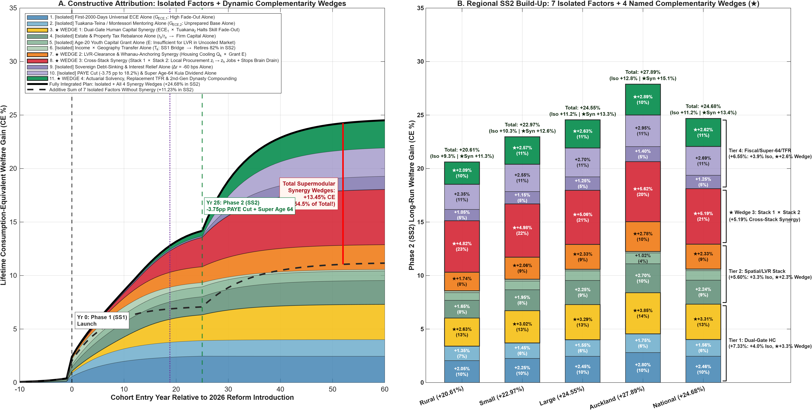
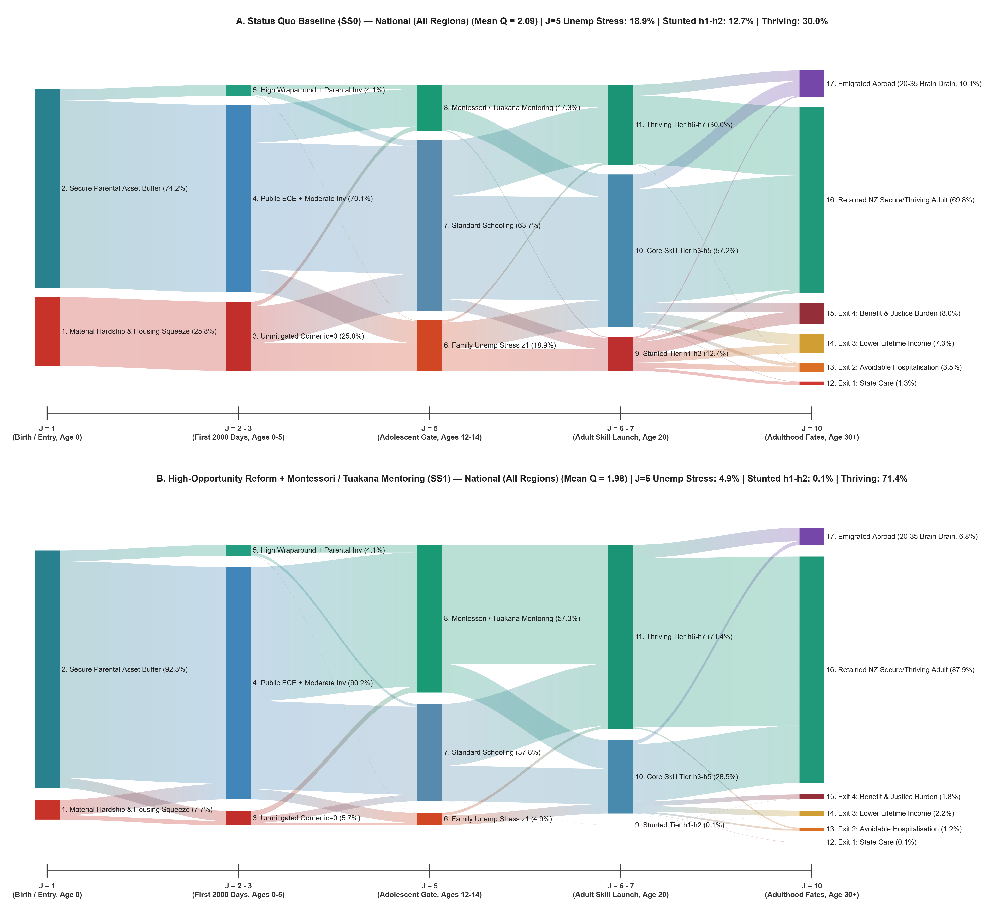
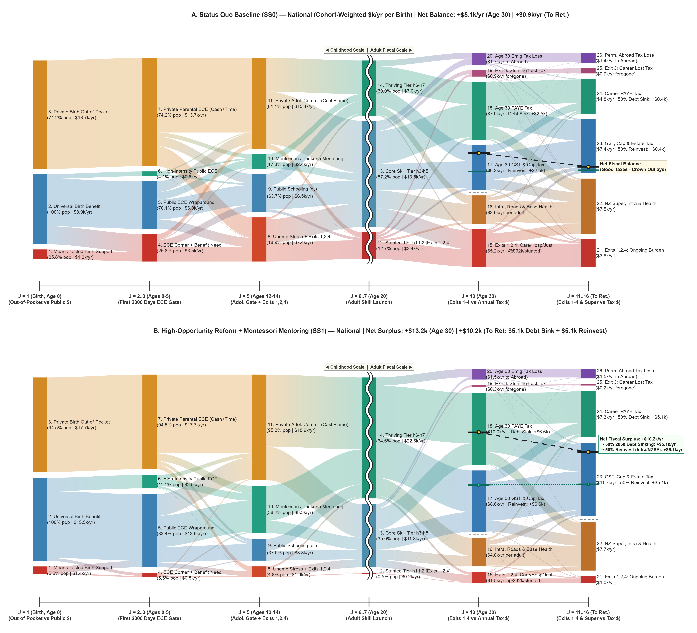

# IGWelfare: Intergenerational Welfare, Capital Allocation, & Human Potential in New Zealand

This repository contains the quantitative general-equilibrium model, replication suite, and monograph series for evaluating intergenerational welfare, spatial housing dynamics, human capability formation, and long-run fiscal solvency across four regions in Aotearoa New Zealand (plus an endogenous international emigration margin) using a GPU-accelerated Overlapping Generations (OLG) framework.

---

## 🌟 Headline Discovery: The Power of Dynamic Complementarity

Evaluating policy levers in isolation misses nearly half the macroeconomic story. When early human capability formation, spatial housing and enterprise tax rebalancing, and actuarial debt-sinking operate together as one coupled system, **47.3% (+11.46% CE) of New Zealand's +24.24% long-run welfare gain is generated by four non-linear Dynamic Complementarity Wedges ($\star$)**:

[](Output_NZ_4Region_Intergen/Fig_Counterfactual_8Scenarios_SS1_SS2_Dunedin_22.png)

*(Read the Monograph Suite below to learn what these four complementarity wedges are, how they interact across regions, and why Aotearoa can achieve them inside a single parliamentary cycle.)*

---

## 🔍 Explore the Lifecycle Ledgers: Population Fates & Fiscal Flows

Every ribbon in our lifecycle Sankey diagrams traces 60,000 newborn lives—and every private and public dollar—from Birth (Age 0) through Retirement across the Status Quo (*SS0*), Phase 1 Incubation (*SS1*), and Phase 2 Harvest (*SS2*). 

Click the preview charts below to view the high-resolution comparisons, or open the **Interactive HTML5 + SVG Sankey Explorers** in [`Output_NZ_4Region_Intergen/`](Output_NZ_4Region_Intergen/) to click on any node or ribbon and inspect the underlying equations, empirical data, and literature:

| **Population Cohort Fates (5 Stages, 17 Nodes)** | **Lifecycle Fiscal Ledger (6 Gates, 26 Nodes)** |
| :---: | :---: |
| [](Output_NZ_4Region_Intergen/Fig_ChildFates_5Stage_2Panel_National_Dunedin_22.png) | [](Output_NZ_4Region_Intergen/Fig_ChildFiscal_6Gate_2Panel_National_Dunedin_22.png) |
| **Interactive Fates Explorers (Download/Open HTML):**<br>[`SS0` Status Quo](Output_NZ_4Region_Intergen/Interactive_ChildFates_SS0_National.html) · [`SS1` Phase 1](Output_NZ_4Region_Intergen/Interactive_ChildFates_SS1_National.html) · [`SS2` Phase 2](Output_NZ_4Region_Intergen/Interactive_ChildFates_SS2_National.html) | **Interactive Fiscal Explorers (Download/Open HTML):**<br>[`SS0` Status Quo](Output_NZ_4Region_Intergen/Interactive_ChildFiscal_SS0_National.html) · [`SS1` Phase 1](Output_NZ_4Region_Intergen/Interactive_ChildFiscal_SS1_National.html) · [`SS2` Phase 2](Output_NZ_4Region_Intergen/Interactive_ChildFiscal_SS2_National.html) |

> **Tip for Interactive `.html` Files:** GitHub shows raw source code when clicking `.html` files in the repository tree. To play with the interactive diagrams, either clone the repo and open the `.html` files locally in any browser, or paste the GitHub file URL into [htmlpreview.github.io](https://htmlpreview.github.io/).

---

## 📚 Monograph Suite & Reading Guide

Before running the code, consult the six companion documents in the repository root, organized around three core questions:

### 1. *How Do We Calculate These Impacts?* (Strategy, Policy & Audit)
* **[Document 1C.md](Document%201C.md) (*Flying, Not Floundering — Executive Brief & Suite Guide*):** A standalone 6-page broad-circulation executive digest and role-based reading guide.
* **[Document 1A.md](Document%201A.md) (*Multi-Audience Strategic Monograph*):** Targeted briefings for five core audiences, the three coupled lifecycle aspects, the 5-Stage Population and 6-Gate Fiscal Sankey ledgers, the 10-Tier Survey-Anchored wealth incidence, the Year-5 ACC Actuarial Continuation Audit, and 12 international benchmarks.
* **[Document 1B.md](Document%201B.md) (*Strategy & Policy Answer Key*):** Line-item cross-reference mapping every claim, table, and figure in Documents 1A, 1C, and 3 to exact MATLAB scripts, VFI Toolkit variables, structural equations, and CSV/PNG/HTML outputs.

### 2. *What Mathematical Tools Do We Use?* (Technical Specification & Methodology)
* **[Document 2.md](Document%202.md) (*Technical Documentation & Model Specification Guide*):** Complete 8-PType Mixed Finite/Infinite-Horizon Bellman equations, exact $\Delta t$-scaling laws (`Configure_TimeGrid_Params.m` for trading off high-resolution `dt=3` vs. fast `dt=5` execution), Simulated Method of Moments (SMM) calibration matrices, and the 22-file codebase manifest.
* **[Document 2B.md](Document%202T.md) (*"Thick" vs. "Thin" Numbers in Quantitative Public Policy*):** Standalone technical tutorial on dimension-free state-contingent conditioning—showing how comonotonic tail risks (sandwich-generation care reversal, *Kaiako* rent crowd-out, the 20% LVR deposit cliff, and differential mortality) are solved on the 26,901-point GPU state manifold at zero additional grid-dimension cost.

### 3. *What Do Our Calculations Mean for Working Together?* (Coalition & Public Synthesis)
* **[Document 3.md](Document%203.md) (*Leaving Our Silos, Lifting All Boats*):** Maps the 11-layer constructive synergy stack onto New Zealand's four policy constituencies (*Barnardos/Youth*, *WellBeing/Housing*, *GrowthNZ/Venture*, and *Fiscal Stewards*), contrasting standalone silos and 6-year "Stop-Go" political cycles against the Treasury LTFM sinkhole and a 3%-of-GDP defense commitment.

---

## 💻 System Requirements & Setup

Solving multi-region, multi-asset mixed-horizon OLG models with 60-year transition paths is computationally intensive. Ensure your environment meets the following baseline:

* **MATLAB:** R2025b or later (with Parallel Computing Toolbox).
* **Hardware:** A modern NVIDIA GPU with **at least 16GB VRAM** (required for vectorized 4D/5D GPU array operations and transition path shooting).
* **Dependencies:** [VFI Toolkit](https://github.com/vfitoolkit/VFIToolkit-matlab) by Robert Kirkby.
  * Clone or download the VFI Toolkit and add it (with all subfolders) to your MATLAB path before executing any scripts:
    ```matlab
    addpath(genpath('/path/to/VFIToolkit-matlab'));
    ```

---

## 🚀 Key Entry Points (What to Run)

You do not need to run individual helper or return functions (`ReturnFn_*.m`) manually. Use these primary scripts depending on your goal (see **Section 8 of [Document 2.md](Document%202.md)** for the full 22-file manifest):

* **Full Suite Execution:**
  * `Run_All_NZ_Intergen_Suite.m` — Master execution pipeline with `.mat` checkpoint caching (`Cache_NZ_Intergen/`) across `Active_Phases = {'SS0', 'SS1', 'SS2'}`.
* **Core Configuration & Equilibrium Solvers:**
  * `Configure_TimeGrid_Params.m` — Maps all flow rates, survival curves, and developmental stage indices across $\Delta t \in \{5, 3, 2, 1\}$ (see [Document 2.md](Document%202.md) Section 1.2).
  * `NZ_4Region_Master.m` & `Solve_Spatial_GE_Loop.m` — Initializes and solves the 8-PType mixed-horizon General Equilibrium (`ValueFnIter_MixHorz_PType` & `StationaryDist_MixHorz_PType`).
  * `WelfareDecomposition_4Region.m` — Computes the multiphase (`SS1`, `SS2`) Daruich / Lee-Seshadri welfare decompositions (`Table 1`), spatial quintiles (`Table 2`), and housing tenure cleavages (`Table 3`).
  * `Counterfactuals_LeeSeshadri_4Region.m` — Runs the multi-stage human capital counterfactuals (`Tables 4–6` & `12A–C`).
  * `FertilityBargaining_Module.m` — Solves cooperative childcare bargaining, hyperbolic fertility, and the continuous Age 60–75 NZ Superannuation U-Curve (`Tables 7, 8, & 8B`).
  * `TransPath_4Region_Master.m` — Computes the 60-year multiphase transition path with dynamic regional weights and credibility blending.
* **Visualization, Actuarial Audits & Interactive Reporting:**
  * `Plot_ChildFates_SSankey.m` & `Plot_ChildFiscal_SSankey.m` — Generate the 5-Stage (17-Node) Population Sankey, the 6-Gate (26-Node) Fiscal Sankey, the 2050 Debt-Sinking Protocol, and standalone interactive HTML5 explorers (via `exportSankeyToHTML.m`).
  * `Plot_CumulativeTransitionPayoffs.m` & `Plot_ActuarialContinuationValuation.m` — Compute 60-year transition integrals and the Year-5 ACC-style Actuarial Continuation Audit (`Table 16`).
  * `Plot_WealthBracket_GiveAndGain.m` — Evaluates Fiscal Give vs. Economic Gain and balance-sheet resilience across 10 survey-anchored Earn + Own tiers (`Table 17`).
  * `Plot_Counterfactuals_And_MirrorInvestments.m` — Generates the 11-Layer Constructive Synergy Attribution (`Table 19`) and Mirror Investment Ledger (`Table 20`).
  * `Plot_Doc3_CoalitionSynergies_And_LTFMSinkhole.m` — Renders the 3D LTFM Fiscal Sinkhole & Defense Shock surface, Stop-Go perishability paths (`Table 21`), and the 4 × 4 Coalition Matrix (`Table 22`).

### Running the tests

Lightweight checks on the exported CSV tables and the flow-matrix helper live in `tests/`. They need no GPU, toolboxes or VFI Toolkit, and run in MATLAB or GNU Octave:

* **MATLAB:** `matlab -batch "addpath('tests'); run_all_tests"` (or `addpath('tests'); run_all_tests` in the Command Window)
* **Octave:** `octave --no-gui --eval "cd tests; run_all_tests"`
* Each test prints `PASS`/`FAIL`/`SKIP`; non-interactive runs exit with status 1 on any failure. The GPU solvers themselves are not under test.
* CI (`.github/workflows/tests.yml`) runs the suite under both GNU Octave and MATLAB R2025b.

---

## 📂 Precomputed Outputs (`Output_NZ_4Region_Intergen/`)

To inspect the results without running the GPU solvers from scratch, browse the **[`Output_NZ_4Region_Intergen/`](Output_NZ_4Region_Intergen/)** directory:

* **Interactive HTML5 + SVG Sankey Explorers:** Zero-dependency web diagrams (`Interactive_ChildFates_*.html`, `Interactive_ChildFiscal_*.html`) featuring clickable node/ribbon dialogs and embedded empirical/theoretical narratives.
* **Publication Figures (`.png`):** High-resolution multi-panel charts covering cohort transition paths, housing tenure cleavages, brain-drain closure, the NZ Super Age 60–75 U-Curve, Year-5 ACC actuarial audits, 10-tier wealth resilience, 11-layer synergy attributions, mirror investment ledgers, and 3D LTFM fiscal surfaces.
* **Leave-Behind Audit Tables (`.csv`):** Complete replication tables (`Table1` through `Table22`) matching every figure and cross-reference in [Document 1B.md](Document%201B.md).
