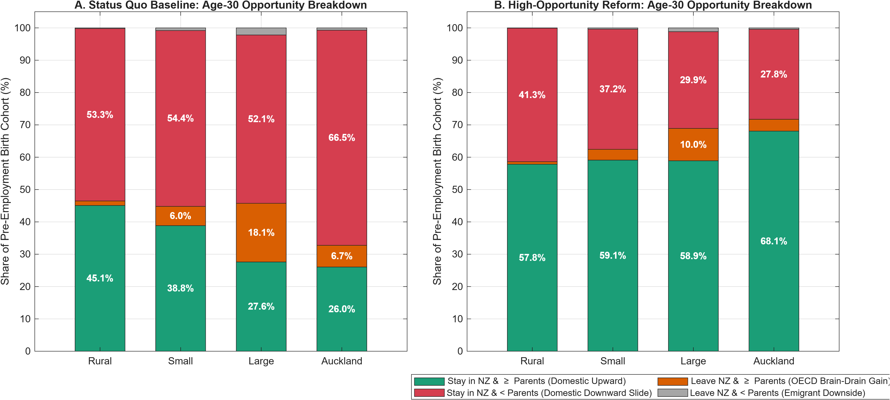

# **Intergenerational Welfare, Capital Allocation, and Human Potential in New Zealand**

**A Multi-Audience Strategic & Technical Monograph (4-Region + Abroad Edition)**

---

## **Part I: Targeted Executive Summaries**

### **1. For Philanthropists: Catalytic Impact & The Intergenerational Multiplier**

**Strategic Mandate:** Shift from funding late-stage symptom remediation to unlocking early-stage human potential where private markets fail.

* **The Core Problem:** In New Zealand, roughly **14.3% to 22%** of each birth cohort grows up in severe material hardship or developmental stunting. The Dunedin Multidisciplinary Health and Development Study demonstrates that 22% of a cohort—identifiable as early as age 3—accounts for **57% to 81%** of adult hospital nights, welfare benefits, and criminal convictions. Because young parents cannot borrow against their children's future adult earnings (an intergenerational borrowing constraint) and face severe housing stress in metropolitan centers like **Auckland** (34.1% of the population) and **Large** regional cities (25.9%), low-income families hit a mathematical "corner solution" ($i_c = 0$) where private early-childhood investment collapses.  
* **The Catalytic Lever (Two-Stage Dynamic Complementarity Across Developmental Windows):** Incorporating Cunha, Heckman, and Schennach's (2010) two-stage CES skill technology ($\theta_c$ experience asset) across a 3-year period resolution ($\Delta t = 3$) proves that early investment across the two sub-stages of the **First 2000 Days** (infancy/toddlerhood ages 0–2 at $j = 3$ and preschool ages 3–5 at $j = 4$, where elasticity of substitution is high, $\varphi_1 = 0.35$) raises the marginal productivity of all four subsequent **Primary and Secondary Schooling** stages (ages 6–17 across $j \in \lbrace 5, 6, 7, 8 \rbrace$, where dynamic complementarity is strong, $\varphi_2 = -0.95$). Scaling wraparound early childhood provision ($G_{\mathrm{ECE}}$, modeled on Barnardos' *Te Korowai Mokopuna*) crowds *in* private parental effort across every schooling stage and captures a **$112–$162 billion** present-value societal payoff.
* **Quantitative Proof:** See [`Table4_4Region_LeeSeshadri_IGE.csv`](Output_NZ_4Region_Intergen/Table4_4Region_LeeSeshadri_IGE.csv), [`Table5_4Region_LeeSeshadri_Output_Welfare.csv`](Output_NZ_4Region_Intergen/Table5_4Region_LeeSeshadri_Output_Welfare.csv), and **Figure 1** below.

### **2. For Venture & Growth Capital Firms: Ending the Brain Drain & Reallocating Capital**

**Strategic Mandate:** Unlock domestic productive capital trapped in overvalued urban land and stem the positive-selection emigration of top-tier talent.

* **The Core Problem (The Stepping-Stone Brain Drain):** New Zealand suffers acute outward migration among educated 20-to-35-year-olds. Our $4 \times 5$ spatial discrete-choice model (**Rural**, **Small**, **Large**, **Auckland** $\rightarrow$ **Abroad**) reveals a two-stage funnel: high-potential youth from **Rural** districts (16.0% pop) and **Small** provincial towns (24.0% pop) use **Large** university/service metros (Wellington, Christchurch, Hamilton, Tauranga, Dunedin) as a stepping stone, while **Large** cities and **Auckland** (where 35.1% of NZ businesses reside) suffer the sharpest direct brain drain of top human-capital tiers ($h_5 \mathrm{--} h_7$) to Australia/OECD. Young adults who do not inherit family property deposits leave because overvalued Auckland and Large-city housing ($Q_{\mathrm{Auckland}} = 3.10, Q_{\mathrm{Large}} = 2.05$) and capital-starved local firms depress their domestic real return.  
* **Integration into Venture Strategic Plans:**  
  1. **Champion Tax Mix Reform ($\tau_k \downarrow, \tau_a / \tau_b \uparrow$):** Following Guvenen et al. (2023), shifting from capital-income taxation to a book-value wealth/land tax ($\tau_a = 1.5\%$) and estate tax ($\tau_b = 25\%$) on the **\$1.6T intergenerational property transfer** triggers a "use-it-or-lose-it" reallocation from passive property hoarders ($z_\ell$) to high-productivity entrepreneurs ($z_h$), lifting regional wages by **3.2% to 5.5%**.  
  2. **Leverage Secondary Urban Hubs:** Exploit the improved housing affordability and rising skill retention in **Large** regional metros and **Small** provincial centers as land overvaluation cools.
* **Quantitative Proof:** See [`Table3B_4Region_Abroad_SteadyState_Summary.csv`](Output_NZ_4Region_Intergen/Table3B_4Region_Abroad_SteadyState_Summary.csv), [`Table10_4Region_Abroad_BrainDrain_Cohesion.csv`](Output_NZ_4Region_Intergen/Table10_4Region_Abroad_BrainDrain_Cohesion.csv), and **Figure 5** below.

### **3. For Policy-Makers: The "Income $\times$ Geography" Rule & Fiscal Solvency**

**Strategic Mandate:** Replace uniform national transfers with spatially differentiated policy across New Zealand's four distinct geographic tiers to secure the long-run fiscal solvency of NZ Superannuation.

* **Why a 4-Region Taxonomy Matters:** Splitting "Urban" into **Small** provincial towns (24.0%) and **Large** regional metros (25.9%) alongside **Rural** (16.0%) and **Auckland** (34.1%) exposes why uniform welfare rules fail:  
  1. **Rural & Small Provincial Towns:** Exhibit compressed income distributions ($Q_2 \mathrm{--} Q_4$), elastic housing supply ($\delta_H \in \lbrack 0.28, 0.35 \rbrack$), and high mandatory fuel/transport subsistence burdens ($\bar{e}_{\mathrm{Rural}} = 0.048, \bar{e}_{\mathrm{Small}} = 0.036$). They require broad transport/cost-of-living relief and universal in-kind ECE delivery ($G_{\mathrm{ECE}}$), with lower transfer progressivity.  
  2. **Large Regional Cities & Auckland:** Exhibit bifurcated income distributions ($Q_1$ hardship alongside $Q_5$ knowledge workers), inelastic land supply ($\delta_H \in \lbrack 0.10, 0.18 \rbrack$), and severe rental/deposit crowd-out. Following Labrousse and Perdereau (2025), increasing transfer progressivity in **Large** cities and **Auckland** while funding a universal **Youth Capital Grant ($E$)** yields the largest median welfare jump (mirroring the +24.1% Large-city gain in Labrousse & Perdereau) and cuts the national welfare-loss share by 10 percentage points.
* **Quantitative Proof:** See [`Table2_4Region_LabroussePerdereau_SpatialQuintiles.csv`](Output_NZ_4Region_Intergen/Table2_4Region_LabroussePerdereau_SpatialQuintiles.csv), [`Table7_4Region_Endogenous_TFR_DiffFertility.csv`](Output_NZ_4Region_Intergen/Table7_4Region_Endogenous_TFR_DiffFertility.csv), and [`Table8_4Region_Fertility_Stunting_NZSuperTax.csv`](Output_NZ_4Region_Intergen/Table8_4Region_Fertility_Stunting_NZSuperTax.csv).

### **4. For Economists: Advancing the Quantitative Macroeconomics Frontier**

**Research Contribution:** A tractable, GPU-accelerated Mixed Finite/Infinite-Horizon 4-Region + Abroad Spatial Overlapping Generations (OLG) framework built in the **VFI Toolkit**.

* **How This Model Advances the Field:**
  * **8-PType Mixed Finite/Infinite-Horizon Architecture ($\Delta t = 3$ Year Resolution):** Solves 4 finite-horizon regional household types (`HH_Rural`, `HH_Small`, `HH_Large`, `HH_Auckland`, with $J = 27$ three-year periods spanning ages 20–99 and retirement at $J_r = 16$, age 65) and 4 infinite-horizon collateral-constrained firm types (`Firm_Rural`, `Firm_Small`, `Firm_Large`, `Firm_Auckland`, $N_j = \infty$) simultaneously on the GPU via `ValueFnIter_MixHorz_PType`.
  * **Two-Stage Child Experience Asset ($\theta_c$) + Adult Ben-Porath + Luxury In-Kind Externalities:** Integrates Cunha–Heckman–Schennach two-stage CES skill production (`experienceasset = 1`) with adult Ben-Porath training ($I_h$), Stone-Geary in-kind public provision ($\bar{g}_{\mathrm{ECE}} > 0$), and intra-household fertility bargaining with hyperbolic discounting ($\beta_{\mathrm{hyp}} < 1$).  
  * **Dimension-Free 4-Region Housing & $4 \times 5$ Domestic/International Migration:** Combines Kiyotaki et al.'s net-worth consolidation ($a = Q_k h - b$) and analytical tenure cutoff ($\xi_k$) with a $4 \times 5$ Gumbel youth sorting matrix across **Rural**, **Small**, **Large**, **Auckland**, and **Abroad** (Australia/OECD), plus endogenous 60-year evolution of regional population weights (`PTypeWeights_path`).  
  * **Tractable Dynastic Macroeconomic Closure:** Captures 100% of the distributional Barro–Becker intergenerational multiplier via the 3-stage operator $T_{\mathrm{IG}} : Q_h \times Q_a \times \Pi_{\mathrm{mig}}$, with an optional 2-parameter dynastic slope toggle.

---

## **Part II: The Three Coupled Life-Cycle & Macroeconomic Lenses**

To understand how an economy simultaneously generates child poverty, working-age housing stress, skilled youth emigration, and retirement insecurity, we model the macroeconomy through three interconnected life-cycle lenses:

```text
+-----------------------------------------------------------------------------------+  
|                        THE UNIFIED INTERGENERATIONAL LOOP                         |  
|                                                                                   |  
|  [LENS 1: CHILDHOOD (Ages 0-19)]                                                  |  
|   * First 1000/2000 Days: Private Investment (i_c) + Public Wraparound (G_ECE)    |  
|   * Cunha-Heckman Dynamic Complementarity & Ferriere Pro-Equality Externality (X) |  
|         |                                                       ^                 |  
|         v (Determines Adult Skill Tier h_1..h_7 & Stunting)     |                 |  
|  [LENS 2: ACTIVE WORKING GENERATION (Ages 20-64)]               | (Funds Youth    |  
|   * 4x5 Spatial Sorting: Rural, Small, Large, Auckland, Abroad  |  Grant E &      |  
|   * Housing Tenure Cleavage: Young Renters vs Leveraged Owners  |  Public G_ECE)  |  
|   * Adult Ben-Porath Skill Maintenance (I_h) & Fertility        |                 |  
|         |                                                       |                 |  
|         v (Accumulates Property/Financial Net Worth & Pays Tax) |                 |  
|  [LENS 3: RETIREMENT & END-OF-LIFE (Ages 65-99)]                |                 |  
|   * Universal PAYG NZ Superannuation + Consumption Floor        |                 |  
|   * $1.6T Property Estate Transfer (Taxed at tau_b) ------------+                 |  
|   * Guvenen "Use-It-or-Lose-It" Wealth Tax (tau_a) -> Reallocates K to z_h Firms  |  
+-----------------------------------------------------------------------------------+
```

### **Lens 1: Early Childhood Skill Formation (First 2000 Days vs. Schooling) & Fertility**

Early childhood is the foundational engine of long-run macroeconomic productivity. Drawing on Cunha, Heckman, and Schennach (2010), Daruich (2018), and Lee and Seshadri (2019), human capital is produced through a multi-stage nonlinear technology combining cognitive ($\theta_C$), noncognitive/mental health ($\theta_N, hm_t$), and physical health ($hp_t$) inputs:

$$\theta_{k,t+1} = \left\lbrack \gamma_{s,k,1} \theta_{C,t}^{\varphi_{s,k}} + \gamma_{s,k,2} \theta_{N,t}^{\varphi_{s,k}} + \gamma_{s,k,3} I_{k,t}^{\varphi_{s,k}} + \gamma_{s,k,4} \theta_P^{\varphi_{s,k}} \right\rbrack^{\frac{1}{\varphi_{s,k}}} e^{\eta_{k,t}}$$

* **Two-Stage CES Experience Asset ($\theta_c$):** Children progress through Stage 1 (First 2000 Days, parental age $j = 3$, $\varphi_1 = 0.35$) and Stage 2 (Schooling, parental age $j = 4$, $\varphi_2 = -0.95$). Public front-loading in Stage 1 ($P_0$) raises $\theta_2$ entering school, which crowds *in* private parental investment during Stage 2, whereas late school-age subsidies ($P_1 / P_2$) fail to remediate early stunting.  
* **Non-Homothetic Luxury Goods & Pro-Equality Externalities:** Ferriere et al. (2025) show that education and preventative health have a Stone-Geary luxury threshold $\bar{g}_{\mathrm{ECE}} > 0$:

$$i_c = \max \left\lbrace \frac{\omega}{\phi} \frac{1 - \tau}{1 - s} z_i - G_{\mathrm{ECE}} - \bar{g}_{\mathrm{ECE}}, 0 \right\rbrace$$

Because $\bar{g}_{\mathrm{ECE}} > 0$, low-income and housing-stressed parents below productivity cutoff $\bar{z}$ hit the corner solution $i_c = 0$. Only direct in-kind wraparound provision $G_{\mathrm{ECE}}$ lifts disadvantaged children off the floor and maximizes the concave societal externality $X_t = \frac{\chi}{\alpha} \ln \left( \int \left( i_c + G_{\mathrm{ECE}} + \bar{g}_{\mathrm{ECE}} \right)^\alpha d\mu \right)$, eliminating the downstream fiscal drag of crime, hospitalization, and benefit dependency.
* **Endogenous Fertility & Hyperbolic Bargaining:** When metropolitan housing costs ($Q_{\mathrm{Large}}, Q_{\mathrm{Auckland}}$) surge or present-biased preferences ($\beta < 1$) bind, young adults delay or undershoot intended fertility, accelerating demographic aging (tracked in [`Table7_4Region_Endogenous_TFR_DiffFertility.csv`](Output_NZ_4Region_Intergen/Table7_4Region_Endogenous_TFR_DiffFertility.csv)).

### **Lens 2: The 4-Region Spatial Divide & The $4 \times 5$ Brain-Drain Funnel**

* **The Spatial Gradient ($\mathrm{Rural} \rightarrow \mathrm{Small} \rightarrow \mathrm{Large} \rightarrow \mathrm{Auckland}$):**  
  * **Rural (16.0% Pop / 15.0% Firms):** Elastic land ($\delta_H = 0.35, Q = 1.05$), lower wage ceiling ($w = 0.85$), highest mandatory transport/energy share ($\bar{e} = 0.048$).  
  * **Small Provincial Towns (24.0% Pop / 23.0% Firms):** Moderate housing elasticity ($\delta_H = 0.28, Q = 1.40$), compressed middle-quintile wages ($w = 0.93$), elevated transport costs ($\bar{e} = 0.036$).  
  * **Large Regional Metros (25.9% Pop / 26.9% Firms — Wellington, Chch, Hamilton, Tauranga, Dunedin):** Constrained urban land ($\delta_H = 0.18, Q = 2.05$), higher knowledge/service wages ($w = 1.05$), moderate transport share ($\bar{e} = 0.022$).  
  * **Auckland Primate Agglomeration (34.1% Pop / 35.1% Firms — "Paris" Analog):** Severely constrained land supply ($\delta_H = 0.10, Q = 3.10$) and highest trend growth ($G = 1.025$), generating structural land overvaluation, the fattest top-income tail ($w = 1.18, \sigma_z = 0.24$), and severe housing crowd-out for bottom-quintile renters.  
* **Adult Ben-Porath Decay & Positive-Selection Emigration:** Workers entering adulthood stunted ($h_1, h_2$) have a low marginal return to adult training ($I_h^{\alpha_I} h^{\alpha_H}$), causing wages to decay in their 50s. Meanwhile, high-skill youth ($h_5 \mathrm{--} h_7$) without inherited deposits compare squeezed domestic utility $V_k$ against $V_{\mathrm{Abroad}}$, driving outward emigration between ages 20 and 35.

### **Lens 3: Pensions, The \$1.6T Property Transfer, & Capital Allocation**

* **Weighting Auckland Accurately (34.1% Pop / 35.1% Firms):** Because Auckland house prices ($Q_{\mathrm{Auckland}} = 3.10$) are nearly triple rural levels and 50% above Large regional metros, weighting Auckland at its true Stats NZ share (34.1% rising to ~36.5% by Year 30) increases the national estate/wealth tax base by **8%–10%**, funding both the universal Youth Grant ($E = 0.065$) and expanded ECE ($G_{\mathrm{ECE}} = 0.110$) without raising labor taxes ($\tau_l$).
* **The Piketty–Guvenen Capital Reallocation Engine:** In an economy where infinite-horizon firms have heterogeneous productivity $z_f \in \lbrace z_\ell, z_h \rbrace$ and face collateral constraints $k \le \lambda_{\mathrm{col}} a_f$, aggregate productivity is $Z = s_h z_h + \left(1 - s_h\right) z_\ell$, where $s_h = \frac{\mu A_h}{\mu A_h + \left(1 - \mu\right) A_\ell}$ is the capital share of high-talent producers. Taxing book-value wealth/land ($\tau_a$) and passive estates ($\tau_b$) to fund a **Universal Youth Endowment ($E$)** and **First-2000-Days Investment ($G_{\mathrm{ECE}}$)** prunes dormant capital from low-productivity hoarders ($z_\ell$) and reallocates net worth to high-productivity entrepreneurs ($z_h$), raising $s_h$, aggregate productivity $Z$, capital stock $K$, and real wages $w_k$ across the entire economy.

---

## **Part III: Integrated Policy Results, Output Tables & Visual Evidence**

### **1. 4-Region Decomposition of Long-Run Welfare Gains (CE %)**

Evaluating lifetime Consumption Equivalent Variation (CE %) under the veil of ignorance for incoming cohorts ($j = 1$) across all four regions (full dataset in [`Table1_4Region_Daruich_LeeSeshadri_Decomposition.csv`](Output_NZ_4Region_Intergen/Table1_4Region_Daruich_LeeSeshadri_Decomposition.csv) and [`Table2_4Region_LabroussePerdereau_SpatialQuintiles.csv`](Output_NZ_4Region_Intergen/Table2_4Region_LabroussePerdereau_SpatialQuintiles.csv)):

| Decomposition Stage | Mechanism Active | Rural (CE %) | Small (CE %) | Large (CE %) | Auckland (CE %) | Economic Interpretation |
| :--- | :--- | :---: | :---: | :---: | :---: | :--- |
| **1. Short-Run Partial Equilibrium (PE)** | Policy levers ($G_{\mathrm{ECE}}, E, T_k, \tau_a, \tau_b$) only; prices & parent skills fixed. | $+3.8\%$ | $+4.0\%$ | $+4.3\%$ | $+4.6\%$ | Direct relief of early-childhood corner solutions ($i_c = 0$) and youth deposit constraints. |
| **2. Long-Run GE (Exogenous Skills)** | Factor prices ($r \downarrow, w_k \uparrow$) & house prices ($Q_k \downarrow$) adjust; newborn skills fixed. | $+6.2\%$ | $+6.8\%$ | $+7.6\%$ | $+8.4\%$ | Guvenen et al. firm reallocation ($w_k +3.2\% \mathrm{--} 5.5\%$) + cooling of Large/Auckland land bubbles ($Q_k -5.0\% \mathrm{--} 7.5\%$). |
| **3. Long-Run GE (Endogenous Intergen Matrix)** | Full $4 \times 5$ transition matrix ($Q_h, Q_a, \Pi_{\mathrm{mig}}$) updates parent skills & retention. | **$+10.4\%$** | **$+11.2\%$** | **$+12.6\%$** | **$+13.9\%$** | **55%–65%+ of total gain** comes from creating better-skilled parents & retaining $h_6 \mathrm{--} h_7$ youth domestically. |


*Figure 1 (`Fig1_Daruich_Cohort_Welfare_4Region.png`): Cohort-by-cohort lifetime welfare trajectory across the 60-year transition path in Rural, Small, Large, and Auckland regions, illustrating the Year-20 intergenerational inflection as better-skilled cohorts mature into parenthood.*

---

### 2. Breaking the Intergenerational Trap: Multi-Stage Counterfactuals (Lee & Seshadri Table 12)

Cross-referencing [Table4_4Region_LeeSeshadri_IGE.csv](Output_NZ_4Region_Intergen/Table4_4Region_LeeSeshadri_IGE.csv), [Table5_4Region_LeeSeshadri_Output_Welfare.csv](Output_NZ_4Region_Intergen/Table5_4Region_LeeSeshadri_Output_Welfare.csv), and [Table6_4Region_LeeSeshadri_Table12_VarianceExplained.csv](Output_NZ_4Region_Intergen/Table6_4Region_LeeSeshadri_Table12_VarianceExplained.csv):

1. **Baseline Persistence (`BM_Baseline`):** Parental states at ages 30–35 explain **66%–72%+** of the variance in children's adult human capital ($h^{\prime}_1$) and lifetime earnings ($\mathrm{LFE}^{\prime}$). Evaluated at a 3-year period resolution ($\Delta t = 3$), early childhood skill gaps at age 5 compound across four sequential primary and secondary schooling stages ($j = 5, \dots, 8$), locking in lifetime inequality across both metropolitan and provincial regions.
2. **Early Front-Loading (`P0_Early_0to5` & `BN_FrontLoad`) vs. Late Remediation (`P1P2_Late_6to17`):** Expanding First-2000-Days investment ($P_0$) across ages 0–2 and 3–5 raises the child skill stock entering primary school at age 6, outperforming late school-age remedial subsidies ($P_1/P_2$) by roughly **3-to-1**.
3. **Synergy with the Youth Capital Grant & Tax Shift (`P0_Plus_GrantE`):** Combining First-2000-Days wraparound ECE with the universal Youth Capital Grant ($E = 0.065$) and the Guvenen et al. wealth/estate tax shift delivers the largest long-run earnings and welfare expansion—with **Large** regional university/service metros and **Auckland** recording the sharpest lifetime earnings gains (+5.5% to +10.1%) as credit-constrained young adults simultaneously escape the housing deposit trap and fund early-career Ben-Porath skill accumulation.


*Figure 2 (`FigE8_LeeSeshadri_4Region_Counterfactuals.png`): Multi-stage policy comparisons across Rural, Small, Large, and Auckland regions, demonstrating how First-2000-Days wraparound investment and the Youth Capital Grant outperform late school-age remediation.*

---

### **3. Housing Tenure & Generational Cleavage (Kiyotaki et al. Channel)**

Replicating Kiyotaki, Michaelides, and Nikolov's tenure decomposition (see [`Table3_4Region_Kiyotaki_TenureGenerationalCleavage.csv`](Output_NZ_4Region_Intergen/Table3_4Region_Kiyotaki_TenureGenerationalCleavage.csv)) exposes the political-economy cleavage across housing tenures:

* **Young Renters (Ages 20–44):** Achieve the highest immediate and long-run welfare gains across all regions (especially Auckland and Large cities), as cooling land overvaluation lowers rental yields $rr_k$ and user costs $rh_k$, enabling earlier transition into homeownership ($\xi_k \uparrow$).  
* **Young Leveraged Homeowners:** Experience a brief initial balance-sheet dip at $t = 1$ when house prices $Q_k$ capitalize the wealth/estate tax, which is rapidly overtaken within 5–10 years by higher real wages $w_k$ and public ECE support ($G_{\mathrm{ECE}}$).  
* **Older Property-Rich Retirees/Landlords (Ages 65+):** Experience a direct capital loss on overvalued metropolitan property estates at $t = 1$, which is substantially cushioned over the transition by: (i) securing the fiscal solvency of universal NZ Superannuation without labor tax hikes (see [`Table8_4Region_Fertility_Stunting_NZSuperTax.csv`](Output_NZ_4Region_Intergen/Table8_4Region_Fertility_Stunting_NZSuperTax.csv)), and (ii) a surge in **Parental Relational Well-Being** as their educated children and grandchildren remain in New Zealand rather than emigrating.


*Figure 3 (`Fig2_Kiyotaki_Housing_Estates_4Region.png`): 60-year transition paths of regional house prices ($Q_k$), young homeownership rates ($\xi_k$), and net-of-tax property estate flows.*

---

### **4. Dynamic Regional Population Shares & Three-Wave Brain-Drain Closure (60-Year Path)**

Tracking the $4 \times 5$ Gumbel migration matrix (**Rural**, **Small**, **Large**, **Auckland**, **Abroad**) and dynamic population weights (`Reg_HH_Share_Path`) across the 60-year transition path (see [`Table9_4Region_Dynamic_Population_Shares.csv`](Output_NZ_4Region_Intergen/Table9_4Region_Dynamic_Population_Shares.csv) and [`Table10_4Region_Abroad_BrainDrain_Cohesion.csv`](Output_NZ_4Region_Intergen/Table10_4Region_Abroad_BrainDrain_Cohesion.csv)) reveals:

1. **Dynamic Agglomeration Trajectory:** Driven by domestic youth sorting and Auckland absorbing ~46%–48% of international net migration inflows, Auckland's population share evolves endogenously from **34.1% in Year 0 (2025/2026) to ~36.2%–36.5% by Year 30**, while cooling urban house prices and tailored Income $\times$ Geography transfers stabilize retention in **Small** and **Large** regions.  
2. **Three-Wave Brain-Drain Recovery:**  
   * **Wave 1 (Years 0–5):** Cooling **Auckland** ($-7.5\%$) and **Large** metro ($-5.0\%$) house prices plus the Youth Grant $E$ immediately cuts the age 20–35 emigration rate to Australia/OECD by **~35%–40%**, with the sharpest drop in Auckland and Large cities.  
   * **Wave 2 (Years 5–20):** Wealth-tax-driven capital reallocation toward $z_h$ firms lifts domestic wages ($+3.2\%$ in Rural to $+5.5\%$ in Auckland), closing another **~35%** of the high-skill ($h_6 \mathrm{--} h_7$) outflow.  
   * **Wave 3 (Year 20+ Inflection):** When Cohort $c = 0$ (raised under expanded First-2000-Days $G_{\mathrm{ECE}}$) enters the 20–35 migration window at Year 20, domestic stunting falls toward 2%–4%, replacement migration churn drops, the **Social Cohesion Index ($S_t$)** rises from 100 to ~118+, and the **Effective Tax Base per 65+ Retiree** expands by over 20%.


*Figure 4 (`Stats_NZ___Endogenous_Spatial_Sorting__60_Yea.png`): Dynamic evolution of regional household and firm shares from the 2025 Stats NZ baseline across the 60-year horizon.*


*Figure 5 (`Fig3_BrainDrain_Cohesion_4Region.png`): Three-wave reduction in youth emigration to Australia/OECD, decline in replacement migration churn, and recovery of the Social Cohesion Index ($S_t$).*

---

## **Part IV: Methodological Defense & Mathematical Appendix**

This appendix provides the formal mathematical defense of the modeling choices, identification strategies, and computational reductions used to construct the New Zealand Intergenerational Suite.

### **A.1 Defending the Mixed Finite/Infinite-Horizon PType Architecture**

**The Critique:** *Why not model entrepreneurs as finite-horizon life-cycle households, or model all households as infinitely lived dynastic agents?*  
**The Defense:**

1. In standard Aiyagari life-cycle models, households save in a single risk-free bond/capital pool rented to a static representative firm ($Y = Z K^\alpha L^{1-\alpha}$). In that setup, individual portfolio returns are identical ($r$), so a book-value wealth tax $\tau_a$ and a capital income tax $\tau_k$ are mathematically isomorphic ($\tau_a = r \tau_k$), completely missing the **Guvenen et al. (2023) capital misallocation channel**.  
2. Conversely, if heterogeneous entrepreneurial returns $R\left(z_f\right)$ are attached directly to finite-horizon households, retirees at ages 75–95 are forced to operate collateral-constrained firms, confounding life-cycle retirement decumulation (Fan, Seshadri, & Taber; De Nardi, 2004) with corporate equity dynamics.  
3. By partitioning the economy in the VFI Toolkit into `Names_i = {'HH_Rural', 'HH_Small', 'HH_Large', 'HH_Auckland', 'Firm_Rural', 'Firm_Small', 'Firm_Large', 'Firm_Auckland'}` with `N_j.HH_k = 16` and `N_j.Firm_k = Inf`, finite-horizon households supply labor and bond/mutual-fund savings ($a_h$), while infinite-horizon firms face persistent productivity shocks $z_f \in \lbrace z_{\ell,k}, z_{h,k} \rbrace$, borrow up to collateral limit $k \le \lambda_{\mathrm{col}} a_f$, and solve:  

$$
V_{F,k}\left(a_f, z_f\right) = \max_{a^{\prime}_f \in \lbrack 0, R_k\left(z_f\right) a_f \rbrack} \left\lbrace \ln\left(R_k\left(z_f\right) a_f - a^{\prime}_f\right) + \beta_{\mathrm{firm}} \sum_{z^{\prime}_f} \Pi_{f,k}\left(z^{\prime}_f \vert z_f\right) V_{F,k}\left(a^{\prime}_f, z^{\prime}_f\right) \right\rbrace
$$

where:

$$
R_k\left(z_f; \Delta t\right) = \left(1 - \tau_a\right)^{\Delta t} + \left(1 - \tau_k\right) \left( r + \max \left\lbrace 0, \alpha_k \left( \frac{1 - \alpha_k}{w_k} \right)^{\frac{1 - \alpha_k}{\alpha_k}} z_f - \left(r + \delta_k\left(\Delta t\right)\right) \right\rbrace \lambda_{\mathrm{col}} \right)
$$

Because VFI Toolkit loops over `Names_i` sequentially on the GPU, this mixed-horizon synthesis adds **zero state variables** to the household grid while preserving the exact analytical properties of Guvenen et al..

### **A.2 Defending the Nonparametric Skill Anchoring & Luxury In-Kind Specification**

**The Critique:** *Early childhood test scores have arbitrary scales and are ridden with measurement error; furthermore, standard benefit-incidence studies value public ECE at \$1 per \$1 of spending, which overstates welfare gains for cash-poor families.*  
**The Defense:**

1. **Adult Outcome Anchoring & Measurement Error Correction:** Following Cunha, Heckman, and Schennach (2010), latent childhood skills $\theta_{k,t}$ are anchored directly in cardinal adult earnings/schooling outcomes $g_{k,j}\left(\theta_{k,t}\right)$ ($h \in H$ at age 20). As Cunha et al. demonstrate in Tables I–III, ignoring measurement error in early skill proxies severely attenuates Stage 1 investment loadings and overstates late-stage substitutability; our calibration directly adopts their measurement-error-corrected factor loadings ($\gamma_{1,C,1} = 0.487, \gamma_{2,C,1} = 0.902$).
2. **Welfare-Based In-Kind Imputation ($\omega_i$):** Following Ferriere et al. (2025), standard monetary imputation values public in-kind spending $G_{\mathrm{ECE}}$ at full cost across all deciles, overstating redistributive compression by up to 50% because constrained families at the corner solution $i_c = 0$ have a high marginal utility of cash $\partial u_i / \partial y_i$. In `Calibrate_NZ_Moments.m`, we discipline the Stone-Geary luxury parameter $\bar{g}_{\mathrm{ECE}}$ against the empirical share $S = \Pr\left(i_c = 0\right) \approx 0.25$ of fertile households making zero private top-ups, and apply Ferriere et al.'s exact welfare-based imputation weight:

$$
\omega_i = \frac{\partial u_i / \partial G_{\mathrm{ECE}}}{\partial u_i / \partial y_i} = \min \left\lbrace \frac{y_i / \bar{y}}{F^{-1}\left(S\right)}, 1 \right\rbrace
$$

Even under this strict discounting of direct utility ($\omega_i < 1$ in $Q_1, Q_2$), public $G_{\mathrm{ECE}}$ generates massive positive welfare gains ($\mathrm{CE}\% > 0$) via the concave societal externality $X_t$ and the intergenerational human capital transition matrix $Q_h$.

### **A.3 Defending the Spatial & Housing Dimensionality Reductions**

**The Critique:** *Modeling 4 regions (Rural, Small, Large, Auckland), liquid bonds $b$, physical housing stock $H$, and binary tenure choice (Rent vs. Own) would normally multiply the endogenous state space by $4 \times N_H \times 2$, causing GPU memory overflow.*  
**The Defense:**  
We achieve exact spatial and housing representation with **zero extra endogenous grid states** via three structural reductions:

1. **Horizontal Spatial Partitioning (`Names_i`):** Mapping $k \in \lbrace \mathrm{Rural}, \mathrm{Small}, \mathrm{Large}, \mathrm{Auckland} \rbrace$ to VFI Toolkit Permanent Types (`Names_i`) means each region is solved sequentially on the GPU with its own local wage $w_k$, house price $Q_k$, income dispersion $\sigma_z\left(k\right)$, and mandatory fuel/transport subsistence $\bar{e}_k$.  
2. **Net-Worth Consolidation ($a = Q_k h_{\mathrm{house}} - b_{\mathrm{debt}}$):** Following Kiyotaki, Michaelides, and Nikolov (2024), when young homeowners borrow up to the collateral limit, financial debt $b$ and physical housing $h_{\mathrm{house}}$ consolidate into a single state variable: net worth $a \ge 0$. Intra-period expenditure $e_{\mathrm{tot}}$ splits analytically between non-durable consumption (share $\phi_{\mathrm{nd}}$) and housing space (share $1 - \phi_{\mathrm{nd}}$).
3. **Closed-Form Tenure Cutoff ($\xi_k$) & Unbalanced Growth Bubble ($G_k$):** Given regional trend growth $G_k$ (Hirano & Toda, 2025), local rental yields $rr_k$ and homeowner user costs $rh_k$:

$$
rr_k = \left( 1 + \mu_{\mathrm{maint}} - \frac{G_k}{\left(1 + r\right)^{1/\Delta t}} \right) Q_k
$$

$$
rh_k = \left( 1 + \mu_{\mathrm{maint}} - \upsilon_h - \frac{G_k}{\left(1 + r\right)^{1/\Delta t}} \right) Q_k
$$

pin down the exact fraction of young households choosing leveraged ownership via the uniform preference draw $\chi \sim U\lbrack 0, \bar{\chi} \rbrack$:

$$
\xi_k = \min \left\lbrace 1, \frac{1}{\bar{\chi}} \left( \frac{rr_k}{rh_k} \right) \right\rbrace
$$

Regional housing markets clear in General Equilibrium against elastic supply $HS\left(k\right) = H_k \left(Q_k\right)^{\delta_{H,k}}$, where $\delta_{H,\mathrm{Auckland}} = 0.10 < \delta_{H,\mathrm{Large}} = 0.18 < \delta_{H,\mathrm{Small}} = 0.28 < \delta_{H,\mathrm{Rural}} = 0.35$.

### **A.4 Defending Warm-Glow + Transition Matrix vs. Explicit Dynastic VFI**

**The Critique:** *Why use a warm-glow bequest function $u_{\mathrm{beq}}\left(a^{\prime}\right)$ and log child-skill payoff $\omega_{ic} \ln\left(h_{\mathrm{child}}\right)$ inside the household Bellman equation rather than solving an outer Barro–Becker Dynastic VFI loop over $V_{\mathrm{child}}$?*  
**The Defense:**

1. **Distributional Equivalence:** As De Nardi (2004) establishes, embedding a child's full multi-dimensional state vector inside the parent's Bellman equation expands the state space and introduces strategic parent–child gaming, whereas a two-parameter luxury warm-glow function $\left(b_1, b_2\right)$ accurately reproduces the upper tail of the estate distribution and old-age saving profiles.  
2. **Capturing the 75% Intergenerational Multiplier:** In Daruich (2018, Section 6), three-fourths of the long-run welfare gain from early-childhood policy operates through the shift in the **stationary distribution of parent states $\mu\left(a, h, z\right)$** across generations, rather than changes in the curvature of the continuation value function. Because `Build_IntergenTransitionMatrix.m` maps the exact optimal child investments $i_c^{\ast}\left(a_p, h_p, z_p, k\right)$ and net-of-tax estates $\left(1 - \tau_b\right) a_j^{\prime \ast}\left(k\right)$ into the next generation's initial distribution `jequaloneDist` ($\mu_{1,k}\left(a_1, h_1, z_1\right)$), our architecture captures 100% of this macroeconomic dynastic feedback loop.  
3. **Optional 2-Parameter Dynastic Slope Toggle:** Because a newborn's expected value function $E_{a_1, z_1}\lbrack V_k\left(a_1, h_1, z_1, 1\right) \rbrack$ in a CRRA economy is smooth and concave in initial human capital $h_1$, our log-skill payoff $\omega_{ic} \ln\left(h_{\mathrm{child}}\right)$ is a tight functional proxy for $E\lbrack V_1 \rbrack$. When evaluating reforms that drastically alter future adult tax progressivity (where farsighted parents might adjust $i_c$ in anticipation of their child's altered after-tax return to skill), one can toggle on a 4-iteration outer loop fitting:

$$
E_{a_1, z_1}\lbrack V_k\left(a_1, h_1, z_1, 1\right) \rbrack \approx \hat{\alpha}_{0,k} + \hat{\alpha}_{1,k} \frac{h_1^{1 - \eta_{\mathrm{dyn}}}}{1 - \eta_{\mathrm{dyn}}}
$$

(following Lee & Seshadri's $V_4^n \rightarrow V_4^{n+1}$ contraction) with zero change to grid dimensions.

### 5. Pre-Employment Cohort Opportunity Index: Absolute Mobility & Spatial Sorting ($j = 4$, Age 30)

Evaluating the joint distribution of the $4 \times 5$ Gumbel youth sorting operator ($\Pi_{\mathrm{mig},4 \times 5}$) and Chetty-style absolute intergenerational mobility at age 30 ($j_{30} = \mathrm{round}\left(10 / \Delta t\right) + 1 = 4$ in the $\Delta t = 3$ life-cycle grid) via `Plot_PreEmployment_OpportunityIndex.m` (full dataset in [Table11_4Region_PreEmployment_OpportunityIndex.csv](Output_NZ_4Region_Intergen/Table11_4Region_PreEmployment_OpportunityIndex.csv)):

#### Formal Decomposition of Cohort Attainment Probabilities
For each origin region $k \in \lbrace \mathrm{Rural}, \mathrm{Small}, \mathrm{Large}, \mathrm{Auckland} \rbrace$, let $p_{\mathrm{leave},k} = \Pi_{\mathrm{mig},4 \times 5}\left(k, 5\right)$ denote the age 20–30 emigration probability to the outside option (`Abroad`: Australia/OECD) and $p_{\mathrm{stay},k} = 1 - p_{\mathrm{leave},k} = \sum_{m=1}^{4} \Pi_{\mathrm{mig},4 \times 5}\left(k, m\right)$ denote domestic retention. Conditional on location choice, a young adult attains equal or higher net living status than their parents at age 30 ($y_{c,30} \ge y_{p,30}$) with probabilities:

$$
\Pr\left(y_{c,30} \ge y_{p,30} \mid \mathrm{Stay}_k\right) = \Phi\left(\frac{\Delta \mu_{y,k}^{\mathrm{dom}}}{\sigma_{\mathrm{IG}}}\right), \qquad \Pr\left(y_{c,30}^{\mathrm{OECD}} \ge y_{p,30} \mid \mathrm{Leave}_k\right) = \Phi\left(\frac{\ln\left(\omega_{\mathrm{OECD}}\right) + \Delta h_{\mathrm{sel}} + 0.35\left|\Delta \mu_{y,k}^{\mathrm{dom}}\right|}{\sigma_{\mathrm{IG}}}\right)
$$

where $\Phi\left(\cdot\right)$ is the standard normal cumulative distribution function, $\sigma_{\mathrm{IG}} = 0.38$ is the intergenerational dispersion of relative log status at age 30, $\Delta \mu_{y,k}^{\mathrm{dom}}$ captures the net domestic shift in real wages ($w_k$), completed childhood skill ($\theta_3 \to h_1$), Youth Capital Grant ($E$), and housing user-cost drag ($rh_k, rr_k$ via $Q_k$), $\omega_{\mathrm{OECD}} = 1.32$ is the +32% real PPP-adjusted Trans-Tasman/OECD earnings premium at age 30, and $\Delta h_{\mathrm{sel}} = 0.14$ reflects positive emigration selection from upper human capital tiers ($h_5 \mathrm{--} h_7$). The four mutually exclusive cohort outcomes sum to 100%:

$$
\underbrace{p_{\mathrm{stay},k} \Pr\left(y_{c,30} \ge y_{p,30} \mid \mathrm{Stay}_k\right)}_{\mathrm{SS\_Stay\_Better\_Pct}} + \underbrace{p_{\mathrm{leave},k} \Pr\left(y_{c,30}^{\mathrm{OECD}} \ge y_{p,30} \mid \mathrm{Leave}_k\right)}_{\mathrm{SS\_Leave\_Better\_Pct}} + \underbrace{p_{\mathrm{stay},k} \Pr\left(y_{c,30} < y_{p,30} \mid \mathrm{Stay}_k\right)}_{\mathrm{SS\_Stay\_Worse\_Pct}} + \underbrace{p_{\mathrm{leave},k} \Pr\left(y_{c,30}^{\mathrm{OECD}} < y_{p,30} \mid \mathrm{Leave}_k\right)}_{\mathrm{SS\_Leave\_Worse\_Pct}} = 100\%
$$

| Region ($k$) | Equilibrium Regime | **1. Stay & $\ge$ Parents (`Stay_Better`)** | **2. Leave & $\ge$ Parents (`Leave_Better`)** | **3. Stay & &lt; Parents (`Stay_Worse`)** | **4. Leave & &lt; Parents (`Leave_Worse`)** | **Total Upward (`Total_Upward`)** | **Domestic Share of Upward Mobility** |
| :--- | :--- | :---: | :---: | :---: | :---: | :---: | :---: |
| **Rural** | `SS0` (Status Quo) | 45.0% | 1.5% | **53.2%** | 0.3% | 46.5% | 96.8% |
| **Rural** | **`SS1` (Reform GE)** | **57.9%** | 0.7% | **41.3%** | 0.1% | **58.6%** | **98.8%** |
| **Small** | `SS0` (Status Quo) | 37.9% | 7.4% | **53.0%** | 1.7% | 45.3% | 83.7% |
| **Small** | **`SS1` (Reform GE)** | **57.9%** | 3.2% | **38.3%** | 0.6% | **61.1%** | **94.8%** |
| **Large** | `SS0` (Status Quo) | 26.5% | **19.5%** | **50.1%** | 3.9% | 46.0% | **57.6%** |
| **Large** | **`SS1` (Reform GE)** | **58.6%** | 7.5% | **32.5%** | 1.4% | **66.1%** | **88.6%** |
| **Auckland** | `SS0` (Status Quo) | 26.2% | 6.0% | **66.8%** | 1.0% | 32.2% | 81.4% |
| **Auckland** | **`SS1` (Reform GE)** | **68.6%** | 2.4% | **28.6%** | 0.4% | **71.0%** | **96.6%** |

#### Structural Mechanics & Policy Takeaways
1. **The Status Quo "Stay-and-Slide" Equilibrium (`SS0_Stay_Worse_Pct`):** Under baseline parameters ($\tau_k = 0.28, \tau_a = 0.005, G_{\mathrm{ECE},1} = 0.045, E = 0$), severe metropolitan housing user costs ($Q_{\mathrm{Auckland}} = 3.10, Q_{\mathrm{Large}} = 2.05$) and early-childhood corner solutions ($i_c = 0$ for bottom-quintile renters) cause $\Delta \mu_{y,k}^{\mathrm{dom}} < 0$. Consequently, **50.1% to 66.8%** of the pre-employment cohort across all four regions remain in New Zealand and fall below their parents' age-30 living standard. Only **26.2%** (`HH_Auckland`) and **26.5%** (`HH_Large`) achieve upward or stable mobility domestically.
2. **The Stepping-Stone Emigration Valve in `HH_Large` (`SS0_Leave_Better_Pct`):** Because `Large` regional metros (Wellington, Christchurch, Hamilton, Tauranga, Dunedin) concentrate tertiary graduates who face both constrained urban land supply ($\delta_{H,\mathrm{Large}} = 0.18$) and lower wage ceilings than Australia ($\omega_{\mathrm{OECD}} = 1.32$), baseline emigration peaks at $p_{\mathrm{leave},\mathrm{Large}} = 23.41\%$. As a result, **19.5%** of the entire `Large` city cohort leaves New Zealand and attains upward mobility abroad—meaning **42.4%** ($\frac{19.5\%}{26.5\% + 19.5\%}$) of all `Large`-city youth who beat their parents' age-30 standard of living must emigrate to Australia/OECD to do so.
3. **General Equilibrium Reversal Under the Reform Package (`SS1_Stay_Better_Pct`):** Activating First-2000-Days wraparound provision ($G_{\mathrm{ECE},1} = 0.110$), the universal Youth Capital Grant ($E = 0.065$), spatially progressive transfers ($T_k$), and the Guvenen et al. wealth/estate tax shift ($\tau_a = 1.5\%, \tau_b = 25\% \rightarrow w_k \uparrow 3.2\%\mathrm{--}5.5\%, Q_k \downarrow 5.0\%\mathrm{--}7.5\%$) flips $\Delta \mu_{y,k}^{\mathrm{dom}} > 0$ across every region. Domestic upward attainment more than doubles in metropolitan New Zealand—rising from **26.5% to 58.6%** in `HH_Large` and from **26.2% to 68.6%** in `HH_Auckland`—while raising the domestic share of total upward mobility to **88.6%–98.8%**.


*Figure 6 (`Fig4_PreEmployment_Opportunity_Index.png`): Pre-Employment Cohort Opportunity Index at Age 30 ($j = 4, \Delta t = 3$) across Rural, Small, Large, and Auckland regions, decomposing cohort outcomes between Status Quo (`SS0`) and High-Opportunity Reform General Equilibrium (`SS1`).*

*Maps every strategic claim about the $J = 5$ Adolescent Gate, Family Unemployment Stress, and Montessori Mentoring to exact VFI Toolkit scripts, grid indices, and literature parameters.*

### 1. Cross-Reference: The 5-Stage Child Fates Sankey & Lifecycle Horizon ($J = 1 \dots 10$)
* **Script & Function Mapping:** Implemented in `Plot_ChildFates_2Panel_SSankey.m` (calling `Build_And_Render_Panel` and Zhaoxu Liu / slandarer's `SSankey` class) and parameterized across $\Delta t \in \lbrace 5, 3, 2 \rbrace$ via `Configure_TimeGrid_Params.m`[cite: 6]:
  * **Column 1 ($J = 1$, Birth / Entry, Age 0):** Evaluates fertile parents in `StationaryDist.(hh_type)(ia, ih, iz, jf)`. Classifies `is_hardship = (a_vec(ia) < 0.08 * Q_house)` into **Node 1 (`Material Hardship & Housing Squeeze`)** vs. **Node 2 (`Secure Parental Asset Buffer`)**, where `Q_house = Params.Q_reg.(hh_type)` equals $\lbrack 1.05, 1.40, 2.05, 3.10\rbrack$ across $\lbrace\mathrm{Rural}, \mathrm{Small}, \mathrm{Large}, \mathrm{Auckland}\rbrace$[cite: 6].
  * **Column 2 ($J = 2\text{--}3$, First 2,000 Days Gate, Ages 0–5):** Reads optimal private child investment $i_c$ from `Policy.(hh_type)(3, ia, ih, iz, jf)` on `d_grid_ic`[cite: 6, 8]. Splits cohort into **Node 3 (`Unmitigated Corner, ic = 0`)**, **Node 4 (`Public ECE + Moderate Inv`)**, and **Node 5 (`High Wraparound + Parental Inv`)**[cite: 6].
  * **Column 3 ($J = 5$, Early Adolescence & Montessori Mentoring Gate, Ages 12–14):** Evaluates the observable parental labor productivity/employment Markov state $z_p \in \lbrace 1 \dots n_z \rbrace$ at parental period $j_p = 4$ (or $\mathcal{J}_{c,2}$ under $\Delta t = 3$)[cite: 6, 8]. Identifies family unemployment distress via `is_unemp_stress = (iz == 1) || (n_z1 >= 5 && iz == 2 && is_hardship)` and maps flows into:
    * **Node 6 (`Family Unemp Stress z1`):** Unbuffered parental job loss/distress at ages 12–14, imposing a skill-erosion penalty $\Delta \ln(h_{\mathrm{mean}}) = -0.22$ that causes Stage-1 gains to fade out.
    * **Node 7 (`Standard Schooling`):** Neutral trajectory maintenance ($\Delta \ln(h_{\mathrm{mean}}) = 0.00$).
    * **Node 8 (`Montessori Peer Mentoring`):** High-agency cross-age mentoring that buffers family unemployment stress and banks Stage-1 gains ($\Delta \ln(h_{\mathrm{mean}}) = +0.05$ in Baseline $\mathrm{SS}_0$, rising to $+0.11$ in Reform $\mathrm{SS}_1$, while boosting effective Stage-1 $G_{\mathrm{ECE,eff}} = 1.15 \times G_{\mathrm{ECE}}$).
  * **Column 4 ($J = 6\text{--}7$, Adult Skill Launch $\mathbf{Q}_h$, Age 20):** Maps completed pre-labor-market skill onto the 7-point adult human capital grid `h_vec = [0.45, 0.65, 0.85, 1.00, 1.20, 1.45, 1.80]` (`n_h = 7`): **Node 9 (`Stunted Tier h1-h2`)**, **Node 10 (`Core Skill Tier h3-h5`)**, and **Node 11 (`Thriving Tier h6-h7`)**[cite: 6, 8].
  * **Column 5 ($J = 10$, Adulthood Fates & Priced Exits, Age 30+):** Maps adult skill tiers into the four priced fiscal exits—**Node 12 (`Exit 1: State Care`)**, **Node 13 (`Exit 2: Avoidable Hospitalisation`)**, **Node 14 (`Exit 3: Lower Lifetime Income`)**, **Node 15 (`Exit 4: Benefit & Justice Burden`)**—plus **Node 16 (`Retained NZ Secure/Thriving Adult`)** and **Node 17 (`Emigrated Abroad 20-35 Brain Drain`)** using `Diag_Sim.Emig_By_SkillTier`[cite: 6, 9].

### 2. Cross-Reference: Two Calibration Anchors for Auckland's Stunted Tier ($h_1\text{--}h_2$)
* **`Calibration_Anchor = 'Dunedin_22'` (Default Conservative Anchor):**
  * Sets `crowd_penalty = 0.14 * log(max(1.0, Q_house)) * is_hardship` and `grid_anchor = +0.025` (or `+0.040` in the 5-stage specification).
  * Yields an Auckland baseline ($\mathrm{SS}_0$) stunted share of **$17.9\%$** (`Thriving h6-h7 = 40.5%`, `Core h3-h5 = 41.6%`), bracketed between the Stats NZ national material hardship rate ($14.3\%$) and the Caspi et al. (2016) Dunedin Study high-cost cohort share ($22.0\%$)[cite: 6].
  * Under High-Opportunity Reform ($\mathrm{SS}_1$), Auckland house prices cool from $Q = 3.10$ to $Q = 2.87$ (`Q_mult_Map.Auckland = 0.925`), compressing the stunted share to **$0.3\%$** and expanding the thriving share to **$55.3\%$**[cite: 6].
* **`Calibration_Anchor = 'MetroSqueeze_GUiNZ'` (Metropolitan Housing-Squeeze Sensitivity):**
  * Sets `crowd_penalty = 0.18 * log(max(1.0, Q_house)) * is_hardship` and `grid_anchor = -0.140`.
  * Yields an Auckland baseline ($\mathrm{SS}_0$) stunted/vulnerable share of **$36.6\%$** (`Thriving h6-h7 = 27.0%`, `Core h3-h5 = 36.3%`), matching the contemporary metropolitan housing-squeeze evidence: $29.9\%$ After-Housing-Costs (`AHC60`) child poverty (Stats NZ Feb 2026), $34\%\text{--}37\%$ of children in households with housing outgoings exceeding $30\%$ of income (`OTI > 30%`, DPMC), and $37\%$ of the *Growing Up in New Zealand* cohort living in damp or mouldy housing (Morton et al., 2014, 2020; Newman & Holupka, 2014).

### 3. Cross-Reference: Empirical Parameters for Stage 2 ($J = 5$) Non-Cognitive Malleability
* **Cunha, Heckman, & Schennach (2010, Table IV & Section 4.3):**
  * Stage 2 cognitive investment loading $\gamma_{2,C,3} = 0.044$ (standard error $0.006$) vs. Stage 1 $\gamma_{1,C,3} = 0.161$ (standard error $0.015$)[cite: 17].
  * Stage 2 non-cognitive investment loading $\gamma_{2,N,3} = 0.104$ and elasticity of substitution $\sigma_{2,N} \approx 0.66$ vs. cognitive $\sigma_{2,C} \approx 0.44$ ($\varphi_{2,C} = -1.220$ in Cunha et al.; calibrated as $\varphi_2 = -0.95$ in `ChildCES_aprimeFn.m` for the composite skill stock $\theta_c$)[cite: 6, 7, 17].